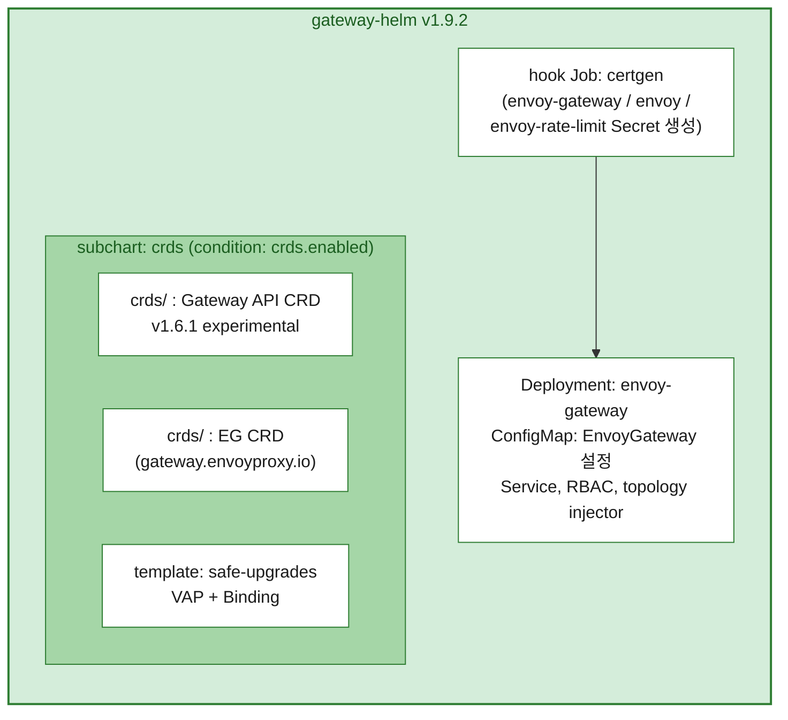
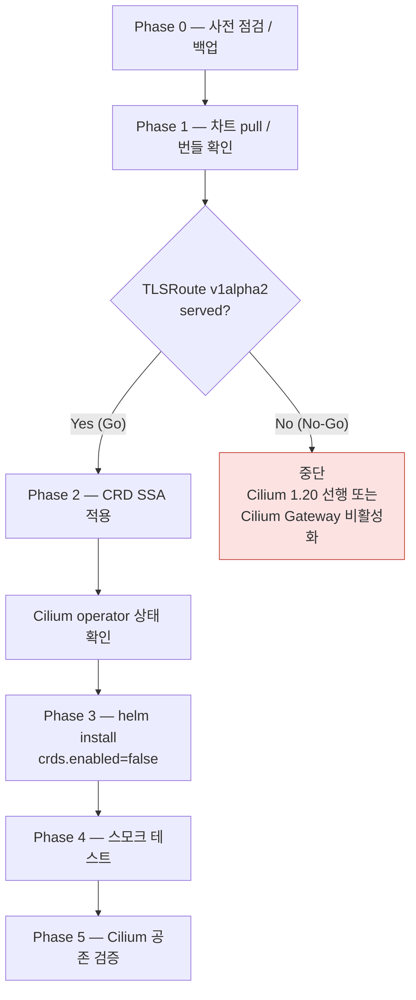
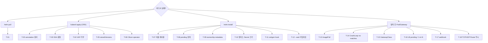

# Envoy Gateway v1.9.2 Helm 설치 및 트러블슈팅 가이드

> **요약** — Cilium Gateway API가 이미 켜진 클러스터에서는 **Gateway API CRD를 Helm 릴리스와 분리**해 먼저 올리고(`gateway-crds-helm` → `kubectl apply --server-side`), 그 다음 `gateway-helm`을 `crds.enabled=false`로 설치한다.
> `gateway-helm`의 번들 CRD(`crds/` 디렉터리)는 **이미 CRD가 있으면 조용히 건너뛰기** 때문에, 기존 v1.4.1 CRD 위에 그대로 `helm install` 하면 EG 1.9.2 컨트롤러가 기동에 실패하거나 일부 Route가 무시된다.
> Cilium 1.19.1을 유지하므로, CRD를 v1.6.1 experimental로 올리기 전 **TLSRoute 서빙 버전 Go/No-Go 점검**이 필수다.

---

## 목차

1. [대상 환경](#1-대상-환경)
2. [설치 전 반드시 알아야 할 핵심 5가지](#2-설치-전-반드시-알아야-할-핵심-5가지)
3. [차트 구조와 설치 흐름](#3-차트-구조와-설치-흐름)
4. [Phase 0 — 사전 점검](#4-phase-0--사전-점검)
5. [Phase 1 — 차트 확보 및 번들 확인](#5-phase-1--차트-확보-및-번들-확인)
6. [Phase 2 — CRD 적용 (Helm 외부)](#6-phase-2--crd-적용-helm-외부)
7. [Phase 3 — gateway-helm 설치](#7-phase-3--gateway-helm-설치)
8. [Phase 4 — 설치 검증 (스모크 테스트)](#8-phase-4--설치-검증-스모크-테스트)
9. [Phase 5 — Cilium 공존 검증](#9-phase-5--cilium-공존-검증)
10. [트러블슈팅](#10-트러블슈팅)
11. [진단 정보 수집 스크립트](#11-진단-정보-수집-스크립트)
12. [롤백 / 제거](#12-롤백--제거)
13. [참고 자료](#13-참고-자료)

---

## 1. 대상 환경

| 구성요소 | 버전 / 값 | 비고 |
|---|---|---|
| Envoy Gateway | **v1.9.2** | 차트: `oci://docker.io/envoyproxy/gateway-helm` |
| Gateway API CRD | **v1.6.1, experimental** | EG 1.9.2 차트 번들과 동일 번들 |
| Cilium | **1.19.1 (유지)** | CNI + KPR + Gateway API 활성 |
| Kubernetes | v1.34.x ~ v1.35.x | CAPI/CAPO, OCCM + Octavia(amphora) |
| 기존 Gateway API CRD | v1.4.1 standard (예: k8s-test) | Cilium Gateway가 사용 중 |
| GatewayClass controllerName | EG: `gateway.envoyproxy.io/gatewayclass-controller`<br>Cilium: `io.cilium/gateway-controller` | 서로 다른 값으로 공존 |

공통 변수 (이후 모든 명령에서 사용):

```bash
export EG_VERSION=v1.9.2
export EG_NS=envoy-gateway-system
export EG_RELEASE=eg
export WORKDIR=~/eg-install/${EG_VERSION}
export REGISTRY=harbor.lab.example/dockerhub-proxy   # 예시값. 실제 레지스트리 프록시 경로로 교체
mkdir -p ${WORKDIR}/rendered ${WORKDIR}/backup
```

> 레지스트리·클러스터 인증은 작업자가 로컬에서 미리 완료해 두고(`helm registry login`, kubeconfig), 이 문서의 명령은 그 결과만 사용한다.

---

## 2. 설치 전 반드시 알아야 할 핵심 5가지

1. **Helm `crds/` 디렉터리는 "없을 때만 생성"**
   - 이미 존재하는 CRD는 건너뜀(`--debug` 시 `CRD ... is already present. Skipping.` 로그)
   - `helm upgrade`로 갱신되지 않고, `helm uninstall`로 삭제되지도 않음
   - → 기존 v1.4.1 CRD가 있는 클러스터에서 기본값(`crds.enabled=true`)으로 설치하면 CRD가 v1.4.1로 남음
2. **EG 1.9는 Gateway API v1.6 CRD가 선행 조건**
   - TCPRoute/UDPRoute를 `gateway.networking.k8s.io/v1`으로 reconcile
   - v1.6 CRD 없이 EG를 올리면 TCP/UDP Route가 **에러 없이 무시**됨
3. **safe-upgrades ValidatingAdmissionPolicy(VAP)** (Gateway API v1.5+)
   - standard CRD 위에 experimental CRD 설치 금지, 구버전 CRD 설치 금지
   - EG 1.9 차트는 이 VAP를 `crds.enabled=true`일 때 템플릿으로 렌더링 (`--skip-crds`로는 안 꺼짐)
   - → **standard → experimental 전환은 VAP가 없는 상태에서만 가능.** 현 환경(v1.4.1, VAP 없음)에서 CRD를 먼저 올려야 하는 이유
4. **대형 CRD는 반드시 server-side apply**
   - experimental CRD는 client-side apply 시 `last-applied-configuration` 어노테이션 크기 제한(262,144 bytes) 초과
   - CRD를 Helm 템플릿으로 릴리스에 넣으면 릴리스 Secret 1 MiB 제한에 걸릴 수 있음 → `helm template | kubectl apply --server-side`
5. **Cilium 1.19.1 호환성은 "TLSRoute 서빙 버전"이 관건**
   - Cilium 1.19는 Gateway API v1.4 기준(v1.4.1 CRD 문서화, 컨포먼스 v1.4.0)
   - Gateway API v1.5 릴리스 노트는 TLSRoute v1alpha2를 v1.6에서 experimental 채널에서도 제거한다고 예고했으나, v1.6 릴리스 노트에는 명시가 없음 → **렌더링 결과로 직접 확인**
   - v1.5.1 CRD 환경에서 Cilium 1.19.x operator가 실패한 사례 보고 있음 (참고 자료 참조)

---

## 3. 차트 구조와 설치 흐름

### 3.1 gateway-helm v1.9.2 구성



### 3.2 CRD 관리 방식 비교

| 항목 | A. 차트 번들 그대로 (`crds.enabled=true`) | **B. 분리 관리 (본 환경 기본)** |
|---|---|---|
| 적용 수단 | Helm `crds/` 디렉터리 | `gateway-crds-helm` → `kubectl apply --server-side` |
| CRD가 이미 있을 때 | **건너뜀** (구버전 유지) | 갱신 |
| `helm upgrade` 시 CRD | 갱신 안 됨 | 수동 단계로 명시적 갱신 |
| VAP | gateway-helm 릴리스가 소유 | Helm 외부 관리 (또는 미설치) |
| 적합한 경우 | Gateway API CRD가 **전혀 없는** 신규 클러스터 | Cilium 등 다른 컨트롤러가 CRD를 이미 쓰는 클러스터 |

> 본 스택은 Cilium operator가 기동 전에 Gateway API CRD를 요구하므로, 신규 클러스터에서도 사실상 B가 기본이다.

### 3.3 설치 흐름



---

## 4. Phase 0 — 사전 점검

### 4.1 도구 / 접근

```bash
helm version --short          # OCI 차트: Helm 3.8 이상
kubectl version               # client/server 확인
kubectl config current-context
kubectl get nodes -o wide
```

### 4.2 기존 Gateway API CRD 상태

```bash
# 번들 버전 / 채널
kubectl get crd -o custom-columns='NAME:.metadata.name,BUNDLE:.metadata.annotations.gateway\.networking\.k8s\.io/bundle-version,CHANNEL:.metadata.annotations.gateway\.networking\.k8s\.io/channel' \
  | grep -E 'NAME|gateway\.networking\.(x-)?k8s\.io'

# 저장 버전 (CRD에서 버전이 빠질 때 문제 원인이 됨 → T-05)
kubectl get crd -o custom-columns='NAME:.metadata.name,STORED:.status.storedVersions' \
  | grep -E 'NAME|gateway\.networking\.(x-)?k8s\.io'
```

### 4.3 VAP / 기존 EG 흔적

```bash
kubectl get validatingadmissionpolicy,validatingadmissionpolicybinding 2>/dev/null | grep -i safe-upgrades
helm list -A -a | grep -iE 'gateway|eg'
kubectl get crd | grep gateway.envoyproxy.io
kubectl get ns ${EG_NS} 2>/dev/null
```

| 결과 | 판단 |
|---|---|
| VAP 없음 + CRD v1.4.1 standard | 정상 (Phase 2에서 experimental 전환 가능) |
| VAP 있음 + CRD standard | standard→experimental 전환이 거부됨 → [T-04](#t-04-vap가-crd-적용을-거부) 절차 필요 |
| 기존 EG 릴리스/CRD 잔존 | 이전 시도 흔적. `helm status`로 상태 확인 후 진행 ([T-07](#t-07-cannot-re-use-a-name-that-is-still-in-use), [T-08](#t-08-another-operation-is-in-progress)) |

### 4.4 Cilium 현재 상태 (기준선 기록)

```bash
kubectl -n kube-system get cm cilium-config -o jsonpath='{.data.enable-gateway-api}{"\n"}'
kubectl -n kube-system get deploy cilium-operator
kubectl get gatewayclass
kubectl get gateway,httproute -A
# 이후 비교를 위해 operator 로그 기준선 저장
kubectl -n kube-system logs deploy/cilium-operator --since=30m > ${WORKDIR}/backup/cilium-operator-before.log
```

### 4.5 백업

```bash
kubectl get crd -o name | grep -E 'gateway\.networking\.(x-)?k8s\.io|gateway\.envoyproxy\.io' \
  | xargs -r kubectl get -o yaml > ${WORKDIR}/backup/crds-before.yaml

kubectl get gatewayclass,gateway,httproute,grpcroute,referencegrant -A -o yaml \
  > ${WORKDIR}/backup/gwapi-resources-before.yaml 2>/dev/null
```

### 4.6 체크리스트

- [ ] 대상 클러스터 컨텍스트 확인 (운영 클러스터 아님)
- [ ] 변경 작업(Phase 2 CRD 적용, Phase 3 helm install) 실행 직전 대상 클러스터·네임스페이스·변경 내용 요약 후 승인
- [ ] CRD / Gateway API 리소스 백업 완료
- [ ] Cilium operator 로그 기준선 저장

---

## 5. Phase 1 — 차트 확보 및 번들 확인

### 5.1 차트 pull

```bash
cd ${WORKDIR}
helm pull oci://docker.io/envoyproxy/gateway-helm      --version ${EG_VERSION}
helm pull oci://docker.io/envoyproxy/gateway-crds-helm --version ${EG_VERSION}
tar -xzf gateway-helm-${EG_VERSION}.tgz
ls -1 *.tgz
helm show chart gateway-helm-${EG_VERSION}.tgz | grep -E '^(name|version|appVersion)'
```

- 버전 태그는 **`v` 접두사 포함** (`v1.9.2`)
- 레지스트리 프록시로 차트를 받는 경우 `oci://` 경로만 교체. 폐쇄망이면 tgz를 반입해 로컬 파일로 설치

### 5.2 번들 CRD 버전 확인

```bash
# gateway-helm 번들 (subchart crds/)
grep -rhoE 'gateway\.networking\.k8s\.io/(bundle-version|channel): *[^ ]+' gateway-helm/charts/crds/crds/ | sort | uniq -c
```

기대값: `bundle-version: v1.6.1`, `channel: experimental`

---

## 6. Phase 2 — CRD 적용 (Helm 외부)

### 6.1 렌더링

```bash
helm template eg-crds ${WORKDIR}/gateway-crds-helm-${EG_VERSION}.tgz \
  --set crds.gatewayAPI.enabled=true \
  --set crds.gatewayAPI.channel=experimental \
  --set crds.envoyGateway.enabled=true \
  > ${WORKDIR}/rendered/eg-crds-${EG_VERSION}.yaml

F=${WORKDIR}/rendered/eg-crds-${EG_VERSION}.yaml
grep -c '^kind: CustomResourceDefinition' $F
grep -E '^kind: ValidatingAdmissionPolicy' $F || echo "VAP 미포함"
grep -hoE 'gateway\.networking\.k8s\.io/(bundle-version|channel): *[^ ]+' $F | sort | uniq -c   # 5.2와 동일해야 함
```

### 6.2 Go/No-Go — TLSRoute 서빙 버전 (Cilium 1.19.1 유지 조건)

```bash
# yq(v4) 사용 시
yq 'select(.kind == "CustomResourceDefinition" and .metadata.name == "tlsroutes.gateway.networking.k8s.io")
    | .spec.versions[] | .name + " served=" + (.served|tostring) + " storage=" + (.storage|tostring)' $F

# yq가 없으면 해당 CRD 블록만 눈으로 확인
awk '/^---/{p=0} /name: tlsroutes.gateway.networking.k8s.io/{p=1} p && /^  - name: v|^    served:|^    storage:/' $F
```

| 결과 | 판단 | 조치 |
|---|---|---|
| `v1alpha2 served=true` 존재 | **Go** | 6.3 진행. Phase 5에서 재확인 |
| `v1`만 존재 (v1alpha2 없음) | **No-Go** | 아래 중 택일 후 재계획 |

No-Go 시 선택지:
- **Cilium 1.20으로 선행 업그레이드** (Gateway API v1.6 지원 버전으로 정렬) — 권장
- Cilium `gatewayAPI.enabled=false`로 끄고 Cilium Gateway에 붙은 Route를 EG로 이관
- 참고: TLSRoute CRD만 빼는 방식은 EG가 해당 CRD를 watch하므로 EG 기동 실패 위험([T-14](#t-14-envoy-gateway-crashloopbackoff--no-matches-for-kind)) → 비권장

> ⚠️ 2026-10 기준 이 항목은 **실측으로 확정**할 것. 결과를 이 문서의 변경 이력에 기록한다.

### 6.3 서버 측 사전 검증 (dry-run)

```bash
kubectl apply --server-side --force-conflicts --dry-run=server -f $F
```

- 에러가 없으면 6.4로
- 에러 발생 시: annotation 길이 → [T-02](#t-02-metadataannotations-too-long), 충돌 → [T-03](#t-03-server-side-apply-충돌), VAP 거부 → [T-04](#t-04-vap가-crd-적용을-거부), storedVersions → [T-05](#t-05-storedversions-오류로-crd-갱신-실패)

### 6.4 적용

```bash
kubectl apply --server-side --force-conflicts -f $F

kubectl get crd -o name | grep -E 'gateway\.networking\.(x-)?k8s\.io|gateway\.envoyproxy\.io' \
  | xargs kubectl wait --for=condition=Established --timeout=120s
```

- `--force-conflicts`: 기존에 client-side apply 또는 다른 매니저가 소유한 필드를 넘겨받기 위해 필요
- 렌더링 결과에 VAP가 포함된 경우, CRD 전환이 같은 apply 안에서 끝나므로 일반적으로 문제없음. 거부되면 [T-04](#t-04-vap가-crd-적용을-거부)

### 6.5 적용 확인

```bash
kubectl get crd -o custom-columns='NAME:.metadata.name,BUNDLE:.metadata.annotations.gateway\.networking\.k8s\.io/bundle-version,CHANNEL:.metadata.annotations.gateway\.networking\.k8s\.io/channel,STORED:.status.storedVersions' \
  | grep -E 'NAME|gateway\.networking\.(x-)?k8s\.io'

kubectl get crd tlsroutes.gateway.networking.k8s.io \
  -o jsonpath='{range .spec.versions[*]}{.name}{"\tserved="}{.served}{"\tstorage="}{.storage}{"\n"}{end}'

kubectl get crd | grep -c gateway.envoyproxy.io
```

### 6.6 CRD 적용 직후 Cilium 확인 (Phase 3 진행 전 게이트)

```bash
kubectl -n kube-system logs deploy/cilium-operator --since=5m | grep -iE 'gateway|tlsroute|crd|error' | tail -50
kubectl get gatewayclass
kubectl get gateway -A
```

- 이상 징후가 없으면 Phase 3
- operator 오류 → [T-06](#t-06-crd-갱신-후-cilium-operator-오류)

---

## 7. Phase 3 — gateway-helm 설치

### 7.1 values 작성 (`eg-values.yaml`)

```yaml
# eg-values.yaml — EG v1.9.2
global:
  images:
    envoyGateway:
      image: harbor.lab.example/dockerhub-proxy/envoyproxy/gateway:v1.9.2
    envoyProxy:
      # EG 1.9 호환 Envoy: distroless-v1.39.x (호환성 매트릭스에서 정확한 패치 확인)
      image: harbor.lab.example/dockerhub-proxy/envoyproxy/envoy:<distroless-v1.39.x>
    ratelimit:
      # 기본값이 :master 태그이므로 고정 태그로 지정 (rate limit 사용 시에만 배포됨)
      image: harbor.lab.example/dockerhub-proxy/envoyproxy/ratelimit:<pinned-tag>

deployment:
  replicas: 2

config:
  envoyGateway:
    logging:
      level:
        default: info        # 문제 분석 시 debug

certgen:
  job:
    ttlSecondsAfterFinished: 600   # 기본 30초 → 실패 시 로그 확인 시간 확보
```

- 레지스트리 경로·태그는 환경에 맞게 교체
- `global.imageRegistry`로 일괄 치환도 가능하나, 이미지별 결과는 반드시 7.2에서 확인

### 7.2 렌더링 / 사전 검증

```bash
cd ${WORKDIR}
helm template ${EG_RELEASE} gateway-helm-${EG_VERSION}.tgz -n ${EG_NS} \
  -f eg-values.yaml --set crds.enabled=false > rendered/eg-${EG_VERSION}.yaml

grep -E '^\s+image:' rendered/eg-${EG_VERSION}.yaml | sort -u        # 이미지 경로 확인
grep -c '^kind: CustomResourceDefinition' rendered/eg-${EG_VERSION}.yaml   # 0 이어야 함
grep -E '^kind: ValidatingAdmissionPolicy' rendered/eg-${EG_VERSION}.yaml || echo "VAP 미포함(정상)"
grep -E 'envoyProxy|image' rendered/eg-${EG_VERSION}.yaml | grep -i envoy | sort -u   # envoyProxy 이미지 반영 확인

helm install ${EG_RELEASE} gateway-helm-${EG_VERSION}.tgz -n ${EG_NS} --create-namespace \
  -f eg-values.yaml --set crds.enabled=false --dry-run=server > /dev/null && echo "dry-run OK"
```

### 7.3 설치

```bash
helm install ${EG_RELEASE} gateway-helm-${EG_VERSION}.tgz \
  -n ${EG_NS} --create-namespace \
  -f eg-values.yaml \
  --set crds.enabled=false \
  --wait --timeout 5m
```

- 실패 시 `--debug`를 붙여 재현하고 [10장](#10-트러블슈팅) 참조
- 재시도는 `helm upgrade --install` 사용 (같은 이름 재사용 오류 방지)

### 7.4 설치 확인

```bash
helm status ${EG_RELEASE} -n ${EG_NS}
kubectl -n ${EG_NS} get deploy,pod,svc,job -o wide
kubectl -n ${EG_NS} get secret envoy-gateway envoy envoy-rate-limit   # certgen 결과 (이름만 확인)
kubectl -n ${EG_NS} wait --for=condition=Available deploy/envoy-gateway --timeout=5m
kubectl -n ${EG_NS} logs deploy/envoy-gateway --since=10m | grep -iE 'error|fail' | head -20
```

---

## 8. Phase 4 — 설치 검증 (스모크 테스트)

테스트용 네임스페이스에 임시 리소스를 만들고 끝나면 삭제한다.

```yaml
# eg-smoke.yaml
apiVersion: gateway.envoyproxy.io/v1alpha1
kind: EnvoyProxy
metadata:
  name: octavia-lb
  namespace: envoy-gateway-system
spec:
  provider:
    type: Kubernetes
    kubernetes:
      envoyService:
        annotations:
          # ETP Local 기본값 + Octavia 헬스모니터 미설정 시 1-in-N 트래픽 유실 방지
          loadbalancer.openstack.org/enable-health-monitor: "true"
---
apiVersion: gateway.networking.k8s.io/v1
kind: GatewayClass
metadata:
  name: eg
spec:
  controllerName: gateway.envoyproxy.io/gatewayclass-controller
  parametersRef:
    group: gateway.envoyproxy.io
    kind: EnvoyProxy
    name: octavia-lb
    namespace: envoy-gateway-system
---
apiVersion: v1
kind: Namespace
metadata:
  name: eg-smoke
---
apiVersion: gateway.networking.k8s.io/v1
kind: Gateway
metadata:
  name: smoke
  namespace: eg-smoke
spec:
  gatewayClassName: eg
  listeners:
    - name: http
      protocol: HTTP
      port: 80
---
apiVersion: gateway.networking.k8s.io/v1
kind: HTTPRoute
metadata:
  name: echo
  namespace: eg-smoke
spec:
  parentRefs:
    - name: smoke
  rules:
    - backendRefs:
        - name: echo
          port: 80
```

```bash
kubectl apply -f eg-smoke.yaml
kubectl -n eg-smoke create deployment echo --image=${REGISTRY}/library/nginx:stable
kubectl -n eg-smoke expose deployment echo --port 80

kubectl get gatewayclass eg -o jsonpath='{.status.conditions[?(@.type=="Accepted")].status}{"\n"}'   # True
kubectl -n eg-smoke wait --for=condition=Programmed gateway/smoke --timeout=10m
kubectl -n eg-smoke get gateway smoke -o wide
kubectl -n eg-smoke get httproute echo -o jsonpath='{.status.parents[*].conditions[*].type}={.status.parents[*].conditions[*].status}{"\n"}'

GW=$(kubectl -n eg-smoke get gateway smoke -o jsonpath='{.status.addresses[0].value}')
for i in $(seq 1 20); do curl -s -o /dev/null -w '%{http_code}\n' http://${GW}/; done | sort | uniq -c
```

- 20회 모두 `200`이어야 함. 일부만 실패하면 [T-16](#t-16-gateway-programmedfalse--service-external-ip-pending)의 ETP/헬스모니터 항목 확인
- 사용한 Envoy 이미지 실제 값 확인:
  ```bash
  kubectl -n ${EG_NS} get deploy -l gateway.envoyproxy.io/owning-gateway-name=smoke -o jsonpath='{..image}{"\n"}'
  ```

정리:

```bash
kubectl delete ns eg-smoke
# GatewayClass/EnvoyProxy를 계속 쓸 계획이 없으면 함께 삭제
```

---

## 9. Phase 5 — Cilium 공존 검증

```bash
kubectl get gatewayclass -o custom-columns='NAME:.metadata.name,CONTROLLER:.spec.controllerName,ACCEPTED:.status.conditions[?(@.type=="Accepted")].status'
kubectl get gateway -A
kubectl -n kube-system logs deploy/cilium-operator --since=30m > ${WORKDIR}/backup/cilium-operator-after.log
diff <(grep -iE 'error|level=warn' ${WORKDIR}/backup/cilium-operator-before.log | sed 's/time=[^ ]*//' | sort -u) \
     <(grep -iE 'error|level=warn' ${WORKDIR}/backup/cilium-operator-after.log  | sed 's/time=[^ ]*//' | sort -u)
```

- Cilium GatewayClass `Accepted=True` 유지
- 기존 Cilium Gateway의 HTTPRoute 트래픽 정상 (기존 엔드포인트로 curl)
- operator 로그에 신규 오류 없음
- (유지보수 시간 내) `cilium-operator` 재시작 후에도 정상 기동하는지 확인 — 기동 시점 CRD 검사에서 문제가 드러나는 경우가 있음
  ```bash
  kubectl -n kube-system rollout restart deploy/cilium-operator
  kubectl -n kube-system rollout status deploy/cilium-operator --timeout=5m
  ```

---

## 10. 트러블슈팅

### 10.1 빠른 분류



공통 원칙:
- 오류 메시지 원문을 먼저 확보 (`--debug`, `kubectl describe`, `kubectl get events --sort-by=.lastTimestamp`)
- 아래 메시지는 **대표 형태**이며 버전에 따라 문구가 조금 다를 수 있음 → 핵심 키워드로 grep

---

### Phase 1 — 차트 확보

#### T-01. OCI 차트 pull 실패

```text
Error: failed to do request: Head "https://registry-1.docker.io/v2/envoyproxy/gateway-helm/manifests/v1.9.2": dial tcp ...: i/o timeout
Error: ... 401 Unauthorized
Error: ... not found
```

- **원인**: 외부망 차단·프록시 미설정 / 레지스트리 인증 필요 / 버전 표기 오류(`1.9.2` vs `v1.9.2`)
- **확인**: `helm show chart oci://docker.io/envoyproxy/gateway-helm --version v1.9.2`
- **조치**
  - 버전은 `v` 접두사 포함
  - 레지스트리 프록시(OCI 프록시 캐시) 경로로 교체하거나, 외부망 가능한 호스트에서 `helm pull` 후 tgz 반입
  - 인증이 필요하면 작업자가 로컬에서 `helm registry login <registry>`를 직접 수행한 뒤 재시도

---

### Phase 2 — CRD 적용

#### T-02. `metadata.annotations: Too long`

```text
The CustomResourceDefinition "httproutes.gateway.networking.k8s.io" is invalid:
metadata.annotations: Too long: must have at most 262144 bytes
```

- **원인**: client-side `kubectl apply`가 `last-applied-configuration` 어노테이션에 전체 CRD를 저장
- **조치**: `kubectl apply --server-side` 사용. 이미 어노테이션이 붙은 CRD도 SSA로 재적용하면 됨

#### T-03. server-side apply 충돌

```text
error: Apply failed with N conflicts: conflicts with "kubectl-client-side-apply" using apiextensions.k8s.io/v1:
- .spec.versions
```

- **원인**: 기존 CRD를 다른 field manager(client-side apply, 다른 도구)가 소유
- **조치**: `--force-conflicts`로 소유권 이전. 이후 해당 CRD는 이 절차로만 관리 (다른 도구로 덮어쓰기 금지)

#### T-04. VAP가 CRD 적용을 거부

```text
customresourcedefinitions.apiextensions.k8s.io "httproutes.gateway.networking.k8s.io" is forbidden:
ValidatingAdmissionPolicy 'safe-upgrades.gateway.networking.k8s.io' with binding
'safe-upgrades.gateway.networking.k8s.io' denied request: ...
```

- **원인**
  - standard CRD가 있는 상태에서 experimental CRD 적용 시도
  - 현재보다 오래된 번들 버전 적용 시도 (다운그레이드)
- **확인**
  ```bash
  kubectl get validatingadmissionpolicy safe-upgrades.gateway.networking.k8s.io -o yaml | head -40
  kubectl get crd gateways.gateway.networking.k8s.io -o jsonpath='{.metadata.annotations}{"\n"}'
  ```
- **조치**
  - 다운그레이드 시도였다면 **중단** (CRD 다운그레이드는 지원 경로 아님)
  - 의도된 standard → experimental 전환이라면, 변경 승인 후 VAP를 일시 제거하고 적용, 즉시 복구
    ```bash
    kubectl get validatingadmissionpolicy,validatingadmissionpolicybinding safe-upgrades.gateway.networking.k8s.io -o yaml \
      > ${WORKDIR}/backup/vap-safe-upgrades.yaml
    kubectl delete validatingadmissionpolicybinding safe-upgrades.gateway.networking.k8s.io
    kubectl delete validatingadmissionpolicy        safe-upgrades.gateway.networking.k8s.io
    kubectl apply --server-side --force-conflicts -f $F
    kubectl apply --server-side -f ${WORKDIR}/backup/vap-safe-upgrades.yaml   # 또는 렌더링 결과의 VAP로 복구
    ```
  - VAP가 Helm 릴리스 소유였다면, 복구는 `helm upgrade`로 하는 것이 소유권 측면에서 깔끔함

#### T-05. storedVersions 오류로 CRD 갱신 실패

```text
The CustomResourceDefinition "tlsroutes.gateway.networking.k8s.io" is invalid:
status.storedVersions[0]: Invalid value: "v1alpha2": must appear in spec.versions
```

- **원인**: 새 CRD가 특정 버전(예: v1alpha2)을 제거했는데, etcd에 그 버전으로 저장된 객체 이력이 `status.storedVersions`에 남아 있음
- **확인**
  ```bash
  kubectl get crd tlsroutes.gateway.networking.k8s.io -o jsonpath='{.status.storedVersions}{"\n"}'
  kubectl get tlsroutes.gateway.networking.k8s.io -A
  ```
- **조치**
  - 이 상황 자체가 "v1alpha2 미서빙" 신호 → Cilium 1.19.1 유지 조건에서는 [6.2 No-Go](#62-gono-go--tlsroute-서빙-버전-cilium-1191-유지-조건)로 회귀해 재판단
  - 진행이 결정된 경우: 기존 객체를 새 저장 버전으로 재기록 → storedVersions 정리 → CRD 재적용
    ```bash
    kubectl get tlsroutes.gateway.networking.k8s.io -A -o json | kubectl replace -f -
    kubectl patch crd tlsroutes.gateway.networking.k8s.io --subresource=status --type=merge \
      -p '{"status":{"storedVersions":["<현재 storage 버전>"]}}'
    ```
  - TCPRoute/UDPRoute도 동일 원리 (v1.6에서 저장 버전이 v1alpha2 → v1로 이동)

#### T-06. CRD 갱신 후 Cilium operator 오류

```text
(cilium-operator 로그) ... TLSRoute ... index / no matches for kind ... / failed to ... gateway-api
GatewayClass "cilium" Accepted 상태 이상, 기존 Cilium Gateway 트래픽 영향
```

- **원인**: Cilium 1.19.x는 Gateway API v1.4 기준으로 빌드됨. v1.5+ CRD 스키마/서빙 버전 변화(특히 TLSRoute)와 불일치
- **확인**
  ```bash
  kubectl -n kube-system logs deploy/cilium-operator --since=15m | grep -iE 'gateway|tlsroute|error'
  kubectl get crd tlsroutes.gateway.networking.k8s.io \
    -o jsonpath='{range .spec.versions[*]}{.name}{" served="}{.served}{"\n"}{end}'
  ```
- **조치**
  - CRD 롤백은 VAP·저장 버전 때문에 사실상 불가 → **전진 복구**
  - 단기: Cilium Gateway API 비활성화(`gatewayAPI.enabled=false`) 후 해당 Route를 EG로 이관
  - 정식: Cilium 1.20 업그레이드
  - 이 증상이 확인되면 6.2 Go/No-Go 결과와 함께 문서 변경 이력에 기록

---

### Phase 3 — helm install

#### T-07. `cannot re-use a name that is still in use`

```text
Error: INSTALLATION FAILED: cannot re-use a name that is still in use
```

- **원인**: 같은 이름의 릴리스(실패/삭제 대기 포함)가 존재
- **확인**: `helm list -n ${EG_NS} -a` / `helm history ${EG_RELEASE} -n ${EG_NS}`
- **조치**: 상태가 `failed`면 `helm upgrade --install`로 재시도, 폐기할 거면 `helm uninstall ${EG_RELEASE} -n ${EG_NS}` 후 재설치

#### T-08. `another operation ... is in progress`

```text
Error: UPGRADE FAILED: another operation (install/upgrade/rollback) is in progress
```

- **원인**: 이전 작업이 중단되어 릴리스가 `pending-install` / `pending-upgrade`에 고정
- **확인**: `helm history ${EG_RELEASE} -n ${EG_NS}` → 마지막 리비전 STATUS
- **조치**
  - 이전 `deployed` 리비전이 있으면 `helm rollback ${EG_RELEASE} <rev> -n ${EG_NS}`
  - 최초 설치가 pending이면 `helm uninstall ${EG_RELEASE} -n ${EG_NS}` 후 재설치
  - 위가 안 될 때만: pending 리비전의 릴리스 Secret(`sh.helm.release.v1.${EG_RELEASE}.v<N>`)을 백업 후 삭제

#### T-09. `invalid ownership metadata`

```text
Error: INSTALLATION FAILED: Unable to continue with install: ValidatingAdmissionPolicy
"safe-upgrades.gateway.networking.k8s.io" in namespace "" exists and cannot be imported into the current release:
invalid ownership metadata; label validation error: missing key "app.kubernetes.io/managed-by": must be set to "Helm";
annotation validation error: missing key "meta.helm.sh/release-name": must be set to "eg"; ...
```

- **원인**: 차트가 렌더링하는 리소스(VAP, CRD 등)가 Helm 외부에서 이미 생성됨
- **조치** (택일)
  - Helm 외부 관리 유지: `--set crds.enabled=false` (CRD+VAP 렌더링 중단)
    - CRD는 외부, VAP만 끄려면 `--set crds.gatewayAPI.safeUpgradePolicy.enabled=false`
  - Helm으로 넘기기: 대상 리소스에 소유권 메타데이터 부여 후 재시도
    ```bash
    for k in validatingadmissionpolicy validatingadmissionpolicybinding; do
      kubectl annotate $k safe-upgrades.gateway.networking.k8s.io \
        meta.helm.sh/release-name=${EG_RELEASE} meta.helm.sh/release-namespace=${EG_NS} --overwrite
      kubectl label $k safe-upgrades.gateway.networking.k8s.io app.kubernetes.io/managed-by=Helm --overwrite
    done
    ```
  - 네임스페이스가 원인이면 `--create-namespace`를 빼거나 기존 네임스페이스를 그대로 사용

#### T-10. 릴리스 Secret 크기 초과

```text
Error: create: failed to create: Secret "sh.helm.release.v1.eg-crds.v1" is invalid:
data: Too long: must have at most 1048576 bytes
```

- **원인**: 대형 CRD를 Helm **템플릿**으로 릴리스에 포함 (예: `gateway-crds-helm`을 `helm install`로 설치). Helm의 multi-secret 드라이버 PR(#12277)은 병합되지 않음
- **조치**: `helm template ... | kubectl apply --server-side -f -` 방식으로 전환 (6장)

#### T-11. certgen hook Job 실패

```text
Error: INSTALLATION FAILED: failed pre-install: ... job <release>-...-certgen failed: BackoffLimitExceeded
Error: INSTALLATION FAILED: failed pre-install: ... timed out waiting for the condition
```

- **원인**: certgen 이미지 Pull 실패 / Pod Security·RBAC 문제 / 노드 스케줄 불가(taint, nodeSelector)
- **확인** (기본 TTL 30초라 Job이 금방 사라짐 → 7.1 values의 `ttlSecondsAfterFinished` 연장 권장)
  ```bash
  kubectl -n ${EG_NS} get job,pod | grep -i certgen
  kubectl -n ${EG_NS} describe pod -l job-name | tail -40      # job-name 라벨이 있는 Pod(=Job Pod)
  kubectl -n ${EG_NS} logs job/$(kubectl -n ${EG_NS} get job -o name | grep certgen | cut -d/ -f2)
  kubectl -n ${EG_NS} get events --sort-by=.lastTimestamp | tail -30
  ```
- **조치**
  - 이미지: `global.images.envoyGateway.image` 경로 수정 (certgen은 envoy-gateway 이미지 사용)
  - 스케줄: `certgen.job.tolerations` / `nodeSelector` 지정
  - certgen 비활성화는 금지(차트 주석: OIDC/OAuth2 등 기능 영향). 사설 인증서가 필요하면 cert-manager로 미리 `envoy-gateway`, `envoy`, `envoy-rate-limit` Secret 생성 — certgen은 기존 Secret을 덮어쓰지 않음

#### T-12. `--wait` 타임아웃

```text
Error: INSTALLATION FAILED: context deadline exceeded
```

- **원인**: envoy-gateway Pod가 시간 내 Ready 되지 않음 (이미지, CRD 불일치, 리소스 부족)
- **확인**
  ```bash
  kubectl -n ${EG_NS} get pod -o wide
  kubectl -n ${EG_NS} describe deploy/envoy-gateway | tail -30
  kubectl -n ${EG_NS} logs deploy/envoy-gateway --previous 2>/dev/null | tail -50
  ```
- **조치**: 원인별로 T-13 / T-14로 이동. 원인 해결 후 `helm upgrade --install ... --wait`

---

### Phase 4 — 설치 후

#### T-13. ImagePullBackOff

| 대상 Pod | 이미지 출처 | 수정 위치 |
|---|---|---|
| `envoy-gateway`, certgen | 차트 | `global.images.envoyGateway.image` |
| `envoy-*` (데이터플레인) | 컨트롤러가 생성 | `global.images.envoyProxy.image` 또는 `EnvoyProxy.spec.provider.kubernetes.envoyDeployment.container.image` |
| `envoy-ratelimit` | 컨트롤러가 생성 | `global.images.ratelimit.image` (기본 `:master` → 고정 태그 권장) |

```bash
kubectl -n ${EG_NS} get pod -o jsonpath='{range .items[*]}{.metadata.name}{"\t"}{..image}{"\n"}{end}'
kubectl -n ${EG_NS} describe pod <pod> | grep -A5 -E 'Failed|Back-off'
```

- 레지스트리 프록시가 해당 upstream(docker.io 등)을 캐시하는지, 프로젝트 경로가 맞는지 확인

#### T-14. envoy-gateway CrashLoopBackOff — `no matches for kind`

```text
failed to create gatewayapi controller: error watching resources:
no matches for kind "ListenerSet" in version "gateway.networking.k8s.io/v1"
```

- **원인**: 클러스터 CRD가 EG 1.9.2 기대 버전보다 낮음. 대부분 **기존 CRD가 있는 상태에서 `crds.enabled=true`로 설치 → Helm이 CRD를 건너뜀**
- **확인**
  ```bash
  helm install ... --debug 2>&1 | grep -i 'already present'
  kubectl get crd gateways.gateway.networking.k8s.io \
    -o jsonpath='{.metadata.annotations.gateway\.networking\.k8s\.io/bundle-version}{"\n"}'
  kubectl get crd listenersets.gateway.networking.k8s.io
  ```
- **조치**: 6장 절차로 CRD 갱신 → `kubectl -n ${EG_NS} rollout restart deploy/envoy-gateway`

#### T-15. GatewayClass `Accepted` 아님 / status 비어 있음

- **원인**
  - `controllerName` 오타 (`config.envoyGateway.gateway.controllerName`과 불일치)
  - `parametersRef`의 EnvoyProxy가 없거나 네임스페이스 누락
  - envoy-gateway Pod 미기동
- **확인**
  ```bash
  kubectl get gatewayclass <name> -o yaml | sed -n '/status:/,$p'
  kubectl get envoyproxy -A
  kubectl -n ${EG_NS} logs deploy/envoy-gateway | grep -i gatewayclass | tail
  ```

#### T-16. Gateway `Programmed=False` / Service `EXTERNAL-IP <pending>`

- **원인 후보**
  - OCCM이 Octavia LB 생성 실패 (쿼터, 서브넷, floating IP)
  - Cilium LB-IPAM 풀(`CiliumLoadBalancerIPPool`)이 생성되어 OCCM과 IP 할당 경합
- **확인**
  ```bash
  kubectl -n ${EG_NS} get svc -l gateway.envoyproxy.io/owning-gateway-name=<gw>
  kubectl -n ${EG_NS} describe svc <envoy-svc> | sed -n '/Events/,$p'
  kubectl get ciliumloadbalancerippool 2>/dev/null
  openstack loadbalancer list | grep <svc-name-fragment>
  ```
- **1-in-N 트래픽 유실 (일부 요청만 실패)**
  - EG Service 기본 `externalTrafficPolicy: Local` + Octavia 헬스모니터 미설정 → envoy Pod 없는 노드로 간 트래픽 유실
  - EnvoyProxy `envoyService.annotations`에 `loadbalancer.openstack.org/enable-health-monitor: "true"` (8장 예시), 보안그룹에서 헬스체크 포트 허용 확인
  - Service 어노테이션은 Gateway가 아니라 **EnvoyProxy**에 넣어야 함 (컨트롤러가 Service를 관리)

#### T-17. Envoy Pod 생성 시 webhook 호출 실패

```text
Error creating: Internal error occurred: failed calling webhook "...envoyproxy.io": ... context deadline exceeded
```

- **원인**: topology injector(mutating webhook)에 API 서버가 도달 불가 (Pod 네트워크/방화벽, envoy-gateway 미기동)
- **확인**
  ```bash
  kubectl get mutatingwebhookconfiguration | grep -i envoy
  kubectl -n ${EG_NS} get endpointslice -l kubernetes.io/service-name=envoy-gateway
  ```
- **조치**: envoy-gateway 기동/서비스 엔드포인트 정상화 우선. 임시 회피가 필요하면 `--set topologyInjector.enabled=false`로 upgrade (zone-aware 라우팅 기능 영향 확인)

#### T-18. TCPRoute / UDPRoute가 에러 없이 무시됨

- **원인**: Gateway API v1.6 CRD 미적용 상태에서 EG 1.9 기동
- **확인**: `kubectl get crd tcproutes.gateway.networking.k8s.io -o jsonpath='{.spec.versions[*].name}{"\n"}'` 에 `v1` 존재 여부
- **조치**: 6장 CRD 적용 → EG 재시작. 매니페스트는 `apiVersion: gateway.networking.k8s.io/v1` 사용 권장 (experimental 채널은 v1alpha2도 당분간 서빙)

#### T-19. `helm upgrade` 후에도 CRD가 그대로

- **원인**: Helm은 `crds/` 디렉터리의 CRD를 upgrade하지 않음
- **조치**: 업그레이드 순서를 **CRD(6장) → `helm upgrade`** 로 고정

---

## 11. 진단 정보 수집 스크립트

문제 발생 시 아래를 실행해 결과 디렉터리를 공유한다. Secret은 **이름만** 수집한다. 공유 전 values 등에 민감정보가 없는지 확인할 것.

```bash
#!/usr/bin/env bash
# eg-collect.sh — Envoy Gateway 설치 진단 수집
set -uo pipefail
NS=${EG_NS:-envoy-gateway-system}
REL=${EG_RELEASE:-eg}
OUT=eg-diag-$(date +%Y%m%d-%H%M%S)
mkdir -p "$OUT"
c() { local f=$1; shift; { echo "### \$ $*"; "$@" 2>&1; echo; } >> "$OUT/$f.txt"; }

# Helm
c helm helm version --short
c helm helm list -A -a
c helm helm history "$REL" -n "$NS"
c helm helm status "$REL" -n "$NS"
c helm helm get values "$REL" -n "$NS"

# EG 네임스페이스
c k8s kubectl -n "$NS" get all,job,cm,endpointslice -o wide
c k8s kubectl -n "$NS" get secret                       # 이름/타입만
c k8s kubectl -n "$NS" get events --sort-by=.lastTimestamp
c k8s kubectl -n "$NS" describe pod
c logs kubectl -n "$NS" logs deploy/envoy-gateway --since=30m
c logs kubectl -n "$NS" logs deploy/envoy-gateway --previous
for j in $(kubectl -n "$NS" get job -o name 2>/dev/null); do c logs kubectl -n "$NS" logs "$j"; done

# CRD / VAP / webhook
c crd kubectl get crd -o custom-columns='NAME:.metadata.name,BUNDLE:.metadata.annotations.gateway\.networking\.k8s\.io/bundle-version,CHANNEL:.metadata.annotations.gateway\.networking\.k8s\.io/channel,STORED:.status.storedVersions'
c crd kubectl get crd tlsroutes.gateway.networking.k8s.io -o jsonpath='{range .spec.versions[*]}{.name}{" served="}{.served}{" storage="}{.storage}{"\n"}{end}'
c crd kubectl get validatingadmissionpolicy,validatingadmissionpolicybinding
c crd kubectl get mutatingwebhookconfiguration

# Gateway API 리소스
c gwapi kubectl get gatewayclass -o wide
c gwapi kubectl get gateway,httproute,grpcroute,tlsroute,tcproute,udproute -A
c gwapi kubectl get envoyproxy -A -o yaml

# Cilium
c cilium kubectl -n kube-system get cm cilium-config -o jsonpath='{.data.enable-gateway-api}'
c cilium kubectl -n kube-system get deploy cilium-operator -o wide
c cilium sh -c "kubectl -n kube-system logs deploy/cilium-operator --since=30m | grep -iE 'gateway|tlsroute|error'"

tar -czf "$OUT.tar.gz" "$OUT" && echo "수집 완료: $OUT.tar.gz"
```

---

## 12. 롤백 / 제거

### 12.1 EG 릴리스 롤백

```bash
helm history ${EG_RELEASE} -n ${EG_NS}
helm rollback ${EG_RELEASE} <revision> -n ${EG_NS} --wait
```

- CRD는 롤백되지 않음 (Helm 외부 관리)

### 12.2 EG 제거

1. EG GatewayClass를 쓰는 Gateway부터 삭제 → 컨트롤러가 데이터플레인(envoy Deployment/Service, Octavia LB)을 정리하게 함
   ```bash
   kubectl get gateway -A -o json | jq -r '.items[] | select(.spec.gatewayClassName=="eg") | "\(.metadata.namespace)/\(.metadata.name)"'
   ```
2. `helm uninstall ${EG_RELEASE} -n ${EG_NS}`
3. 남은 리소스 확인: `kubectl -n ${EG_NS} get all`, `openstack loadbalancer list`
4. EG CRD(`gateway.envoyproxy.io`) 삭제는 **EG를 완전히 걷어낼 때만**. CRD 삭제 = 해당 CR 전부 삭제

### 12.3 하지 말아야 할 것

- ❌ **Gateway API CRD(`gateway.networking.k8s.io`) 삭제** — Cilium Gateway가 공유. 삭제 시 Cilium의 Gateway/HTTPRoute까지 모두 사라짐
- ❌ **CRD 다운그레이드** — VAP가 거부하며, 저장 버전·컨트롤러 호환성 문제로 지원 경로가 아님. 문제가 생기면 전진 복구(T-06)
- ❌ experimental → standard 재적용 — VAP는 허용하지만 experimental 필드가 제거되어 기존 리소스 의미가 바뀔 수 있음

---

## 13. 참고 자료

- Envoy Gateway v1.9 — Install with Helm (CRD 분리 설치, 업그레이드 주의사항): https://gateway.envoyproxy.io/v1.9/install/install-helm/
- Envoy Gateway v1.9 — Install with Kubernetes YAML (v1.6 CRD 선행 요구, 업그레이드 절차): https://gateway.envoyproxy.io/v1.9/install/install-yaml/
- Envoy Gateway v1.9 — Gateway Helm Chart values: https://gateway.envoyproxy.io/v1.9/install/gateway-helm-api/
- Envoy Gateway v1.9 릴리스 공지 (safe-upgrades VAP 소유권, `safeUpgradePolicy.enabled`): https://gateway.envoyproxy.io/news/releases/v1.9/
- Envoy Gateway 호환성 매트릭스: https://gateway.envoyproxy.io/news/releases/matrix/
- Gateway API v1.5.0 릴리스 (TLSRoute v1alpha2 제거 예고, safe-upgrades VAP 도입): https://github.com/kubernetes-sigs/gateway-api/releases/tag/v1.5.0
- Gateway API v1.6.0-rc.1 릴리스 노트 (TCPRoute/UDPRoute v1 승격, VAP 규칙): https://github.com/kubernetes-sigs/gateway-api/releases/tag/v1.6.0-rc.1
- Kubernetes 블로그 — Gateway API v1.6: https://kubernetes.io/blog/2026/08/03/gateway-api-v1-6-release/
- Helm PR #12277 (대형 릴리스 multi-secret, 미병합): https://github.com/helm/helm/pull/12277
- Cilium Gateway API 문서 (v1.4.1 CRD 요구, TLSRoute 선택): https://docs.cilium.io/en/stable/network/servicemesh/gateway-api/gateway-api/
- Broadcom KB 448213 — Gateway API v1.5.1 CRD 환경에서 Cilium 1.19.x operator 실패 사례: https://knowledge.broadcom.com/external/article/448213

---

## 변경 이력

| 날짜 | 내용 |
|---|---|
| 2026-10-11 | 최초 작성 (EG v1.9.2 / Gateway API v1.6.1 experimental / Cilium 1.19.1) |
| | 6.2 TLSRoute Go/No-Go 실측 결과 기록 예정 |
