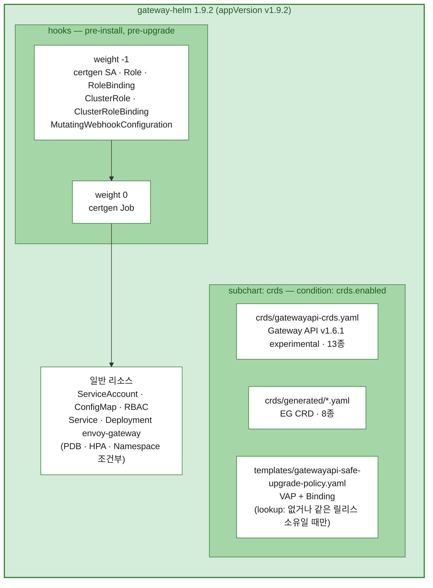
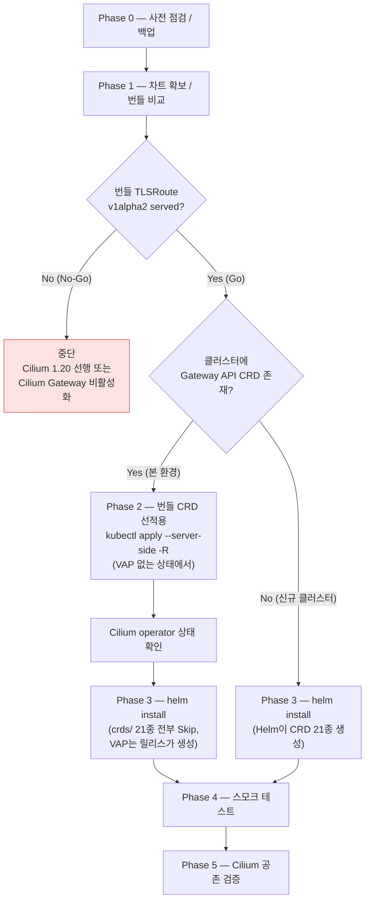
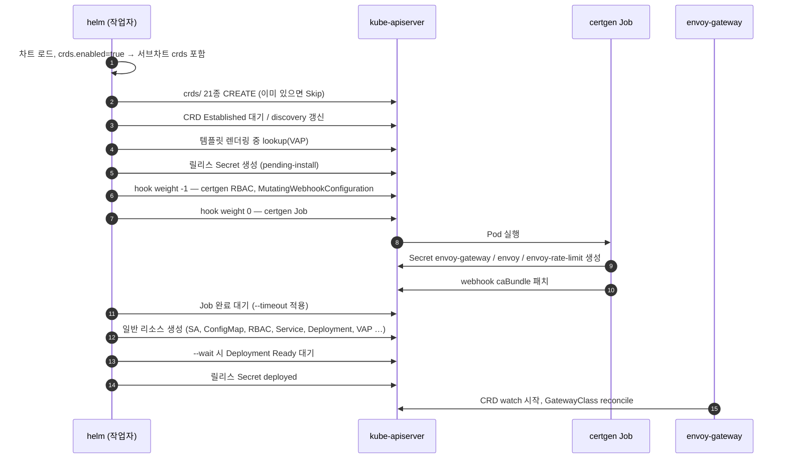
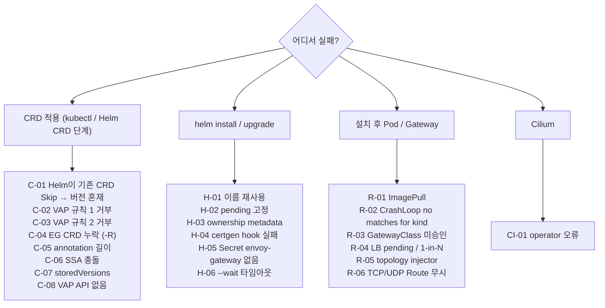

# Envoy Gateway v1.9.2 — gateway-helm 번들 CRD 기반 설치 및 트러블슈팅 가이드

> **요약** — CRD는 `gateway-helm` 차트에 포함된 번들(`charts/crds/crds/`)만 사용한다. 다만 Helm은 `crds/`의 CRD를 **없을 때만 생성**하므로, Gateway API CRD가 이미 있는 클러스터(Cilium Gateway 사용 중)에서는 **같은 차트의 CRD 파일을 `kubectl apply --server-side`로 먼저 적용**한 뒤 `helm install`을 실행한다.
> 순서가 바뀌면 Helm이 기존 CRD 6종을 v1.4.1 standard로 남긴 채 safe-upgrades VAP를 만들고, 이후 VAP가 experimental 전환을 거부해 **CRD를 올릴 수 없는 상태**에 빠진다.
> 첨부 차트(1.9.2) 분석 결과 TLSRoute CRD는 `v1alpha2`를 계속 서빙하므로, Cilium 1.19.1 유지 조건의 1차 게이트는 **Go**다 (실클러스터 검증은 Phase 5).

---

## 목차

1. [대상 환경](#1-대상-환경)
2. [차트 분석으로 확인된 핵심 사항](#2-차트-분석으로-확인된-핵심-사항)
3. [차트 구조와 설치 흐름](#3-차트-구조와-설치-흐름)
4. [gateway-helm 설치 시 내부 동작](#4-gateway-helm-설치-시-내부-동작)
5. [Phase 0 — 사전 점검](#5-phase-0--사전-점검)
6. [Phase 1 — 차트 확보 및 번들 비교](#6-phase-1--차트-확보-및-번들-비교)
7. [Phase 2 — 번들 CRD 선적용](#7-phase-2--번들-crd-선적용)
8. [Phase 3 — helm install](#8-phase-3--helm-install)
9. [Phase 4 — 스모크 테스트](#9-phase-4--스모크-테스트)
10. [Phase 5 — Cilium 공존 검증](#10-phase-5--cilium-공존-검증)
11. [트러블슈팅](#11-트러블슈팅)
12. [진단 정보 수집 스크립트](#12-진단-정보-수집-스크립트)
13. [업그레이드 / 롤백 / 제거](#13-업그레이드--롤백--제거)
14. [참고 자료](#14-참고-자료)

---

## 1. 대상 환경

| 구성요소 | 버전 / 값 | 비고 |
|---|---|---|
| Envoy Gateway | **v1.9.2** | 차트 `gateway-helm` (Chart.yaml `version: 1.9.2`, `appVersion: v1.9.2`) |
| Gateway API CRD | **v1.6.1, experimental** | `gateway-helm/charts/crds/crds/gatewayapi-crds.yaml` |
| EG CRD | 8종 (`gateway.envoyproxy.io`) | `gateway-helm/charts/crds/crds/generated/` |
| Cilium | **1.19.1 (유지)** | CNI + KPR + Gateway API 활성 |
| Kubernetes | v1.34.x ~ v1.35.x | VAP `admissionregistration.k8s.io/v1` 사용 → 1.30 이상 필요 |
| 기존 Gateway API CRD | v1.4.1 standard (예: k8s-test) | Cilium Gateway가 사용 중 |
| GatewayClass controllerName | EG `gateway.envoyproxy.io/gatewayclass-controller` / Cilium `io.cilium/gateway-controller` | 서로 다른 값으로 공존 |

공통 변수:

```bash
export EG_VERSION=v1.9.2
export EG_NS=envoy-gateway-system
export EG_RELEASE=eg                       # fullname → "eg-gateway-helm"
export WORKDIR=~/eg-install/${EG_VERSION}
export REGISTRY=harbor.lab.example/dockerhub-proxy   # 예시값. 실제 레지스트리 프록시 경로로 교체
mkdir -p ${WORKDIR}/{rendered,backup,logs}
```

> 레지스트리·클러스터 인증은 작업자가 로컬에서 미리 완료해 두고(`helm registry login`, kubeconfig), 이 문서의 명령은 그 결과만 사용한다.

---

## 2. 차트 분석으로 확인된 핵심 사항

`gateway-helm` 1.9.2 tgz를 풀어 템플릿과 CRD 파일을 직접 확인한 결과다.

1. **CRD 21종이 서브차트 `crds`의 `crds/` 디렉터리에 있음**
   - Gateway API 13종(v1.6.1 experimental) + EG 8종
   - 서브차트 포함 여부는 `crds.enabled`(기본 `true`) 하나로 결정
   - `crds/`는 템플릿이 아니라 Helm의 CRD 전용 경로 → **없을 때만 생성, upgrade·uninstall 시 손대지 않음**
2. **safe-upgrades VAP는 서브차트의 일반 템플릿**
   - `lookup`으로 기존 VAP를 조회해 **없거나 같은 릴리스 소유일 때만 렌더링** → 다른 주체가 만든 VAP가 있으면 조용히 건너뜀 (ownership 오류 없음)
   - 규칙 1: standard CRD 위에 experimental CRD **UPDATE 거부**
   - 규칙 2: `bundle-version`이 v1.5 미만인 CRD **CREATE/UPDATE 거부**
   - `--skip-crds`로는 꺼지지 않음. 끄려면 `crds.gatewayAPI.safeUpgradePolicy.enabled=false` 또는 `crds.enabled=false`
3. **TLSRoute 서빙 버전 (Cilium 1.19.1 게이트)**
   - 번들 TLSRoute: `v1`(storage), `v1alpha2`(served, deprecated), `v1alpha3`(served, deprecated)
   - TCPRoute/UDPRoute도 `v1alpha2` 계속 서빙 → Cilium 1.19의 v1alpha2 watch 대상이 유지됨
4. **certgen과 topology injector webhook은 Helm hook**
   - `pre-install, pre-upgrade` 훅이며 **릴리스 리소스로 추적되지 않음** → `helm uninstall` 후에도 남음
   - webhook `failurePolicy: Ignore` → webhook 장애가 Pod 생성을 막지는 않음
5. **이미지 레지스트리 오버라이드의 함정**
   - `global.imageRegistry`는 envoy-gateway·ratelimit 이미지에는 적용되지만, **데이터플레인 Envoy 이미지는 `global.images.envoyProxy.image`가 비어 있으면 적용되지 않음** (컨트롤러 내장 기본값 `docker.io/...` 사용)
   - ratelimit 기본 이미지는 `docker.io/envoyproxy/ratelimit:0482748e` (고정 태그)
6. **대형 CRD**
   - `envoyproxies.gateway.envoyproxy.io`는 JSON 기준 약 649 KB → client-side apply 시 `last-applied-configuration` 한도(262,144 bytes) 초과 → **반드시 `--server-side`**

---

## 3. 차트 구조와 설치 흐름

### 3.1 gateway-helm 1.9.2 구성



### 3.2 번들 CRD 인벤토리

| 그룹 | CRD | 서빙 버전 (storage 굵게) |
|---|---|---|
| gateway.networking.k8s.io | gatewayclasses, gateways, httproutes | **v1**, v1beta1 |
| | grpcroutes, listenersets | **v1** |
| | referencegrants | v1, **v1beta1** |
| | backendtlspolicies | **v1**, v1alpha3(deprecated) |
| | tcproutes, udproutes | **v1**, v1alpha2(deprecated) |
| | tlsroutes | **v1**, v1alpha2(deprecated), v1alpha3(deprecated) |
| gateway.networking.x-k8s.io | xbackends, xbackendtrafficpolicies, xmeshes | **v1alpha1** |
| gateway.envoyproxy.io | backends, backendtrafficpolicies, clienttrafficpolicies, envoyextensionpolicies, envoypatchpolicies, envoyproxies, httproutefilters, securitypolicies | **v1alpha1** |

- Gateway API 13종 모두 `bundle-version: v1.6.1`, `channel: experimental` 어노테이션 보유
- VAP 규칙은 `spec.group == gateway.networking.k8s.io`(10종)에만 적용. `x-k8s.io`·EG CRD는 대상 아님

### 3.3 설치 흐름



---

## 4. gateway-helm 설치 시 내부 동작

### 4.1 `helm install` 단계별 시퀀스



단계별 의미:

| # | 단계 | 실패 시 증상 | 참조 |
|---|---|---|---|
| 2 | CRD 생성 | 기존 CRD는 **에러 없이 Skip** → 버전 혼재 | C-01 |
| 4 | lookup(VAP) | 외부 VAP 존재 시 VAP 미렌더링 (조용함) | 4.3 |
| 6~10 | hook | `failed pre-install: ... job ... failed` | H-04 |
| 11 | 일반 리소스 | `invalid ownership metadata`, VAP API 없음 | H-03, C-08 |
| 12 | --wait | `context deadline exceeded` | H-06 |
| 14 | 컨트롤러 기동 | CrashLoop `no matches for kind` | R-02 |

### 4.2 Helm의 `crds/` 처리 규칙

| 동작 | `crds/` 디렉터리 CRD |
|---|---|
| `helm install` | 없으면 CREATE, **있으면 Skip** (Helm 3 `--debug` 로그: `CRD <name> is already present. Skipping.`) |
| `helm install --skip-crds` | 전부 건너뜀 (VAP 템플릿은 여전히 렌더링) |
| `helm upgrade` | **처리 안 함** |
| `helm uninstall` | **삭제 안 함** |
| `helm template` | 기본 미출력 (`--include-crds` 시 출력) |
| `crds.enabled=false` | 서브차트 전체 제외 → CRD·VAP 모두 미처리 |

→ 기존 CRD가 있는 클러스터에서 "번들 CRD로 설치"하려면, **같은 파일을 kubectl로 먼저 적용**하고 Helm의 CRD 단계는 전부 Skip되게 만드는 것이 유일하게 일관된 방법이다.

### 4.3 safe-upgrades VAP 동작

렌더링 조건 (템플릿 발췌 요약):

```text
safeUpgradePolicy.enabled == true
AND (VAP 없음 OR VAP가 managed-by=Helm & release-name/namespace 일치)
AND (Binding 없음 OR Binding이 같은 조건)
```

| 상황 | 결과 |
|---|---|
| VAP 없음 | 릴리스가 VAP·Binding 생성 (uninstall 시 함께 삭제) |
| 같은 릴리스 소유 VAP | 계속 관리 |
| 외부(kubectl, 다른 릴리스) VAP | **렌더링 생략** → 릴리스는 VAP를 관리하지 않음 |
| `helm template` / 클라이언트 dry-run | lookup이 항상 빈 값 → **항상 렌더링된 것처럼 보임** (실제 설치와 다를 수 있음) |

거부 메시지 (차트 원문):

```text
규칙 1: Installing experimental CRDs on top of standard channel CRDs is prohibited by default.
        Uninstall ValidatingAdmissionPolicy safe-upgrades.gateway.networking.k8s.io to install
        experimental CRDs on top of standard channel CRDs.
규칙 2: Installing CRDs with version other than v0.0.0-dev or v1.5+ is prohibited by default.
        Uninstall ValidatingAdmissionPolicy safe-upgrades.gateway.networking.k8s.io to install other versions.
```

- 규칙 1은 **UPDATE에만** 걸림(`oldObject == null`이면 통과) → 신규 CREATE는 허용
- 규칙 2는 CREATE에도 걸림 → VAP 존재 후 v1.4.x CRD를 새로 만드는 것도 거부 (예: Cilium 문서의 v1.4.1 TLSRoute 단독 설치)

### 4.4 생성 리소스 인벤토리 (release=`eg`, ns=`envoy-gateway-system`)

| 구분 | 리소스 | 이름 | uninstall 시 |
|---|---|---|---|
| CRD (Helm `crds/`) | CRD 21종 | §3.2 | **남음** |
| Hook (-1) | ServiceAccount / Role / RoleBinding | `eg-gateway-helm-certgen` | **남음** |
| Hook (-1) | ClusterRole / ClusterRoleBinding | `eg-gateway-helm-certgen:envoy-gateway-system` | **남음** |
| Hook (-1) | MutatingWebhookConfiguration | `envoy-gateway-topology-injector.envoy-gateway-system` | **남음** |
| Hook (0) | Job | `eg-gateway-helm-certgen` (Pod 라벨 `app=certgen`, TTL 30s) | TTL로 자동 삭제 |
| certgen 생성 | Secret | `envoy-gateway`, `envoy`, `envoy-rate-limit` (+ 필요 시 추가 Secret) | **남음** |
| 릴리스 | ServiceAccount | `envoy-gateway` | 삭제 |
| 릴리스 | ConfigMap | `envoy-gateway-config` (EnvoyGateway 설정) | 삭제 |
| 릴리스 | ClusterRole / ClusterRoleBinding | `eg-gateway-helm-envoy-gateway-role` / `-rolebinding` | 삭제 |
| 릴리스 | Role / RoleBinding | `eg-gateway-helm-infra-manager`, `eg-gateway-helm-leader-election-role(binding)` | 삭제 |
| 릴리스 | Service | `envoy-gateway` (ClusterIP: 18000, 18001, 18002, 19001, 9443) | 삭제 |
| 릴리스 | Deployment | `envoy-gateway` | 삭제 |
| 릴리스 (조건부) | PDB / HPA / Namespace | `minAvailable≥1` / `hpa.enabled` / `createNamespace` | 삭제 |
| 릴리스 (서브차트) | VAP / Binding | `safe-upgrades.gateway.networking.k8s.io` | 삭제 |
| 컨트롤러 생성 | Envoy Deployment, Service, ServiceAccount 등 | `envoy-<gw-ns>-<gw-name>-<hash>` | Gateway 삭제 시 정리, **먼저 uninstall하면 남음** |

참고:
- hook은 기본 삭제 정책이 `before-hook-creation` → 재설치·업그레이드 시 기존 hook 리소스를 지우고 다시 생성
- `--create-namespace`로 만든 네임스페이스는 릴리스 소유가 아님 → uninstall 후에도 남음
- Deployment·SA·Service·ConfigMap 이름이 **고정**(`envoy-gateway`) → 한 네임스페이스에 EG 릴리스는 하나만 가능

### 4.5 이미지 결정 로직 (`_helpers.tpl`)

| 대상 | 결정 순서 | 기본값 |
|---|---|---|
| envoy-gateway, certgen, Envoy Pod의 shutdown-manager | `deployment.envoyGateway.image.repository` → `global.images.envoyGateway.image`의 첫 경로 요소를 `global.imageRegistry`로 치환 | `docker.io/envoyproxy/gateway:v1.9.2` |
| ratelimit | `global.images.ratelimit.image`의 레지스트리를 `global.imageRegistry`로 치환 | `docker.io/envoyproxy/ratelimit:0482748e` |
| Envoy 데이터플레인 | `global.images.envoyProxy.image`가 **비어 있지 않을 때만** ConfigMap에 주입, 레지스트리 치환 | 비어 있음 → 컨트롤러 내장 기본값 사용 |

예: `global.imageRegistry=harbor.lab.example/dockerhub-proxy`
→ `harbor.lab.example/dockerhub-proxy/envoyproxy/gateway:v1.9.2`

### 4.6 `helm upgrade` 시 동작

- CRD: 처리 안 함 → **업그레이드 전 새 차트의 `crds/`를 kubectl로 먼저 적용** (13장)
- hook: certgen RBAC·webhook·Job 재생성, certgen은 기존 Secret을 덮어쓰지 않음
- VAP: 릴리스 소유면 갱신, 외부 소유면 계속 생략

---

## 5. Phase 0 — 사전 점검

### 5.1 도구 / 접근

```bash
helm version --short          # OCI 차트: Helm 3.8 이상
kubectl version
kubectl config current-context
kubectl get nodes -o wide
```

### 5.2 VAP / 기존 EG 흔적

```bash
kubectl get validatingadmissionpolicy,validatingadmissionpolicybinding 2>/dev/null | grep -i safe-upgrades
helm list -A -a | grep -iE 'gateway|eg'
kubectl get crd | grep -c gateway.envoyproxy.io
kubectl -n ${EG_NS} get deploy,svc,cm,sa 2>/dev/null | grep envoy-gateway
kubectl get mutatingwebhookconfiguration | grep envoy-gateway
```

| 결과 | 판단 |
|---|---|
| VAP 없음, EG 흔적 없음 | 정상 |
| VAP 있음 + Gateway API CRD가 standard | Phase 2가 규칙 1로 거부됨 → **C-02** 먼저 |
| EG 릴리스/리소스 잔존 | 이전 시도 흔적 → **H-01, H-02, H-03** 확인 후 정리 |

### 5.3 Cilium 기준선

```bash
kubectl -n kube-system get cm cilium-config -o jsonpath='{.data.enable-gateway-api}{"\n"}'
kubectl -n kube-system get deploy cilium-operator
kubectl get gatewayclass
kubectl get gateway,httproute -A
kubectl -n kube-system logs deploy/cilium-operator --since=30m > ${WORKDIR}/backup/cilium-operator-before.log
```

### 5.4 백업

```bash
kubectl get crd -o name | grep -E 'gateway\.networking\.(x-)?k8s\.io|gateway\.envoyproxy\.io' \
  | xargs -r kubectl get -o yaml > ${WORKDIR}/backup/crds-before.yaml
kubectl get gatewayclass,gateway,httproute,grpcroute,referencegrant -A -o yaml \
  > ${WORKDIR}/backup/gwapi-resources-before.yaml 2>/dev/null
```

### 5.5 체크리스트

- [ ] 대상 클러스터 컨텍스트 확인 (운영 클러스터 아님)
- [ ] Phase 2(CRD 적용), Phase 3(helm install) 실행 직전 대상 클러스터·네임스페이스·변경 내용 요약 후 승인
- [ ] CRD / Gateway API 리소스 백업 완료
- [ ] Cilium operator 로그 기준선 저장

---

## 6. Phase 1 — 차트 확보 및 번들 비교

### 6.1 차트 확보 및 압축 해제

```bash
cd ${WORKDIR}
helm pull oci://docker.io/envoyproxy/gateway-helm --version ${EG_VERSION}   # 또는 반입한 tgz 복사
export CHART_TGZ=$(ls ${WORKDIR}/gateway-helm-*.tgz | head -1); echo ${CHART_TGZ}
tar -xzf ${CHART_TGZ}
export CHART_DIR=${WORKDIR}/gateway-helm
export CRD_DIR=${CHART_DIR}/charts/crds/crds

grep -E '^(version|appVersion):' ${CHART_DIR}/Chart.yaml       # version: 1.9.2 / appVersion: v1.9.2
cat ${CHART_DIR}/Chart.lock                                     # dependency crds 0.0.0
```

- tgz 파일명은 Chart.yaml의 `version`을 따르므로 `gateway-helm-1.9.2.tgz` 형태일 수 있음 → 위처럼 `ls`로 잡아 사용

### 6.2 번들 확인

```bash
find ${CRD_DIR} -name '*.yaml' | sort                            # gatewayapi-crds.yaml + generated/ 8개
grep -rhE '^  name: ' ${CRD_DIR} | wc -l                         # 21
grep -rhoE 'gateway\.networking\.k8s\.io/(bundle-version|channel): *[^ ]+' ${CRD_DIR} | sort | uniq -c
#   13 ... bundle-version: v1.6.1
#   13 ... channel: experimental
```

### 6.3 Go/No-Go — TLSRoute 서빙 버전

```bash
awk '/^---/{p=0} /^  name: tlsroutes\.gateway\.networking\.k8s\.io/{p=1}
     p && /^    (name: v|served:|storage:)/' ${CRD_DIR}/gatewayapi-crds.yaml
```

- 1.9.2 차트 기준 결과: `v1`(storage) / `v1alpha2` served / `v1alpha3` served → **Go**
- 다른 차트 버전으로 갱신할 때마다 이 단계를 반복 (v1alpha2가 빠지면 Cilium 1.19 유지 불가)

### 6.4 클러스터 대비 차이 (어떤 CRD가 Skip/신규/갱신 대상인지)

```bash
for crd in $(grep -rhE '^  name: ' ${CRD_DIR} | awk '{print $2}' | sort); do
  if kubectl get crd "$crd" >/dev/null 2>&1; then
    b=$(kubectl get crd "$crd" -o jsonpath='{.metadata.annotations.gateway\.networking\.k8s\.io/bundle-version}')
    c=$(kubectl get crd "$crd" -o jsonpath='{.metadata.annotations.gateway\.networking\.k8s\.io/channel}')
    s=$(kubectl get crd "$crd" -o jsonpath='{.status.storedVersions}')
    printf '%-55s EXISTS bundle=%-7s channel=%-12s stored=%s\n' "$crd" "${b:--}" "${c:--}" "$s"
  else
    printf '%-55s NEW\n' "$crd"
  fi
done | tee ${WORKDIR}/logs/crd-diff-before.txt
```

해석:
- `EXISTS`: helm install만 하면 **Skip되어 구버전으로 남는 CRD** → Phase 2에서 갱신
- `NEW`: Phase 2(또는 helm install)에서 생성
- `stored`에 번들이 서빙하지 않는 버전이 있으면 C-07

---

## 7. Phase 2 — 번들 CRD 선적용

> 클러스터에 Gateway API CRD가 하나도 없는 신규 클러스터는 이 단계를 생략하고 Phase 3에서 Helm이 생성하게 둔다.

### 7.1 전제 조건

```bash
kubectl get validatingadmissionpolicy safe-upgrades.gateway.networking.k8s.io 2>&1 | grep -q NotFound \
  && echo "VAP 없음 → 진행" || echo "VAP 존재 → C-02 확인"
```

### 7.2 서버 측 사전 검증

```bash
kubectl apply --server-side --force-conflicts --dry-run=server -R -f ${CRD_DIR}
```

- `-R` 필수: 없으면 `generated/` 하위 EG CRD 8종이 빠짐 (C-04)
- `--server-side` 필수: 대형 CRD (C-05)
- `--force-conflicts`: 기존 CRD를 다른 field manager(client-side apply, Helm 등)가 소유한 경우 (C-06)

### 7.3 적용

```bash
kubectl apply --server-side --force-conflicts -R -f ${CRD_DIR} | tee ${WORKDIR}/logs/crd-apply.log

grep -rhE '^  name: ' ${CRD_DIR} | awk '{print "crd/"$2}' \
  | xargs kubectl wait --for=condition=Established --timeout=120s
```

### 7.4 적용 확인

```bash
# 6.4 스크립트 재실행 → 21종 모두 EXISTS, Gateway API 13종 bundle=v1.6.1 channel=experimental
kubectl get crd tlsroutes.gateway.networking.k8s.io \
  -o jsonpath='{range .spec.versions[*]}{.name}{"\tserved="}{.served}{"\tstorage="}{.storage}{"\n"}{end}'
```

### 7.5 Cilium 게이트 (Phase 3 진행 전)

```bash
kubectl -n kube-system logs deploy/cilium-operator --since=5m | grep -iE 'gateway|tlsroute|crd|error' | tail -50
kubectl get gatewayclass
kubectl get gateway -A
```

- 이상 없음 → Phase 3
- operator 오류 → CI-01

---

## 8. Phase 3 — helm install

### 8.1 values (`eg-values.yaml`)

```yaml
# eg-values.yaml — gateway-helm 1.9.2
global:
  # 아래 3종 이미지의 레지스트리를 일괄 치환 (envoyGateway / ratelimit / envoyProxy)
  imageRegistry: harbor.lab.example/dockerhub-proxy
  images:
    envoyProxy:
      # 비워 두면 imageRegistry가 데이터플레인에 적용되지 않음 (컨트롤러 내장 docker.io 기본값 사용)
      # 태그는 차트 헬퍼 기본값 distroless-v1.39.1. 호환성 매트릭스로 재확인
      image: docker.io/envoyproxy/envoy:distroless-v1.39.1

deployment:
  replicas: 2

config:
  envoyGateway:
    logging:
      level:
        default: info          # 문제 분석 시 debug

certgen:
  job:
    ttlSecondsAfterFinished: 600   # 기본 30초 → 실패 시 로그 확인 시간 확보
```

- `crds.enabled`는 기본값(`true`) 유지 → Helm CRD 단계는 Skip되고 VAP는 릴리스가 생성
- Phase 2에서 CRD를 이미 적용했으므로 Helm이 새로 만들 CRD는 없음. 누락된 CRD가 있으면 같은 번들로 Helm이 채움

### 8.2 렌더링 점검

```bash
helm template ${EG_RELEASE} ${CHART_TGZ} -n ${EG_NS} -f eg-values.yaml \
  > ${WORKDIR}/rendered/eg-${EG_VERSION}.yaml
R=${WORKDIR}/rendered/eg-${EG_VERSION}.yaml

grep -E '^kind:' $R | sort | uniq -c                       # 리소스 종류
grep -E '^\s+image:' $R | sort -u                          # envoy-gateway / certgen 이미지
sed -n '/name: envoy-gateway-config/,/^---/p' $R | grep -E 'image:'   # envoyProxy, ratelimit, shutdownManager 이미지
grep -c 'kind: CustomResourceDefinition' $R                # 0 (crds/는 template에 미포함)
```

- `helm template`은 lookup이 비어 있어 VAP가 **항상** 출력됨 → 실제 렌더링 여부는 8.3 서버 dry-run으로 확인

### 8.3 서버 측 dry-run

```bash
helm install ${EG_RELEASE} ${CHART_TGZ} -n ${EG_NS} --create-namespace \
  -f eg-values.yaml --dry-run=server > ${WORKDIR}/rendered/eg-dryrun-server.yaml \
  && grep -c 'kind: ValidatingAdmissionPolicy' ${WORKDIR}/rendered/eg-dryrun-server.yaml
```

- `1`이면 릴리스가 VAP를 생성, `0`이면 외부 VAP가 이미 있어 생략 (4.3)

### 8.4 설치

```bash
helm install ${EG_RELEASE} ${CHART_TGZ} \
  -n ${EG_NS} --create-namespace \
  -f eg-values.yaml \
  --wait --timeout 10m --debug 2>&1 | tee ${WORKDIR}/logs/helm-install.log

grep -c 'already present. Skipping' ${WORKDIR}/logs/helm-install.log   # 기존 CRD 환경: 21 (Helm 3 로그 기준)
```

- `--timeout`은 certgen hook 대기와 `--wait` 모두에 적용
- 재시도는 `helm upgrade --install`

### 8.5 설치 확인

```bash
helm status ${EG_RELEASE} -n ${EG_NS}
helm get hooks ${EG_RELEASE} -n ${EG_NS} | grep -E '^kind:|^  name:'
helm get manifest ${EG_RELEASE} -n ${EG_NS} | grep -E '^kind:' | sort | uniq -c

kubectl -n ${EG_NS} get deploy,pod,svc -o wide
kubectl -n ${EG_NS} get secret envoy-gateway envoy envoy-rate-limit          # certgen 결과 (이름만)
kubectl get mutatingwebhookconfiguration envoy-gateway-topology-injector.${EG_NS} \
  -o jsonpath='{.webhooks[0].clientConfig.caBundle}' | wc -c                   # 0보다 커야 함 (certgen 패치)
kubectl get validatingadmissionpolicy safe-upgrades.gateway.networking.k8s.io \
  -o jsonpath='{.metadata.labels.app\.kubernetes\.io/managed-by} {.metadata.annotations.meta\.helm\.sh/release-name}{"\n"}'
kubectl -n ${EG_NS} logs deploy/envoy-gateway --since=10m | grep -iE 'error|fail' | head -20

# 릴리스 Secret 크기 (1 MiB 제한 대비)
kubectl -n ${EG_NS} get secret -l owner=helm,name=${EG_RELEASE} \
  -o jsonpath='{range .items[*]}{.metadata.name}{"\t"}{.data.release}{"\n"}{end}' | awk '{print $1, length($2)}'
```

---

## 9. Phase 4 — 스모크 테스트

테스트 네임스페이스에 임시 리소스를 만들고 끝나면 삭제한다.

```yaml
# eg-smoke.yaml
apiVersion: gateway.envoyproxy.io/v1alpha1
kind: EnvoyProxy
metadata:
  name: octavia-lb
  namespace: envoy-gateway-system
spec:
  provider:
    type: Kubernetes
    kubernetes:
      envoyService:
        annotations:
          # ETP Local 기본값 + Octavia 헬스모니터 미설정 시 1-in-N 트래픽 유실 방지
          loadbalancer.openstack.org/enable-health-monitor: "true"
---
apiVersion: gateway.networking.k8s.io/v1
kind: GatewayClass
metadata:
  name: eg
spec:
  controllerName: gateway.envoyproxy.io/gatewayclass-controller
  parametersRef:
    group: gateway.envoyproxy.io
    kind: EnvoyProxy
    name: octavia-lb
    namespace: envoy-gateway-system
---
apiVersion: v1
kind: Namespace
metadata:
  name: eg-smoke
---
apiVersion: gateway.networking.k8s.io/v1
kind: Gateway
metadata:
  name: smoke
  namespace: eg-smoke
spec:
  gatewayClassName: eg
  listeners:
    - name: http
      protocol: HTTP
      port: 80
---
apiVersion: gateway.networking.k8s.io/v1
kind: HTTPRoute
metadata:
  name: echo
  namespace: eg-smoke
spec:
  parentRefs:
    - name: smoke
  rules:
    - backendRefs:
        - name: echo
          port: 80
```

```bash
kubectl apply -f eg-smoke.yaml
kubectl -n eg-smoke create deployment echo --image=${REGISTRY}/library/nginx:stable
kubectl -n eg-smoke expose deployment echo --port 80

kubectl get gatewayclass eg -o jsonpath='{.status.conditions[?(@.type=="Accepted")].status}{"\n"}'   # True
kubectl -n eg-smoke wait --for=condition=Programmed gateway/smoke --timeout=10m

# 컨트롤러가 만든 데이터플레인 리소스 (EG 네임스페이스)
kubectl -n ${EG_NS} get deploy,svc,sa -l gateway.envoyproxy.io/owning-gateway-name=smoke
kubectl -n ${EG_NS} get deploy -l gateway.envoyproxy.io/owning-gateway-name=smoke \
  -o jsonpath='{range ..containers[*]}{.name}{"\t"}{.image}{"\n"}{end}'   # envoy + shutdown-manager 이미지

GW=$(kubectl -n eg-smoke get gateway smoke -o jsonpath='{.status.addresses[0].value}')
for i in $(seq 1 20); do curl -s -o /dev/null -w '%{http_code}\n' http://${GW}/; done | sort | uniq -c
```

- 20회 모두 `200`이어야 함. 일부만 실패하면 R-04
- Envoy Pod 이미지가 `docker.io/...`로 나오면 8.1의 `global.images.envoyProxy.image` 누락 (R-01)

정리:

```bash
kubectl delete ns eg-smoke    # Gateway 삭제 → 컨트롤러가 Envoy 리소스와 Octavia LB 정리
```

---

## 10. Phase 5 — Cilium 공존 검증

```bash
kubectl get gatewayclass -o custom-columns='NAME:.metadata.name,CONTROLLER:.spec.controllerName,ACCEPTED:.status.conditions[?(@.type=="Accepted")].status'
kubectl get gateway -A
kubectl -n kube-system logs deploy/cilium-operator --since=30m > ${WORKDIR}/backup/cilium-operator-after.log
diff <(grep -iE 'error|level=warn' ${WORKDIR}/backup/cilium-operator-before.log | sed 's/time=[^ ]*//' | sort -u) \
     <(grep -iE 'error|level=warn' ${WORKDIR}/backup/cilium-operator-after.log  | sed 's/time=[^ ]*//' | sort -u)
```

- Cilium GatewayClass `Accepted=True` 유지, 기존 Cilium HTTPRoute 트래픽 정상
- Cilium operator는 기동 시점에 Gateway API CRD 존재 여부를 판단 → 유지보수 시간 내 재시작 후에도 정상인지 확인
  ```bash
  kubectl -n kube-system rollout restart deploy/cilium-operator
  kubectl -n kube-system rollout status deploy/cilium-operator --timeout=5m
  kubectl -n kube-system logs deploy/cilium-operator --since=5m | grep -iE 'gateway|tlsroute|error'
  ```
- 이전에 TLSRoute CRD가 없던 환경이면, 재시작 후 Cilium이 TLSRoute 지원을 새로 활성화하므로 이 시점의 로그를 특히 확인

---

## 11. 트러블슈팅

### 11.1 빠른 분류



공통 원칙:
- 오류 원문 확보: `--debug`, `kubectl describe`, `kubectl get events --sort-by=.lastTimestamp`
- 아래 메시지 중 VAP 메시지는 차트 원문, 나머지는 대표 형태 → 핵심 키워드로 grep

---

### CRD 단계

#### C-01. Helm이 기존 CRD를 Skip → 버전 혼재

```text
(helm --debug) CRD gateways.gateway.networking.k8s.io is already present. Skipping.
```

- **원인**: Phase 2 없이 `helm install` → 기존 6종 등은 v1.4.1 standard로 남고 신규 CRD만 v1.6.1로 생성. 동시에 VAP가 생성됨
- **확인**: 6.4 스크립트 → `bundle`이 섞여 있음
- **조치**: 이 상태에서 Phase 2를 실행하면 **C-02로 거부됨** → C-02의 "릴리스 소유 VAP" 절차로 복구

#### C-02. VAP 규칙 1 — standard 위 experimental 거부

```text
customresourcedefinitions.apiextensions.k8s.io "gateways.gateway.networking.k8s.io" is forbidden:
ValidatingAdmissionPolicy 'safe-upgrades.gateway.networking.k8s.io' with binding 'safe-upgrades.gateway.networking.k8s.io'
denied request: Installing experimental CRDs on top of standard channel CRDs is prohibited by default. ...
```

- **원인**: VAP가 있는 상태에서 standard CRD를 experimental로 UPDATE
- **확인**
  ```bash
  kubectl get validatingadmissionpolicy safe-upgrades.gateway.networking.k8s.io \
    -o jsonpath='{.metadata.labels.app\.kubernetes\.io/managed-by} {.metadata.annotations.meta\.helm\.sh/release-name}{"\n"}'
  ```
- **조치 A — VAP가 EG 릴리스 소유 (C-01 이후 상황)**: Helm으로 VAP를 내렸다가 다시 올림
  ```bash
  helm upgrade ${EG_RELEASE} ${CHART_TGZ} -n ${EG_NS} -f eg-values.yaml \
    --set crds.gatewayAPI.safeUpgradePolicy.enabled=false --wait      # 릴리스가 VAP 삭제
  kubectl apply --server-side --force-conflicts -R -f ${CRD_DIR}       # Phase 2
  helm upgrade ${EG_RELEASE} ${CHART_TGZ} -n ${EG_NS} -f eg-values.yaml --wait   # VAP 재생성
  ```
- **조치 B — 외부 소유 VAP**: 변경 승인 후 백업 → 삭제 → Phase 2 → 백업으로 복구
  ```bash
  kubectl get validatingadmissionpolicy,validatingadmissionpolicybinding safe-upgrades.gateway.networking.k8s.io -o yaml \
    > ${WORKDIR}/backup/vap-safe-upgrades.yaml
  kubectl delete validatingadmissionpolicybinding safe-upgrades.gateway.networking.k8s.io
  kubectl delete validatingadmissionpolicy        safe-upgrades.gateway.networking.k8s.io
  kubectl apply --server-side --force-conflicts -R -f ${CRD_DIR}
  kubectl apply --server-side -f ${WORKDIR}/backup/vap-safe-upgrades.yaml
  ```

#### C-03. VAP 규칙 2 — v1.5 미만 번들 거부

```text
... denied request: Installing CRDs with version other than v0.0.0-dev or v1.5+ is prohibited by default. ...
```

- **원인**: VAP 존재 후 v1.4.x CRD를 적용 (예: Cilium 문서의 v1.4.1 TLSRoute 단독 설치, 백업본 복원, 다운그레이드)
- **조치**: 다운그레이드는 지원 경로가 아님 → 중단. TLSRoute가 필요하면 이미 번들(v1.6.1)에 포함되어 있으므로 별도 설치 불필요

#### C-04. EG CRD 8종 누락

```text
(envoy-gateway 로그) ... no matches for kind "EnvoyProxy" in version "gateway.envoyproxy.io/v1alpha1"
```

- **원인**: `kubectl apply -f ${CRD_DIR}`에 `-R`을 빠뜨려 `generated/` 미적용
- **확인**: `kubectl get crd | grep -c gateway.envoyproxy.io` → 8이어야 함
- **조치**: `kubectl apply --server-side --force-conflicts -R -f ${CRD_DIR}` 후 `kubectl -n ${EG_NS} rollout restart deploy/envoy-gateway`

#### C-05. `metadata.annotations: Too long`

```text
The CustomResourceDefinition "envoyproxies.gateway.envoyproxy.io" is invalid:
metadata.annotations: Too long: must have at most 262144 bytes
```

- **원인**: client-side apply가 `last-applied-configuration`에 CRD 전체를 저장 (envoyproxies ≈ 649 KB)
- **조치**: `--server-side`

#### C-06. server-side apply 충돌

```text
error: Apply failed with N conflicts: conflicts with "helm" ... / conflicts with "kubectl-client-side-apply" ...
```

- **원인**: 기존 CRD를 Helm(신규 클러스터에서 Helm이 생성한 경우) 또는 client-side apply가 소유
- **조치**: `--force-conflicts`. 이후 CRD는 이 절차(차트 `crds/` + kubectl SSA)로만 관리

#### C-07. storedVersions 오류

```text
status.storedVersions[0]: Invalid value: "v1alpha2": must appear in spec.versions
```

- **원인**: 새 CRD가 서빙하지 않는 버전이 `status.storedVersions`에 남아 있음
- **1.9.2 번들 기준**: 기존에 서빙되던 버전을 제거한 CRD가 없으므로 v1.4.1 → v1.6.1 전환에서는 발생하지 않는 것이 정상. 차트를 올릴 때 6.4 결과의 `stored`와 6.3 결과를 대조
- **조치** (발생 시): 객체 재기록 → storedVersions 정리 → 재적용
  ```bash
  kubectl get <plural>.gateway.networking.k8s.io -A -o json | kubectl replace -f -
  kubectl patch crd <plural>.gateway.networking.k8s.io --subresource=status --type=merge \
    -p '{"status":{"storedVersions":["<현재 storage 버전>"]}}'
  ```

#### C-08. VAP API 없음

```text
resource mapping not found for name: "safe-upgrades.gateway.networking.k8s.io" ...
no matches for kind "ValidatingAdmissionPolicy" in version "admissionregistration.k8s.io/v1"
```

- **원인**: Kubernetes 1.30 미만
- **조치**: `--set crds.gatewayAPI.safeUpgradePolicy.enabled=false`

---

### Helm 단계

#### H-01. `cannot re-use a name that is still in use`

- **확인**: `helm list -n ${EG_NS} -a`, `helm history ${EG_RELEASE} -n ${EG_NS}`
- **조치**: `failed` 상태면 `helm upgrade --install`, 폐기할 거면 `helm uninstall` 후 재설치

#### H-02. `another operation (install/upgrade/rollback) is in progress`

- **원인**: 중단으로 릴리스가 `pending-install` / `pending-upgrade`에 고정 (certgen 대기 중 Ctrl+C 등)
- **조치**
  - 이전 `deployed` 리비전이 있으면 `helm rollback ${EG_RELEASE} <rev> -n ${EG_NS}`
  - 최초 설치가 pending이면 `helm uninstall ${EG_RELEASE} -n ${EG_NS}` 후 재설치
  - 위가 안 될 때만: pending 리비전의 릴리스 Secret(`sh.helm.release.v1.${EG_RELEASE}.v<N>`)을 백업 후 삭제

#### H-03. `invalid ownership metadata`

```text
Error: INSTALLATION FAILED: Unable to continue with install: Deployment "envoy-gateway" in namespace
"envoy-gateway-system" exists and cannot be imported into the current release: invalid ownership metadata; ...
```

- **원인**: 고정 이름 리소스(`envoy-gateway` Deployment/Service/SA, `envoy-gateway-config` ConfigMap)가 다른 방식(`install.yaml`, 다른 릴리스명)으로 이미 존재
- **참고**: VAP는 lookup으로 외부 소유 시 렌더링을 생략하므로 이 오류의 대상이 아님 (4.3)
- **조치**: 기존 설치 주체를 확인해 정리하거나, 같은 릴리스명으로 소유권 메타데이터를 부여 후 재시도
  ```bash
  kubectl -n ${EG_NS} get deploy envoy-gateway -o jsonpath='{.metadata.labels}{"\n"}{.metadata.annotations}{"\n"}'
  ```

#### H-04. certgen hook 실패

```text
Error: INSTALLATION FAILED: failed pre-install: ... job eg-gateway-helm-certgen failed: BackoffLimitExceeded
Error: INSTALLATION FAILED: failed pre-install: ... timed out waiting for the condition
```

- **원인**: 이미지 Pull 실패 (certgen은 envoy-gateway 이미지 사용) / 스케줄 불가 / Secret 생성 권한 문제
- **확인** (`backoffLimit: 1`, TTL 기본 30초 → 8.1처럼 TTL 연장 권장)
  ```bash
  kubectl -n ${EG_NS} get job,pod -l app=certgen
  kubectl -n ${EG_NS} describe pod -l app=certgen | sed -n '/Events/,$p'
  kubectl -n ${EG_NS} logs -l app=certgen --tail=100
  kubectl get events -n ${EG_NS} --sort-by=.lastTimestamp | tail -30
  ```
- **조치**
  - 이미지: `global.imageRegistry` / `global.images.envoyGateway.image`
  - 스케줄: `certgen.job.tolerations` / `nodeSelector` / `affinity`
  - certgen 비활성화(`--no-hooks`)는 금지 → H-05 발생. 사설 인증서가 필요하면 cert-manager로 `envoy-gateway`, `envoy`, `envoy-rate-limit` Secret을 미리 생성 (certgen은 기존 Secret을 덮어쓰지 않음)

#### H-05. envoy-gateway Pod `ContainerCreating` — Secret 없음

```text
MountVolume.SetUp failed for volume "certs" : secret "envoy-gateway" not found
```

- **원인**: certgen 미실행 (`--no-hooks`, hook 실패 후 수동 진행, Secret 수동 삭제)
- **조치**: `helm upgrade ${EG_RELEASE} ${CHART_TGZ} -n ${EG_NS} -f eg-values.yaml` (pre-upgrade hook으로 certgen 재실행)

#### H-06. `--wait` 타임아웃

```text
Error: INSTALLATION FAILED: context deadline exceeded
```

- **확인**
  ```bash
  kubectl -n ${EG_NS} get pod -o wide
  kubectl -n ${EG_NS} describe deploy/envoy-gateway | tail -30
  kubectl -n ${EG_NS} logs deploy/envoy-gateway --previous 2>/dev/null | tail -50
  ```
- **조치**: 원인별 R-01 / R-02 / H-05

---

### 설치 후

#### R-01. ImagePullBackOff

| 대상 Pod | 이미지 출처 | 수정 위치 |
|---|---|---|
| `envoy-gateway`, certgen | 차트 | `global.imageRegistry` 또는 `global.images.envoyGateway.image` |
| `envoy-*` envoy 컨테이너 | 컨트롤러 (ConfigMap 설정) | **`global.images.envoyProxy.image` 지정 필수** (4.5) 또는 `EnvoyProxy.spec.provider.kubernetes.envoyDeployment.container.image` |
| `envoy-*` shutdown-manager 컨테이너 | 컨트롤러 (envoy-gateway 이미지 재사용) | envoy-gateway 이미지 설정을 따름 |
| `envoy-ratelimit` | 컨트롤러 | `global.images.ratelimit.image` (기본 `:0482748e`) |

```bash
kubectl -n ${EG_NS} get pod -o jsonpath='{range .items[*]}{.metadata.name}{"\t"}{..image}{"\n"}{end}'
kubectl -n ${EG_NS} get cm envoy-gateway-config -o jsonpath='{.data.envoy-gateway\.yaml}' | grep -E 'image:'
```

- values 변경 후 `helm upgrade` → ConfigMap 갱신 → envoy-gateway가 재기동되며 데이터플레인 Deployment 갱신

#### R-02. envoy-gateway CrashLoopBackOff — `no matches for kind`

```text
failed to create gatewayapi controller: error watching resources:
no matches for kind "ListenerSet" in version "gateway.networking.k8s.io/v1"
```

- **원인**: 클러스터 CRD가 번들보다 낮거나 누락 (C-01, C-04)
- **확인**: 6.4 스크립트
- **조치**: Phase 2 → `kubectl -n ${EG_NS} rollout restart deploy/envoy-gateway`

#### R-03. GatewayClass `Accepted` 아님

- **원인**: `controllerName` 불일치 (`config.envoyGateway.gateway.controllerName`), `parametersRef`의 EnvoyProxy 없음/네임스페이스 누락, 컨트롤러 미기동
- **확인**
  ```bash
  kubectl get gatewayclass <name> -o yaml | sed -n '/status:/,$p'
  kubectl get envoyproxy -A
  kubectl -n ${EG_NS} logs deploy/envoy-gateway | grep -i gatewayclass | tail
  ```

#### R-04. Gateway `Programmed=False` / Service `EXTERNAL-IP <pending>` / 1-in-N 유실

- **원인 후보**
  - OCCM의 Octavia LB 생성 실패 (쿼터, 서브넷, floating IP)
  - Cilium LB-IPAM 풀(`CiliumLoadBalancerIPPool`) 생성 시 OCCM과 IP 할당 경합
  - ETP `Local` 기본값 + Octavia 헬스모니터 미설정 → Envoy Pod 없는 노드로 간 트래픽 유실
- **확인**
  ```bash
  kubectl -n ${EG_NS} get svc -l gateway.envoyproxy.io/owning-gateway-name=<gw>
  kubectl -n ${EG_NS} describe svc <envoy-svc> | sed -n '/Events/,$p'
  kubectl get ciliumloadbalancerippool 2>/dev/null
  openstack loadbalancer list | grep <svc-name-fragment>
  ```
- **조치**: EnvoyProxy `envoyService.annotations`에 `loadbalancer.openstack.org/enable-health-monitor: "true"`, 보안그룹에서 헬스체크 포트 허용 (Service는 컨트롤러가 관리하므로 어노테이션은 EnvoyProxy에)

#### R-05. topology injector

- **구성**: `pods/binding` CREATE를 EG 네임스페이스에 한해 가로채 토폴로지 라벨 주입, `failurePolicy: Ignore`
- **증상**: Pod 생성은 막히지 않음. 대신 zone 관련 라벨 누락으로 zone-aware 라우팅이 기대대로 동작하지 않을 수 있음
- **확인**
  ```bash
  kubectl get mutatingwebhookconfiguration envoy-gateway-topology-injector.${EG_NS} -o yaml | grep -E 'caBundle|failurePolicy|port'
  kubectl -n ${EG_NS} get endpointslice -l kubernetes.io/service-name=envoy-gateway
  ```
- **조치**: caBundle이 비어 있으면 certgen 재실행(H-05와 동일), 필요 없으면 `topologyInjector.enabled=false`
- **잔존 주의**: hook 리소스라 uninstall 후에도 남음 → 13.3 정리

#### R-06. TCPRoute / UDPRoute가 에러 없이 무시됨

- **원인**: v1.6 CRD 미적용 상태에서 EG 1.9 기동 (EG 1.9는 TCP/UDP Route를 `v1`으로 reconcile)
- **조치**: Phase 2 → EG 재시작. 매니페스트는 `apiVersion: gateway.networking.k8s.io/v1` 권장

---

### Cilium

#### CI-01. CRD 갱신 후 Cilium operator 오류

- **원인**: Cilium 1.19.x는 Gateway API v1.4 기준. v1.5+ CRD에서 operator 실패 사례 보고 있음
- **확인**
  ```bash
  kubectl -n kube-system logs deploy/cilium-operator --since=15m | grep -iE 'gateway|tlsroute|error'
  kubectl get crd tlsroutes.gateway.networking.k8s.io \
    -o jsonpath='{range .spec.versions[*]}{.name}{" served="}{.served}{"\n"}{end}'
  ```
- **조치**
  - CRD 롤백은 VAP 규칙 2·저장 버전 때문에 사실상 불가 → **전진 복구**
  - 단기: Cilium Gateway API 비활성화(`gatewayAPI.enabled=false`) 후 해당 Route를 EG로 이관
  - 정식: Cilium 1.20 업그레이드
  - 결과는 문서 변경 이력에 기록

---

## 12. 진단 정보 수집 스크립트

Secret은 **이름만** 수집한다. 공유 전 values에 민감정보가 없는지 확인한다.

```bash
#!/usr/bin/env bash
# eg-collect.sh — Envoy Gateway 설치 진단 수집
set -uo pipefail
NS=${EG_NS:-envoy-gateway-system}
REL=${EG_RELEASE:-eg}
OUT=eg-diag-$(date +%Y%m%d-%H%M%S)
mkdir -p "$OUT"
c() { local f=$1; shift; { echo "### \$ $*"; "$@" 2>&1; echo; } >> "$OUT/$f.txt"; }

# Helm
c helm helm version --short
c helm helm list -A -a
c helm helm history "$REL" -n "$NS"
c helm helm status "$REL" -n "$NS"
c helm helm get values "$REL" -n "$NS"
c helm sh -c "helm get hooks $REL -n $NS | grep -E '^kind:|^  name:'"
c helm sh -c "helm get manifest $REL -n $NS | grep -E '^kind:' | sort | uniq -c"

# EG 네임스페이스
c k8s kubectl -n "$NS" get all,job,cm,sa,role,rolebinding,endpointslice -o wide
c k8s kubectl -n "$NS" get secret                       # 이름/타입만
c k8s kubectl -n "$NS" get events --sort-by=.lastTimestamp
c k8s kubectl -n "$NS" describe pod
c logs kubectl -n "$NS" logs deploy/envoy-gateway --since=30m
c logs kubectl -n "$NS" logs deploy/envoy-gateway --previous
c logs kubectl -n "$NS" logs -l app=certgen --tail=200
c k8s sh -c "kubectl -n $NS get cm envoy-gateway-config -o jsonpath='{.data.envoy-gateway\.yaml}'"

# CRD / VAP / webhook / cluster RBAC
c crd kubectl get crd -o custom-columns='NAME:.metadata.name,BUNDLE:.metadata.annotations.gateway\.networking\.k8s\.io/bundle-version,CHANNEL:.metadata.annotations.gateway\.networking\.k8s\.io/channel,STORED:.status.storedVersions'
c crd kubectl get crd tlsroutes.gateway.networking.k8s.io -o jsonpath='{range .spec.versions[*]}{.name}{" served="}{.served}{" storage="}{.storage}{"\n"}{end}'
c crd kubectl get validatingadmissionpolicy,validatingadmissionpolicybinding -o wide
c crd sh -c "kubectl get validatingadmissionpolicy safe-upgrades.gateway.networking.k8s.io -o jsonpath='{.metadata.labels}{\"\n\"}{.metadata.annotations}'"
c crd kubectl get mutatingwebhookconfiguration
c crd sh -c "kubectl get clusterrole,clusterrolebinding | grep -E 'gateway-helm|envoy-gateway'"

# Gateway API 리소스
c gwapi kubectl get gatewayclass -o wide
c gwapi kubectl get gateway,httproute,grpcroute,tlsroute,tcproute,udproute -A
c gwapi kubectl get envoyproxy -A -o yaml

# Cilium
c cilium kubectl -n kube-system get cm cilium-config -o jsonpath='{.data.enable-gateway-api}'
c cilium kubectl -n kube-system get deploy cilium-operator -o wide
c cilium sh -c "kubectl -n kube-system logs deploy/cilium-operator --since=30m | grep -iE 'gateway|tlsroute|error'"

tar -czf "$OUT.tar.gz" "$OUT" && echo "수집 완료: $OUT.tar.gz"
```

---

## 13. 업그레이드 / 롤백 / 제거

### 13.1 차트 업그레이드 (예: 1.9.x → 1.9.y)

1. 새 차트 pull → 6.2·6.3(TLSRoute Go/No-Go)·6.4 반복
2. 새 차트의 `crds/`를 kubectl SSA로 적용 (VAP 존재 상태: experimental → experimental, v1.5+ → 통과)
   ```bash
   kubectl apply --server-side --force-conflicts -R -f ${NEW_CHART_DIR}/charts/crds/crds
   ```
3. `helm upgrade ${EG_RELEASE} ${NEW_CHART_TGZ} -n ${EG_NS} -f eg-values.yaml --wait --timeout 10m`
4. Phase 4·5 재검증

### 13.2 EG 릴리스 롤백

```bash
helm history ${EG_RELEASE} -n ${EG_NS}
helm rollback ${EG_RELEASE} <revision> -n ${EG_NS} --wait
```

- CRD는 롤백되지 않음. 이전 차트가 요구하는 CRD가 현재 CRD와 호환되는지 별도 판단

### 13.3 EG 제거

1. EG GatewayClass를 쓰는 Gateway부터 삭제 → 컨트롤러가 Envoy 리소스와 Octavia LB 정리
   ```bash
   kubectl get gateway -A -o json | jq -r '.items[] | select(.spec.gatewayClassName=="eg") | "\(.metadata.namespace)/\(.metadata.name)"'
   ```
2. `helm uninstall ${EG_RELEASE} -n ${EG_NS}` → 릴리스 리소스와 **VAP** 삭제
3. 남는 리소스 정리 (변경 승인 후)
   ```bash
   kubectl delete mutatingwebhookconfiguration envoy-gateway-topology-injector.${EG_NS}
   kubectl delete clusterrolebinding,clusterrole eg-gateway-helm-certgen:${EG_NS}
   kubectl -n ${EG_NS} delete rolebinding,role,serviceaccount eg-gateway-helm-certgen
   kubectl -n ${EG_NS} delete secret envoy-gateway envoy envoy-rate-limit
   kubectl -n ${EG_NS} get all                       # 컨트롤러 생성 리소스 잔존 여부
   openstack loadbalancer list                       # 고아 LB 여부
   ```
4. EG CRD(`gateway.envoyproxy.io`) 삭제는 **EG를 완전히 걷어낼 때만**. CRD 삭제 = 해당 CR 전부 삭제

### 13.4 하지 말아야 할 것

- ❌ **Gateway API CRD(`gateway.networking.k8s.io`) 삭제** — Cilium Gateway와 공유. 삭제 시 Cilium의 Gateway/HTTPRoute도 사라짐
- ❌ **CRD 다운그레이드** — VAP 규칙 2가 거부. 저장 버전·컨트롤러 호환성 문제로 지원 경로가 아님
- ❌ **기존 CRD가 있는 클러스터에서 Phase 2 없이 `helm install`** — C-01 → C-02 상태로 진입
- ❌ **`--no-hooks`** — certgen 미실행으로 envoy-gateway 기동 불가 (H-05)
- ❌ experimental → standard 재적용 — VAP는 허용하지만 experimental 필드가 제거되어 기존 리소스 의미가 바뀔 수 있음

---

## 14. 참고 자료

- 분석 대상: `gateway-helm` 1.9.2 차트 — `templates/`, `charts/crds/templates/gatewayapi-safe-upgrade-policy.yaml`, `charts/crds/crds/`
- Envoy Gateway v1.9 — Install with Helm: https://gateway.envoyproxy.io/v1.9/install/install-helm/
- Envoy Gateway v1.9 — Install with Kubernetes YAML (v1.6 CRD 선행 요구): https://gateway.envoyproxy.io/v1.9/install/install-yaml/
- Envoy Gateway v1.9 — Gateway Helm Chart values: https://gateway.envoyproxy.io/v1.9/install/gateway-helm-api/
- Envoy Gateway v1.9 릴리스 공지: https://gateway.envoyproxy.io/news/releases/v1.9/
- Envoy Gateway 호환성 매트릭스: https://gateway.envoyproxy.io/news/releases/matrix/
- Helm — Custom Resource Definitions (crds/ 디렉터리 제약): https://helm.sh/docs/chart_best_practices/custom_resource_definitions/
- Helm — Chart Hooks (hook 리소스 관리, 삭제 정책): https://helm.sh/docs/topics/charts_hooks/
- Gateway API v1.5.0 릴리스 (safe-upgrades VAP 도입): https://github.com/kubernetes-sigs/gateway-api/releases/tag/v1.5.0
- Kubernetes 블로그 — Gateway API v1.6: https://kubernetes.io/blog/2026/08/03/gateway-api-v1-6-release/
- Cilium Gateway API 문서: https://docs.cilium.io/en/stable/network/servicemesh/gateway-api/gateway-api/
- Broadcom KB 448213 — Gateway API v1.5.1 CRD 환경에서 Cilium 1.19.x operator 실패 사례: https://knowledge.broadcom.com/external/article/448213

---

## 변경 이력

| 날짜 | 내용 |
|---|---|
| 2026-10-11 | 최초 작성 (gateway-crds-helm 기반) |
| 2026-10-11 | gateway-helm 번들 CRD 기반으로 전면 개정. 1.9.2 차트 분석 반영 (VAP lookup, hook 구성, 이미지 로직, TLSRoute v1alpha2 서빙 확인) |
| | Phase 5 Cilium 실측 결과 기록 예정 |
