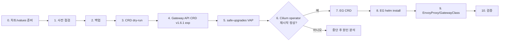

# Envoy Gateway 설치 가이드 (구성 B)

> EG 1.9.2 + Gateway API CRD v1.6.1 experimental(차트 번들) + Cilium 1.19.1 유지

이 문서는 Cilium Gateway가 이미 동작 중인 CAPI/CAPO 기반 Kubernetes 클러스터에 Envoy Gateway(EG)를 함께 설치하는 절차입니다. Cilium은 그대로 두고 Gateway API CRD만 v1.6.1 experimental로 올리는 **브리지 구성**이며, 이후 Cilium만 1.20으로 올리면 전부 지원 범위인 구성 C가 됩니다.

---

## 목차

- [1. 설치 환경](#1-설치-환경)
- [2. 작업 개요](#2-작업-개요)
- [3. 작업 상세](#3-작업-상세)
  - [Step 0. 차트 준비와 values 작성](#step-0-차트-준비와-values-작성)
  - [Step 1. 사전 점검](#step-1-사전-점검)
  - [Step 2. 기존 리소스 백업](#step-2-기존-리소스-백업)
  - [Step 3. Gateway API CRD dry-run](#step-3-gateway-api-crd-dry-run)
  - [Step 4. Gateway API CRD v1.6.1 적용](#step-4-gateway-api-crd-v161-적용)
  - [Step 5. safe-upgrades VAP 적용](#step-5-safe-upgrades-vap-적용)
  - [Step 6. Cilium operator 재시작 검증](#step-6-cilium-operator-재시작-검증)
  - [Step 7. EG CRD 적용](#step-7-eg-crd-적용)
  - [Step 8. EG 컨트롤러 설치](#step-8-eg-컨트롤러-설치)
  - [Step 9. EnvoyProxy와 GatewayClass 적용](#step-9-envoyproxy와-gatewayclass-적용)
  - [Step 10. 설치 후 검증](#step-10-설치-후-검증)
- [4. 운영 규칙](#4-운영-규칙)
- [5. 다음 단계: 구성 C](#5-다음-단계-구성-c)
- [부록. 차트 옵션 함정](#부록-차트-옵션-함정)

---

## 1. 설치 환경

### 1-1. 클러스터

| 항목 | 값 |
|---|---|
| 클러스터 | `k8s-test` |
| 배포 방식 | Cluster API (CAPI/CAPO) on OpenStack |
| Kubernetes | 1.34.5 |
| LoadBalancer | OpenStack CCM(OCCM) + Octavia (amphora) |
| CNI | Cilium 1.19.1 (Helm 설치) |
| Cilium 기능 | CNI, kube-proxy replacement, Gateway API (`cilium` GatewayClass, HTTPRoute 1개 사용 중) |
| 현재 Gateway API CRD | v1.4.1 **standard** (TLSRoute 없음) |
| 사설 레지스트리 | `10.4.22.22/dockerhub-proxy/...` (전체 경로 방식, `global.imageRegistry`는 비움) |

> 공개 저장소에 올릴 경우 `10.4.22.22`는 환경에 맞는 레지스트리 주소로 바꿔 사용하세요.

### 1-2. 설치 대상 버전

| 구성 요소 | 버전 | 비고 |
|---|---|---|
| Envoy Gateway 차트 | `gateway-helm` **1.9.2** | `gateway-helm-1_9_2.tgz` |
| EG 컨트롤러 이미지 | `envoyproxy/gateway:v1.9.2` | |
| Ratelimit 이미지 | `envoyproxy/ratelimit:0482748e` | 1.9.2 차트 기본 태그 |
| Envoy 프록시 이미지 | `envoyproxy/envoy:distroless-v1.39.3` | 차트 기본값(v1.39.1) 대신 보안 패치 버전. [1-5](#1-5-envoy-프록시-이미지-버전) 참고 |
| Gateway API CRD | **v1.6.1 experimental** | 1.9.2 차트에 번들된 파일 사용 |
| Cilium | 1.19.1 | **변경 없음** |

### 1-3. 구성 B를 선택한 이유

| 근거 | 내용 |
|---|---|
| EG 지원 범위 | EG v1.9는 Gateway API v1.6.1, K8s v1.33–v1.36 지원, EOL 2027-02-14. (v1.7은 이미 EOL 2026-08-05) |
| Cilium 1.19 요구사항 | Gateway API v1.4.1 기준이며 TLSRoute를 `v1alpha2`로 감시함 |
| experimental 채널 필수 | v1.6.1 **standard**는 TLSRoute `v1alpha2`가 `served: false` → Cilium 1.19.1 operator가 `backendServiceTLSRouteIndex` 설정 단계에서 fatal 종료. **experimental** 번들은 `v1alpha2`를 서빙함 |
| HTTPRoute만 써도 위험 동일 | Cilium operator는 TLSRoute 사용 여부와 무관하게 기동 시 TLSRoute `v1alpha2` 인덱서를 등록함 |
| 스키마 호환성 | v1.4.1 std → v1.6.1 exp 사이에 **삭제된 필드 0개**. Cilium이 쓰는 status가 pruning되지 않음 |
| 향후 경로 | 구성 C(Cilium 1.20)와 CRD 상태가 동일 → Cilium만 올리면 됨 |

**성격:** EG 쪽은 공식 지원 조합이고, Cilium 1.19 + Gateway API v1.6.1 조합만 비공식입니다. **v1.6.1 CRD 적용은 되돌릴 수 없다고 간주**합니다(VAP가 v1.5 미만 설치를 거부하고, TLSRoute `storedVersions`에 `v1`이 기록됨).

### 1-4. CRD 변경 검증 결과

**served 버전**

| CRD | v1.4.1 std (현재) | **v1.6.1 exp (적용 대상)** | v1.6.1 std (참고) | Cilium 1.19 요구 |
|---|---|---|---|---|
| gatewayclasses / gateways / httproutes | v1\*, v1beta1 | v1\*, v1beta1 | 동일 | v1 ✅ |
| grpcroutes | v1\* | v1\* | 동일 | v1 ✅ |
| referencegrants | v1beta1\* | v1, v1beta1\* | 동일 | v1beta1 ✅ |
| tlsroutes | 없음 | v1\*, **v1alpha2**, v1alpha3 (served) | v1\*, v1alpha2 **(served: false)** | v1alpha2: exp ✅ / std ❌ |

\* storage version

**스키마 변화 (v1.4.1 std → v1.6.1 exp)**

| CRD | 변화 | 영향 |
|---|---|---|
| gatewayclasses | 없음 | 없음 |
| gateways | `spec.tls`, `allowedListeners`, `defaultScope`, `status.attachedListenerSets` 추가 | Cilium 1.19는 모름 → `cilium` Gateway에 쓰면 조용히 무시됨 |
| gateways | CEL: TLS 리스너는 `tls.mode` 필수 / `supportedKinds` required 해제 | 사용자 spec에만 적용 / 완화 방향 |
| httproutes | `rules` minItems 1, rule `name` 중복 금지 | `rules: []`나 중복 name만 해당 |
| httproutes, grpcroutes | header 값 pattern (출력 가능 ASCII, 앞뒤 공백 금지) | 기존 값 확인 필요 (K8s 1.34는 validation ratcheting 기본 활성) |
| httproutes | CORS, ExternalAuth, retry, sessionPersistence, redirect 303/307/308 | 추가 기능. `cilium` 쪽에서는 사용 금지 |
| referencegrants | `spec` required | 사실상 무관 |

### 1-5. Envoy 프록시 이미지 버전

2026-10-10 기준 최신 릴리스를 확인해 **`distroless-v1.39.3`**을 사용합니다.

| 항목 | 내용 |
|---|---|
| EG 1.9.x가 테스트한 Envoy 마이너 | `distroless-v1.39.x` ([호환성 매트릭스](https://gateway.envoyproxy.io/news/releases/matrix/)) |
| 1.9.2 차트 기본값 | `distroless-v1.39.1` |
| Envoy 1.39 최신 패치 | **v1.39.3** (2026-10-06) |
| EG 권장 | v1.9.2 릴리스 노트의 보안 업데이트 안내가 `distroless-v1.39.2`에서 **`distroless-v1.39.3`**으로 변경됨 ([v1.9.2 notes](https://gateway.envoyproxy.io/news/releases/notes/v1.9.2/), [PR #10222](https://github.com/envoyproxy/gateway/pull/10222)) |
| 다음 EG 1.9 패치 | 내장 기본 이미지를 v1.39.3으로 올리는 작업이 진행 중 ([PR #10206](https://github.com/envoyproxy/gateway/pull/10206)) |

| Envoy 버전 | 포함된 보안 수정 |
|---|---|
| v1.39.2 (2026-10-01) | CVE-2026-35189: BoringSSL 인증서 파싱 시 과도한 메모리 할당 → TLS 핸드셰이크 중 원격 DoS |
| v1.39.3 (2026-10-06) | v1.39.2 수정 포함 + GHSA-8vc2-jrm4-835w(oauth2), GHSA-47vj-9r25-wv5j(api_key_auth): `:path` 헤더가 없는 요청(CONNECT)에서 크래시 |

이미지 태그를 바꿀 때는 **1.39.x 안에서만** 패치합니다. 사설 레지스트리 프록시에 해당 태그가 캐시되는지(`docker pull 10.4.22.22/dockerhub-proxy/envoyproxy/envoy:distroless-v1.39.3`) 설치 전에 확인하세요.

---

## 2. 작업 개요

| Step | 작업 | 대상 | 되돌리기 |
|---|---|---|---|
| 0 | 차트 풀기, `eg-values.yaml` 작성, 렌더링 확인 | 작업 PC | 해당 없음 |
| 1 | 사전 점검 (CRD 상태, 이전 설치 흔적, LB-IPAM, route 값) | 클러스터 (조회) | 해당 없음 |
| 2 | Gateway API 리소스 백업 | 클러스터 (조회) | 해당 없음 |
| 3 | Gateway API CRD v1.6.1 server dry-run | 클러스터 (dry-run) | 해당 없음 |
| 4 | **Gateway API CRD v1.6.1 experimental 적용** | 클러스터 CRD | **사실상 불가** |
| 5 | safe-upgrades VAP 적용 | 클러스터 VAP | 가능 |
| 6 | **Cilium operator 재시작 검증** | `kube-system` | — |
| 7 | EG CRD 적용 | 클러스터 CRD | 가능 |
| 8 | EG 컨트롤러 Helm 설치 (`crds.enabled=false`) | `envoy-gateway-system` | `helm uninstall` |
| 9 | EnvoyProxy, GatewayClass `eg` 적용 | `envoy-gateway-system` | 가능 |
| 10 | 설치 후 검증 (테스트 Gateway, Service annotation, 프록시 이미지) | 클러스터 | — |



**핵심 원칙:** CRD는 tgz에서 꺼내 `kubectl apply --server-side`로 직접 관리하고, Helm 차트로는 **컨트롤러만** 설치합니다.

---

## 3. 작업 상세

### Step 0. 차트 준비와 values 작성

#### 0-1. 차트 풀기

```bash
tar -xzf gateway-helm-1_9_2.tgz
CHART=./gateway-helm
CRD_DIR=$CHART/charts/crds/crds
```

1.9.2 차트에서 사용할 경로는 다음과 같습니다.

| 경로 | 내용 |
|---|---|
| `charts/crds/crds/gatewayapi-crds.yaml` | Gateway API v1.6.1 **experimental** CRD 13개 |
| `charts/crds/crds/generated/*.yaml` | EG CRD 8개 (envoyproxies는 1.2–1.4MB → server-side apply 필수) |
| `charts/crds/templates/gatewayapi-safe-upgrade-policy.yaml` | safe-upgrades ValidatingAdmissionPolicy(VAP)와 바인딩 |

#### 0-2. `eg-values.yaml`

```yaml
# eg-values.yaml (gateway-helm 1.9.2 차트 기준 검증)
global:
  imageRegistry: ""          # 전체 경로 image와 함께 쓰면 경로가 중복되므로 비움
  images:
    envoyGateway:
      image: 10.4.22.22/dockerhub-proxy/envoyproxy/gateway:v1.9.2
    ratelimit:
      image: 10.4.22.22/dockerhub-proxy/envoyproxy/ratelimit:0482748e
    envoyProxy:
      image: 10.4.22.22/dockerhub-proxy/envoyproxy/envoy:distroless-v1.39.3   # 지정해야 envoyProxy 블록이 생성됨

crds:
  enabled: false             # Gateway API CRD, EG CRD, VAP 모두 차트 밖에서 관리

deployment:
  replicas: 2
podDisruptionBudget:
  minAvailable: 1
```

#### 0-3. 렌더링 확인

차트에 values 스키마가 없어서 잘못된 키는 에러 없이 무시됩니다. 설치 전에 렌더링 결과로 반드시 확인합니다.

```bash
helm template eg $CHART -n envoy-gateway-system -f eg-values.yaml > /tmp/eg.yaml

# CRD, VAP가 렌더링되지 않아야 정상 (출력 없음)
grep -E 'kind: (CustomResourceDefinition|ValidatingAdmissionPolicy)' /tmp/eg.yaml

# 이미지 3종이 사설 경로로, dockerhub-proxy 중복 없이 나와야 정상
grep -E 'image: ' /tmp/eg.yaml | sort -u
```

---

### Step 1. 사전 점검

```bash
# Gateway API CRD 버전, 채널, storedVersions
kubectl get crd -o custom-columns='NAME:.metadata.name,BUNDLE:.metadata.annotations.gateway\.networking\.k8s\.io/bundle-version,CHANNEL:.metadata.annotations.gateway\.networking\.k8s\.io/channel,STORED:.status.storedVersions' \
  | grep -E 'NAME|gateway\.networking'

# TLSRoute 존재 여부
kubectl get crd tlsroutes.gateway.networking.k8s.io \
  -o jsonpath='{.metadata.annotations.gateway\.networking\.k8s\.io/channel} {range .spec.versions[*]}{.name}={.served} {end}{"\n"}' 2>/dev/null || echo "TLSRoute 없음"

# 이전 설치 시도 흔적
helm list -A | grep -iE 'NAME|gateway'
kubectl get validatingadmissionpolicy,validatingadmissionpolicybinding 2>/dev/null | grep safe-upgrades
kubectl get crd | grep gateway.envoyproxy.io

# Cilium LB-IPAM 풀 (OCCM과 경합 여부)
kubectl get ciliumloadbalancerippools

# 사용 중인 route의 rules, header 값 (v1.6.1 검증 규칙 대상)
kubectl get httproute,grpcroute -A -o yaml | grep -nE 'value:|rules: \[\]' | head -50
```

| 확인 항목 | 기대 결과 | 다를 때 조치 |
|---|---|---|
| Gateway API CRD | bundle v1.4.1, channel standard | 다른 상태면 1-4 표와 비교 후 진행 여부 판단 |
| TLSRoute | 없음 | — |
| `eg` Helm 릴리스, `safe-upgrades` VAP | 없음 | 이전 기본값 설치 흔적 → `helm uninstall eg -n envoy-gateway-system` (템플릿 VAP는 함께 삭제, CRD는 남음) |
| `CiliumLoadBalancerIPPool` | 없음 | 있으면 OCCM과 LB IP 경합 가능성 검토 |
| HTTPRoute | `rules: []` 없음, header 값 앞뒤 공백 없음 | 수정 후 진행 |

---

### Step 2. 기존 리소스 백업

```bash
kubectl get gateway,httproute,grpcroute,referencegrant -A -o yaml > gwapi-backup-$(date +%F).yaml
kubectl get crd $(kubectl get crd -o name | grep gateway.networking.k8s.io | sed 's#.*/##') -o yaml \
  > gwapi-crd-backup-$(date +%F).yaml
```

CRD 백업은 참고용입니다. v1.6.1 적용 후에는 VAP와 storedVersions 때문에 이 파일로 복구할 수 없습니다.

---

### Step 3. Gateway API CRD dry-run

```bash
kubectl apply --server-side --force-conflicts --dry-run=server -f $CRD_DIR/gatewayapi-crds.yaml
```

`Installing experimental CRDs on top of standard channel CRDs is prohibited` 메시지가 나오면 이전 설치에서 VAP가 남아 있는 것입니다. Step 1의 흔적 정리부터 다시 하세요.

---

### Step 4. Gateway API CRD v1.6.1 적용

```bash
kubectl apply --server-side --force-conflicts -f $CRD_DIR/gatewayapi-crds.yaml
```

**반드시 VAP(Step 5)보다 먼저 적용합니다.** 현재 standard CRD 위에 experimental을 덮는 작업이라 VAP가 먼저 있으면 거부됩니다. (experimental 위에 experimental을 덮는 것은 허용됨)

적용 결과 확인:

```bash
kubectl get crd -o custom-columns='NAME:.metadata.name,BUNDLE:.metadata.annotations.gateway\.networking\.k8s\.io/bundle-version,CHANNEL:.metadata.annotations.gateway\.networking\.k8s\.io/channel' \
  | grep -E 'NAME|gateway\.networking'

kubectl get crd tlsroutes.gateway.networking.k8s.io \
  -o jsonpath='{range .spec.versions[*]}{.name}={.served} {end}{"\n"}'
# 기대: v1=true v1alpha2=true v1alpha3=true
```

---

### Step 5. safe-upgrades VAP 적용

차트의 VAP 템플릿만 추출해 적용합니다. 이 명령은 `eg-values.yaml`을 넘기지 않아야 합니다(`crds.enabled=false`면 VAP가 렌더링되지 않음).

```bash
helm template eg $CHART -n envoy-gateway-system \
  --show-only charts/crds/templates/gatewayapi-safe-upgrade-policy.yaml \
  | kubectl apply --server-side -f -

kubectl get validatingadmissionpolicy,validatingadmissionpolicybinding | grep safe-upgrades
```

VAP는 권장 사항입니다. Gateway API v1.5 미만 CRD 설치와 standard 위에 experimental을 덮는 작업을 막아 줍니다.

---

### Step 6. Cilium operator 재시작 검증

CRD 호환성 문제는 Cilium operator **기동 시점에만** 드러납니다. CRD를 바꾼 직후 재시작해서 지금 확인합니다.

```bash
kubectl -n kube-system rollout restart deploy/cilium-operator
kubectl -n kube-system rollout status deploy/cilium-operator

kubectl -n kube-system logs deploy/cilium-operator --since=5m \
  | grep -iE 'GatewayAPI resources|Invoke failed|fatal|tlsroute'

# 기존 HTTPRoute가 cilium 컨트롤러에 계속 Accepted 되는지
kubectl get httproute -A -o jsonpath='{range .items[*]}{.metadata.namespace}/{.metadata.name}{"\t"}{range .status.parents[*]}{.controllerName}={.conditions[?(@.type=="Accepted")].status} {end}{"\n"}{end}'
```

| 결과 | 판단 |
|---|---|
| rollout 완료, `fatal`/`Invoke failed` 없음, HTTPRoute `io.cilium/gateway-controller=True` | 정상. Step 7 진행 |
| operator CrashLoop, 로그에 `backendServiceTLSRouteIndex` 또는 `tlsroute` 관련 fatal | **중단.** TLSRoute `v1alpha2` served 상태(Step 4 확인 명령)를 먼저 점검 |

기존 Cilium Gateway로 서비스 중인 경로가 있다면 실제 요청(curl)으로도 한 번 확인합니다.

---

### Step 7. EG CRD 적용

```bash
kubectl apply --server-side -f $CRD_DIR/generated/
kubectl get crd | grep gateway.envoyproxy.io
```

envoyproxies CRD가 1MB를 넘기 때문에 client-side apply(annotation 크기 제한)로는 실패합니다. server-side apply를 사용합니다.

---

### Step 8. EG 컨트롤러 설치

```bash
helm install eg $CHART -n envoy-gateway-system --create-namespace -f eg-values.yaml

kubectl -n envoy-gateway-system rollout status deploy/envoy-gateway
kubectl -n envoy-gateway-system get deploy,pod
```

`crds.enabled=false`가 values에 있으므로 Helm은 CRD와 VAP를 건드리지 않습니다. 이 설정 없이 설치하면 Helm이 **없는 CRD만** 생성해 버전과 채널이 섞이고, VAP까지 템플릿으로 생성됩니다.

---

### Step 9. EnvoyProxy와 GatewayClass 적용

```yaml
# eg-gatewayclass.yaml
apiVersion: gateway.envoyproxy.io/v1alpha1
kind: EnvoyProxy
metadata:
  name: octavia-proxy
  namespace: envoy-gateway-system
spec:
  provider:
    type: Kubernetes
    kubernetes:
      envoyDeployment:
        replicas: 2
        container:
          image: 10.4.22.22/dockerhub-proxy/envoyproxy/envoy:distroless-v1.39.3
      envoyService:
        annotations:
          loadbalancer.openstack.org/enable-health-monitor: "true"
---
apiVersion: gateway.networking.k8s.io/v1
kind: GatewayClass
metadata:
  name: eg
spec:
  controllerName: gateway.envoyproxy.io/gatewayclass-controller
  parametersRef:
    group: gateway.envoyproxy.io
    kind: EnvoyProxy
    name: octavia-proxy
    namespace: envoy-gateway-system
```

```bash
kubectl apply -f eg-gatewayclass.yaml
kubectl get gatewayclass      # cilium, eg 둘 다 Accepted=True
```

| 항목 | 이유 |
|---|---|
| EnvoyProxy에 image 명시 | `mergeType` 없이 `parametersRef`로 붙이면 Helm 기본값이 EnvoyProxy 설정으로 대체되므로 여기서도 지정 |
| `enable-health-monitor` annotation | EG가 만드는 Service의 기본 ETP가 `Local` → envoy pod가 없는 노드로 간 트래픽이 유실되지 않도록 Octavia health monitor 활성화. 보안 그룹이 health check 포트를 허용하는지도 확인 |
| Service annotation 위치 | EG가 관리하는 Service이므로 `Gateway.metadata.annotations`가 아니라 `EnvoyProxy.spec.provider.kubernetes.envoyService.annotations`에 지정 |
| `cilium` GatewayClass와 공존 | `controllerName`이 달라 충돌 없음 |

---

### Step 10. 설치 후 검증

#### 10-1. 컨트롤러 상태

```bash
kubectl -n envoy-gateway-system get deploy,pod
kubectl -n envoy-gateway-system logs deploy/envoy-gateway | grep -iE 'error|no matches' | head
kubectl get gatewayclass
```

#### 10-2. 테스트 Gateway (예시)

```yaml
# eg-test-gateway.yaml
apiVersion: gateway.networking.k8s.io/v1
kind: Gateway
metadata:
  name: eg-test
  namespace: default
spec:
  gatewayClassName: eg
  listeners:
    - name: http
      protocol: HTTP
      port: 80
```

```bash
kubectl apply -f eg-test-gateway.yaml
kubectl get gateway eg-test -n default        # PROGRAMMED=True, ADDRESS에 Octavia VIP
```

#### 10-3. 생성된 Service와 프록시 이미지

```bash
# Service annotation, ETP 확인
kubectl -n envoy-gateway-system get svc -l app.kubernetes.io/managed-by=envoy-gateway \
  -o jsonpath='{range .items[*]}{.metadata.name}{"\t"}{.metadata.annotations}{"\t"}{.spec.externalTrafficPolicy}{"\n"}{end}'

# 프록시 이미지가 distroless-v1.39.3인지 확인
kubectl get deploy -A -l app.kubernetes.io/managed-by=envoy-gateway,app.kubernetes.io/component=proxy \
  -o jsonpath='{range .items[*]}{.metadata.name}{"\t"}{.spec.template.spec.containers[?(@.name=="envoy")].image}{"\n"}{end}'

# Octavia health monitor 생성 확인
openstack loadbalancer healthmonitor list
```

검증이 끝나면 테스트 Gateway는 `kubectl delete -f eg-test-gateway.yaml`로 정리합니다.

---

## 4. 운영 규칙

| 규칙 | 이유 |
|---|---|
| Gateway API CRD 출처를 **EG 1.9.2 차트 번들로 고정**. upstream `standard-install`이나 `gateway-crds-helm` standard 사용 금지 | TLSRoute가 standard로 바뀌면 Cilium 1.19 operator가 다음 재시작 때 죽음. VAP는 experimental 위에 standard를 덮는 방향을 막지 않음 |
| 차트가 CRD를 설치하지 않게 유지 (`crds.enabled=false`) | Helm은 없는 CRD만 만들어 버전과 채널이 섞임 |
| `cilium` Gateway와 HTTPRoute에 v1.5 이후 추가된 필드 사용 금지 | Cilium 1.19가 에러 없이 무시함 |
| 하나의 HTTPRoute를 `cilium`과 `eg` Gateway에 동시에 붙이지 말 것 | 컨트롤러 간 status 덮어쓰기 위험 |
| EG 업그레이드는 CRD 먼저(새 tgz에서 server-side apply), 차트는 나중에. 한 마이너씩 | Helm은 CRD를 업그레이드하지 않음 |
| 프록시 이미지는 EG가 테스트한 Envoy 마이너 안에서만 패치 | EG 1.9.x는 Envoy 1.39.x |
| 모든 EG Gateway는 `eg` GatewayClass(EnvoyProxy 연결) 사용 | 사설 레지스트리 이미지와 Octavia annotation이 적용됨 |
| v1.6.1 적용은 되돌릴 수 없다고 간주 | VAP가 v1.5 미만 설치를 거부하고, TLSRoute storedVersions에 v1이 기록됨 |

---

## 5. 다음 단계: 구성 C

구성 B의 CRD 상태는 Cilium 1.20의 요구사항(Gateway API v1.6.1 이상, TLSRoute는 v1alpha2를 포함한 experimental)을 그대로 만족합니다. 원하는 시점에 Cilium만 한 마이너씩 올리면 구성 C가 됩니다.

```bash
helm get values cilium -n kube-system -o yaml > cilium-values.yaml
# override 태그 5종 수정: image, operator(operator-generic), hubble.relay, envoy(cilium-envoy), certgen
# cilium-envoy 태그: helm show values cilium/cilium --version <대상> 에서 확인

# 1) 1.19 최신 패치 → 2) 1.20.x
helm upgrade cilium cilium/cilium --version <대상버전> -n kube-system -f cilium-values.yaml
```

| 주의 | 내용 |
|---|---|
| preflight | kube-proxy-free 모드이므로 `k8sServiceHost`/`k8sServicePort` 지정 |
| `--reuse-values` | 마이너 업그레이드에서 사용 금지 |
| 트래픽 | 업그레이드 중 Cilium Gateway를 지나는 L7 트래픽이 끊김 |
| standard 전환 (선택) | 1.20 이후 검토 가능. experimental → standard 방향은 VAP가 허용. 단 EG에서 쓰는 experimental 필드(retry, sessionPersistence, ExternalAuth 등)는 pruning됨 |

---

## 부록. 차트 옵션 함정

`gateway-helm` 1.9.2 차트에는 values 스키마가 없어서 잘못된 키를 넣어도 에러가 나지 않습니다.

| 옵션 | 실제 동작 |
|---|---|
| `crds.gatewayAPI.enabled`, `crds.envoyGateway.enabled`, `crds.gatewayAPI.channel` | **키가 없어 무시됨** (`gateway-crds-helm` 차트 전용 키) |
| `--skip-crds` | `crds/`만 생략. **VAP는 렌더링됨** |
| **`crds.enabled=false`** | CRD와 VAP 전체 비활성화. **이 가이드의 기준** |
| `crds.gatewayAPI.safeUpgradePolicy.enabled=false` | VAP만 끔 (`crds.enabled=true`일 때만 의미) |
| CRD 제외 없이 기존 CRD 위에 install | 없는 CRD만 생성하고 기존 CRD는 갱신 안 함 → v1.4.1과 v1.6.1 혼재 + VAP 생성 |
| `global.imageRegistry`와 전체 경로 image를 함께 사용 | 첫 경로 구간이 치환되어 `.../dockerhub-proxy/dockerhub-proxy/...`로 깨짐 |
| `global.images.envoyProxy.image` 미지정 | 렌더링 결과에 envoyProxy 블록이 생성되지 않음 → Step 0-3에서 이미지 3종이 모두 나오는지 확인 |
