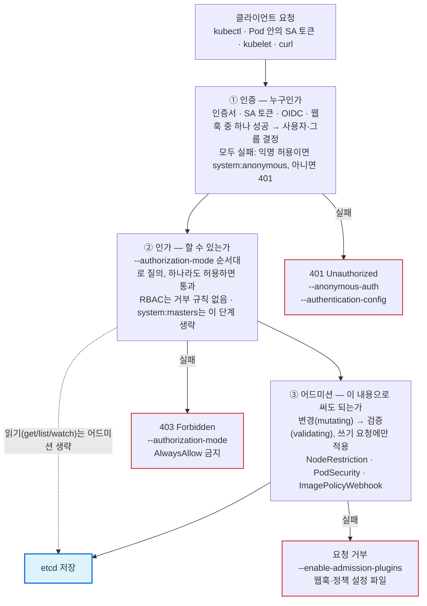

# CKS 도메인 2 — Cluster Hardening 학습 자료

> 작성일: 2026-10-09 · 기준 환경: Kubernetes v1.35 (CKS 시험 환경)

## 목차

- [개요](#개요)
- [1. RBAC로 노출 최소화](#1-rbac로-노출-최소화)
- [2. ServiceAccount 주의 사용](#2-serviceaccount-주의-사용)
- [3. Kubernetes API 접근 제한](#3-kubernetes-api-접근-제한)
- [4. 취약점 대응을 위한 Kubernetes 업그레이드](#4-취약점-대응을-위한-kubernetes-업그레이드)
- [5. 시험 대비](#5-시험-대비)
- [6. 자가 점검 문제](#6-자가-점검-문제)

## 개요

Cluster Hardening은 시험의 15%이며, "누가 API에 무엇을 할 수 있는가"를 좁히는 도메인입니다. 공식 역량은 4개이고, 모두 kubeadm 클러스터에서 YAML과 kubectl로 직접 고치는 실기 문제로 나옵니다.

| # | 공식 역량 | 시험에서 실제로 하는 일 | 연관 LFS260 랩 |
| --- | --- | --- | --- |
| 1 | RBAC로 노출 최소화 | 과도한 ClusterRoleBinding 제거, 최소 Role 작성, `auth can-i`로 검증 | 5.1, 8.1 |
| 2 | ServiceAccount 주의 사용 | default SA 토큰 자동 마운트 끄기, 전용 SA 생성·바인딩 | 5.2, 8.1 |
| 3 | Kubernetes API 접근 제한 | kube-apiserver·kubelet 플래그 수정(익명 접근, 인가 모드, NodeRestriction) | 5.2(익명 403 확인), 5.5 |
| 4 | 취약점 대응을 위한 업그레이드 | kubeadm으로 컨트롤 플레인·워커를 한 마이너 버전 올리기 | 랩 없음 (CKA 범위) |

### 학습 순서

1. RBAC 모델을 먼저 확실히 잡습니다. ServiceAccount와 API 접근 제한 문제도 결국 RBAC로 검증합니다.
2. ServiceAccount 토큰의 수명과 마운트 동작을 익힙니다.
3. kube-apiserver 정적 Pod 매니페스트를 안전하게 고치는 손버릇을 만듭니다.
4. 업그레이드는 CKA 때 절차를 복습하고, 시간 안에 끝내는 연습만 합니다.

### 시험 중 열어볼 공식 문서

시험 환경은 Kubernetes v1.35이며, 개인 북마크는 쓸 수 없고 kubernetes.io 문서는 볼 수 있습니다. 아래 페이지의 검색어를 외워 두면 빨리 찾습니다.

- [Using RBAC Authorization](https://kubernetes.io/docs/reference/access-authn-authz/rbac/) — Role·Binding YAML 예시, 기본 ClusterRole 목록
- [Configure Service Accounts for Pods](https://kubernetes.io/docs/tasks/configure-pod-container/configure-service-account/) — `automountServiceAccountToken`, 프로젝션 토큰
- [Authenticating](https://kubernetes.io/docs/reference/access-authn-authz/authentication/) — 익명 요청, X.509 클라이언트 인증서
- [Controlling Access to the Kubernetes API](https://kubernetes.io/docs/concepts/security/controlling-access/) — 요청 처리 단계
- [Kubelet authentication/authorization](https://kubernetes.io/docs/reference/access-authn-authz/kubelet-authn-authz/)
- [Upgrading kubeadm clusters](https://kubernetes.io/docs/tasks/administer-cluster/kubeadm/kubeadm-upgrade/)
- [Version Skew Policy](https://kubernetes.io/releases/version-skew-policy/)

## 1. RBAC로 노출 최소화

RBAC는 기본이 전부 거부이고, 허용 규칙만 더해지는(additive) 모델입니다. 거부 규칙이 없으므로 권한을 줄이려면 해당 규칙이나 바인딩을 지우는 수밖에 없습니다.

### 1.1 네 가지 객체와 범위

| 객체 | 범위 | 역할 |
| --- | --- | --- |
| Role | 네임스페이스 | 그 네임스페이스 안의 리소스 권한 묶음 |
| ClusterRole | 클러스터 | 클러스터 범위 리소스(nodes, PV, namespaces), 비리소스 URL(`/healthz`), 또는 여러 네임스페이스에 재사용할 권한 묶음 |
| RoleBinding | 네임스페이스 | Role **또는 ClusterRole**을 주체에게 연결. 효력은 바인딩이 있는 네임스페이스 하나 |
| ClusterRoleBinding | 클러스터 | ClusterRole을 주체에게 연결. 효력은 모든 네임스페이스 |

조합 규칙은 세 가지입니다.

- RoleBinding + Role: 한 네임스페이스에만 적용. 가장 좁은 형태.
- RoleBinding + ClusterRole: ClusterRole 정의를 재사용하되 효력은 바인딩 네임스페이스로 제한. 최소 권한 문제에서 자주 쓰는 정답 형태.
- ClusterRoleBinding + ClusterRole: 모든 네임스페이스에 적용. 시험에서 "과도한 권한"으로 지목되는 형태.

주체(subject)는 `User`, `Group`, `ServiceAccount` 세 종류입니다. User와 Group은 Kubernetes 객체가 아니라 인증 단계가 넘겨준 문자열입니다(X.509 인증서의 CN이 사용자, O가 그룹). ServiceAccount는 `system:serviceaccount:<ns>:<name>` 사용자명으로 인증되고, `system:serviceaccounts`와 `system:serviceaccounts:<ns>` 그룹에 속합니다.

### 1.2 rule의 구성

```yaml
rules:
- apiGroups: [""]              # "" = core(v1). Deployment는 "apps"
  resources: ["pods", "pods/log"]   # 서브리소스는 "리소스/서브리소스"
  verbs: ["get", "list", "watch"]
  resourceNames: ["web-0"]    # 선택. 특정 객체만. list/watch/create에는 효과 없음
- nonResourceURLs: ["/healthz", "/version"]   # ClusterRole에서만
  verbs: ["get"]
```

- apiGroup은 `kubectl api-resources -o wide`의 APIVERSION 열에서 `/v1` 앞부분입니다. 비어 있으면 core입니다.
- 서브리소스는 따로 허용해야 합니다. `pods` 권한이 있어도 `pods/exec`, `pods/log`, `pods/portforward`는 별도입니다.
- `resourceNames`를 지정하면 `list`와 `watch`는 사실상 막힙니다. 컬렉션 요청에는 이름이 없기 때문입니다.
- verb 대응: GET 단건 `get`, GET 컬렉션 `list`, `?watch=true` `watch`, POST `create`, PUT `update`, PATCH `patch`, DELETE `delete`, 컬렉션 DELETE `deletecollection`.

### 1.3 위험한 권한 (발견하면 줄일 대상)

| 권한 | 왜 위험한가 |
| --- | --- |
| `*` (verbs/resources/apiGroups 와일드카드) | 앞으로 추가될 리소스·CRD까지 전부 허용 |
| `secrets`의 `get`/`list`/`watch` | 다른 SA 토큰, TLS 키, 비밀번호 탈취. `list`만 있어도 값까지 응답에 포함 |
| `pods`의 `create` | 네임스페이스 안의 아무 SA로 Pod를 띄워 그 SA 권한 획득, hostPath로 노드 탈취 |
| `pods/exec`, `pods/attach` | 다른 컨테이너 안에서 명령 실행 |
| `nodes/proxy` | kubelet API 직접 호출, 사실상 노드의 모든 컨테이너에서 exec |
| `escalate`, `bind` (roles, clusterroles) | 자신에게 없는 권한을 담은 Role을 만들거나 바인딩 가능. RBAC 자체 방어를 우회 |
| `impersonate` (users, groups, serviceaccounts) | `--as=system:admin`처럼 다른 주체로 행세 |
| `serviceaccounts/token`의 `create` | 다른 SA의 토큰 발급 |
| `certificatesigningrequests/approval` + signers | 임의 사용자 인증서 발급 |
| 그룹 `system:masters` 바인딩 | 인가 단계를 통째로 건너뜀. RBAC로 회수 불가, 인증서 폐기 외 방법 없음 |

기본 ClusterRole 중 `cluster-admin`은 전부, `admin`은 네임스페이스 안 거의 전부(Role·RoleBinding 포함), `edit`은 Secret 읽기와 Pod 생성 포함, `view`는 Secret 제외 읽기 전용입니다. `edit`도 Secret과 Pod 생성이 가능하므로 "읽기만 필요"한 주체에게 `edit`을 주면 과도합니다.

### 1.4 명령형으로 빠르게 만들기

```bash
# Role / ClusterRole
k -n prod create role pod-reader --verb=get,list,watch --resource=pods
k -n prod create role log-reader --verb=get --resource=pods/log
k create clusterrole node-reader --verb=get,list --resource=nodes
k create clusterrole dep-scaler --verb=get,patch --resource=deployments.apps,deployments.apps/scale

# 바인딩 (사용자, 그룹, SA)
k -n prod create rolebinding rb1 --role=pod-reader --user=jane
k -n prod create rolebinding rb2 --clusterrole=view --group=dev-team
k -n prod create rolebinding rb3 --role=pod-reader --serviceaccount=prod:app-sa
k create clusterrolebinding crb1 --clusterrole=node-reader --user=ops

# YAML만 뽑기
k -n prod create role r --verb=get --resource=pods $do   # $do='--dry-run=client -o yaml'
```

`roleRef`는 생성 후 바꿀 수 없습니다. 다른 Role로 연결하려면 바인딩을 지우고 다시 만듭니다. `kubectl edit`로 roleRef를 바꾸면 거부됩니다.

### 1.5 검증과 조사

```bash
# 특정 주체가 할 수 있는지
k auth can-i list secrets -n prod --as=jane
k auth can-i create pods -n prod --as=system:serviceaccount:prod:app-sa
k auth can-i get pods/log -n prod --as=jane
k auth can-i --list -n prod --as=system:serviceaccount:prod:app-sa

# 내가 누구로 인증되는지 (v1.28 GA)
k auth whoami

# 주체가 어떤 바인딩에 걸려 있는지 역추적
k get rolebindings,clusterrolebindings -A -o wide | grep -E 'app-sa|jane'

# 특정 ClusterRole을 참조하는 바인딩
k get clusterrolebindings -o json | jq -r '.items[] | select(.roleRef.name=="cluster-admin") | .metadata.name'
```

`can-i`는 정답 확인용입니다. 문제에서 "A는 되고 B는 안 되게"라고 하면 두 방향을 모두 `can-i`로 확인한 뒤 넘어갑니다.

### 1.6 실습 시나리오

**실습 A — 과도한 ClusterRoleBinding 줄이기** (LFS260 8.1 변형)

1. `prod-a`의 `webapp-sa`가 ClusterRoleBinding으로 모든 네임스페이스의 secrets를 읽는 상태를 만듭니다.
2. `k auth can-i --list --as=system:serviceaccount:prod-a:webapp-sa`로 노출 범위를 확인합니다.
3. ClusterRoleBinding과 ClusterRole을 삭제하고, `prod-a` 안의 configmaps `get,list`만 주는 Role·RoleBinding으로 바꿉니다.
4. `k auth can-i list secrets -n kube-system --as=...`가 `no`, `k auth can-i get configmaps -n prod-a --as=...`가 `yes`인지 확인합니다.

**실습 B — 사용자에게 최소 권한 부여** (LFS260 5.1 변형)

1. 사용자 `paul`에게 `prod-a`의 pods `get,watch,delete`만 허용합니다.
2. 사용자 `dan`에게 `dev-ns`에서 같은 권한 중 `delete`를 뺀 Role을 만들고 바인딩합니다. 2분 안에 명령형으로 끝내는 것을 목표로 합니다.
3. `kubectl auth reconcile -f`로 YAML을 적용해 보고, `create`와의 차이(이미 있으면 누락된 규칙만 추가)를 확인합니다.

LFS260 5.1 본문은 "pods and secrets"라고 쓰지만 예시 YAML에는 pods만 있습니다. 시험 문제는 문장 기준으로 채점되므로, 문장과 예시가 다르면 문장을 따릅니다.

**실습 C — 서브리소스 함정**

`pods`의 `get`만 가진 사용자로 `k logs`와 `k exec`가 실패하는지 확인하고, `pods/log`의 `get`만 추가해 로그는 되고 exec는 안 되는 상태를 만듭니다.

## 2. ServiceAccount 주의 사용

모든 Pod는 SA를 지정하지 않으면 네임스페이스의 `default` SA로 실행되고, 그 토큰이 `/var/run/secrets/kubernetes.io/serviceaccount/token`에 자동으로 마운트됩니다. 컨테이너가 뚫리면 이 토큰이 공격자의 첫 번째 목표이므로, 쓰지 않는 토큰은 마운트하지 않고 쓰는 토큰은 권한을 좁힙니다.

### 2.1 토큰의 변천 (v1.35 기준)

| 구분 | 바운드(프로젝션) 토큰 | 레거시 Secret 토큰 |
| --- | --- | --- |
| 발급 방식 | kubelet이 TokenRequest API로 요청해 projected volume에 기록 | `kubernetes.io/service-account-token` 타입 Secret에 저장 |
| 만료 | 있음. 기본 약 1시간, kubelet이 자동 갱신 | 없음(영구) |
| 대상 바인딩 | Pod·노드에 묶임. Pod가 지워지면 무효 | 묶이지 않음 |
| 현재 상태 | v1.22부터 기본 | v1.24부터 자동 생성 안 됨. 미사용 레거시 토큰은 자동 정리 대상 |

장기 토큰이 꼭 필요할 때만 Secret을 직접 만듭니다. 시험에서는 대부분 바운드 토큰이나 `kubectl create token`으로 충분합니다.

```bash
k -n prod create token app-sa                  # 임시 토큰 출력 (기본 1h)
k -n prod create token app-sa --duration=10m
```

```yaml
# 장기 토큰이 필요할 때만 (수동 생성)
apiVersion: v1
kind: Secret
metadata:
  name: app-sa-token
  namespace: prod
  annotations:
    kubernetes.io/service-account.name: app-sa
type: kubernetes.io/service-account-token
```

### 2.2 자동 마운트 끄기

`automountServiceAccountToken`은 SA와 Pod 양쪽에 둘 수 있고, **Pod spec 값이 우선**합니다.

```yaml
# SA 수준: 이 SA를 쓰는 Pod 전체 기본값
apiVersion: v1
kind: ServiceAccount
metadata:
  name: default
  namespace: prod
automountServiceAccountToken: false
---
# Pod 수준: 이 Pod만 (SA 설정보다 우선)
apiVersion: v1
kind: Pod
metadata:
  name: web
  namespace: prod
spec:
  serviceAccountName: web-sa
  automountServiceAccountToken: false
  containers:
  - name: web
    image: nginx
```

```bash
# default SA에 바로 적용
k -n prod patch sa default -p '{"automountServiceAccountToken": false}'

# 확인: 마운트가 사라졌는지
k -n prod get pod web -o jsonpath='{.spec.containers[*].volumeMounts}'
k -n prod exec web -- ls /var/run/secrets/kubernetes.io/serviceaccount   # No such file 이어야 함
```

> [!IMPORTANT]
> SA나 Pod의 `automountServiceAccountToken`을 바꿔도 **이미 떠 있는 Pod에는 반영되지 않습니다.** Pod는 재생성해야 하고, Deployment면 `k rollout restart`로 다시 띄웁니다. 시험에서 가장 흔한 감점 원인입니다.

### 2.3 "기본 SA 비활성화"의 실제 의미

default SA는 지울 수 없습니다. 지워도 ServiceAccount 컨트롤러가 바로 다시 만듭니다. 그래서 "비활성화"는 아래 세 가지를 뜻합니다.

1. default SA에 `automountServiceAccountToken: false`를 설정합니다.
2. default SA에 어떤 Role도 바인딩하지 않습니다. 기존 바인딩이 있으면 찾아서 지웁니다.
3. API를 호출해야 하는 워크로드에는 전용 SA를 만들어 필요한 권한만 바인딩합니다.

```bash
# default SA에 걸린 바인딩 찾기
k get rolebindings,clusterrolebindings -A -o json | jq -r '
  .items[] | select(.subjects[]? | .kind=="ServiceAccount" and .name=="default")
  | "\(.kind) \(.metadata.namespace // "-") \(.metadata.name) -> \(.roleRef.name)"'
```

### 2.4 전용 SA 만들고 최소 권한 주기

```bash
k -n prod create sa app-sa
k -n prod create role app-cm-reader --verb=get,list --resource=configmaps
k -n prod create rolebinding app-cm-reader --role=app-cm-reader --serviceaccount=prod:app-sa
k -n prod set serviceaccount deploy/app app-sa   # Deployment에 지정 (롤아웃 발생)

k auth can-i list configmaps -n prod --as=system:serviceaccount:prod:app-sa   # yes
k auth can-i list secrets    -n prod --as=system:serviceaccount:prod:app-sa   # no
```

- 실행 중인 Pod의 `serviceAccountName`은 바꿀 수 없습니다. Pod를 지우고 다시 만듭니다.
- `--serviceaccount=<ns>:<name>` 형식의 네임스페이스를 빠뜨리지 않습니다.
- SA는 같은 네임스페이스의 Pod만 쓸 수 있습니다.

### 2.5 토큰이 실제로 무엇을 할 수 있는지 확인

시험에서 "이 Pod의 SA 권한을 확인하라"는 문제는 Pod 안에서 직접 API를 호출하거나, 토큰을 꺼내 `can-i`로 묻는 두 방법이 있습니다.

```bash
# Pod 안에서 (LFS260 5.2)
TOKEN=$(cat /var/run/secrets/kubernetes.io/serviceaccount/token)
curl -s --cacert /var/run/secrets/kubernetes.io/serviceaccount/ca.crt \
  -H "Authorization: Bearer $TOKEN" \
  https://kubernetes.default.svc/api/v1/namespaces/prod/pods

# 밖에서 토큰으로 질의 (LFS260 8.1)
TOKEN=$(k -n prod exec web -- cat /var/run/secrets/kubernetes.io/serviceaccount/token)
k auth can-i --list --token="$TOKEN"
```

토큰 없이 호출하면 `system:anonymous`로 처리되어 403이 납니다. 토큰을 붙이면 `system:serviceaccount:prod:<sa>`로 인증되고, 이후는 RBAC가 결정합니다. 이 차이가 인증과 인가가 분리돼 있다는 것을 보여 줍니다.

### 2.6 실습 시나리오

1. `prod-b`에 nginx Pod를 띄우고, 토큰 없이 `curl https://kubernetes.default/api/v1 -k`가 403(system:anonymous)인 것을 확인합니다.
2. 토큰을 붙여 같은 요청을 보내 성공하는 것, `pods` list는 403인 것을 확인합니다.
3. `simple-sa`를 만들어 `prod-b`의 pods `list`만 바인딩하고 Pod를 재생성해 다시 호출합니다. `prod-b`는 성공, `default`는 403이어야 합니다.
4. `prod-b`의 default SA에 `automountServiceAccountToken: false`를 넣고, SA를 지정하지 않은 새 Pod에 토큰 디렉터리가 없는지 확인합니다. 기존 Pod는 그대로인 것도 함께 확인합니다.
5. `simple-sa`를 쓰되 Pod spec에서 `automountServiceAccountToken: true`로 덮어써서 Pod 값이 우선하는 것을 확인합니다.

## 3. Kubernetes API 접근 제한

API 요청은 인증 → 인가 → 어드미션 순서로 걸러지고, 이 도메인의 문제는 대부분 각 단계를 여는 플래그를 닫는 일입니다. 대상은 kube-apiserver 정적 Pod 매니페스트와 각 노드의 kubelet 설정 파일 두 곳입니다.

### 3.1 요청이 지나가는 단계



각 단계에서 막히면 오른쪽 응답이 나오므로, 401과 403만 보고도 어느 설정을 볼지 정할 수 있습니다.

- **인증(Authentication)**: "누구인가". X.509 클라이언트 인증서, SA 토큰, OIDC, 웹훅 중 하나가 성공하면 사용자명·그룹이 정해집니다. 모두 실패하고 익명 접근이 켜져 있으면 `system:anonymous` / `system:unauthenticated`로 통과합니다. 꺼져 있으면 401입니다.
- **인가(Authorization)**: "할 수 있는가". `--authorization-mode`의 인가자를 순서대로 묻고, 하나라도 허용하면 통과합니다. 모두 의견이 없으면 403입니다.
- **어드미션(Admission)**: "이 내용으로 써도 되는가". 변경(mutating) 후 검증(validating) 순서이며, 쓰기 요청(create/update/delete)에만 적용됩니다. NodeRestriction, PodSecurity, ImagePolicyWebhook이 여기에 있습니다.

### 3.2 kube-apiserver 점검 플래그

파일: `/etc/kubernetes/manifests/kube-apiserver.yaml`

| 플래그 | 안전한 값 | 위험한 값과 영향 |
| --- | --- | --- |
| `--authorization-mode` | `Node,RBAC` | `AlwaysAllow` — 인증만 되면 전부 허용 |
| `--anonymous-auth` | `false` (아래 주의 참고) | `true` + 익명 바인딩 존재 시 미인증 접근 |
| `--enable-admission-plugins` | `NodeRestriction` 포함 | 누락 시 kubelet이 다른 노드·Pod 수정 가능 |
| `--insecure-port` | 해당 없음 | v1.24에서 플래그 자체가 제거됨. 구버전 자료의 `--insecure-port=0` 문제는 지금은 나오지 않음 |
| `--token-auth-file` | 사용하지 않음 | 평문 정적 토큰, 만료·회수 불가 |
| `--profiling` | `false` | `/debug/pprof` 노출 (CIS 권고) |
| `--kubelet-certificate-authority` | CA 경로 지정 | 미지정 시 kubelet 인증서 검증 안 함 |

> [!WARNING]
> **익명 접근 주의.** kubeadm은 컨트롤 플레인 Pod의 liveness·readiness probe를 인증 없이 `/livez`, `/readyz`로 보냅니다. `--anonymous-auth=false`로 바꾸면 probe가 401을 받아 kube-apiserver가 재시작을 반복할 수 있습니다. 시험에서 명시적으로 요구하면 그대로 따르고, 그렇지 않으면 아래 두 방법이 더 안전합니다.

1. 익명 주체에 걸린 바인딩을 지웁니다. 익명 요청 자체는 남지만 `system:public-info-viewer`(버전·헬스 정보) 외에는 403이 됩니다.
2. 구조화된 인증 설정(`--authentication-config`, `AuthenticationConfiguration`)에서 익명 접근을 헬스 엔드포인트로만 제한합니다. v1.32 beta, v1.34 GA 기능이며 `--anonymous-auth`와 함께 쓸 수 없습니다.

```yaml
apiVersion: apiserver.config.k8s.io/v1
kind: AuthenticationConfiguration
anonymous:
  enabled: true
  conditions:
  - path: /livez
  - path: /readyz
  - path: /healthz
```

```bash
# 익명·미인증 주체에 걸린 바인딩 찾기
k get clusterrolebindings,rolebindings -A -o json | jq -r '
  .items[] | select(.subjects[]? | .name=="system:anonymous" or .name=="system:unauthenticated")
  | "\(.kind) \(.metadata.namespace // "-") \(.metadata.name) -> \(.roleRef.name)"'

# 확인: 밖에서 익명 호출
curl -sk https://<cp-ip>:6443/api/v1/namespaces    # 401(익명 끔) 또는 403(익명은 되지만 권한 없음)
curl -sk https://<cp-ip>:6443/version              # 기본 권한으로 허용되는 경로
```

### 3.3 정적 Pod 매니페스트를 안전하게 고치기

kube-apiserver를 잘못 고치면 kubectl 자체가 안 되므로, 고치기 전에 백업하고 복구 경로를 확보합니다.

```bash
sudo -i
cp /etc/kubernetes/manifests/kube-apiserver.yaml /root/kube-apiserver.yaml.bak   # manifests 디렉터리 밖에!
vim /etc/kubernetes/manifests/kube-apiserver.yaml

# 재기동 확인 (kubelet이 파일 변경을 감지해 재생성, 보통 30초~1분)
watch crictl ps --name kube-apiserver
k get --raw /readyz

# 뜨지 않을 때
crictl ps -a --name kube-apiserver          # Exited 상태와 재시작 횟수
crictl logs <container-id>                    # 잘못된 플래그 메시지
ls /var/log/pods/kube-system_kube-apiserver-*/kube-apiserver/
journalctl -u kubelet --since "5 min ago" | grep -i apiserver   # YAML 문법 오류는 여기서만 보임
```

- 백업을 `manifests` 디렉터리 안에 두면 kubelet이 그 파일도 정적 Pod로 띄우려 해서 충돌합니다.
- 새 설정 파일(인증 설정, 어드미션 설정)을 참조하면 `volumes`와 `volumeMounts`에 hostPath도 함께 추가해야 컨테이너 안에서 보입니다.
- 같은 플래그가 두 줄이 되지 않게, 기존 줄을 고칩니다. `--enable-admission-plugins`는 쉼표로 이어 붙입니다.

### 3.4 NodeRestriction 어드미션

`Node` 인가자는 kubelet(`system:node:<name>`)이 할 수 있는 API를 정하고, `NodeRestriction` 어드미션은 그 범위를 자기 노드와 자기 노드에 스케줄된 Pod로 좁힙니다. 둘 다 있어야 노드 하나가 뚫려도 다른 노드로 번지지 않습니다.

- kubelet은 자기 Node 객체와 자기 노드에 바인딩된 Pod의 상태만 수정할 수 있습니다.
- kubelet은 `node-restriction.kubernetes.io/` 접두사 레이블을 자기 노드에 붙일 수 없습니다. 이 접두사는 워크로드 격리용 nodeSelector에 쓰라고 예약된 것입니다.

```bash
# 워커 노드에서 kubelet 자격으로 테스트
ssh worker1; sudo -i
export KUBECONFIG=/etc/kubernetes/kubelet.conf
k label node worker1 node-restriction.kubernetes.io/test=yes   # forbidden 이어야 함
k label node cp-node foo=bar                                    # 다른 노드: forbidden
k label node worker1 foo=bar                                    # 자기 노드 일반 레이블: 허용
```

### 3.5 kubelet API 접근 제한

kubelet은 10250 포트로 Pod 목록, exec, 로그 API를 엽니다. 익명 접근을 끄고 인가를 API 서버에 위임해야 합니다.

파일: 각 노드의 `/var/lib/kubelet/config.yaml`

```yaml
authentication:
  anonymous:
    enabled: false        # 기본 kubeadm 값도 false. 문제에서 true로 바꿔 놓았는지 확인
  webhook:
    enabled: true
  x509:
    clientCAFile: /etc/kubernetes/pki/ca.crt
authorization:
  mode: Webhook           # AlwaysAllow 이면 위험
readOnlyPort: 0           # 10255 비인증 읽기 포트 끄기
```

```bash
systemctl restart kubelet && systemctl status kubelet --no-pager
curl -sk https://localhost:10250/pods        # 401 Unauthorized 이어야 함
ps aux | grep kubelet                         # 명령행 플래그가 config.yaml보다 우선하므로 함께 확인
```

### 3.6 API 서버 노출 줄이기

- 클러스터 안에서 API는 `default` 네임스페이스의 `kubernetes` Service(ClusterIP)로 접근합니다. 누군가 이 Service를 NodePort로 바꿨다면 ClusterIP로 되돌립니다. `kubernetes` Service는 API 서버가 관리하므로, 수정 후 값이 유지되는지 다시 확인합니다.
- 외부 접근은 방화벽, 보안 그룹, 로드밸런서 소스 제한으로 6443을 관리망에만 엽니다. NetworkPolicy는 Pod 트래픽만 다루므로 API 서버 포트 보호 수단이 아닙니다.
- kubeconfig에 `cluster-admin` 인증서를 넣어 배포하지 않습니다. kubeadm의 `admin.conf`는 `kubeadm:cluster-admins` 그룹(v1.29+)이고, `super-admin.conf`는 `system:masters`입니다. 일상 작업에는 전자만 씁니다.

### 3.7 사용자 인증서 발급 (CSR API)

새 사용자에게 접근을 주는 문제는 인증서 발급과 RBAC 바인딩이 한 세트입니다. 클라이언트 인증서는 회수가 안 되므로 `expirationSeconds`를 짧게 둡니다.

```bash
openssl genrsa -out jane.key 2048
openssl req -new -key jane.key -subj "/CN=jane/O=dev-team" -out jane.csr

cat <<EOF | k apply -f -
apiVersion: certificates.k8s.io/v1
kind: CertificateSigningRequest
metadata:
  name: jane
spec:
  request: $(base64 -w0 jane.csr)
  signerName: kubernetes.io/kube-apiserver-client
  expirationSeconds: 86400
  usages: ["client auth"]
EOF

k certificate approve jane
k get csr jane -o jsonpath='{.status.certificate}' | base64 -d > jane.crt

k config set-credentials jane --client-key=jane.key --client-certificate=jane.crt --embed-certs
k config set-context jane --cluster=kubernetes --user=jane
k --context=jane auth whoami      # Username jane, Groups [dev-team system:authenticated]
```

### 3.8 실습 시나리오

1. kube-apiserver의 `--authorization-mode`를 `AlwaysAllow`로 바꿔 놓고, 권한 없는 사용자로 `can-i`가 yes가 되는 것을 본 뒤 `Node,RBAC`로 복구합니다.
2. `system:anonymous`에 `view` ClusterRole을 바인딩해 익명 curl로 Pod 목록이 보이는 것을 확인하고, 바인딩을 지워 403으로 되돌립니다.
3. `--enable-admission-plugins`에서 NodeRestriction을 빼고 워커의 kubelet.conf로 다른 노드에 레이블을 붙여 본 뒤, 다시 넣고 forbidden을 확인합니다.
4. 워커 kubelet의 `authentication.anonymous.enabled`를 true, `authorization.mode`를 AlwaysAllow로 바꿔 `curl -sk https://<worker>:10250/pods`가 열리는 것을 보고 되돌립니다.
5. CSR로 사용자 `jane`(그룹 `dev-team`)을 만들고, `dev-team` 그룹에 `dev` 네임스페이스 `view`만 바인딩합니다.

## 4. 취약점 대응을 위한 Kubernetes 업그레이드

업그레이드 문제는 kubeadm 클러스터를 한 마이너 버전(또는 같은 마이너의 패치 버전) 올리는 것이며, 순서를 지키면 15분 안에 끝납니다. 아래 예시는 v1.34.x → v1.35.x 기준이고, 문제에 적힌 정확한 버전으로 바꿔 씁니다.

### 4.1 버전 스큐 규칙

| 컴포넌트 | kube-apiserver 대비 허용 범위 |
| --- | --- |
| 다른 kube-apiserver (HA) | 마이너 1 차이까지 |
| kube-controller-manager, kube-scheduler | 같거나 1 낮게. 높으면 안 됨 |
| kubelet, kube-proxy | 같거나 최대 3 낮게 (v1.28부터). 높으면 안 됨 |
| kubectl | 위아래 1 |

여기서 나오는 순서 규칙은 두 가지입니다.

- **컨트롤 플레인을 먼저, 워커를 나중에** 올립니다. kubelet이 API 서버보다 높으면 안 되기 때문입니다.
- **마이너 버전을 건너뛸 수 없습니다.** v1.33 → v1.35는 v1.34를 거쳐야 합니다.

### 4.2 컨트롤 플레인 노드

```bash
ssh cp-node; sudo -i

# 0) 패키지 저장소가 목표 마이너를 가리키는지 확인 (pkgs.k8s.io는 마이너별 저장소)
cat /etc/apt/sources.list.d/kubernetes.list
#   .../core:/stable:/v1.35/deb/ 가 아니면 v1.34 → v1.35로 고치고, 키도 필요하면 갱신
apt-get update
apt-cache madison kubeadm | head          # 설치 가능한 정확한 패치 버전 확인

# 1) kubeadm 먼저
apt-mark unhold kubeadm
apt-get install -y kubeadm='1.35.X-*'
apt-mark hold kubeadm
kubeadm version

# 2) 계획 확인 후 적용 (첫 컨트롤 플레인 노드만 apply)
kubeadm upgrade plan
kubeadm upgrade apply v1.35.X            # 확인 프롬프트에 y. 비대화형은 -y

# 3) 노드 비우기 (cp에서 kubectl 사용)
kubectl drain cp-node --ignore-daemonsets

# 4) kubelet, kubectl
apt-mark unhold kubelet kubectl
apt-get install -y kubelet='1.35.X-*' kubectl='1.35.X-*'
apt-mark hold kubelet kubectl
systemctl daemon-reload
systemctl restart kubelet

# 5) 다시 스케줄 가능하게
kubectl uncordon cp-node
kubectl get nodes                         # VERSION 열 확인
```

컨트롤 플레인이 여러 대면 두 번째 노드부터는 `kubeadm upgrade apply` 대신 `kubeadm upgrade node`를 씁니다.

### 4.3 워커 노드

```bash
# cp에서
kubectl drain worker1 --ignore-daemonsets --delete-emptydir-data

ssh worker1; sudo -i
# 저장소 확인은 cp와 동일
apt-mark unhold kubeadm && apt-get install -y kubeadm='1.35.X-*' && apt-mark hold kubeadm
kubeadm upgrade node                      # 워커는 apply가 아니라 node
apt-mark unhold kubelet kubectl
apt-get install -y kubelet='1.35.X-*' kubectl='1.35.X-*'
apt-mark hold kubelet kubectl
systemctl daemon-reload && systemctl restart kubelet
exit; exit                                # base 노드로 복귀

# cp에서
kubectl uncordon worker1
kubectl get nodes
```

### 4.4 자주 틀리는 지점

- `drain`은 kubectl이 있는 노드(cp)에서 실행합니다. 워커에서 하면 kubeconfig가 없어 실패합니다.
- drain이 멈추면 원인을 읽습니다. DaemonSet은 `--ignore-daemonsets`, emptyDir은 `--delete-emptydir-data`, 컨트롤러 없는 단독 Pod은 `--force`(Pod 삭제됨)가 필요합니다. PodDisruptionBudget 때문이면 문제 조건을 확인한 뒤 처리합니다.
- `uncordon`을 빼먹으면 노드가 `SchedulingDisabled`로 남아 감점됩니다.
- kubelet 패키지만 바꾸고 `systemctl restart kubelet`을 안 하면 버전이 그대로 보입니다.
- 문제가 "컨트롤 플레인만"이라고 하면 워커는 건드리지 않습니다. 반대로 "모든 노드"면 전부 해야 점수가 납니다.
- 업그레이드 후 `kubectl get pods -A`로 kube-system Pod가 모두 Running인지 확인합니다.

### 4.5 실습 시나리오

kubeadm으로 한 버전 낮은 클러스터(cp 1대, 워커 1대)를 만들어 두고, 타이머를 켠 상태에서 4.2 → 4.3을 처음부터 끝까지 반복합니다. 목표 시간은 12분입니다. killer.sh 시뮬레이터에도 같은 유형이 나오므로 그쪽에서도 한 번 시간을 잽니다.

## 5. 시험 대비

이 도메인 문제는 "상태 점검 → 최소 변경 → can-i나 curl로 검증" 세 단계로 풀면 대부분 5\~8분 안에 끝납니다. 검증 단계를 건너뛰는 것이 가장 큰 감점 원인입니다.

### 5.1 출제 유형별 풀이 순서

| 유형 | 첫 명령 | 핵심 조치 | 검증 |
| --- | --- | --- | --- |
| 과도한 SA 권한 축소 | `k get rolebindings,clusterrolebindings -A -o wide \| grep <sa>` | CRB 삭제, 지정된 리소스·verb만 담은 Role·RB 생성 | `k auth can-i ... --as=system:serviceaccount:<ns>:<sa>` 양방향 |
| 토큰 자동 마운트 금지 | `k -n <ns> get sa,pod -o yaml \| grep -i automount` | SA 또는 Pod에 `automountServiceAccountToken: false`, Pod 재생성 | `k exec ... -- ls /var/run/secrets/kubernetes.io/serviceaccount` 실패 |
| 전용 SA로 교체 | `k -n <ns> get deploy <d> -o jsonpath='{..serviceAccountName}'` | SA 생성, Role·RB, `k set serviceaccount` | 새 Pod의 `spec.serviceAccountName` |
| API 서버 플래그 교정 | `grep -E 'authorization-mode\|anonymous\|admission' /etc/kubernetes/manifests/kube-apiserver.yaml` | 백업 후 수정, 재기동 대기 | `k get --raw /readyz`, 익명 curl |
| kubelet 교정 | `grep -A3 -E 'anonymous\|authorization' /var/lib/kubelet/config.yaml` | 설정 수정, `systemctl restart kubelet` | `curl -sk https://localhost:10250/pods` → 401 |
| 사용자 접근 부여 | 문제의 CN·그룹 확인 | CSR 생성·승인, kubeconfig, RB | `k --context=<u> auth whoami`, `can-i` |
| 클러스터 업그레이드 | `k get nodes`, `kubeadm upgrade plan` | 4장 순서대로 | `k get nodes` VERSION, Ready |

### 5.2 시작할 때 설정

```bash
export do='--dry-run=client -o yaml'
export now='--force --grace-period=0'
alias kn='kubectl config set-context --current --namespace'
```

```vim
" ~/.vimrc
set expandtab tabstop=2 shiftwidth=2
```

문제마다 지정된 노드로 `ssh`하고, 끝나면 반드시 base 노드로 `exit`합니다. 중첩 ssh는 지원되지 않습니다.

### 5.3 치트시트

```bash
# 권한 조사
k auth can-i --list --as=system:serviceaccount:NS:SA -n NS
k auth can-i create pods/exec -n NS --as=USER        # exec는 pods/exec의 create
k auth whoami
k get clusterrole CR -o yaml                         # 규칙 확인 (aggregationRule 여부도)
k api-resources --namespaced=true -o wide | grep -i KEYWORD   # apiGroup·verb 확인

# 생성
k -n NS create role R --verb=get,list --resource=pods,configmaps
k -n NS create rolebinding RB --role=R --serviceaccount=NS:SA
k -n NS create rolebinding RB --clusterrole=view --user=U
k -n NS create sa SA
k -n NS create token SA --duration=1h
k -n NS set serviceaccount deploy/D SA
k -n NS patch sa default -p '{"automountServiceAccountToken":false}'

# 정적 Pod 상태
crictl ps -a | grep -E 'apiserver|etcd|controller|scheduler'
crictl logs CONTAINER_ID
journalctl -u kubelet -f
```

### 5.4 흔한 실수

- 설정만 바꾸고 Pod를 재생성하지 않습니다 (automount, serviceAccountName).
- RoleBinding의 SA 주체에 `namespace`를 빠뜨립니다. YAML로 쓰면 `subjects[].namespace`가 필수입니다.
- `apiGroups: [""]`에 Deployment를 넣습니다. Deployment·ReplicaSet·StatefulSet·DaemonSet은 `apps`입니다.
- 문제는 "pods 목록 보기"인데 `get`만 주고 `list`를 빠뜨립니다. `kubectl get pods`는 `list`입니다.
- ClusterRoleBinding을 지우라는 문제에서 ClusterRole까지 지웁니다. 다른 바인딩이 같은 ClusterRole을 참조할 수 있으므로 문제 문장만큼만 지웁니다.
- kube-apiserver 매니페스트 백업을 `manifests` 디렉터리 안에 둡니다.
- 업그레이드 후 `uncordon`을 빼먹습니다.

## 6. 자가 점검 문제

문제를 먼저 풀고 해설을 펼쳐 확인합니다. 1\~6은 개념, 7\~10은 실기형입니다.

**1.** RoleBinding이 ClusterRole `view`를 참조하면 효력 범위는 어디까지인가?

<details>
<summary>해설</summary>

RoleBinding이 있는 네임스페이스 하나입니다. ClusterRole은 권한 정의만 빌려 올 뿐, 범위는 바인딩이 정합니다.

</details>

**2.** `resourceNames: ["app-config"]`와 `verbs: ["get","list"]`를 준 Role로 `kubectl get configmaps`가 실패하는 이유는?

<details>
<summary>해설</summary>

`kubectl get configmaps`는 컬렉션 `list` 요청이라 이름이 없습니다. `resourceNames`가 걸린 규칙은 이름이 있는 요청에만 맞으므로 `k get cm app-config`만 성공합니다.

</details>

**3.** 사용자에게 `pods`의 `create`만 줘도 Secret을 읽을 수 있는 경로는?

<details>
<summary>해설</summary>

같은 네임스페이스의 Secret을 볼륨이나 환경변수로 마운트한 Pod를 만들거나, Secret 읽기 권한이 있는 SA를 지정한 Pod를 띄워 그 토큰을 씁니다. 그래서 Pod 생성 권한은 그 네임스페이스의 모든 SA 권한과 Secret 접근을 사실상 포함합니다.

</details>

**4.** SA에는 `automountServiceAccountToken: false`, Pod에는 `true`일 때 토큰은 마운트되는가?

<details>
<summary>해설</summary>

마운트됩니다. Pod spec 값이 우선합니다.

</details>

**5.** v1.35 클러스터에서 새 SA를 만들면 토큰 Secret이 생기는가?

<details>
<summary>해설</summary>

생기지 않습니다. v1.24부터 자동 생성이 없고, Pod에는 kubelet이 TokenRequest로 받은 만료 있는 프로젝션 토큰이 들어갑니다.

</details>

**6.** 그룹 `system:masters`에 속한 인증서의 권한을 RBAC로 줄일 수 있는가?

<details>
<summary>해설</summary>

줄일 수 없습니다. 이 그룹은 인가 단계를 건너뛰므로, 해당 인증서를 만료시키거나 CA를 교체해야 합니다.

</details>

**7.** 네임스페이스 `team-a`의 Deployment `api`가 default SA로 돌고 있고, default SA에는 `edit` ClusterRole이 RoleBinding으로 걸려 있다. `api`는 같은 네임스페이스의 configmaps를 읽기만 하면 된다. 고쳐라.

<details>
<summary>해설</summary>

```bash
k -n team-a get rolebindings -o wide | grep default
k -n team-a delete rolebinding <그 바인딩>
k -n team-a patch sa default -p '{"automountServiceAccountToken":false}'
k -n team-a create sa api-sa
k -n team-a create role api-cm --verb=get,list,watch --resource=configmaps
k -n team-a create rolebinding api-cm --role=api-cm --serviceaccount=team-a:api-sa
k -n team-a set serviceaccount deploy/api api-sa
k auth can-i list configmaps -n team-a --as=system:serviceaccount:team-a:api-sa   # yes
k auth can-i create pods     -n team-a --as=system:serviceaccount:team-a:api-sa   # no
k auth can-i create pods     -n team-a --as=system:serviceaccount:team-a:default  # no
```

default SA의 권한 제거, 자동 마운트 금지, 전용 SA 부여의 세 가지를 모두 해야 "기본 SA 비활성화"와 "신규 SA 최소 권한" 두 역량을 다 만족합니다. `set serviceaccount`가 롤아웃을 일으키므로 Pod 재생성은 따로 하지 않아도 됩니다.

</details>

**8.** 익명 사용자가 `curl -sk https://<cp>:6443/api/v1/namespaces/default/pods`로 Pod 목록을 볼 수 있다. 원인을 찾아 막아라.

<details>
<summary>해설</summary>

`--authorization-mode`에 `AlwaysAllow`가 있는지, 또는 `system:anonymous`·`system:unauthenticated`에 걸린 바인딩이 있는지 확인합니다(3.2의 jq 명령). 원인이 바인딩이면 지우고, 플래그면 `Node,RBAC`로 고친 뒤 재기동을 기다립니다. 같은 curl이 403 또는 401이면 완료입니다.

</details>

**9.** 워커 노드 `node01`의 kubelet이 인증 없이 `https://node01:10250/pods`에 응답한다. 막아라.

<details>
<summary>해설</summary>

`ssh node01`, `/var/lib/kubelet/config.yaml`에서 `authentication.anonymous.enabled: false`, `authentication.webhook.enabled: true`, `authorization.mode: Webhook`으로 고친 뒤 `systemctl restart kubelet`. `ps aux | grep kubelet`으로 명령행 플래그가 덮어쓰는지도 봅니다. curl이 401이면 완료입니다.

</details>

**10.** 클러스터를 v1.34.2에서 v1.35.1로 올리되, 워커 `node01`은 kubelet만 v1.35.1로 맞춰라.

<details>
<summary>해설</summary>

cp에서 kubeadm 설치 → `kubeadm upgrade plan` → `kubeadm upgrade apply v1.35.1` → drain → kubelet·kubectl 설치 → `daemon-reload`·재시작 → uncordon. 워커는 cp에서 drain, 노드에서 kubeadm 설치 → `kubeadm upgrade node` → kubelet 설치·재시작, cp에서 uncordon. "kubelet만"이라는 조건이어도 kubelet 설정 갱신을 위해 `kubeadm upgrade node`는 실행하는 것이 표준 절차입니다.

</details>

### 다음 단계

- [ ] 실습 A\~C(RBAC), 2.6(SA), 3.8(API 접근), 4.5(업그레이드)를 각각 한 번씩 실제 클러스터에서 실행
- [ ] 자가 점검 7\~10을 문서 없이 타이머 8분으로 다시 풀기
- [ ] killer.sh 1회차에서 이 도메인 문제의 소요 시간 기록

### 출처

- 프로젝트 자료: LFS260 Labs V2026-07-30, Exercise 5.1, 5.2, 8.1 / CKS 시험 응시 컨텍스트 (2026-10-09)
- 그 밖의 플래그·버전 정보는 kubernetes.io 공식 문서(개요의 링크) 기준이며, 이 문서 작성 중 웹에서 다시 대조하지는 않았습니다. 응시 전에 v1.35 문서로 한 번 확인합니다.
