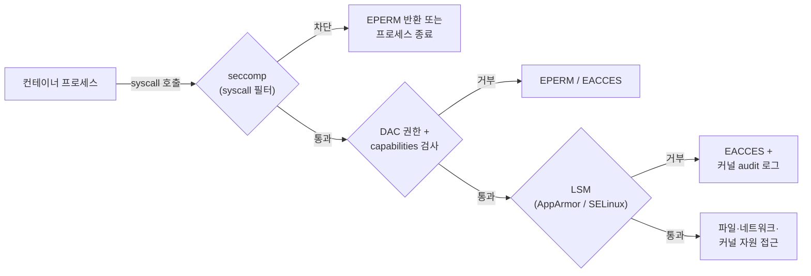

# CKS Domain 3: System Hardening (10%)

> **핵심 메시지**: System Hardening은 "컨테이너가 결국 호스트 커널 위의 프로세스"라는 사실에서 출발합니다.
> 호스트 자체의 공격 표면(서비스·패키지·포트·사용자)을 줄이고, 컨테이너 프로세스가 커널에 할 수 있는 일을 seccomp·AppArmor·capabilities로 좁히는 것이 이 도메인의 전부입니다.
> 시험에서는 **AppArmor와 seccomp 프로파일을 노드에 올리고 Pod에 적용하는 문제**가 가장 자주 나오는 유형이므로 여기에 학습 시간을 가장 많이 씁니다.

- 기준: Kubernetes v1.35 시험 환경, Ubuntu 노드, containerd 런타임 (2026-10 기준)
- 시험 환경 버전은 최신 마이너 출시 후 4~8주 안에 올라가므로 응시 직전에 다시 확인합니다.
- 다른 도메인과 겹치는 내용(NetworkPolicy, RBAC, Pod Security Standards)은 이 문서에서 연결 지점만 다룹니다.

---

## 목차

- [0. 도메인 개요](#0-도메인-개요)
- [1. 큰 그림: 컨테이너 프로세스가 통과하는 방어 계층](#1-큰-그림-컨테이너-프로세스가-통과하는-방어-계층)
- [2. 호스트 OS 풋프린트 최소화](#2-호스트-os-풋프린트-최소화)
- [3. 최소 권한 IAM](#3-최소-권한-iam)
- [4. 네트워크 외부 접근 최소화](#4-네트워크-외부-접근-최소화)
- [5. 커널 하드닝 도구 ① AppArmor](#5-커널-하드닝-도구--apparmor)
- [6. 커널 하드닝 도구 ② seccomp](#6-커널-하드닝-도구--seccomp)
- [7. 커널 하드닝 도구 ③ Linux capabilities와 securityContext](#7-커널-하드닝-도구--linux-capabilities와-securitycontext)
- [8. 시험 실전 플레이북](#8-시험-실전-플레이북)
- [9. 연습 문제 (풀이 포함)](#9-연습-문제-풀이-포함)
- [10. 자가 점검 Q&A](#10-자가-점검-qa)
- [11. 시험 전날 치트시트](#11-시험-전날-치트시트)
- [12. 참고 문서](#12-참고-문서)

---

## 0. 도메인 개요

### 0.1 공식 역량(competency)과 시험에서의 형태

| 공식 역량 | 의미 | 시험에서 나오는 형태 (경향) |
|---|---|---|
| Minimize host OS footprint (reduce attack surface) | 노드에서 필요 없는 것을 없앤다 | 불필요한 서비스 중지·비활성화, 패키지 삭제, 특정 포트를 여는 프로세스를 찾아 제거 |
| Using least-privilege identity and access management | 사람·프로세스·노드에 필요한 권한만 준다 | Linux 사용자/그룹/sudo 정리, 컨테이너를 non-root로 실행, 클라우드 노드 IAM·메타데이터 접근 제한 |
| Minimize external access to the network | 노드와 컴포넌트가 외부에 노출되는 면을 줄인다 | 호스트 방화벽(UFW) 규칙, 컴포넌트 bind 주소, hostNetwork·hostPort·NodePort 점검 |
| Appropriately use kernel hardening tools such as AppArmor, seccomp | 커널 수준에서 프로세스 행위를 제한한다 | AppArmor 프로파일 로드 후 Pod/Deployment 적용, seccomp 프로파일 배치 후 Pod 적용, kubelet 기본 seccomp 활성화 |

> 2024-10-15 개정 이전에는 이 도메인 비중이 15%였습니다. 오래된 자료의 비중 표기는 무시합니다.

### 0.2 학습 우선순위 (개인 판단)

| 우선순위 | 주제 | 이유 |
|---|---|---|
| ★★★ | AppArmor, seccomp | 거의 매 시험 출제되는 유형이고, 노드 작업과 YAML 작업이 섞여 실수가 잦음. Domain 4(Pod Security), Domain 6(런타임 보안)과도 연결됨 |
| ★★★ | securityContext 전반 (capabilities, runAsNonRoot, readOnlyRootFilesystem, allowPrivilegeEscalation) | Domain 4와 공통. 여러 도메인 문제에 부분 점수로 계속 등장 |
| ★★ | 포트 → 프로세스 → 바이너리 추적 후 제거 | 명령 몇 개만 알면 빠르게 점수를 얻는 유형 |
| ★★ | 서비스·패키지 정리 | 위와 같음 |
| ★ | 사용자·sudo·SSH 정리, UFW | 출제 빈도는 낮지만 실수하면 노드 접속을 잃는 위험 작업 |

### 0.3 LFS260 실습과의 연결

LFS260 실습 자료 가운데 이 도메인과 직접 연결되는 실습은 다음과 같습니다. 실습 내용 자체는 이 문서에 옮기지 않았으므로 원본으로 함께 학습합니다.

| LFS260 실습 | 이 문서의 연결 섹션 |
|---|---|
| Lab 5.3 Security Context | [7. capabilities와 securityContext](#7-커널-하드닝-도구--linux-capabilities와-securitycontext) |
| Lab 5.4 Pod Security Admission (restricted 위반 메시지에 seccomp·capabilities 요구사항이 나옴) | [6.6](#66-pod-security-standards와의-관계), [7.4](#74-하드닝된-pod-템플릿) |
| Lab 7.6 AppArmor 프로파일 (aa-genprof, disable/enable) | [5. AppArmor](#5-커널-하드닝-도구--apparmor) |
| Lab 9.2 Practice Steps 11번 (컨테이너용 최소 권한 AppArmor 프로파일 작성) | [9. 연습 문제](#9-연습-문제-풀이-포함) |
| Lab 2.4 CIS Benchmarks, Lab 4.4 kube-bench | [3.5](#35-쿠버네티스-구성-파일-권한), [4.4](#44-컴포넌트-bind-주소와-불필요한-포트) |

---

## 1. 큰 그림: 컨테이너 프로세스가 통과하는 방어 계층

> **핵심**: 컨테이너 안의 프로세스가 커널 자원에 접근하려면 seccomp → 권한 검사(DAC·capabilities) → LSM(AppArmor/SELinux)을 차례로 통과해야 합니다. 각 계층은 서로를 대체하지 않고 **겹쳐서** 씁니다.



(개념을 단순화한 그림입니다. 실제 커널에서는 capabilities 검사도 LSM 훅 체계 안에서 이뤄집니다.)

### 1.1 메커니즘 비교

| 메커니즘 | 무엇을 제한하나 | 단위 | Kubernetes 필드 | 노드 쪽 준비 |
|---|---|---|---|---|
| **seccomp** | 호출할 수 있는 **syscall** 자체 | 프로세스 (필터는 자식에게 상속) | `securityContext.seccompProfile` | Localhost 프로파일이면 `/var/lib/kubelet/seccomp/` 아래 JSON 파일 배치 |
| **capabilities** | root 권한을 쪼갠 **특권 단위** (CAP_NET_ADMIN 등) | 스레드 | `securityContext.capabilities.add/drop` | 없음 |
| **AppArmor** | **경로 기반** 파일 접근, 네트워크 종류, capability, mount 등 | 프로파일 (실행 파일 또는 이름으로 부착) | `securityContext.appArmorProfile` | 프로파일을 커널에 **로드**해 둬야 함 (`apparmor_parser`) |
| **SELinux** | **레이블 기반** 접근 제어 | 프로세스·파일 레이블 | `securityContext.seLinuxOptions` | SELinux 활성 노드 (RHEL 계열). CKS 시험 노드(Ubuntu)는 보통 AppArmor |
| **user namespace** | 컨테이너의 UID 0을 호스트의 비특권 UID로 매핑 | Pod | `spec.hostUsers: false` | containerd 2.0+ 등 런타임과 커널 지원 필요 |
| **no_new_privs** | setuid 바이너리 등으로 권한이 **늘어나는 것** 차단 | 프로세스 | `allowPrivilegeEscalation: false` | 없음 |

### 1.2 꼭 기억할 관계

- `privileged: true`이면 모든 capability가 부여되고 호스트 디바이스에 접근할 수 있으며, **seccomp 프로파일이 적용되지 않습니다** (Kubernetes 문서: privileged 컨테이너는 항상 Unconfined로 실행). 하드닝 문제에서 privileged 컨테이너가 보이면 먼저 의심합니다.
- seccomp는 "어떤 syscall을 부를 수 있는가", AppArmor는 "어떤 대상(경로·소켓)에 대해 무엇을 할 수 있는가"입니다. `mkdir` syscall을 막는 건 seccomp, `/etc` 아래 쓰기를 막는 건 AppArmor가 자연스럽습니다.
- 둘 다 **노드 로컬 리소스**입니다. Pod가 스케줄된 노드에 프로파일이 없으면 컨테이너가 시작되지 않습니다. 시험 문제가 특정 노드를 지정하는 이유입니다.

---

## 2. 호스트 OS 풋프린트 최소화

> **핵심**: 노드에서 돌고 있는 것, 설치된 것, 열려 있는 것 하나하나가 공격 표면입니다. 시험에서는 "이 노드에서 불필요한 X를 찾아 제거하라"는 형태로 나오며, **찾기 → 소유자 확인 → 중지 → 영구 비활성화/삭제 → 검증** 순서를 몸에 익히면 됩니다.

### 2.1 원칙

- 컨테이너 전용 노드에는 kubelet, 컨테이너 런타임, CNI 에이전트, 로깅·모니터링 에이전트, SSH 정도만 있어야 합니다.
- 범용 OS 대신 컨테이너 최적화 OS(Bottlerocket, Flatcar, Talos 등)를 쓰는 것도 풋프린트 최소화 전략입니다. 시험에서는 개념으로만 알아둡니다.
- 제거 작업은 **영구 반영**까지가 정답입니다. `kill`만 하고 끝내면 재부팅이나 서비스 재시작으로 되살아납니다.

### 2.2 실행 중인 서비스 정리

```bash
# 실행 중인 서비스
systemctl list-units --type=service --state=running

# 부팅 시 자동 시작되는 서비스
systemctl list-unit-files --type=service --state=enabled

# 특정 서비스 상태와 유닛 파일 위치
systemctl status <svc>
systemctl cat <svc>

# 중지 + 부팅 시 비활성화 (한 번에)
systemctl disable --now <svc>

# 다른 유닛이 의존성으로 다시 띄우는 것까지 막으려면 mask
systemctl mask <svc>        # /etc/systemd/system/<svc>.service -> /dev/null 심볼릭 링크

# 검증
systemctl is-active <svc>   # inactive
systemctl is-enabled <svc>  # disabled 또는 masked
```

- 소켓 활성화 서비스는 `.socket` 유닛도 같이 확인합니다. 서비스만 끄면 소켓으로 다시 깨어날 수 있습니다.

```bash
systemctl list-units --type=socket
systemctl disable --now <svc>.socket <svc>.service
```

### 2.3 불필요한 패키지 제거

```bash
# 설치 여부 확인
apt list --installed 2>/dev/null | grep -i <name>
dpkg -l | grep -i <name>

# 바이너리가 어느 패키지 소속인지
dpkg -S /usr/sbin/<binary>

# 패키지 제거 (설정 파일까지)
apt-get purge -y <package>
apt-get autoremove -y
```

- 패키지에 속하지 않은 바이너리(`dpkg -S`가 "no path found")는 누군가 직접 넣은 것이므로, 문제 조건에 맞으면 파일을 지웁니다.

### 2.4 열린 포트 → 프로세스 → 바이너리 추적 (자주 나오는 유형)

```bash
# 1) 리스닝 포트와 프로세스 확인 (netstat은 없을 수 있음)
ss -tulpn
ss -tulpn | grep ':<port>'

# lsof가 있으면 다른 방법으로 교차 확인
lsof -i :<port>

# 2) PID로 실제 실행 파일과 명령행 확인
ls -l /proc/<pid>/exe
tr '\0' ' ' < /proc/<pid>/cmdline; echo
ps -fp <pid>

# 3) 이 프로세스를 관리하는 systemd 유닛 찾기 (PID를 그대로 넣어도 됨)
systemctl status <pid>

# 4) 영구 제거
systemctl disable --now <unit>      # 유닛이 있으면
kill <pid>                          # 유닛이 없으면
rm -f <binary-path>                 # 문제에서 바이너리 삭제를 요구하면

# 5) 검증
ss -tulpn | grep ':<port>'          # 출력이 없어야 함
```

- `ls -l /proc/<pid>/exe`는 바이너리가 이미 삭제됐어도 `(deleted)` 표시와 함께 경로를 보여 줍니다.
- 컨테이너 안 프로세스가 노드 포트를 열고 있다면 그 Pod는 `hostNetwork: true` 또는 `hostPort`를 쓰고 있을 가능성이 큽니다. 이때는 노드에서 프로세스를 죽이는 것이 아니라 Pod/워크로드를 고쳐야 합니다 ([4.5](#45-hostnetworkhostporthostpid-점검)).

### 2.5 커널 모듈 정리

```bash
# 로드된 모듈 확인
lsmod | grep -E 'sctp|dccp|rds|tipc'

# 즉시 언로드
modprobe -r sctp

# 영구 차단: /etc/modprobe.d/ 아래 파일 작성
cat <<'EOF' > /etc/modprobe.d/k8s-hardening.conf
blacklist sctp
install sctp /bin/false
EOF
```

| 지시어 | 효과 |
|---|---|
| `blacklist <mod>` | alias 기반 **자동** 로드만 막음. `modprobe <mod>`로 직접 로드하면 여전히 로드됨 |
| `install <mod> /bin/false` | `modprobe <mod>` 실행 시 실제 로드 대신 `/bin/false`를 실행해 **명시적 로드도 실패**시킴 |

- CIS 계열 가이드는 두 줄을 함께 쓰는 형태를 권장합니다.
- initramfs에 포함된 모듈이면 `update-initramfs -u`가 필요할 수 있습니다.

### 2.6 SUID 바이너리와 기타 점검

```bash
# SUID/SGID 바이너리 목록 (권한 상승 경로)
find / -xdev \( -perm -4000 -o -perm -2000 \) -type f 2>/dev/null

# 예약 작업
ls -la /etc/cron.* /var/spool/cron/crontabs 2>/dev/null
systemctl list-timers
```

### 2.7 커널 파라미터(sysctl)

> **핵심**: 노드 sysctl은 하드닝 대상이지만, Kubernetes가 **필요로 하는 값은 건드리면 안 됩니다**.

| 구분 | 예 | 메모 |
|---|---|---|
| 끄면 안 되는 값 | `net.ipv4.ip_forward=1`, `net.bridge.bridge-nf-call-iptables=1` (CNI에 따라) | 끄면 Pod 네트워크가 깨짐 |
| 일반 하드닝 예 | `kernel.kptr_restrict=2`, `kernel.dmesg_restrict=1`, `net.ipv4.conf.all.accept_redirects=0`, `net.ipv4.conf.all.send_redirects=0` | `/etc/sysctl.d/*.conf`에 쓰고 `sysctl --system` |
| kubelet `protectKernelDefaults: true` | kubelet이 기대하는 커널 값(`vm.overcommit_memory=1`, `kernel.panic=10`, `kernel.panic_on_oops=1` 등)과 다르면 kubelet이 **기동 실패** | CIS kubelet 항목. 켜기 전에 sysctl 값을 먼저 맞춤 |

Pod 단위 sysctl은 별도 규칙이 있습니다.

- `spec.securityContext.sysctls`로 설정하며, **safe sysctl**만 기본 허용됩니다 (`kernel.shm_rmid_forced`, `net.ipv4.ip_local_port_range`, `net.ipv4.tcp_syncookies`, `net.ipv4.ping_group_range`, `net.ipv4.ip_unprivileged_port_start` 등).
- unsafe sysctl은 kubelet `allowedUnsafeSysctls`로 노드별 허용이 필요하고, 허용되지 않은 노드에서는 Pod가 `SysctlForbidden`으로 실패합니다.
- Pod Security Standards baseline은 safe sysctl 외 사용을 금지합니다.

---

## 3. 최소 권한 IAM

> **핵심**: 시험에서 "IAM"은 클라우드 IAM만 뜻하지 않습니다. **노드에 로그인할 수 있는 사람**, **컨테이너 프로세스가 가진 사용자 ID**, **노드가 클라우드에 대해 가진 권한** 세 층을 모두 최소화하는 것이 범위입니다. Kubernetes API 권한(RBAC, ServiceAccount)은 Domain 2 Cluster Hardening에서 다룹니다.

| 층 | 대상 | 이 문서 위치 |
|---|---|---|
| 노드 OS | Linux 사용자, 그룹, sudo, SSH | 3.1~3.3 |
| 노드 구성 파일 | kubelet·PKI·etcd 파일 권한 | 3.5 |
| 워크로드 | 컨테이너의 UID/GID, user namespace | 3.6 |
| 클라우드 | 노드 인스턴스 역할, 메타데이터 서비스 | 3.4 |

### 3.1 Linux 사용자·그룹 점검

```bash
# UID 0 계정 (root 외에 있으면 의심)
awk -F: '$3 == 0 {print $1}' /etc/passwd

# 로그인 가능한 셸을 가진 계정
awk -F: '$7 !~ /(nologin|false)$/ {print $1, $7}' /etc/passwd

# 특권 그룹 멤버
getent group sudo
getent group docker      # docker 그룹 = 사실상 root
getent group adm

# 사용자의 그룹과 sudo 권한
id <user>
sudo -l -U <user>

# sudoers 전체
grep -Ev '^\s*(#|$)' /etc/sudoers /etc/sudoers.d/* 2>/dev/null
```

> `docker` 그룹 멤버는 `docker run -v /:/host --privileged ...`로 호스트 root를 얻을 수 있습니다. containerd 소켓(`/run/containerd/containerd.sock`)에 쓰기 권한이 있는 사용자도 마찬가지입니다.

### 3.2 권한 축소 명령

```bash
# 그룹에서 제거
gpasswd -d <user> sudo
# 또는
deluser <user> docker

# 비밀번호 로그인 잠금 (주의: SSH 키 로그인은 막지 못함)
usermod -L <user>

# 셸 로그인 차단
usermod -s /usr/sbin/nologin <user>

# 계정 만료 (PAM account 단계에서 키 로그인까지 차단)
chage -E 0 <user>

# 계정 삭제 (홈 디렉터리 포함)
userdel -r <user>

# sudoers 수정은 반드시 visudo 계열로
visudo -f /etc/sudoers.d/<file>
visudo -c                          # 문법 검사
```

| 목표 | 충분한 조치 |
|---|---|
| 비밀번호 로그인만 막기 | `usermod -L` |
| SSH 키 로그인까지 막기 | `usermod -s /usr/sbin/nologin` 또는 `chage -E 0`, 그리고 `~/.ssh/authorized_keys` 제거 |
| 특권 제거 | 특권 그룹에서 제거 + `/etc/sudoers.d/` 항목 제거 |

### 3.3 SSH 하드닝

```bash
# 효과적으로 적용 중인 설정 확인 (파일보다 이걸 믿음)
sshd -T | grep -Ei 'permitrootlogin|passwordauthentication|pubkeyauthentication|allowusers|x11forwarding'
```

권장 값 예시 (`/etc/ssh/sshd_config.d/10-hardening.conf`):

```text
PermitRootLogin no
PasswordAuthentication no
KbdInteractiveAuthentication no
PubkeyAuthentication yes
X11Forwarding no
AllowTcpForwarding no
AllowUsers ops-admin
```

```bash
sshd -t && systemctl restart ssh     # Ubuntu 유닛 이름은 ssh (RHEL 계열은 sshd)
```

- **함정**: Ubuntu는 `/etc/ssh/sshd_config.d/*.conf`를 메인 파일보다 먼저 읽고, OpenSSH는 **처음 나온 값이 우선**입니다. cloud-init이 만든 `50-cloud-init.conf`에 `PasswordAuthentication yes`가 있으면 메인 파일을 고쳐도 적용되지 않습니다. 그래서 `sshd -T`로 확인합니다.
- **시험 주의**: 시험은 base 노드에서 `ssh <node>`로 각 노드에 접속하는 구조입니다. SSH 설정을 잘못 바꾸면 그 노드에 다시 들어갈 수 없습니다. 문제에서 요구한 항목만 바꾸고, 재시작 전에 `sshd -t`를 꼭 돌립니다.

### 3.4 클라우드 IAM과 메타데이터 서비스

> **핵심**: 노드에 붙은 클라우드 역할은 그 노드의 모든 Pod가 메타데이터 서비스(169.254.169.254)를 통해 빌려 쓸 수 있습니다. 노드 역할을 최소화하고, Pod에서 메타데이터 엔드포인트로 가는 경로를 막습니다.

- 노드 인스턴스 역할에는 노드 운영에 필요한 권한만 둡니다. 워크로드용 클라우드 권한은 워크로드 아이덴티티(IRSA, GKE Workload Identity, Azure Workload Identity 등)로 Pod 단위로 분리합니다.
- AWS는 IMDSv2 강제와 hop limit 1 설정으로 컨테이너에서의 접근을 어렵게 만들 수 있습니다.
- Pod → 메타데이터 차단은 NetworkPolicy egress로 합니다 (Domain 1 Cluster Setup "노드 메타데이터 보호"와 같은 주제).

```yaml
apiVersion: networking.k8s.io/v1
kind: NetworkPolicy
metadata:
  name: deny-cloud-metadata
  namespace: app
spec:
  podSelector: {}
  policyTypes: ["Egress"]
  egress:
  - to:
    - ipBlock:
        cidr: 0.0.0.0/0
        except:
        - 169.254.169.254/32
```

- egress 정책을 만들면 명시하지 않은 egress는 모두 막히므로, 위처럼 "나머지는 허용"을 함께 쓰는 형태가 기본입니다.
- `ipBlock`은 원래 클러스터 외부 IP용이라 Pod IP나 Service IP에 대한 동작은 CNI마다 다를 수 있습니다. DNS가 안 되면 kube-dns로 가는 egress 규칙을 따로 추가합니다.

> **실무 연결 (OpenStack 기반 클러스터)**: OpenStack Nova 메타데이터 서비스도 같은 169.254.169.254를 씁니다. Cluster API(CAPO) 같은 방식으로 만든 노드는 kubeadm 부트스트랩 데이터가 user_data로 전달되고, 컨트롤 플레인 노드라면 인증서 같은 민감 정보가 포함될 수 있습니다. 실제 환경에서 `curl http://169.254.169.254/openstack/latest/user_data`가 Pod에서 되는지 직접 확인해 보고, 위와 같은 egress 차단(또는 Cilium의 CIDR 정책)을 검토할 만합니다.

### 3.5 쿠버네티스 구성 파일 권한

kube-bench(CIS Kubernetes Benchmark)가 점검하는 항목과 겹칩니다. 대표 값만 기억합니다.

| 파일 | 권장 권한 | 소유자 |
|---|---|---|
| `/etc/kubernetes/manifests/*.yaml` (static Pod) | 600 이하 | root:root |
| `/etc/kubernetes/admin.conf`, `super-admin.conf`, `scheduler.conf`, `controller-manager.conf` | 600 이하 | root:root |
| `/etc/kubernetes/kubelet.conf` | 600 이하 | root:root |
| `/var/lib/kubelet/config.yaml` | 600 이하 | root:root |
| `/etc/kubernetes/pki/*.key` | 600 | root:root |
| `/var/lib/etcd` 디렉터리 | 700 | etcd:etcd (kubeadm 기본은 root) |

```bash
stat -c '%a %U:%G %n' /etc/kubernetes/*.conf /etc/kubernetes/pki/*.key
chmod 600 <file>
```

### 3.6 컨테이너 프로세스의 사용자 ID

```yaml
spec:
  securityContext:
    runAsNonRoot: true      # 이미지가 root로 실행되려 하면 kubelet이 컨테이너 시작을 거부
    runAsUser: 10001
    runAsGroup: 10001
    fsGroup: 10001          # 볼륨 그룹 소유권
```

- `runAsNonRoot: true`만 쓰고 `runAsUser`를 안 주면, 이미지의 `USER`가 숫자 UID가 아닐 때(예: `USER nginx`) kubelet이 non-root인지 판단하지 못해 시작을 거부합니다. 이럴 땐 `runAsUser`를 숫자로 지정합니다.
- **user namespace** (`spec.hostUsers: false`): 컨테이너 안에서는 root(UID 0)지만 호스트에서는 비특권 UID로 매핑됩니다. v1.33부터 기본 활성화, v1.35 기준 beta이며 containerd 2.0 이상 같은 런타임 지원이 필요합니다. 컨테이너 탈출 계열 CVE 다수를 완화하므로 개념과 필드 이름은 알아둡니다.

```yaml
spec:
  hostUsers: false
```

---

## 4. 네트워크 외부 접근 최소화

> **핵심**: 외부 노출은 클라우드 보안 그룹 → 호스트 방화벽 → 컴포넌트 bind 주소 → Pod 네트워크 설정(hostNetwork/hostPort/NodePort) → NetworkPolicy의 여러 층에서 줄일 수 있습니다. 이 도메인은 **노드 쪽 층**(호스트 방화벽, bind 주소, host 네임스페이스 사용)에 초점이 있습니다.

### 4.1 Kubernetes가 필요로 하는 포트

컨트롤 플레인 노드:

| 프로토콜 | 포트 | 용도 | 접근 주체 |
|---|---|---|---|
| TCP | 6443 | kube-apiserver | 전체 (외부 노출 최소화 대상) |
| TCP | 2379-2380 | etcd 클라이언트·피어 | kube-apiserver, etcd |
| TCP | 10250 | kubelet API | 자기 자신, 컨트롤 플레인 |
| TCP | 10259 | kube-scheduler | 자기 자신 |
| TCP | 10257 | kube-controller-manager | 자기 자신 |

워커 노드:

| 프로토콜 | 포트 | 용도 | 접근 주체 |
|---|---|---|---|
| TCP | 10250 | kubelet API | 자기 자신, 컨트롤 플레인 |
| TCP | 10256 | kube-proxy 헬스체크 | 자기 자신, 로드밸런서 |
| TCP/UDP | 30000-32767 | NodePort Service | 전체 |

- CNI별 추가 포트가 있습니다 (예: Cilium VXLAN 8472/UDP, Cilium health 4240/TCP, Calico BGP 179/TCP).
- **10255** (kubelet read-only, 인증 없음)는 열려 있으면 안 됩니다. kubeadm 기본 설정은 `readOnlyPort: 0`입니다.

### 4.2 호스트 방화벽: UFW

```bash
ufw status verbose

# 기본 정책
ufw default deny incoming
ufw default allow outgoing

# SSH를 먼저 허용 (순서가 바뀌면 접속이 끊김)
ufw allow 22/tcp

# 필요한 포트만 허용, 가능하면 출발지 제한
ufw allow 6443/tcp
ufw allow from 10.0.0.0/24 to any port 10250 proto tcp
ufw allow from 10.0.0.0/24 to any port 2379:2380 proto tcp

ufw enable

# 규칙 번호 보고 삭제
ufw status numbered
ufw delete <번호>
```

- kube-proxy(iptables/nftables 모드)와 CNI는 자체 체인을 씁니다. 호스트 방화벽을 켜면 Pod 간 트래픽이나 NodePort가 막힐 수 있으므로, 시험에서는 **문제에서 요구한 규칙만** 넣습니다.
- iptables를 직접 보는 명령: `iptables -S`, `iptables -L INPUT -n --line-numbers`, nftables는 `nft list ruleset`.

### 4.3 외부로 나가는 접근(egress)

- 노드: UFW `default deny outgoing` 후 필요한 대상만 허용할 수 있지만, 이미지 풀·NTP·DNS·클라우드 API를 모두 고려해야 해서 시험에서는 드뭅니다.
- Pod: NetworkPolicy egress (Domain 1). 메타데이터 차단 예시는 [3.4](#34-클라우드-iam과-메타데이터-서비스).

### 4.4 컴포넌트 bind 주소와 불필요한 포트

| 컴포넌트 | 하드닝 설정 | 확인 위치 |
|---|---|---|
| kube-scheduler, kube-controller-manager | `--bind-address=127.0.0.1` (kubeadm 기본값) | `/etc/kubernetes/manifests/*.yaml` |
| kube-apiserver | 필요하면 `--advertise-address`·`--bind-address`를 내부 인터페이스로 | 같은 위치 |
| kubelet | `readOnlyPort: 0`, `authentication.anonymous.enabled: false`, `authorization.mode: Webhook` | `/var/lib/kubelet/config.yaml` |
| etcd | `--listen-client-urls`를 필요한 주소로 제한, 클라이언트 인증서 필수 | `/etc/kubernetes/manifests/etcd.yaml` |

```bash
# 어떤 주소로 리스닝하는지 확인
ss -tlnp | grep -E 'kube|etcd'
```

static Pod 매니페스트를 고치면 kubelet이 자동으로 Pod를 다시 만듭니다. kubelet 설정 파일을 고치면 `systemctl restart kubelet`이 필요합니다.

### 4.5 hostNetwork·hostPort·hostPID 점검

Pod가 호스트 네임스페이스를 쓰면 노드 네트워크·프로세스가 그대로 노출됩니다.

```bash
# hostNetwork 사용 Pod
kubectl get pods -A -o jsonpath='{range .items[?(@.spec.hostNetwork==true)]}{.metadata.namespace}/{.metadata.name}{"\n"}{end}'

# hostPID / hostIPC
kubectl get pods -A -o jsonpath='{range .items[?(@.spec.hostPID==true)]}{.metadata.namespace}/{.metadata.name}{"\n"}{end}'

# hostPort 사용 컨테이너 (jq가 있으면)
kubectl get pods -A -o json | jq -r '.items[] | select(any(.spec.containers[]; any(.ports[]?; .hostPort))) | "\(.metadata.namespace)/\(.metadata.name)"'

# NodePort / LoadBalancer Service
kubectl get svc -A | grep -E 'NodePort|LoadBalancer'
```

- kube-system의 kube-proxy, CNI 에이전트, static Pod(etcd, apiserver 등)는 원래 hostNetwork를 씁니다. 애플리케이션 네임스페이스에서 보이면 의심합니다.

---

## 5. 커널 하드닝 도구 ① AppArmor

> **핵심**: AppArmor는 **경로 기반 강제 접근 제어(MAC)** 입니다. 프로파일을 노드 커널에 **로드**한 뒤, Pod의 `securityContext.appArmorProfile`에서 **프로파일 이름**으로 참조합니다. 시험의 대부분의 실수는 "로드 안 함", "다른 노드에 로드함", "파일 이름과 프로파일 이름 혼동" 세 가지입니다.

### 5.1 개념

| 용어 | 설명 |
|---|---|
| 프로파일 | 프로세스가 접근할 수 있는 파일 경로·권한, 네트워크, capability, mount 등을 정의한 규칙 묶음 |
| enforce 모드 | 위반을 **차단**하고 로그를 남김 |
| complain 모드 | 차단하지 않고 **로그만** 남김 (프로파일 작성 단계에서 사용) |
| unconfined | 프로파일 없이 실행 |
| 프로파일 이름 | `profile <이름> { ... }`의 이름. **파일 이름과 다를 수 있음**. Pod에서는 이 이름을 씀 |

컨테이너 런타임(containerd, CRI-O)은 아무것도 지정하지 않아도 기본 프로파일(`cri-containerd.apparmor.d` 등)을 적용합니다. Kubernetes 1.30부터 AppArmor 설정은 `securityContext.appArmorProfile` 필드로 GA되었습니다.

### 5.2 노드에서 상태 확인

```bash
# 커널 모듈 활성 여부 (Y)
cat /sys/module/apparmor/parameters/enabled

# 로드된 프로파일과 모드 (root 필요)
aa-status          # apparmor_status 와 같음

# 특정 프로파일이 로드됐는지
aa-status | grep <profile-name>
# 또는
grep <profile-name> /sys/kernel/security/apparmor/profiles
```

### 5.3 프로파일 문법

컨테이너용 제한 프로파일 예시입니다. 웹 서버가 동작하는 데 필요한 것은 허용하고, 시스템 경로 쓰기·raw 소켓·mount·위험한 capability를 막습니다.

```text
#include <tunables/global>

profile k8s-web-restricted flags=(attach_disconnected,mediate_deleted) {
  #include <abstractions/base>

  # ---- 기본 허용 (deny 규칙이 항상 우선) ----
  file,
  capability,
  network inet,
  network inet6,
  signal (receive) peer=unconfined,
  signal (send,receive) peer=k8s-web-restricted,

  # ---- 네트워크 제한 ----
  deny network raw,
  deny network packet,

  # ---- 위험 capability 제한 ----
  deny capability sys_admin,
  deny capability sys_module,
  deny capability sys_ptrace,
  deny capability net_admin,

  # ---- 파일시스템 제한 ----
  deny mount,
  deny umount,
  deny /etc/** w,
  deny /usr/** w,
  deny /bin/** w,
  deny /sbin/** w,
  deny /lib/** w,
  deny /root/** rw,
  deny /proc/sys/** w,
  deny /sys/** w,
}
```

| 규칙 | 의미 |
|---|---|
| `#include <tunables/global>` | `@{HOME}` 같은 변수 정의 |
| `#include <abstractions/base>` | 대부분의 프로그램에 필요한 공통 규칙 (libc, /dev/null 등) |
| `flags=(attach_disconnected)` | 컨테이너처럼 마운트 네임스페이스가 분리된 경로를 처리하기 위해 필요 |
| `file,` | 모든 파일 접근 허용 |
| `capability,` | 모든 capability 허용. **AppArmor 프로파일에 capability 규칙이 없으면 capability 사용이 거부**되므로, root로 도는 프로세스(예: nginx 마스터)에는 필요 |
| `signal ...` | 런타임이 컨테이너를 정상 종료할 수 있도록 신호 수신 허용 |
| `deny <path> w,` | 해당 경로 쓰기 금지. `deny`는 허용 규칙보다 우선 |
| 권한 문자 | `r` 읽기, `w` 쓰기, `a` 추가, `x` 실행 (`ix`, `px`, `ux` 등 변형), `m` mmap 실행, `k` 잠금, `l` 링크 |
| 경로 glob | `*`는 한 단계, `**`는 하위 전체 |

가장 단순한 "모든 쓰기 금지" 프로파일 (테스트용):

```text
#include <tunables/global>

profile k8s-no-write flags=(attach_disconnected) {
  #include <abstractions/base>
  file,
  deny /** w,
}
```

### 5.4 프로파일 로드·교체·제거

```bash
# 파일을 표준 위치에 두면 부팅 시 apparmor.service가 자동 로드 (영구 반영)
vi /etc/apparmor.d/k8s-web-restricted

# 로드 (처음)
apparmor_parser -q /etc/apparmor.d/k8s-web-restricted

# 교체 (이미 로드된 프로파일을 수정한 경우)
apparmor_parser -r /etc/apparmor.d/k8s-web-restricted

# 커널에서 제거
apparmor_parser -R /etc/apparmor.d/k8s-web-restricted

# 확인
aa-status | grep k8s-web-restricted
```

apparmor-utils 패키지가 있으면 모드 전환과 프로파일 생성 도구를 쓸 수 있습니다.

```bash
aa-complain /etc/apparmor.d/<profile>     # complain 모드
aa-enforce  /etc/apparmor.d/<profile>     # enforce 모드
aa-disable  /etc/apparmor.d/<profile>     # disable/ 에 링크 + 언로드
aa-genprof  /usr/bin/<program>            # 실행을 관찰하며 프로파일 생성
aa-logprof                                # 로그를 보고 기존 프로파일 보완
```

- 문제에서 프로파일 파일을 `/home/...` 같은 위치로 주는 경우가 있습니다. 그 경로에서 바로 `apparmor_parser`로 로드해도 동작하지만, 재부팅 후 유지되게 하려면 `/etc/apparmor.d/`로 복사해 둡니다.
- 프로파일 이름은 파일 안의 `profile <이름>`입니다. 이름 없이 `/usr/bin/foo { ... }` 형태로 쓰인 프로파일은 그 경로 자체가 이름입니다. 로드 후 `aa-status` 출력에 나온 이름을 그대로 쓰는 것이 가장 안전합니다.

### 5.5 Pod에 적용

```yaml
apiVersion: v1
kind: Pod
metadata:
  name: web
spec:
  nodeName: node01                     # 프로파일을 로드한 노드에 고정 (또는 nodeSelector)
  securityContext:
    appArmorProfile:                   # Pod 수준: 모든 컨테이너 기본값
      type: RuntimeDefault
  containers:
  - name: nginx
    image: nginx:1.27
    securityContext:
      appArmorProfile:                 # 컨테이너 수준: Pod 수준보다 우선
        type: Localhost
        localhostProfile: k8s-web-restricted
```

| `type` | 의미 |
|---|---|
| `RuntimeDefault` | 컨테이너 런타임 기본 프로파일 |
| `Localhost` | 노드에 로드된 프로파일. `localhostProfile`에 **프로파일 이름** 지정 |
| `Unconfined` | AppArmor 미적용 |

Deployment라면 `spec.template.spec` 아래에 같은 형태로 넣습니다. 수정하면 롤링 업데이트로 Pod가 다시 만들어집니다.

```bash
kubectl explain pod.spec.containers.securityContext.appArmorProfile   # 필드 이름이 헷갈릴 때
```

#### 구버전 어노테이션 방식 (참고)

v1.30 이전 자료와 일부 문제 해설은 어노테이션을 씁니다. v1.30부터 deprecated이며, 쓰면 경고가 나옵니다. 새 필드로 답하는 것을 기본으로 하되 읽을 수는 있어야 합니다.

```yaml
metadata:
  annotations:
    container.apparmor.security.beta.kubernetes.io/<컨테이너이름>: localhost/k8s-web-restricted
    # 다른 값: runtime/default, unconfined
```

### 5.6 검증

```bash
# 컨테이너 안에서 현재 적용된 프로파일
kubectl exec web -- cat /proc/1/attr/current
# 출력 예: k8s-web-restricted (enforce)
# 커널에 따라 /proc/1/attr/apparmor/current

# 차단되는 동작을 직접 시도
kubectl exec web -- sh -c 'echo x > /etc/test'
# sh: can't create /etc/test: Permission denied

# 노드에서 차단 로그
journalctl -k | grep -i 'apparmor="DENIED"'
dmesg | grep -i apparmor
# auditd가 있으면 /var/log/audit/audit.log

# 노드에서 런타임 설정 확인
crictl ps --name nginx
crictl inspect <container-id> | grep -i apparmor
```

### 5.7 트러블슈팅

| 증상 | 원인 | 조치 |
|---|---|---|
| Pod가 Running이 안 되고 Events에 AppArmor 프로파일을 찾을 수 없다는 오류 (CreateContainerError 등) | 스케줄된 노드에 프로파일이 로드되지 않음 | `kubectl get pod -o wide`로 노드 확인 → 그 노드에서 `aa-status` → 로드하거나 Pod를 프로파일이 있는 노드로 고정 |
| 로드는 했는데 이름이 안 맞음 | `localhostProfile`에 파일 이름을 씀 | `aa-status`의 이름으로 수정 |
| 컨테이너가 바로 종료되거나 앱 오류 | 프로파일이 너무 엄격 (예: capability 규칙 없음) | 노드 커널 로그의 DENIED 항목 확인 → 규칙 추가 → `apparmor_parser -r` → Pod 재생성 |
| 재부팅 후 Pod 실패 | 프로파일을 `/etc/apparmor.d/` 밖에서만 로드 | 표준 위치에 복사 |
| 프로파일을 고쳤는데 반영 안 됨 | 이미 실행 중인 컨테이너는 이전 정책 유지 | `apparmor_parser -r` 후 Pod 재생성 |

모든 노드에 프로파일을 배포하는 실무 방법으로는 DaemonSet 로더, 구성 관리 도구, **Security Profiles Operator**가 있습니다. Kubernetes 자체는 프로파일을 노드에 로드하는 기능을 제공하지 않습니다.

---

## 6. 커널 하드닝 도구 ② seccomp

> **핵심**: seccomp는 프로세스가 호출할 수 있는 **syscall을 BPF 필터로 제한**합니다. Localhost 프로파일은 kubelet의 seccomp 디렉터리(`/var/lib/kubelet/seccomp/`) 아래 JSON 파일이며, Pod에서는 그 디렉터리 기준 **상대 경로**로 참조합니다.

### 6.1 프로파일 유형

| `type` | 의미 |
|---|---|
| `RuntimeDefault` | 런타임 기본 프로파일. 일반 컨테이너 동작은 허용하면서 `kexec_load`, `reboot`, `mount`(일부 조건), `ptrace`(커널 버전에 따라), `bpf`, `add_key` 등 위험한 syscall을 차단 |
| `Localhost` | 노드의 JSON 프로파일. `localhostProfile`에 상대 경로 지정 |
| `Unconfined` | seccomp 미적용. kubelet `seccompDefault`를 켜지 않으면 **이것이 기본값** |

### 6.2 프로파일 JSON 구조

```json
{
  "defaultAction": "SCMP_ACT_ERRNO",
  "defaultErrnoRet": 1,
  "architectures": ["SCMP_ARCH_X86_64", "SCMP_ARCH_X86", "SCMP_ARCH_X32"],
  "syscalls": [
    {
      "names": ["read", "write", "exit_group"],
      "action": "SCMP_ACT_ALLOW"
    }
  ]
}
```

| 필드 | 설명 |
|---|---|
| `defaultAction` | `syscalls` 목록에 없는 syscall에 적용할 동작 |
| `defaultErrnoRet` | ERRNO 동작일 때 돌려줄 errno (1 = EPERM). 생략하면 EPERM |
| `architectures` | 적용할 아키텍처. 생략 가능 |
| `syscalls[].names` | 대상 syscall 이름 목록 |
| `syscalls[].action` | 해당 syscall에 적용할 동작 |

| 동작 | 효과 |
|---|---|
| `SCMP_ACT_ALLOW` | 허용 |
| `SCMP_ACT_ERRNO` | 실행하지 않고 오류 반환 (보통 "Operation not permitted") |
| `SCMP_ACT_KILL_PROCESS` | 프로세스 종료 (`SCMP_ACT_KILL`은 스레드 종료) |
| `SCMP_ACT_LOG` | 허용하되 커널 로그에 기록 (프로파일 작성용) |
| `SCMP_ACT_TRACE`, `SCMP_ACT_TRAP` | tracer 통지, SIGSYS 발생 (시험에서는 거의 안 씀) |

두 가지 설계 방식:

- **allowlist**: `defaultAction: SCMP_ACT_ERRNO` + 허용할 syscall 나열. 가장 안전하지만 실제 앱용 목록이 길어서 로그·도구로 생성합니다.
- **denylist**: `defaultAction: SCMP_ACT_ALLOW` + 금지할 syscall 나열. 작성은 쉽지만 빠뜨린 위험 syscall이 열려 있습니다.

### 6.3 예제 프로파일 세 가지

노드의 `/var/lib/kubelet/seccomp/profiles/` 아래에 둡니다.

**① 관찰용 (모두 허용하고 기록)** `profiles/audit-all.json`

```json
{
  "defaultAction": "SCMP_ACT_LOG"
}
```

**② denylist (디렉터리 생성·권한 변경 금지)** `profiles/deny-mkdir-chmod.json`

```json
{
  "defaultAction": "SCMP_ACT_ALLOW",
  "syscalls": [
    {
      "names": ["mkdir", "mkdirat", "chmod", "fchmod", "fchmodat", "fchmodat2"],
      "action": "SCMP_ACT_ERRNO"
    }
  ]
}
```

같은 기능의 syscall이 여러 개(예: `mkdir`와 `mkdirat`)인 경우가 많으므로 함께 막습니다. libc와 아키텍처에 따라 실제 호출되는 쪽이 다릅니다.

**③ 모두 차단 (동작 확인용)** `profiles/deny-all.json`

```json
{
  "defaultAction": "SCMP_ACT_ERRNO"
}
```

이 프로파일로는 컨테이너가 아예 시작되지 않습니다. "프로파일이 실제로 적용되는가"를 확인하는 용도입니다.

### 6.4 노드 배치와 Pod 적용

```bash
# 대상 노드에서
mkdir -p /var/lib/kubelet/seccomp/profiles
vi /var/lib/kubelet/seccomp/profiles/deny-mkdir-chmod.json
python3 -m json.tool /var/lib/kubelet/seccomp/profiles/deny-mkdir-chmod.json >/dev/null && echo OK   # JSON 문법 검사
```

```yaml
apiVersion: v1
kind: Pod
metadata:
  name: seccomp-demo
spec:
  nodeName: node01
  securityContext:
    seccompProfile:
      type: Localhost
      localhostProfile: profiles/deny-mkdir-chmod.json   # /var/lib/kubelet/seccomp/ 기준 상대 경로
  containers:
  - name: app
    image: busybox:1.36
    command: ["sleep", "3600"]
    securityContext:
      allowPrivilegeEscalation: false
```

- Pod 수준에 쓰면 모든 컨테이너에, 컨테이너 수준에 쓰면 그 컨테이너에만 적용되며 컨테이너 수준이 우선합니다.
- `localhostProfile`에 절대 경로(`/var/lib/kubelet/seccomp/...`)를 쓰면 안 됩니다.
- kubelet `--root-dir`를 바꾼 환경이면 기준 디렉터리도 `<root-dir>/seccomp`입니다.

### 6.5 검증

```bash
# 컨테이너 안에서 seccomp 모드
kubectl exec seccomp-demo -- grep -E 'Seccomp|NoNewPrivs' /proc/1/status
# Seccomp:          2    <- 0: 미적용, 1: strict, 2: filter(프로파일 적용)
# Seccomp_filters:  1
# NoNewPrivs:       1    <- allowPrivilegeEscalation: false

# 차단 동작 확인
kubectl exec seccomp-demo -- mkdir /tmp/x
# mkdir: can't create directory '/tmp/x': Operation not permitted

# 노드에서 런타임 설정 확인
crictl inspect <container-id> | grep -i -A3 seccomp

# SCMP_ACT_LOG 결과 (auditd 없으면 커널 로그, 있으면 audit.log)
journalctl -k | grep 'type=1326'
grep SECCOMP /var/log/audit/audit.log
```

### 6.6 Pod Security Standards와의 관계

- **restricted** 레벨은 `seccompProfile.type`이 `RuntimeDefault` 또는 `Localhost`이기를 요구합니다 (Pod 또는 모든 컨테이너 수준). LFS260 Lab 5.4의 위반 메시지에서 이 요구사항을 직접 볼 수 있습니다.
- **baseline** 레벨은 `Unconfined`로 명시하는 것만 금지합니다.

### 6.7 kubelet 기본 seccomp 활성화 (seccompDefault)

모든 Pod의 기본값을 `Unconfined` 대신 `RuntimeDefault`로 바꿉니다 (v1.27 GA).

```bash
# 대상 노드에서
vi /var/lib/kubelet/config.yaml
```

```yaml
apiVersion: kubelet.config.k8s.io/v1beta1
kind: KubeletConfiguration
# ...기존 설정...
seccompDefault: true
```

```bash
systemctl restart kubelet
systemctl status kubelet --no-pager
```

- **이미 실행 중인 Pod에는 적용되지 않습니다.** 새로 만든 Pod에서 `/proc/1/status`의 `Seccomp: 2`로 확인합니다.
- `seccompProfile`을 명시한 Pod는 그 값이 우선합니다.
- 플래그 방식(`--seccomp-default`)도 있지만 kubeadm 노드는 config 파일을 고치는 것이 표준입니다.

### 6.8 프로파일을 만드는 방법

| 방법 | 설명 |
|---|---|
| `SCMP_ACT_LOG` 프로파일로 실행 후 로그 수집 | ① 예제처럼 로그만 남기고, 실제 호출된 syscall로 allowlist 작성 |
| `strace -f -c <command>` | 노드나 컨테이너 밖에서 프로그램이 부르는 syscall 통계 |
| Security Profiles Operator | 워크로드를 기록해 seccomp·AppArmor 프로파일을 CRD로 생성·배포 |
| RuntimeDefault에서 시작 | 런타임 기본 프로파일(moby/containerd 저장소에 JSON 공개)을 복사해 더 줄임 |

### 6.9 트러블슈팅

| 증상 | 원인 | 조치 |
|---|---|---|
| Pod 생성 시 컨테이너 시작 실패, Events에 seccomp 프로파일 관련 오류 | 해당 노드에 파일 없음, 경로 오타, JSON 문법 오류 | `kubectl get pod -o wide`로 노드 확인 → 그 노드의 `/var/lib/kubelet/seccomp/` 확인 → `json.tool`로 검사 |
| 적용했는데 `Seccomp: 0` | `privileged: true` 컨테이너이거나 프로파일이 다른 컨테이너에만 적용 | privileged 제거, 적용 수준(Pod/컨테이너) 확인 |
| 컨테이너가 즉시 종료 | 필요한 syscall까지 차단 | `SCMP_ACT_LOG`로 바꿔서 필요한 syscall 확인 |
| 프로파일 수정이 반영 안 됨 | 실행 중인 컨테이너는 시작 시점 필터 유지 | Pod 재생성 |

---

## 7. 커널 하드닝 도구 ③ Linux capabilities와 securityContext

> **핵심**: capabilities는 root 권한을 약 40개 단위로 쪼갠 것입니다. 기본값은 **모두 drop하고 꼭 필요한 것만 add**입니다. securityContext의 다른 필드(allowPrivilegeEscalation, readOnlyRootFilesystem, privileged)와 함께 하나의 하드닝 세트로 외웁니다.

### 7.1 컨테이너 기본 capabilities

containerd/Docker가 기본으로 주는 14개:

`CHOWN, DAC_OVERRIDE, FSETID, FOWNER, MKNOD, NET_RAW, SETGID, SETUID, SETFCAP, SETPCAP, NET_BIND_SERVICE, SYS_CHROOT, KILL, AUDIT_WRITE`

| 위험도 높은 capability | 위험 |
|---|---|
| `SYS_ADMIN` | mount, 네임스페이스 조작 등 "새로운 root". 컨테이너 탈출에 자주 쓰임 |
| `SYS_MODULE` | 커널 모듈 로드 |
| `SYS_PTRACE` | 다른 프로세스 메모리 읽기·조작 |
| `NET_ADMIN` | 네트워크 설정·iptables 변경 |
| `NET_RAW` | raw 소켓 (ARP/ICMP 스푸핑). 기본 포함이므로 drop 대상 |
| `DAC_READ_SEARCH` | 파일 권한 무시하고 읽기 (shocker 공격) |

### 7.2 설정과 검증

```yaml
securityContext:
  capabilities:
    drop: ["ALL"]
    add: ["NET_BIND_SERVICE"]     # 1024 미만 포트 바인딩이 필요할 때만
```

- 이름에 `CAP_` 접두어를 붙이지 않습니다 (`NET_ADMIN`O, `CAP_NET_ADMIN`X).
- capabilities는 **컨테이너 수준에만** 있습니다. Pod 수준 securityContext에는 없습니다.

```bash
kubectl exec <pod> -- grep Cap /proc/1/status
# CapEff: 00000000a80425fb   <- 기본 14개
# CapEff: 0000000000000000   <- 모두 drop

# 노드에서 디코드 (libcap2-bin 패키지)
capsh --decode=00000000a80425fb
```

non-root 사용자로 실행되는 컨테이너는 `add`로 넣은 capability가 effective 집합에 들어가지 않을 수 있습니다 (ambient capability 미지원). 1024 미만 포트가 필요하면 non-root + 높은 포트, 또는 safe sysctl `net.ipv4.ip_unprivileged_port_start`를 검토합니다.

### 7.3 securityContext 필드 정리

| 필드 | 수준 | 하드닝 값 | 메모 |
|---|---|---|---|
| `privileged` | 컨테이너 | `false` | true면 모든 capability + 디바이스 + seccomp 미적용 |
| `allowPrivilegeEscalation` | 컨테이너 | `false` | `no_new_privs` 설정. `privileged: true` 또는 `SYS_ADMIN` add와 함께 false로 두면 API 검증에서 거부됨 |
| `capabilities` | 컨테이너 | `drop: [ALL]` | 필요한 것만 add |
| `readOnlyRootFilesystem` | 컨테이너 | `true` | 쓰기 필요한 경로는 `emptyDir`로 마운트. Domain 6의 "런타임 불변성"과 연결 |
| `runAsNonRoot` | Pod/컨테이너 | `true` | |
| `runAsUser` / `runAsGroup` | Pod/컨테이너 | 0이 아닌 숫자 | |
| `fsGroup` | Pod | 숫자 | 볼륨 그룹 소유권 |
| `seccompProfile` | Pod/컨테이너 | `RuntimeDefault` 이상 | |
| `appArmorProfile` | Pod/컨테이너 | `RuntimeDefault` 이상 | |
| `seLinuxOptions` | Pod/컨테이너 | 환경에 맞게 | SELinux 노드에서만 의미 |
| `procMount` | 컨테이너 | `Default` | `Unmasked`는 /proc 마스킹 해제 |
| `sysctls` | Pod | safe sysctl만 | [2.7](#27-커널-파라미터sysctl) |
| `hostUsers` | Pod spec | `false` | securityContext 밖, `spec` 바로 아래 |
| `hostNetwork` / `hostPID` / `hostIPC` | Pod spec | `false` | securityContext 밖 |
| `automountServiceAccountToken` | Pod spec | 필요 없으면 `false` | Domain 2와 연결 |

Pod 수준과 컨테이너 수준에 같은 필드가 있으면 **컨테이너 수준이 우선**합니다.

### 7.4 하드닝된 Pod 템플릿

시험 중 빠르게 붙여 넣을 수 있도록 외워 두면 좋은 형태입니다.

```yaml
apiVersion: v1
kind: Pod
metadata:
  name: hardened
spec:
  automountServiceAccountToken: false
  # hostUsers: false            # 런타임이 지원하는 환경에서만
  securityContext:
    runAsNonRoot: true
    runAsUser: 10001
    runAsGroup: 10001
    fsGroup: 10001
    seccompProfile:
      type: RuntimeDefault
    appArmorProfile:
      type: RuntimeDefault
  containers:
  - name: app
    image: nginxinc/nginx-unprivileged:1.27
    ports:
    - containerPort: 8080
    securityContext:
      privileged: false
      allowPrivilegeEscalation: false
      readOnlyRootFilesystem: true
      capabilities:
        drop: ["ALL"]
    volumeMounts:
    - name: tmp
      mountPath: /tmp
  volumes:
  - name: tmp
    emptyDir: {}
```

빠르게 만드는 방법:

```bash
kubectl run app --image=nginx --dry-run=client -o yaml > app.yaml
# app.yaml에 securityContext 블록 추가 후
kubectl apply -f app.yaml
```

---

## 8. 시험 실전 플레이북

> **핵심**: 이 도메인 문제는 "노드 작업 + 클러스터 작업"이 섞입니다. **어느 호스트에서 실행해야 하는지**를 먼저 확인하고, 노드 작업은 `ssh` → `sudo -i` → 작업 → 검증 → `exit`로 base 노드까지 돌아오는 흐름을 지킵니다.

### 8.1 공통 절차

```bash
# 1) 문제에서 지정한 컨텍스트로 전환 (문제 상단에 명령이 주어짐)
kubectl config use-context <ctx>

# 2) 노드 작업이 필요하면
ssh <node>
sudo -i
# ... 작업 ...
exit     # root 셸 종료
exit     # 노드 ssh 종료 → base 노드로 복귀 (중첩 ssh 금지)
```

- base 노드에는 kubectl 등 도구가 없을 수 있습니다. 문제에서 안내하는 호스트에서 작업합니다.
- 프로파일·설정 파일을 수정하기 전에 원본을 복사해 둡니다 (`cp file file.bak`). 특히 kubelet config와 static Pod 매니페스트.
- static Pod 매니페스트 백업 파일을 `/etc/kubernetes/manifests/` 안에 두면 kubelet이 그것도 Pod로 띄우려 합니다. 백업은 다른 디렉터리에 둡니다.

### 8.2 유형별 체크리스트

**AppArmor 문제**

1. 문제에서 지정한 노드 확인 (워크로드가 어느 노드로 가는지 포함)
2. 그 노드에 ssh → 프로파일 파일 확인 → `apparmor_parser -q <file>` → `aa-status | grep <name>`
3. 프로파일 이름(`profile <name>`) 기록
4. Pod/Deployment에 `appArmorProfile: {type: Localhost, localhostProfile: <name>}` 추가, 지정 노드로 고정 필요 여부 확인
5. Pod Running 확인 → `cat /proc/1/attr/current`로 프로파일 적용 확인

**seccomp 문제**

1. 지정 노드에 ssh → `/var/lib/kubelet/seccomp/` 아래에 파일 배치 (문제가 경로를 주면 그대로)
2. JSON 문법 확인
3. Pod에 `seccompProfile: {type: Localhost, localhostProfile: <상대경로>}`
4. Pod Running 확인 → `grep Seccomp /proc/1/status`가 2인지 확인

**포트·프로세스·서비스 제거 문제**

1. `ss -tulpn`로 PID 확인 → `/proc/<pid>/exe`로 바이너리 확인
2. `systemctl status <pid>`로 유닛 확인 → `systemctl disable --now`
3. 문제에서 요구하면 바이너리·패키지 삭제
4. `ss`로 포트가 닫혔는지 재확인

**kubelet 설정 문제 (seccompDefault 등)**

1. `/var/lib/kubelet/config.yaml` 백업 → 수정
2. `systemctl restart kubelet` → `systemctl status kubelet` → `kubectl get nodes`로 Ready 확인

### 8.3 자주 하는 실수

- [ ] 프로파일을 **다른 노드**에 로드했다
- [ ] AppArmor `localhostProfile`에 **파일 이름이나 경로**를 넣었다
- [ ] seccomp `localhostProfile`에 **절대 경로**를 넣었다
- [ ] 컨테이너 수준이 필요한데 Pod 수준에만 넣었다 (또는 그 반대)
- [ ] Deployment의 `spec.securityContext`에 넣었다 (정답은 `spec.template.spec.securityContext`)
- [ ] `kill`만 하고 서비스를 `disable`하지 않았다
- [ ] kubelet 설정 수정 후 재시작하지 않았다
- [ ] 이미 실행 중인 Pod가 새 설정을 반영할 거라 기대했다
- [ ] 노드에서 `exit`하지 않고 다음 문제로 넘어가 다음 `ssh`가 중첩됐다
- [ ] `capabilities`에 `CAP_` 접두어를 붙였다

### 8.4 문서 활용

시험 중 kubernetes.io 문서를 볼 수 있습니다 (허용 자료 목록은 응시 전 "CKS Resources Allowed" 페이지에서 확인). 이 도메인에서 바로 찾아갈 페이지:

- Tutorials → Security → **Restrict a Container's Access to Resources with AppArmor**
- Tutorials → Security → **Restrict a Container's Syscalls with seccomp**
- Tasks → Configure Pods and Containers → **Configure a Security Context for a Pod or Container**
- Reference → Networking → **Ports and Protocols**

필드 이름은 문서보다 `kubectl explain`이 빠릅니다.

```bash
kubectl explain pod.spec.securityContext --recursive | less
kubectl explain pod.spec.containers.securityContext.seccompProfile
```

---

## 9. 연습 문제 (풀이 포함)

kubeadm으로 만든 2노드 실습 클러스터(cp, node01) 기준입니다. 먼저 풀어 보고 펼쳐서 확인합니다.

### 문제 1. AppArmor 프로파일 적용

> `node01`의 `/root/profiles/k8s-no-write` 파일에 AppArmor 프로파일이 있습니다. 이 프로파일을 `node01`에 로드하고, `secure` 네임스페이스의 Deployment `writer`(컨테이너 이름 `app`)에 적용하세요. Pod는 `node01`에서만 실행되어야 합니다.

<details>
<summary>풀이</summary>

```bash
ssh node01
sudo -i
cat /root/profiles/k8s-no-write | grep -E '^\s*profile'   # 이름 확인: k8s-no-write
cp /root/profiles/k8s-no-write /etc/apparmor.d/            # 재부팅 대비
apparmor_parser -q /etc/apparmor.d/k8s-no-write
aa-status | grep k8s-no-write
exit; exit
```

```bash
kubectl -n secure edit deploy writer
```

```yaml
spec:
  template:
    spec:
      nodeSelector:
        kubernetes.io/hostname: node01
      containers:
      - name: app
        securityContext:
          appArmorProfile:
            type: Localhost
            localhostProfile: k8s-no-write
```

```bash
kubectl -n secure rollout status deploy writer
kubectl -n secure get pod -o wide
kubectl -n secure exec deploy/writer -- cat /proc/1/attr/current
kubectl -n secure exec deploy/writer -- touch /tmp/x     # Permission denied 기대
```

</details>

### 문제 2. seccomp Localhost 프로파일

> `node01`에 `mkdir` 계열 syscall을 막는 seccomp 프로파일을 `profiles/no-mkdir.json`으로 만들고, `node01`에서 실행되는 Pod `nomkdir`(이미지 `busybox:1.36`, `sleep 3600`)에 적용하세요.

<details>
<summary>풀이</summary>

```bash
ssh node01
sudo -i
mkdir -p /var/lib/kubelet/seccomp/profiles
cat <<'EOF' > /var/lib/kubelet/seccomp/profiles/no-mkdir.json
{
  "defaultAction": "SCMP_ACT_ALLOW",
  "syscalls": [
    { "names": ["mkdir", "mkdirat"], "action": "SCMP_ACT_ERRNO" }
  ]
}
EOF
python3 -m json.tool /var/lib/kubelet/seccomp/profiles/no-mkdir.json >/dev/null && echo OK
exit; exit
```

```yaml
apiVersion: v1
kind: Pod
metadata:
  name: nomkdir
spec:
  nodeName: node01
  securityContext:
    seccompProfile:
      type: Localhost
      localhostProfile: profiles/no-mkdir.json
  containers:
  - name: c
    image: busybox:1.36
    command: ["sleep", "3600"]
```

```bash
kubectl apply -f nomkdir.yaml
kubectl exec nomkdir -- grep Seccomp /proc/1/status   # Seccomp: 2
kubectl exec nomkdir -- mkdir /tmp/a                  # Operation not permitted
```

</details>

### 문제 3. 수상한 리스닝 프로세스 제거

> `node01`에서 TCP 4444 포트를 리스닝하는 프로세스가 있습니다. 이 프로세스를 중지하고 재부팅 후에도 실행되지 않게 하세요. 실행 파일도 삭제하세요.

<details>
<summary>풀이</summary>

```bash
ssh node01
sudo -i
ss -tlnp | grep ':4444'
# users:(("backdoor",pid=2345,fd=3))
ls -l /proc/2345/exe                    # -> /usr/local/bin/backdoor
systemctl status 2345                   # 유닛 이름 확인, 예: sysmon.service
systemctl disable --now sysmon.service
systemctl cat sysmon.service            # 유닛 파일 위치 확인 (필요 시 삭제 후 daemon-reload)
rm -f /usr/local/bin/backdoor
ss -tlnp | grep ':4444'                 # 출력 없음
exit; exit
```

유닛이 없고 cron이나 rc 스크립트로 띄워졌다면 `systemctl list-timers`, `/etc/cron*`, `crontab -l -u <user>`도 확인합니다.

</details>

### 문제 4. kubelet 기본 seccomp

> `node01`의 kubelet이 seccomp 프로파일을 지정하지 않은 모든 새 Pod에 런타임 기본 프로파일을 적용하도록 설정하세요.

<details>
<summary>풀이</summary>

```bash
ssh node01
sudo -i
cp /var/lib/kubelet/config.yaml /root/kubelet-config.yaml.bak
echo 'seccompDefault: true' >> /var/lib/kubelet/config.yaml   # 기존 키가 있으면 값만 수정
grep seccompDefault /var/lib/kubelet/config.yaml
systemctl restart kubelet
systemctl is-active kubelet
exit; exit
```

```bash
kubectl get node node01
kubectl run sc-test --image=busybox:1.36 --overrides='{"spec":{"nodeName":"node01"}}' -- sleep 3600
kubectl exec sc-test -- grep Seccomp /proc/1/status    # Seccomp: 2
```

</details>

### 문제 5. 노드 사용자 정리

> `node01`에서 사용자 `contractor`가 `sudo`와 `docker` 그룹에 속해 있습니다. 두 그룹에서 제거하고, 셸 로그인과 SSH 키 로그인이 모두 불가능하게 하세요. 계정은 삭제하지 마세요.

<details>
<summary>풀이</summary>

```bash
ssh node01
sudo -i
id contractor
gpasswd -d contractor sudo
gpasswd -d contractor docker
usermod -s /usr/sbin/nologin contractor
chage -E 0 contractor
grep -rn contractor /etc/sudoers /etc/sudoers.d/   # 개별 sudoers 항목이 있으면 제거
id contractor
exit; exit
```

</details>

### 문제 6. 하드닝 종합

> `team-a` 네임스페이스의 Pod `legacy`를 다음 조건으로 다시 만드세요: non-root(UID 2000), 권한 상승 금지, 모든 capability 제거, 루트 파일시스템 읽기 전용(`/tmp`는 쓰기 가능), seccomp RuntimeDefault.

<details>
<summary>풀이</summary>

```bash
kubectl -n team-a get pod legacy -o yaml > legacy.yaml
# status, metadata.uid/resourceVersion/creationTimestamp 등 정리 후 아래 필드 추가
kubectl -n team-a delete pod legacy
kubectl apply -f legacy.yaml
```

```yaml
spec:
  securityContext:
    runAsNonRoot: true
    runAsUser: 2000
    seccompProfile:
      type: RuntimeDefault
  containers:
  - name: legacy
    securityContext:
      allowPrivilegeEscalation: false
      readOnlyRootFilesystem: true
      capabilities:
        drop: ["ALL"]
    volumeMounts:
    - name: tmp
      mountPath: /tmp
  volumes:
  - name: tmp
    emptyDir: {}
```

`kubectl replace --force -f legacy.yaml`로 삭제와 재생성을 한 번에 할 수도 있습니다.

</details>

---

## 10. 자가 점검 Q&A

<details>
<summary>Q1. <code>/etc/apparmor.d/web-policy</code> 파일 안에 <code>profile nginx-guard { ... }</code>가 있습니다. <code>localhostProfile</code>에는 무엇을 쓰나요?</summary>

`nginx-guard`. 파일 이름이 아니라 프로파일 이름을 씁니다. 로드 후 `aa-status`에 나오는 이름이 기준입니다.

</details>

<details>
<summary>Q2. seccomp <code>localhostProfile: profiles/a.json</code>은 노드의 어느 파일을 가리키나요?</summary>

`/var/lib/kubelet/seccomp/profiles/a.json` (kubelet root-dir 기본값 기준).

</details>

<details>
<summary>Q3. <code>privileged: true</code> 컨테이너에 seccomp Localhost 프로파일을 지정하면?</summary>

적용되지 않습니다. privileged 컨테이너는 항상 seccomp Unconfined로 실행됩니다.

</details>

<details>
<summary>Q4. AppArmor Localhost 프로파일을 지정한 Pod가 시작되지 않습니다. 가장 먼저 확인할 것은?</summary>

`kubectl get pod -o wide`로 스케줄된 노드를 확인하고, 그 노드에서 `aa-status`로 프로파일이 로드됐는지 봅니다.

</details>

<details>
<summary>Q5. <code>usermod -L</code>만으로 SSH 키 로그인을 막을 수 있나요?</summary>

아니요. 비밀번호 해시만 잠급니다. 셸을 `nologin`으로 바꾸거나 `chage -E 0`으로 계정을 만료시키고 `authorized_keys`를 정리합니다.

</details>

<details>
<summary>Q6. <code>/etc/modprobe.d/</code>에서 <code>blacklist sctp</code>와 <code>install sctp /bin/false</code>의 차이는?</summary>

`blacklist`는 자동 로드만 막고 `modprobe sctp`는 여전히 성공합니다. `install ... /bin/false`는 명시적 로드도 실패시킵니다.

</details>

<details>
<summary>Q7. 컨테이너 안 <code>/proc/1/status</code>의 <code>Seccomp: 0 / 1 / 2</code>는 각각 무엇인가요?</summary>

0 미적용, 1 strict 모드(read/write/exit/sigreturn만 허용), 2 filter 모드(BPF 프로파일 적용).

</details>

<details>
<summary>Q8. kubelet <code>seccompDefault: true</code>를 켜면 이미 실행 중인 Pod도 바뀌나요?</summary>

아니요. 새로 생성되는 Pod부터 적용됩니다.

</details>

<details>
<summary>Q9. <code>allowPrivilegeEscalation: false</code>와 <code>privileged: true</code>를 같이 쓰면?</summary>

API 서버 검증에서 거부됩니다. capabilities에 `SYS_ADMIN`을 add하면서 false로 두는 것도 거부됩니다.

</details>

<details>
<summary>Q10. 사용자가 <code>docker</code> 그룹에 있으면 왜 위험한가요?</summary>

Docker 데몬은 root로 돌고, 그룹 멤버는 데몬 소켓으로 호스트 루트를 마운트한 privileged 컨테이너를 띄울 수 있어 사실상 root입니다.

</details>

<details>
<summary>Q11. kubelet 10255 포트는 무엇이고 어떻게 닫나요?</summary>

인증 없는 read-only API 포트입니다. `/var/lib/kubelet/config.yaml`에서 `readOnlyPort: 0`으로 두고 kubelet을 재시작합니다.

</details>

<details>
<summary>Q12. AppArmor complain 모드와 enforce 모드의 차이, 그리고 각각 언제 쓰나요?</summary>

complain은 위반을 기록만 하고 허용(프로파일 작성·튜닝 단계), enforce는 차단하고 기록(운영 단계)합니다. `aa-complain`, `aa-enforce`로 전환합니다.

</details>

<details>
<summary>Q13. capabilities를 Pod 수준 securityContext에 쓸 수 있나요?</summary>

없습니다. `capabilities`, `privileged`, `allowPrivilegeEscalation`, `readOnlyRootFilesystem`은 컨테이너 수준 필드입니다.

</details>

<details>
<summary>Q14. 노드 프로세스가 4444 포트를 열고 있는데 <code>systemctl status &lt;pid&gt;</code>가 kubepods 슬라이스를 보여 줍니다. 어떻게 해야 하나요?</summary>

컨테이너 프로세스입니다. 노드에서 kill해도 kubelet이 다시 띄우므로, 해당 Pod(대개 `hostNetwork: true`나 `hostPort` 사용)를 찾아 워크로드를 수정하거나 삭제합니다. `crictl ps`, `crictl inspect`로 컨테이너와 Pod를 연결할 수 있습니다.

</details>

---

## 11. 시험 전날 치트시트

```bash
# ===== AppArmor (노드) =====
aa-status | grep <name>
apparmor_parser -q /etc/apparmor.d/<file>     # 로드
apparmor_parser -r /etc/apparmor.d/<file>     # 교체
apparmor_parser -R /etc/apparmor.d/<file>     # 제거
journalctl -k | grep 'apparmor="DENIED"'

# ===== AppArmor (Pod) =====
#   securityContext.appArmorProfile: {type: Localhost, localhostProfile: <프로파일 이름>}
kubectl exec <pod> -- cat /proc/1/attr/current

# ===== seccomp (노드) =====
/var/lib/kubelet/seccomp/<relative-path>.json
python3 -m json.tool <file> >/dev/null
#   kubelet 기본값: /var/lib/kubelet/config.yaml 에 seccompDefault: true → systemctl restart kubelet

# ===== seccomp (Pod) =====
#   securityContext.seccompProfile: {type: Localhost, localhostProfile: profiles/x.json}
kubectl exec <pod> -- grep Seccomp /proc/1/status     # 2 = 적용

# ===== capabilities =====
#   containers[].securityContext.capabilities.drop: ["ALL"]
kubectl exec <pod> -- grep CapEff /proc/1/status
capsh --decode=<hex>

# ===== 포트/프로세스/서비스 =====
ss -tulpn | grep :<port>
ls -l /proc/<pid>/exe
systemctl status <pid>
systemctl disable --now <unit>; systemctl mask <unit>
dpkg -S <path>; apt-get purge -y <pkg>

# ===== 사용자 =====
getent group sudo docker
gpasswd -d <user> <group>
usermod -s /usr/sbin/nologin <user>; chage -E 0 <user>
visudo -c

# ===== 방화벽 =====
ufw allow 22/tcp  # 항상 먼저
ufw default deny incoming; ufw enable; ufw status numbered

# ===== 커널 모듈 =====
echo -e "blacklist sctp\ninstall sctp /bin/false" > /etc/modprobe.d/k8s-hardening.conf
```

---

## 12. 참고 문서

Kubernetes 공식 문서

- AppArmor 튜토리얼: https://kubernetes.io/docs/tutorials/security/apparmor/
- seccomp 튜토리얼: https://kubernetes.io/docs/tutorials/security/seccomp/
- Linux 커널 보안 제약 개요: https://kubernetes.io/docs/concepts/security/linux-kernel-security-constraints/
- Security Context 설정: https://kubernetes.io/docs/tasks/configure-pod-container/security-context/
- Pod Security Standards: https://kubernetes.io/docs/concepts/security/pod-security-standards/
- Ports and Protocols: https://kubernetes.io/docs/reference/networking/ports-and-protocols/
- User Namespaces: https://kubernetes.io/docs/concepts/workloads/pods/user-namespaces/
- sysctl 사용: https://kubernetes.io/docs/tasks/administer-cluster/sysctl-cluster/
- Kubelet 설정 파일: https://kubernetes.io/docs/tasks/administer-cluster/kubelet-config-file/

도구·외부 자료

- AppArmor 문서: https://gitlab.com/apparmor/apparmor/-/wikis/Documentation
- Security Profiles Operator: https://github.com/kubernetes-sigs/security-profiles-operator
- CIS Kubernetes Benchmark: https://www.cisecurity.org/benchmark/kubernetes
- kube-bench: https://github.com/aquasecurity/kube-bench
- CNCF CKS 커리큘럼: https://github.com/cncf/curriculum/tree/master/cks

---

*작성: 2026-10-09. Kubernetes 기능 상태(GA/beta)와 시험 환경 버전은 바뀔 수 있으므로 응시 직전에 공식 문서로 다시 확인합니다.*
