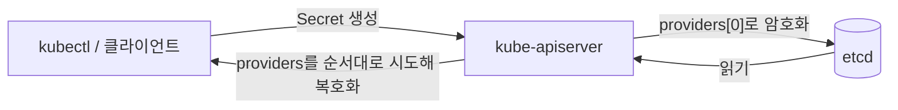

# CKS Domain 4 — Minimize Microservice Vulnerabilities (20%)

> 이 도메인은 **"워크로드가 탈취돼도 피해가 번지지 않게 만드는 법"**을 묻습니다.
> Pod 권한 축소(PSS/SecurityContext), 비밀값 보호(Secrets), 격리(멀티테넌시·샌드박스), 전송 구간 암호화(Pod-to-Pod) 네 축으로 정리합니다.

- 작성 기준일: 2026-10-09
- 대상 시험 환경: Kubernetes v1.35 (LF Important Instructions 기준. 응시 직전 버전 재확인 필요)
- 공식 문서 기준: <https://kubernetes.io/docs/> (시험 중 열람 가능한 범위는 LF "CKS Resources Allowed" 페이지에서 확인)

---

## 목차

- [0. 도메인 개요](#0-도메인-개요)
- [1. Pod Security Standards와 Pod Security Admission](#1-pod-security-standards와-pod-security-admission)
- [2. SecurityContext 상세](#2-securitycontext-상세)
- [3. Secrets 관리](#3-secrets-관리)
- [4. Secret 저장 암호화 (Encryption at Rest)](#4-secret-저장-암호화-encryption-at-rest)
- [5. 격리 기법: 멀티테넌시](#5-격리-기법-멀티테넌시)
- [6. 격리 기법: 샌드박스 컨테이너 (RuntimeClass)](#6-격리-기법-샌드박스-컨테이너-runtimeclass)
- [7. Pod-to-Pod 암호화 (Cilium, Istio, Linkerd)](#7-pod-to-pod-암호화-cilium-istio-linkerd)
- [8. 시험 실전 팁과 함정](#8-시험-실전-팁과-함정)
- [9. 연습 문제 (해답 포함)](#9-연습-문제-해답-포함)
- [10. 자가 점검 체크리스트](#10-자가-점검-체크리스트)
- [11. 참고 문서](#11-참고-문서)

---

## 0. 도메인 개요

### 0.1 공식 역량 (2024-10-15 개정 커리큘럼)

| # | 역량 | 이 문서 섹션 |
|---|---|---|
| 1 | Use appropriate pod security standards | 1, 2 |
| 2 | Manage Kubernetes secrets | 3, 4 |
| 3 | Understand and implement isolation techniques (multi-tenancy, sandboxed containers, etc.) | 5, 6 |
| 4 | Implement Pod-to-Pod encryption (Cilium, Istio) | 7 |

> 구버전 커리큘럼(2024-10 이전)에는 이 도메인에 "OPA Gatekeeper", "OS 수준 보안 도메인 설정" 같은 항목이 있었습니다. 오래된 강의·블로그는 구성이 다르니 위 4개 역량을 기준으로 봅니다.

### 0.2 시험에서 자주 나오는 작업 유형

- 네임스페이스에 PSA 라벨을 붙이고, 위반하는 Deployment를 **고쳐서 다시 Running** 상태로 만들기
- Pod/Deployment의 `securityContext`를 요구 조건(비루트, 읽기 전용 루트 FS, capability 제거 등)에 맞게 수정
- Secret 값을 읽어 파일로 저장, 새 Secret 생성 후 Pod에 볼륨/환경변수로 주입
- kube-apiserver에 `EncryptionConfiguration`을 적용하고 기존 Secret까지 암호화
- `RuntimeClass`를 만들고 특정 워크로드를 gVisor(`runsc`)로 실행
- ServiceAccount 토큰 자동 마운트 비활성화
- Istio `PeerAuthentication` STRICT, Cilium 투명 암호화 상태 확인

### 0.3 LFS260 랩 매핑 (수강 교재 참고용)

| LFS260 Exercise | 관련 섹션 |
|---|---|
| 3.5 Investigate Sandbox Tools / 3.6 Leverage Secure Runtimes | 6 |
| 5.2 Service Accounts | 3.5 |
| 5.3 Security Context | 2 |
| 5.4 Enable Pod Security Admission | 1 |
| 5.7 Encrypting Secrets | 4 |
| 6.1 Implement Network Policy | 5 |
| 6.4 Configure mTLS (Linkerd) | 7.4 |

### 0.4 권장 학습 순서 (2~3일 압축)

1. **1일차**: PSA/PSS → SecurityContext → restricted 통과 매니페스트를 손으로 3번 작성
2. **2일차**: Secret 사용법 → Encryption at Rest를 kubeadm 클러스터에서 처음부터 끝까지 2회 (apiserver 깨뜨렸다 복구하는 연습 포함)
3. **3일차**: RuntimeClass(gVisor) → 멀티테넌시 기본 세트 → Cilium/Istio 검증 명령 → 연습 문제 9장 전체

---

## 1. Pod Security Standards와 Pod Security Admission

> **핵심**: PSS는 "정책 수준 3단계"이고, PSA는 그것을 **네임스페이스 라벨**로 강제하는 내장 Admission Controller입니다. PodSecurityPolicy(PSP)는 v1.25에서 제거됐습니다.

### 1.1 세 가지 프로파일

| 프로파일 | 의도 | 대상 |
|---|---|---|
| `privileged` | 제한 없음 | 시스템/인프라 컴포넌트 (CNI, CSI, 로깅 에이전트 등) |
| `baseline` | 알려진 권한 상승 경로만 차단. 대부분 기본 이미지가 그대로 통과 | 일반 애플리케이션의 최소선 |
| `restricted` | Pod 하드닝 모범 사례 강제. 대부분 이미지가 **수정 없이는 실패** | 보안 민감 워크로드 |

### 1.2 baseline이 막는 것

| 항목 | 허용 조건 |
|---|---|
| Host namespaces | `hostNetwork`, `hostPID`, `hostIPC` 미설정 또는 `false` |
| Privileged | `privileged` 미설정 또는 `false` |
| Capabilities | 기본 집합 외 추가 금지 (`AUDIT_WRITE, CHOWN, DAC_OVERRIDE, FOWNER, FSETID, KILL, MKNOD, NET_BIND_SERVICE, SETFCAP, SETGID, SETPCAP, SETUID, SYS_CHROOT`만 add 가능) |
| HostPath 볼륨 | 금지 |
| Host ports | 금지 (또는 허용 목록, 기본은 금지) |
| AppArmor | `Unconfined` 금지 (`RuntimeDefault`, `Localhost`, 미설정은 허용) |
| SELinux | type은 `container_t` 계열만, user/role 설정 금지 |
| `/proc` mount | `Default`만 |
| Seccomp | `Unconfined` 금지 (미설정은 허용) |
| Sysctls | 안전한 sysctl 집합만 |
| Windows HostProcess | 금지 |

### 1.3 restricted가 추가로 요구하는 것

restricted = baseline 전체 + 아래 항목. **이 5개는 반드시 외웁니다.** 위반 메시지에 그대로 나옵니다.

| 항목 | 요구 조건 | 설정 위치 |
|---|---|---|
| Privilege escalation | `allowPrivilegeEscalation: false` | 컨테이너 (모든 컨테이너, initContainer 포함) |
| Capabilities | `capabilities.drop: ["ALL"]`, add는 `NET_BIND_SERVICE`만 | 컨테이너 |
| Non-root | `runAsNonRoot: true` | Pod 또는 모든 컨테이너 |
| Non-root user | `runAsUser`가 `0`이 아님 | Pod 또는 컨테이너 |
| Seccomp | `seccompProfile.type`이 `RuntimeDefault` 또는 `Localhost` | Pod 또는 모든 컨테이너 |
| 볼륨 타입 | `configMap, csi, downwardAPI, emptyDir, ephemeral, persistentVolumeClaim, projected, secret`만 | Pod |

### 1.4 세 가지 모드와 라벨

| 모드 | 위반 시 동작 | 적용 대상 |
|---|---|---|
| `enforce` | **Pod 생성 거부** | Pod만 |
| `audit` | 감사 로그 이벤트에 annotation 추가 (허용은 함) | Pod + 워크로드 리소스 |
| `warn` | 사용자에게 경고 메시지 출력 (허용은 함) | Pod + 워크로드 리소스 |

라벨 형식:

```text
pod-security.kubernetes.io/<MODE>: <LEVEL>
pod-security.kubernetes.io/<MODE>-version: <VERSION>   # 선택, 기본 latest
```

```yaml
apiVersion: v1
kind: Namespace
metadata:
  name: team-a
  labels:
    pod-security.kubernetes.io/enforce: restricted
    pod-security.kubernetes.io/enforce-version: latest
    pod-security.kubernetes.io/warn: restricted
    pod-security.kubernetes.io/warn-version: latest
    pod-security.kubernetes.io/audit: restricted
    pod-security.kubernetes.io/audit-version: latest
```

명령으로 붙이기:

```bash
kubectl label ns team-a \
  pod-security.kubernetes.io/enforce=restricted \
  pod-security.kubernetes.io/warn=restricted --overwrite

# 기존 Pod 중 위반 대상 미리 확인 (실제 적용 안 함)
kubectl label --dry-run=server --overwrite ns team-a \
  pod-security.kubernetes.io/enforce=restricted

# 클러스터 전체 영향 점검
kubectl label --dry-run=server --overwrite ns --all \
  pod-security.kubernetes.io/enforce=baseline

# 라벨 제거
kubectl label ns team-a pod-security.kubernetes.io/enforce-
```

### 1.5 꼭 알아야 할 동작 특성

- **라벨을 붙여도 이미 실행 중인 Pod는 쫓겨나지 않습니다.** 경고만 나옵니다. 위반 Pod를 정리하려면 재생성(`kubectl rollout restart`, `kubectl delete pod`)이 필요합니다.
- **enforce는 Pod에만 적용됩니다.** Deployment를 만들면 `warn` 경고만 뜨고 Deployment 자체는 생성됩니다. 실제 거부는 ReplicaSet이 Pod를 만들 때 일어나므로 **에러는 ReplicaSet 이벤트에** 남습니다.

  ```bash
  kubectl -n team-a get deploy,rs,pod
  kubectl -n team-a describe rs <rs-name> | tail -20
  kubectl -n team-a get events --sort-by=.lastTimestamp | tail
  ```

  시험에서 "Deployment가 READY 0/1"이면 가장 먼저 RS 이벤트를 봅니다.
- `-version` 라벨을 특정 버전(예: `v1.34`)으로 고정하면 해당 버전의 정책 정의로 평가합니다. 문제에서 버전 지정이 없으면 `latest`(또는 생략).
- `kube-system` 등 시스템 네임스페이스에 baseline 이상을 enforce하면 컨트롤 플레인 static Pod 재생성이 막힐 수 있습니다 (hostNetwork, hostPath 사용).

### 1.6 클러스터 기본값 설정 (AdmissionConfiguration)

네임스페이스 라벨이 없을 때 적용할 기본값과 예외는 kube-apiserver 설정 파일로 지정합니다.

```yaml
# /etc/kubernetes/admission/admission-config.yaml
apiVersion: apiserver.config.k8s.io/v1
kind: AdmissionConfiguration
plugins:
- name: PodSecurity
  configuration:
    apiVersion: pod-security.admission.config.k8s.io/v1
    kind: PodSecurityConfiguration
    defaults:
      enforce: "baseline"
      enforce-version: "latest"
      audit: "restricted"
      audit-version: "latest"
      warn: "restricted"
      warn-version: "latest"
    exemptions:
      usernames: []          # 인증된 사용자명
      runtimeClasses: []     # 예: ["gvisor"]
      namespaces: ["kube-system"]
```

kube-apiserver static Pod에 적용:

```yaml
- --admission-control-config-file=/etc/kubernetes/admission/admission-config.yaml
# + 해당 디렉터리 hostPath volume / volumeMount 추가 (4.4절 참고)
```

> `--admission-control-config-file`은 ImagePolicyWebhook 설정과 **같은 파일**을 씁니다. 이미 파일이 있으면 `plugins:` 아래에 항목을 추가합니다.

### 1.7 위반 메시지 읽고 고치기

전형적인 restricted 위반 메시지:

```text
Error from server (Forbidden): pods "web" is forbidden: violates PodSecurity "restricted:latest":
allowPrivilegeEscalation != false (container "web" must set securityContext.allowPrivilegeEscalation=false),
unrestricted capabilities (container "web" must set securityContext.capabilities.drop=["ALL"]),
runAsNonRoot != true (pod or container "web" must set securityContext.runAsNonRoot=true),
seccompProfile (pod or container "web" must set securityContext.seccompProfile.type to "RuntimeDefault" or "Localhost")
```

메시지에 필요한 필드와 값이 그대로 들어 있으므로 하나씩 반영하면 됩니다.

### 1.8 restricted를 통과하는 기본 템플릿

```yaml
apiVersion: v1
kind: Pod
metadata:
  name: hardened
  namespace: team-a
spec:
  securityContext:
    runAsNonRoot: true
    runAsUser: 10001
    runAsGroup: 10001
    fsGroup: 10001
    seccompProfile:
      type: RuntimeDefault
  automountServiceAccountToken: false
  containers:
  - name: app
    image: busybox:1.36
    command: ["sh", "-c", "sleep 3600"]
    securityContext:
      allowPrivilegeEscalation: false
      readOnlyRootFilesystem: true
      capabilities:
        drop: ["ALL"]
    volumeMounts:
    - name: tmp
      mountPath: /tmp
  volumes:
  - name: tmp
    emptyDir: {}
```

> `readOnlyRootFilesystem`은 restricted 요구 사항은 아니지만 시험 문제에서 자주 함께 요구됩니다. 쓰기가 필요한 경로는 `emptyDir`로 따로 마운트합니다.

### 1.9 PSS 밖의 요구는 정책 엔진으로

PSS는 고정된 3단계라서 "특정 레지스트리만 허용", "라벨 필수" 같은 조직 규칙은 표현할 수 없습니다. 이런 요구는 다음 도구로 보완합니다 (주로 Supply Chain 도메인에서 출제).

- **ValidatingAdmissionPolicy** (내장, CEL 기반, v1.30 GA)
- **OPA Gatekeeper** (LFS260 Exercise 4.5), **Kyverno**

---

## 2. SecurityContext 상세

> **핵심**: PSS는 "검사"만 하고, 실제 설정은 `securityContext`로 합니다. Pod 수준과 컨테이너 수준 필드를 구분하는 것이 시험 실수를 줄이는 지름길입니다.

### 2.1 필드 위치 정리

| 필드 | Pod | Container | 비고 |
|---|:-:|:-:|---|
| `runAsUser`, `runAsGroup`, `runAsNonRoot` | ✅ | ✅ | 둘 다 있으면 **컨테이너 값이 우선** |
| `seccompProfile` | ✅ | ✅ | 컨테이너 값 우선 |
| `seLinuxOptions` | ✅ | ✅ | 컨테이너 값 우선 |
| `appArmorProfile` (v1.30 GA) | ✅ | ✅ | 기존 annotation 방식은 deprecated |
| `fsGroup`, `fsGroupChangePolicy` | ✅ | ❌ | 볼륨 소유 그룹 |
| `supplementalGroups` | ✅ | ❌ | |
| `sysctls` | ✅ | ❌ | |
| `privileged` | ❌ | ✅ | |
| `allowPrivilegeEscalation` | ❌ | ✅ | `privileged: true` 또는 `CAP_SYS_ADMIN`이면 항상 true로 취급 |
| `capabilities` | ❌ | ✅ | |
| `readOnlyRootFilesystem` | ❌ | ✅ | |
| `procMount` | ❌ | ✅ | |

> Pod 수준에 `capabilities`나 `readOnlyRootFilesystem`을 쓰면 `kubectl apply` 시 unknown field 오류가 납니다. 헷갈리면 `kubectl explain`으로 확인합니다.

```bash
kubectl explain pod.spec.securityContext
kubectl explain pod.spec.containers.securityContext
kubectl explain pod.spec.containers.securityContext.capabilities
```

### 2.2 runAsNonRoot의 동작 (자주 틀리는 부분)

- `runAsNonRoot: true`는 **kubelet이 컨테이너 시작 시점에 검사**합니다. Admission은 통과하더라도 실행 단계에서 막힐 수 있습니다.
- `runAsUser`를 지정하지 않으면 이미지의 `USER`를 봅니다.
  - 이미지 USER가 root(0) → `CreateContainerConfigError`: `container has runAsNonRoot and image will run as root`
  - 이미지 USER가 숫자가 아닌 이름 → `image has non-numeric user (...), cannot verify user is non-root`
- 해결: `runAsUser: <0이 아닌 숫자>`를 명시합니다. 단, 이미지가 루트 권한을 요구하면(예: 공식 `nginx`가 80 포트 바인딩, `/var/cache` 쓰기) 앱이 죽을 수 있으므로 비루트 이미지(`nginxinc/nginx-unprivileged` 등)를 쓰거나 쓰기 경로를 `emptyDir`로 열어 줍니다.

### 2.3 Capabilities

```yaml
securityContext:
  capabilities:
    drop: ["ALL"]
    add: ["NET_BIND_SERVICE"]   # 1024 미만 포트가 필요할 때만
```

- 이름에 `CAP_` 접두어를 붙이지 않습니다 (`NET_ADMIN`, `SYS_TIME` 형식).
- 컨테이너 안에서 확인: `grep Cap /proc/1/status` → `capsh --decode=<hex>`로 해석 (노드에서 실행).

### 2.4 seccomp, AppArmor 필드 형식 (System Hardening과 겹침)

```yaml
securityContext:
  seccompProfile:
    type: Localhost
    localhostProfile: profiles/audit.json     # /var/lib/kubelet/seccomp/ 기준 상대 경로
  appArmorProfile:
    type: Localhost
    localhostProfile: k8s-apparmor-example-deny-write   # 노드에 로드된 프로파일 이름
```

### 2.5 검증 명령

```bash
kubectl exec <pod> -- id
kubectl exec <pod> -- sh -c 'touch /test'     # read-only면 "Read-only file system"
kubectl exec <pod> -- grep -E 'Cap(Prm|Eff)|NoNewPrivs|Seccomp' /proc/1/status
kubectl get pod <pod> -o jsonpath='{.spec.securityContext}{"\n"}{.spec.containers[*].securityContext}{"\n"}'
```

`/proc/1/status`의 `NoNewPrivs: 1`은 `allowPrivilegeEscalation: false`, `Seccomp: 2`는 seccomp 필터 적용 상태를 뜻합니다.

### 2.6 User Namespaces (`hostUsers: false`)

- Pod의 UID/GID를 호스트의 비특권 범위로 매핑합니다. 컨테이너 안의 root(0)가 호스트에서는 일반 사용자입니다.
- v1.33부터 기본 활성화(feature state는 beta). containerd 2.0+ 또는 CRI-O 1.25+와 커널·파일시스템 지원이 필요합니다.
- 컨테이너 탈출 계열 CVE의 영향을 줄이는 격리 기법이라 "isolation techniques" 맥락에서 알아 둘 만합니다.

```yaml
spec:
  hostUsers: false
```

```bash
kubectl exec <pod> -- cat /proc/self/uid_map   # "0 <호스트 고UID> 65536" 형태면 적용됨
```

---

## 3. Secrets 관리

> **핵심**: Secret은 기본적으로 **base64 인코딩일 뿐 암호화가 아닙니다.** 보호는 (1) RBAC로 접근 제한, (2) etcd 저장 암호화, (3) 노출 경로(env, SA 토큰) 최소화로 합니다.

### 3.1 생성

```bash
# 일반 (Opaque)
kubectl -n app create secret generic db-cred \
  --from-literal=username=admin --from-literal=password='S3cr3t!'

# 파일에서
kubectl -n app create secret generic app-config --from-file=config.json

# TLS
kubectl -n app create secret tls web-tls --cert=tls.crt --key=tls.key

# 레지스트리 인증
kubectl -n app create secret docker-registry regcred \
  --docker-server=registry.example.com --docker-username=u --docker-password=p
```

| type | 용도 |
|---|---|
| `Opaque` | 일반 키-값 |
| `kubernetes.io/tls` | `tls.crt`, `tls.key` |
| `kubernetes.io/dockerconfigjson` | imagePullSecrets |
| `kubernetes.io/service-account-token` | 장기 SA 토큰 (수동 생성) |
| `kubernetes.io/basic-auth`, `kubernetes.io/ssh-auth` | 형식 검증용 |

### 3.2 읽기 (시험 단골)

```bash
kubectl -n app get secret db-cred -o jsonpath='{.data.password}' | base64 -d
kubectl -n app get secret db-cred -o go-template='{{.data.password | base64decode}}'
kubectl -n app get secret db-cred -o json | jq -r '.data | map_values(@base64d)'

# 결과를 파일로 (개행 주의: base64 -d 결과에는 개행이 없음)
kubectl -n app get secret db-cred -o jsonpath='{.data.password}' | base64 -d > /opt/answer/password.txt
```

### 3.3 Pod에 주입하는 방법 비교

| 방식 | 값 변경 반영 | 노출 위험 | 비고 |
|---|---|---|---|
| 환경변수 (`env`, `envFrom`) | ❌ (재시작 필요) | 높음: `/proc/<pid>/environ`, 크래시 덤프, 로그, 자식 프로세스 상속 | |
| 볼륨 마운트 | ✅ (kubelet 동기화 주기 후) | 낮음: 노드 tmpfs, 파일 권한 제어 가능 | **`subPath` 마운트는 반영 안 됨** |

```yaml
apiVersion: v1
kind: Pod
metadata:
  name: secret-consumer
  namespace: app
spec:
  containers:
  - name: app
    image: busybox:1.36
    command: ["sh", "-c", "sleep 3600"]
    env:
    - name: DB_USER
      valueFrom:
        secretKeyRef:
          name: db-cred
          key: username
    volumeMounts:
    - name: creds
      mountPath: /etc/creds
      readOnly: true
  volumes:
  - name: creds
    secret:
      secretName: db-cred
      defaultMode: 0400
      items:                 # 특정 키만, 파일명 변경
      - key: password
        path: db-password
```

### 3.4 RBAC로 Secret 보호

- `list`나 `watch` 권한만 있어도 **모든 Secret 내용이 보입니다** (`kubectl get secrets -o yaml`). "목록만 보는 권한"이 아닙니다.
- 네임스페이스에서 **Pod를 만들 수 있는 사용자는 그 네임스페이스의 모든 Secret을 마운트해서 읽을 수 있습니다.** Pod 생성 권한 = 간접적인 Secret 읽기 권한.
- 특정 Secret만 허용하려면 `resourceNames`를 씁니다 (`get`에만 의미가 있고 `list`에는 적용되지 않음).

```yaml
apiVersion: rbac.authorization.k8s.io/v1
kind: Role
metadata:
  name: read-one-secret
  namespace: app
rules:
- apiGroups: [""]
  resources: ["secrets"]
  resourceNames: ["db-cred"]
  verbs: ["get"]
```

```bash
kubectl auth can-i list secrets -n app --as system:serviceaccount:app:web
kubectl auth can-i get secret/db-cred -n app --as jane
```

### 3.5 ServiceAccount 토큰 노출 최소화 (Cluster Hardening과 겹침)

- v1.24부터 SA를 만들어도 **장기 토큰 Secret이 자동 생성되지 않습니다.** Pod에는 kubelet이 발급한 **만료되는 projected 토큰**이 마운트됩니다 (`/var/run/secrets/kubernetes.io/serviceaccount/token`).
- API 접근이 필요 없는 Pod는 마운트 자체를 끕니다. **Pod 설정이 SA 설정보다 우선합니다.**

```yaml
# SA 수준
apiVersion: v1
kind: ServiceAccount
metadata:
  name: web
  namespace: app
automountServiceAccountToken: false
---
# Pod 수준 (우선)
spec:
  serviceAccountName: web
  automountServiceAccountToken: false
```

- 특정 audience/짧은 만료 토큰이 필요하면 projected volume을 직접 정의합니다 (`expirationSeconds` 최소 600).

```yaml
volumes:
- name: vault-token
  projected:
    sources:
    - serviceAccountToken:
        path: token
        audience: vault
        expirationSeconds: 3600
```

- 수동 토큰: `kubectl create token web -n app --duration=1h`
- 장기 토큰이 꼭 필요하면 (비권장):

```yaml
apiVersion: v1
kind: Secret
metadata:
  name: web-token
  namespace: app
  annotations:
    kubernetes.io/service-account.name: web
type: kubernetes.io/service-account-token
```

### 3.6 불변 Secret

```yaml
apiVersion: v1
kind: Secret
metadata:
  name: app-key
immutable: true
data:
  key: c2VjcmV0
```

- 실수로 인한 변경을 막고, kubelet의 watch 부하를 줄입니다. 한 번 `immutable: true`로 만들면 되돌릴 수 없고 삭제 후 재생성해야 합니다.

### 3.7 외부 비밀 저장소 (개념)

- **External Secrets Operator**: Vault, AWS/GCP/Azure Secret Manager 값을 Kubernetes Secret으로 동기화
- **Secrets Store CSI Driver**: 외부 저장소 값을 CSI 볼륨으로 직접 마운트 (Secret 객체를 거치지 않는 구성 가능)
- **Vault Agent Injector**: 사이드카가 값을 파일로 렌더링
- **KMS provider**: etcd 저장 암호화의 키를 외부 KMS가 관리 (4.2절)

시험에서 설치까지 요구할 가능성은 낮지만, "Secret을 Git에 평문으로 두지 않는다"는 설계 질문에 대한 선택지로 알아 둡니다.

---

## 4. Secret 저장 암호화 (Encryption at Rest)

> **핵심**: kube-apiserver가 etcd에 쓰기 직전에 암호화하도록 `EncryptionConfiguration`을 지정합니다. **설정 후에 쓰여진 데이터만 암호화**되므로, 기존 Secret은 반드시 다시 써야 합니다.

### 4.1 동작 원리



- **쓰기**: `providers` 목록의 **첫 번째** provider로 암호화합니다.
- **읽기**: 저장된 값의 접두어(`k8s:enc:<provider>:v1:<keyname>:`)를 보고 맞는 provider를 목록에서 찾아 복호화합니다. 목록에 없으면 읽기 실패.
- 첫 번째가 `identity`이면 **암호화하지 않고** 저장합니다.

### 4.2 Provider 비교

| Provider | 방식 | 키 | 권장 여부 |
|---|---|---|---|
| `identity` | 평문 | - | 복호화 전환용 |
| `aescbc` | AES-CBC + PKCS#7 | 32바이트 | CBC 패딩 오라클 취약성으로 공식 문서상 비권장. 단, 시험·교재 예제에 가장 자주 등장 |
| `aesgcm` | AES-GCM | 16/24/32바이트 | 키를 자주(쓰기 20만 회마다) 교체해야 해서 자동 교체가 없으면 비권장 |
| `secretbox` | XSalsa20 + Poly1305 | 32바이트 | 로컬 키 방식 중 강력 |
| `kms` (v2) | 봉투 암호화 (DEK를 외부 KMS의 KEK로 암호화) | 외부 KMS | **운영 환경 권장**. KMS v2는 v1.29 GA, KMS v1은 deprecated |

> 시험에서는 문제에 provider와 키 이름이 지정되므로 그대로 따릅니다. 지정이 없으면 `aescbc` 또는 `secretbox`가 무난합니다.

### 4.3 설정 파일 작성

```bash
sudo mkdir -p /etc/kubernetes/enc
head -c 32 /dev/urandom | base64          # 32바이트 키 생성
```

```yaml
# /etc/kubernetes/enc/enc.yaml
apiVersion: apiserver.config.k8s.io/v1
kind: EncryptionConfiguration
resources:
- resources:
  - secrets
  # - configmaps            # 필요 시 추가
  providers:
  - aescbc:
      keys:
      - name: key1
        secret: <BASE64_32BYTE_KEY>
  - identity: {}            # 기존 평문 데이터 읽기용 (마지막에 둠)
```

- 리소스는 `secrets`, `configmaps` 외에 `*.apps`, `*.*`(전체) 같은 와일드카드도 가능합니다 (v1.27+).
- 키는 반드시 **base64로 인코딩된 32바이트**여야 합니다 (`aescbc`, `secretbox`). 길이가 맞지 않으면 apiserver가 기동하지 않습니다.

### 4.4 kube-apiserver static Pod 수정

```bash
# 백업은 반드시 manifests 디렉터리 "밖"에
sudo cp /etc/kubernetes/manifests/kube-apiserver.yaml /root/kube-apiserver.yaml.bak
sudo vim /etc/kubernetes/manifests/kube-apiserver.yaml
```

세 군데를 수정합니다: **플래그, volumeMount, volume**.

```yaml
spec:
  containers:
  - command:
    - kube-apiserver
    # ... 기존 플래그 ...
    - --encryption-provider-config=/etc/kubernetes/enc/enc.yaml
    volumeMounts:
    # ... 기존 마운트 ...
    - name: enc
      mountPath: /etc/kubernetes/enc
      readOnly: true
  volumes:
  # ... 기존 볼륨 ...
  - name: enc
    hostPath:
      path: /etc/kubernetes/enc
      type: DirectoryOrCreate
```

> 설정 파일을 이미 마운트된 `/etc/kubernetes/pki/` 아래에 두면 volume 추가 없이 동작합니다 (LFS260 Exercise 5.7 방식). 다만 시험 문제가 경로를 지정하면 그 경로를 그대로 쓰고, 그 경로가 마운트돼 있지 않으면 volume을 추가해야 합니다.

apiserver 재기동 확인:

```bash
# kubelet이 manifest 변경을 감지해 재생성. 30초~1분 대기
watch -n2 'sudo crictl ps | grep kube-apiserver'
kubectl get --raw /readyz
```

기동 실패 시 로그 위치:

```bash
sudo ls /var/log/pods/ | grep apiserver
sudo tail -50 /var/log/pods/kube-system_kube-apiserver-*/kube-apiserver/*.log
sudo crictl ps -a | grep apiserver && sudo crictl logs <container-id>
sudo journalctl -u kubelet --since "5 min ago" | grep -i apiserver
```

### 4.5 기존 Secret 재암호화와 검증

```bash
# 모든 Secret을 다시 써서 새 provider로 암호화
kubectl get secrets -A -o json | kubectl replace -f -

# 문제에서 특정 네임스페이스만 요구하면
kubectl -n app get secrets -o json | kubectl replace -f -
```

etcd에서 직접 확인:

```bash
# 컨트롤 플레인 노드에 etcdctl이 있는 경우
sudo ETCDCTL_API=3 etcdctl \
  --endpoints=https://127.0.0.1:2379 \
  --cacert=/etc/kubernetes/pki/etcd/ca.crt \
  --cert=/etc/kubernetes/pki/etcd/server.crt \
  --key=/etc/kubernetes/pki/etcd/server.key \
  get /registry/secrets/app/db-cred | hexdump -C | head

# etcdctl이 없으면 etcd Pod 안의 것을 사용 (hexdump는 호스트에서 파이프로)
kubectl -n kube-system exec etcd-<cp-node> -- etcdctl \
  --endpoints=https://127.0.0.1:2379 \
  --cacert=/etc/kubernetes/pki/etcd/ca.crt \
  --cert=/etc/kubernetes/pki/etcd/server.crt \
  --key=/etc/kubernetes/pki/etcd/server.key \
  get /registry/secrets/app/db-cred | hexdump -C | head
```

- 암호화됨: 값 앞부분에 `k8s:enc:aescbc:v1:key1:` 접두어 + 이진 데이터
- 암호화 안 됨: `k8s` 다음에 Secret 키와 값이 평문으로 보임
- etcd 키 경로 형식: `/registry/<resource>/<namespace>/<name>`

### 4.6 키 교체 (rotation)

1. 새 키 `key2`를 `aescbc.keys`의 **두 번째**에 추가 → apiserver 재기동 (HA면 모든 apiserver에 반영)
2. `key2`를 **첫 번째**로 올림 → 재기동
3. `kubectl get secrets -A -o json | kubectl replace -f -`
4. `key1` 제거 → 재기동

> 1단계를 건너뛰고 바로 새 키를 첫 번째로 두면, HA 환경에서 아직 갱신되지 않은 apiserver가 새 키로 쓴 데이터를 읽지 못합니다.

### 4.7 암호화 해제

1. `identity: {}`를 `providers`의 **첫 번째**로 옮기고, 기존 `aescbc`는 그대로 둠 → 재기동
2. 모든 Secret 다시 쓰기 (`replace`)
3. 그 다음에야 `--encryption-provider-config` 제거 가능

> `--encryption-provider-config-automatic-reload` 플래그를 켜면 apiserver 재기동 없이 설정 파일 변경을 반영합니다 (KMS 사용 환경에서 주로 사용).

---

## 5. 격리 기법: 멀티테넌시

> **핵심**: 네임스페이스는 "이름 경계"일 뿐 보안 경계가 아닙니다. RBAC, NetworkPolicy, PSA, ResourceQuota, 노드 격리, 런타임 격리를 **겹겹이 쌓아야** 테넌트 간 격리가 됩니다.

### 5.1 격리 계층

| 계층 | 수단 | 막는 것 |
|---|---|---|
| API 접근 | Namespace + RBAC (Role/RoleBinding) | 다른 테넌트 리소스 조회·변경 |
| 워크로드 권한 | PSA (baseline/restricted) | 특권 Pod로 노드 탈취 |
| 네트워크 | NetworkPolicy (기본 거부 + 허용 규칙) | 테넌트 간 횡이동 |
| 자원 | ResourceQuota, LimitRange | 자원 고갈(DoS), noisy neighbor |
| 노드 | taint/toleration + nodeSelector/affinity, (`PodNodeSelector` admission) | 같은 커널 공유 |
| 커널 | RuntimeClass(gVisor/Kata), User Namespaces | 컨테이너 탈출 시 호스트 영향 |
| 컨트롤 플레인 | 클러스터 분리, vcluster 같은 가상 클러스터 | CRD·클러스터 범위 리소스 충돌 |

- **Soft multi-tenancy**: 같은 조직 내 팀 간. 네임스페이스 + RBAC + NetworkPolicy + Quota 정도로 충분
- **Hard multi-tenancy**: 서로 신뢰하지 않는 고객 간. 샌드박스 런타임, 전용 노드, 클러스터 분리까지 고려

### 5.2 테넌트 네임스페이스 기본 세트 예시

```yaml
apiVersion: v1
kind: Namespace
metadata:
  name: tenant-a
  labels:
    tenant: a
    pod-security.kubernetes.io/enforce: restricted
    pod-security.kubernetes.io/warn: restricted
---
apiVersion: v1
kind: ResourceQuota
metadata:
  name: quota
  namespace: tenant-a
spec:
  hard:
    requests.cpu: "4"
    requests.memory: 8Gi
    limits.cpu: "8"
    limits.memory: 16Gi
    pods: "20"
    secrets: "30"
    services.loadbalancers: "0"
    services.nodeports: "0"
---
apiVersion: v1
kind: LimitRange
metadata:
  name: defaults
  namespace: tenant-a
spec:
  limits:
  - type: Container
    default:
      cpu: 500m
      memory: 256Mi
    defaultRequest:
      cpu: 100m
      memory: 128Mi
---
# 모든 인바운드/아웃바운드 기본 거부
apiVersion: networking.k8s.io/v1
kind: NetworkPolicy
metadata:
  name: default-deny-all
  namespace: tenant-a
spec:
  podSelector: {}
  policyTypes: ["Ingress", "Egress"]
---
# 같은 테넌트 내부 통신 + DNS만 허용
apiVersion: networking.k8s.io/v1
kind: NetworkPolicy
metadata:
  name: allow-same-ns-and-dns
  namespace: tenant-a
spec:
  podSelector: {}
  policyTypes: ["Ingress", "Egress"]
  ingress:
  - from:
    - podSelector: {}
  egress:
  - to:
    - podSelector: {}
  - to:
    - namespaceSelector:
        matchLabels:
          kubernetes.io/metadata.name: kube-system
      podSelector:
        matchLabels:
          k8s-app: kube-dns
    ports:
    - protocol: UDP
      port: 53
    - protocol: TCP
      port: 53
```

> Egress 기본 거부를 걸면 DNS가 막혀 서비스 이름 해석이 실패합니다. 시험에서 "통신이 안 된다"는 문제는 DNS 허용 누락이 원인인 경우가 많습니다.

### 5.3 노드 격리

```bash
kubectl taint nodes node-a tenant=a:NoSchedule
kubectl label nodes node-a tenant=a
```

```yaml
spec:
  nodeSelector:
    tenant: a
  tolerations:
  - key: tenant
    operator: Equal
    value: a
    effect: NoSchedule
```

- taint만으로는 "다른 Pod가 못 들어오게"만 되고, 해당 테넌트 Pod가 그 노드에 "가게" 하려면 nodeSelector/affinity가 함께 필요합니다.

---

## 6. 격리 기법: 샌드박스 컨테이너 (RuntimeClass)

> **핵심**: 일반 컨테이너(runc)는 호스트 커널을 공유합니다. gVisor는 **사용자 공간 커널**로 시스템 콜을 가로채고, Kata는 **경량 VM**으로 별도 커널을 띄웁니다. Kubernetes에서는 `RuntimeClass`로 Pod별 런타임을 고릅니다.

### 6.1 gVisor vs Kata

| 항목 | gVisor (`runsc`) | Kata Containers |
|---|---|---|
| 격리 방식 | 사용자 공간 커널(Sentry)이 syscall 처리 | 경량 VM + 게스트 커널 |
| 하드웨어 가상화 | 불필요 | 필요 (VT-x/AMD-V, 중첩 가상화 환경 제약) |
| 성능 | syscall·I/O 많은 워크로드에서 오버헤드 | 부팅·메모리 오버헤드 |
| 호환성 | 일부 syscall 미지원 | 리눅스 호환성 높음 |
| containerd runtime_type | `io.containerd.runsc.v1` | `io.containerd.kata.v2` |
| 확인 방법 | `uname -r`이 `4.4.0` 등 고정값, `dmesg`에 gVisor 메시지 | `uname -r`이 호스트와 다른 게스트 커널 |

### 6.2 노드 측 설정 (containerd)

시험 환경에는 보통 `runsc`가 이미 설치돼 있고, RuntimeClass만 만들면 되는 경우가 많습니다. 설치·설정이 필요하면 다음을 확인합니다.

```bash
which runsc containerd-shim-runsc-v1
containerd --version
sudo containerd config dump | grep -A3 -E 'runtimes\.(runsc|kata)'
sudo crictl info | grep -A5 -i runsc
```

**containerd 1.7 (config `version = 2`)**

```toml
# /etc/containerd/config.toml
[plugins."io.containerd.grpc.v1.cri".containerd.runtimes.runsc]
  runtime_type = "io.containerd.runsc.v1"
```

**containerd 2.x (config `version = 3`)**

```toml
[plugins.'io.containerd.cri.v1.runtime'.containerd.runtimes.runsc]
  runtime_type = 'io.containerd.runsc.v1'
```

```bash
sudo systemctl restart containerd
```

> containerd 메이저 버전에 따라 플러그인 경로가 다릅니다. 파일 맨 위의 `version =` 값과 기존 `runc` 블록 경로를 보고 같은 위치에 추가합니다.

### 6.3 RuntimeClass 생성

```yaml
apiVersion: node.k8s.io/v1
kind: RuntimeClass
metadata:
  name: gvisor          # Pod에서 참조하는 이름
handler: runsc          # containerd 설정의 runtimes.<이름>과 일치해야 함
# 선택: 런타임이 설치된 노드로만 스케줄
scheduling:
  nodeSelector:
    runtime: gvisor
  tolerations:
  - key: runtime
    operator: Equal
    value: gvisor
    effect: NoSchedule
# 선택: 샌드박스 자체 자원 사용량을 스케줄링·쿼터에 반영
overhead:
  podFixed:
    cpu: 100m
    memory: 64Mi
```

- `metadata.name`과 `handler`는 다른 개념입니다. 문제에서 "name: X, handler: runsc"처럼 둘 다 지정하는지 확인합니다.
- RuntimeClass는 **클러스터 범위** 리소스입니다 (namespace 없음).

```bash
kubectl get runtimeclass
```

### 6.4 워크로드에 적용

```yaml
apiVersion: v1
kind: Pod
metadata:
  name: sandboxed
spec:
  runtimeClassName: gvisor
  containers:
  - name: app
    image: nginx:1.27
```

**Deployment 전체에 적용** (시험 단골):

```bash
kubectl -n sandbox patch deploy web --type=merge \
  -p '{"spec":{"template":{"spec":{"runtimeClassName":"gvisor"}}}}'

# 네임스페이스의 모든 Deployment
for d in $(kubectl -n sandbox get deploy -o name); do
  kubectl -n sandbox patch "$d" --type=merge \
    -p '{"spec":{"template":{"spec":{"runtimeClassName":"gvisor"}}}}'
done
```

- `runtimeClassName`은 **실행 중인 Pod에서 변경할 수 없습니다.** 단독 Pod는 `kubectl get pod -o yaml > p.yaml` → 수정 → `kubectl replace --force -f p.yaml`.

### 6.5 검증

```bash
kubectl get pod sandboxed -o jsonpath='{.spec.runtimeClassName}{"\n"}'
kubectl exec sandboxed -- uname -r        # gVisor: 4.4.0 같은 값 (호스트 커널과 다름)
kubectl exec sandboxed -- dmesg | head    # gVisor 부팅 메시지
uname -r                                  # 노드(호스트) 커널과 비교
```

### 6.6 트러블슈팅

| 증상 | 원인 | 조치 |
|---|---|---|
| Pod가 `ContainerCreating`에 머무름, 이벤트 `FailedCreatePodSandBox ... no runtime for "runsc" is configured` | 노드 containerd에 handler 미설정 | config.toml 수정 후 containerd 재시작 |
| Pod 생성 시 RuntimeClass 관련 오류 | `runtimeClassName` 오타 또는 RuntimeClass 미생성 | `kubectl get runtimeclass` 확인 |
| 일부 노드에서만 실패 | 런타임이 설치되지 않은 노드로 스케줄 | `scheduling.nodeSelector`로 노드 제한 |
| 앱이 시작 직후 비정상 종료 | gVisor 미지원 syscall | 로그 확인, 런타임 변경 검토 |

> PSA `AdmissionConfiguration`의 `exemptions.runtimeClasses`로 샌드박스 Pod를 PSS 검사에서 예외 처리할 수 있습니다. 강한 격리 런타임이면 Pod 수준 제약을 완화하는 설계도 가능하다는 뜻이지만, 시험에서는 문제 지시를 따릅니다.

---

## 7. Pod-to-Pod 암호화 (Cilium, Istio, Linkerd)

> **핵심**: 클러스터 내부 트래픽은 기본적으로 평문입니다. **CNI 수준 투명 암호화**(Cilium WireGuard/IPsec)는 앱 변경 없이 노드 간 구간을 L3에서 암호화하고, **서비스 메시 mTLS**(Istio, Linkerd)는 워크로드 ID 기반 인증과 L7 정책까지 제공합니다.

### 7.1 방식 비교

| 항목 | Cilium 투명 암호화 | Istio mTLS | Linkerd mTLS |
|---|---|---|---|
| 계층 | L3 (노드 간 터널) | L4/L7 (사이드카 Envoy 또는 ambient ztunnel) | L4/L7 (사이드카 linkerd-proxy) |
| 인증 | 노드 단위 키 | SPIFFE 워크로드 ID (SA 기반) | SA 기반 워크로드 ID |
| 같은 노드 내 Pod 간 | 암호화 안 함 (노드를 벗어나지 않음) | 암호화 | 암호화 |
| 적용 방식 | Helm 값 | 네임스페이스 라벨 + PeerAuthentication | 주입(annotation) 시 자동 |
| 앱 변경 | 없음 | 재시작(사이드카 주입) | 재시작(사이드카 주입) |

### 7.2 Cilium 투명 암호화

#### WireGuard (권장, 키 자동 관리)

```bash
# Cilium CLI
cilium install --set encryption.enabled=true --set encryption.type=wireguard

# Helm (기존 설치 변경)
helm upgrade cilium cilium/cilium -n kube-system --reuse-values \
  --set encryption.enabled=true \
  --set encryption.type=wireguard
# 노드 간(호스트 네트워크) 트래픽까지 암호화하려면
#   --set encryption.nodeEncryption=true

kubectl -n kube-system rollout restart ds/cilium
kubectl -n kube-system rollout status ds/cilium
```

#### IPsec (사전 키 Secret 필요)

```bash
kubectl -n kube-system create secret generic cilium-ipsec-keys \
  --from-literal=keys="3+ rfc4106(gcm(aes)) $(dd if=/dev/urandom count=20 bs=1 2>/dev/null | xxd -p -c 64) 128"

helm upgrade cilium cilium/cilium -n kube-system --reuse-values \
  --set encryption.enabled=true \
  --set encryption.type=ipsec
```

#### 검증

```bash
cilium status                       # Encryption 항목
cilium encryption status            # 신규 CLI
kubectl -n kube-system exec ds/cilium -- cilium-dbg status | grep Encryption
# 예: Encryption: Wireguard [cilium_wg0 (Pubkey: ..., Port: 51871, Peers: 2)]
kubectl -n kube-system exec ds/cilium -- cilium-dbg encrypt status

# 노드에서 실제 암호화 확인 (서로 다른 노드의 Pod 간 통신 중)
sudo tcpdump -ni <노드 NIC> udp port 51871     # WireGuard
sudo tcpdump -ni <노드 NIC> esp                # IPsec
sudo wg show                                   # WireGuard 피어
```

> 관련 개념: Cilium Mutual Authentication(SPIRE 연동, `CiliumNetworkPolicy`의 `authentication.mode: required`)은 신원 인증 기능이고, 데이터 암호화는 위 투명 암호화가 담당합니다. 둘을 혼동하지 않습니다.

### 7.3 Istio mTLS

```bash
# 사이드카 자동 주입 활성화 후 기존 Pod 재생성
kubectl label ns app istio-injection=enabled --overwrite
kubectl -n app rollout restart deploy
kubectl -n app get pod      # READY 2/2 (앱 + istio-proxy)

# (ambient 모드라면)
kubectl label ns app istio.io/dataplane-mode=ambient
```

`PeerAuthentication`으로 mTLS 모드를 지정합니다.

```yaml
apiVersion: security.istio.io/v1        # 구버전 Istio는 v1beta1
kind: PeerAuthentication
metadata:
  name: default
  namespace: app            # istio-system(루트 네임스페이스)에 두면 메시 전체 적용
spec:
  mtls:
    mode: STRICT
```

| 모드 | 의미 |
|---|---|
| `PERMISSIVE` (기본) | mTLS와 평문 모두 수신. 마이그레이션 단계 |
| `STRICT` | mTLS만 수신. 사이드카 없는 클라이언트는 연결 실패 |
| `DISABLE` | mTLS 끔 |

특정 포트만 예외:

```yaml
spec:
  selector:
    matchLabels:
      app: web
  mtls:
    mode: STRICT
  portLevelMtls:
    8080:
      mode: PERMISSIVE
```

검증:

```bash
# 사이드카 없는 네임스페이스의 Pod에서 STRICT 서비스 호출 → 실패해야 정상
kubectl create ns legacy
kubectl -n legacy run curl --image=curlimages/curl -it --rm --restart=Never -- \
  curl -sS -m 5 http://web.app.svc.cluster.local
# 연결이 reset/실패하면 STRICT 동작 중

istioctl x describe pod <pod> -n app
kubectl get peerauthentication -A
```

> 우선순위: 워크로드 selector가 있는 정책 > 네임스페이스 정책 > 루트 네임스페이스(메시 전체) 정책.

### 7.4 Linkerd mTLS (LFS260 Exercise 6.4)

- Linkerd는 프록시가 주입된 Pod 간 TCP 트래픽에 **기본으로 mTLS를 적용**합니다. 별도 정책 없이도 암호화됩니다.

```bash
# 네임스페이스 단위 주입
kubectl annotate ns app linkerd.io/inject=enabled
kubectl -n app rollout restart deploy

# 매니페스트에 주입
kubectl get deploy web -n app -o yaml | linkerd inject - | kubectl apply -f -

# 확인
linkerd check --proxy -n app
linkerd viz edges deployment -n app     # SECURED 열 확인
```

---

## 8. 시험 실전 팁과 함정

### 8.1 시간 절약 명령

```bash
alias k=kubectl                       # 시험 환경에 이미 설정됨
export do="--dry-run=client -o yaml"

k run tmp --image=busybox:1.36 $do -- sleep 3600 > pod.yaml
k create deploy web --image=nginx $do > deploy.yaml
k create secret generic s1 --from-literal=k=v $do

# 수정 불가 필드(securityContext 일부, runtimeClassName 등)가 바뀐 Pod 재생성
k replace --force -f pod.yaml

# 문서 검색 대신 explain
k explain pod.spec.containers.securityContext --recursive | less
```

### 8.2 static Pod(kube-apiserver) 수정 함정

- **백업을 `/etc/kubernetes/manifests/` 안에 두지 않습니다.** kubelet이 그 디렉터리의 모든 YAML을 static Pod로 띄우려 해서 충돌이 납니다. `/root/` 등에 백업합니다.
- 플래그를 추가했으면 **volume과 volumeMount까지** 확인합니다. 파일 경로가 컨테이너 안에 없으면 apiserver가 기동하지 않습니다.
- 수정 후 `kubectl`이 1분 넘게 응답하지 않으면 바로 로그(`/var/log/pods/kube-system_kube-apiserver-*`, `crictl logs`)를 확인합니다. 원인을 못 찾으면 백업으로 되돌려 다른 문제부터 풉니다.
- YAML 들여쓰기 실수가 가장 흔한 실패 원인입니다. 기존 항목을 복사해서 이름만 바꾸는 식으로 추가합니다.

### 8.3 PSA 함정

- Deployment를 만들 때 경고만 나오고 "created"가 뜨므로 성공으로 착각하기 쉽습니다. 반드시 `get pod`로 Pod가 실제로 생겼는지 확인합니다.
- initContainer와 ephemeral container에도 restricted 조건이 적용됩니다.
- `runAsNonRoot: true`만 넣고 이미지가 root면 Admission은 통과해도 `CreateContainerConfigError`가 납니다.

### 8.4 Secret 함정

- `echo 'value' | base64`는 끝에 개행이 포함돼 인코딩됩니다. YAML에 직접 넣을 때는 `echo -n` 또는 `stringData`를 씁니다.

  ```yaml
  stringData:          # 평문으로 쓰면 저장 시 data로 base64 변환
    password: S3cr3t!
  ```

- Encryption 설정 후 `replace`를 하지 않으면 기존 Secret은 평문 그대로입니다. "모든 Secret을 암호화하라"는 문제는 재작성까지가 정답입니다.
- `kubectl get secret -o yaml`로 보이는 값은 **복호화된** 값입니다. 암호화 여부는 etcd에서 직접 확인합니다.

### 8.5 문제 풀이 순서 습관

1. 문제 상단의 `kubectl config use-context ...` 명령을 **반드시 먼저 실행**
2. `ssh <node>`가 필요한 문제는 작업 후 `exit`로 base 노드에 복귀
3. 결과 검증 명령(`get`, `describe`, `exec`)까지 실행한 뒤 다음 문제로

---

## 9. 연습 문제 (해답 포함)

> 각 문제는 kubeadm 기반 실습 클러스터(컨트롤 플레인 1 + 워커 1 이상)를 가정합니다. 해답을 보기 전에 시간을 재고 직접 풀어 봅니다. 목표 시간은 문제당 5~8분입니다.

### 문제 1. PSA 적용과 워크로드 수정

네임스페이스 `team-red`에 다음을 적용하세요.
- `restricted` 프로파일을 **enforce**와 **warn** 모드로 적용 (버전 `latest`)
- 이미 있는 Deployment `api`(이미지 `busybox:1.36`, `sleep 3600`)가 Running 상태가 되도록 수정

<details>
<summary>해답</summary>

```bash
kubectl label ns team-red \
  pod-security.kubernetes.io/enforce=restricted \
  pod-security.kubernetes.io/enforce-version=latest \
  pod-security.kubernetes.io/warn=restricted \
  pod-security.kubernetes.io/warn-version=latest --overwrite

kubectl -n team-red rollout restart deploy api
kubectl -n team-red get rs                          # 새 RS의 READY 0
kubectl -n team-red describe rs <new-rs> | tail     # 위반 내용 확인
kubectl -n team-red edit deploy api
```

`spec.template.spec`에 추가:

```yaml
      securityContext:
        runAsNonRoot: true
        runAsUser: 1000
        seccompProfile:
          type: RuntimeDefault
      containers:
      - name: busybox
        # ...
        securityContext:
          allowPrivilegeEscalation: false
          capabilities:
            drop: ["ALL"]
```

```bash
kubectl -n team-red rollout status deploy api
kubectl -n team-red get pod
```

</details>

### 문제 2. SecurityContext 하드닝

네임스페이스 `hard`의 Pod `legacy`를 다음 조건으로 다시 만드세요. 이름과 이미지는 유지합니다.
- UID 2000, GID 3000으로 실행
- 루트 파일시스템 읽기 전용, `/var/run`만 쓰기 가능
- 모든 capability 제거
- 권한 상승 금지

<details>
<summary>해답</summary>

```bash
kubectl -n hard get pod legacy -o yaml > legacy.yaml
vim legacy.yaml
```

```yaml
spec:
  securityContext:
    runAsUser: 2000
    runAsGroup: 3000
  containers:
  - name: legacy
    # image 유지
    securityContext:
      readOnlyRootFilesystem: true
      allowPrivilegeEscalation: false
      capabilities:
        drop: ["ALL"]
    volumeMounts:
    - name: run
      mountPath: /var/run
  volumes:
  - name: run
    emptyDir: {}
```

```bash
kubectl replace --force -f legacy.yaml
kubectl -n hard exec legacy -- id
kubectl -n hard exec legacy -- sh -c 'touch /x' ; echo "exit=$?"    # 실패해야 함
kubectl -n hard exec legacy -- sh -c 'touch /var/run/x && echo ok'
```

</details>

### 문제 3. Secret 읽기와 주입

1. 네임스페이스 `vault`의 Secret `db-admin`에서 `password` 값을 디코딩해 `/opt/cks/q3/password.txt`에 저장
2. 네임스페이스 `vault`에 Secret `app-token`(키 `token`, 값 `t0k3n-xyz`)을 만들고
3. Pod `consumer`(이미지 `nginx:1.27`)에서 이 Secret을 `/etc/app-token`에 **읽기 전용**으로 마운트하고, 같은 값을 환경변수 `APP_TOKEN`으로도 주입

<details>
<summary>해답</summary>

```bash
mkdir -p /opt/cks/q3
kubectl -n vault get secret db-admin -o jsonpath='{.data.password}' | base64 -d > /opt/cks/q3/password.txt
cat /opt/cks/q3/password.txt

kubectl -n vault create secret generic app-token --from-literal=token=t0k3n-xyz
kubectl -n vault run consumer --image=nginx:1.27 --dry-run=client -o yaml > q3.yaml
```

```yaml
spec:
  containers:
  - name: consumer
    image: nginx:1.27
    env:
    - name: APP_TOKEN
      valueFrom:
        secretKeyRef:
          name: app-token
          key: token
    volumeMounts:
    - name: token
      mountPath: /etc/app-token
      readOnly: true
  volumes:
  - name: token
    secret:
      secretName: app-token
```

```bash
kubectl apply -f q3.yaml
kubectl -n vault exec consumer -- cat /etc/app-token/token
kubectl -n vault exec consumer -- printenv APP_TOKEN
```

</details>

### 문제 4. Encryption at Rest

- `/etc/kubernetes/enc/enc.yaml`에 Secret을 `aescbc`(키 이름 `cks-key`)로 암호화하는 설정을 작성하고 kube-apiserver에 적용
- 기존 평문 Secret도 읽을 수 있어야 함
- 네임스페이스 `finance`의 모든 Secret이 etcd에 암호화된 상태로 저장되게 할 것

<details>
<summary>해답</summary>

```bash
sudo mkdir -p /etc/kubernetes/enc
KEY=$(head -c 32 /dev/urandom | base64)
sudo tee /etc/kubernetes/enc/enc.yaml >/dev/null <<EOF
apiVersion: apiserver.config.k8s.io/v1
kind: EncryptionConfiguration
resources:
- resources:
  - secrets
  providers:
  - aescbc:
      keys:
      - name: cks-key
        secret: ${KEY}
  - identity: {}
EOF

sudo cp /etc/kubernetes/manifests/kube-apiserver.yaml /root/kube-apiserver.yaml.bak
sudo vim /etc/kubernetes/manifests/kube-apiserver.yaml
# 1) - --encryption-provider-config=/etc/kubernetes/enc/enc.yaml
# 2) volumeMounts: name enc, mountPath /etc/kubernetes/enc, readOnly true
# 3) volumes: name enc, hostPath path /etc/kubernetes/enc, type DirectoryOrCreate

watch -n2 'sudo crictl ps | grep kube-apiserver'
kubectl get --raw /readyz

kubectl -n finance get secrets -o json | kubectl replace -f -

S=$(kubectl -n finance get secret -o jsonpath='{.items[0].metadata.name}')
sudo ETCDCTL_API=3 etcdctl --endpoints=https://127.0.0.1:2379 \
  --cacert=/etc/kubernetes/pki/etcd/ca.crt \
  --cert=/etc/kubernetes/pki/etcd/server.crt \
  --key=/etc/kubernetes/pki/etcd/server.key \
  get /registry/secrets/finance/$S | hexdump -C | head -5
# k8s:enc:aescbc:v1:cks-key: 접두어 확인
```

</details>

### 문제 5. RuntimeClass (gVisor)

- 노드에 `runsc` 런타임이 설정돼 있음
- 이름 `untrusted`, handler `runsc`인 RuntimeClass 생성
- 네임스페이스 `sandbox`의 **모든 Deployment**가 이 RuntimeClass를 사용하도록 수정
- Pod 하나에서 커널 버전을 확인해 `/opt/cks/q5/kernel.txt`에 저장

<details>
<summary>해답</summary>

```bash
cat <<EOF | kubectl apply -f -
apiVersion: node.k8s.io/v1
kind: RuntimeClass
metadata:
  name: untrusted
handler: runsc
EOF

for d in $(kubectl -n sandbox get deploy -o name); do
  kubectl -n sandbox patch "$d" --type=merge \
    -p '{"spec":{"template":{"spec":{"runtimeClassName":"untrusted"}}}}'
done

kubectl -n sandbox get pod -o custom-columns=NAME:.metadata.name,RC:.spec.runtimeClassName,STATUS:.status.phase

mkdir -p /opt/cks/q5
P=$(kubectl -n sandbox get pod -o jsonpath='{.items[0].metadata.name}')
kubectl -n sandbox exec $P -- uname -r > /opt/cks/q5/kernel.txt
cat /opt/cks/q5/kernel.txt     # 호스트 uname -r과 달라야 함
```

Pod가 `ContainerCreating`에 머물면 `kubectl describe pod`의 이벤트에서 `no runtime for "runsc"`를 확인하고, 해당 노드의 containerd 설정을 점검합니다.

</details>

### 문제 6. ServiceAccount 토큰 노출 최소화

네임스페이스 `web`의 Deployment `frontend`는 Kubernetes API를 쓰지 않습니다.
- 전용 SA `frontend-sa`를 만들고 토큰 자동 마운트를 비활성화
- Deployment가 이 SA를 쓰도록 변경하고, Pod 안에 토큰 파일이 없음을 확인

<details>
<summary>해답</summary>

```bash
kubectl -n web create sa frontend-sa
kubectl -n web patch sa frontend-sa -p '{"automountServiceAccountToken": false}'
kubectl -n web patch deploy frontend --type=merge -p \
  '{"spec":{"template":{"spec":{"serviceAccountName":"frontend-sa","automountServiceAccountToken":false}}}}'

kubectl -n web rollout status deploy frontend
P=$(kubectl -n web get pod -l app=frontend -o jsonpath='{.items[0].metadata.name}')
kubectl -n web exec $P -- ls /var/run/secrets/kubernetes.io/serviceaccount   # No such file
```

</details>

### 문제 7. Istio STRICT mTLS

Istio가 설치된 클러스터에서 네임스페이스 `payments`의 모든 워크로드가 **mTLS 트래픽만 수신**하도록 설정하세요. 사이드카가 아직 주입되지 않은 상태입니다.

<details>
<summary>해답</summary>

```bash
kubectl label ns payments istio-injection=enabled --overwrite
kubectl -n payments rollout restart deploy
kubectl -n payments get pod        # 2/2 확인

cat <<EOF | kubectl apply -f -
apiVersion: security.istio.io/v1
kind: PeerAuthentication
metadata:
  name: default
  namespace: payments
spec:
  mtls:
    mode: STRICT
EOF

# 사이드카 없는 클라이언트에서 실패 확인
kubectl -n default run t --image=curlimages/curl -it --rm --restart=Never -- \
  curl -sS -m 5 http://<svc>.payments.svc.cluster.local
```

</details>

### 문제 8. Cilium 암호화 상태 확인

Cilium이 CNI로 설치된 클러스터에서 투명 암호화 상태를 확인하고, 암호화 방식(WireGuard/IPsec/Disabled)을 `/opt/cks/q8/enc.txt`에 기록하세요. 비활성 상태라면 WireGuard로 활성화하세요.

<details>
<summary>해답</summary>

```bash
mkdir -p /opt/cks/q8
kubectl -n kube-system exec ds/cilium -- cilium-dbg status | grep Encryption | tee /opt/cks/q8/enc.txt

# Disabled인 경우
helm -n kube-system get values cilium         # 현재 값 확인
helm upgrade cilium cilium/cilium -n kube-system --reuse-values \
  --set encryption.enabled=true --set encryption.type=wireguard
kubectl -n kube-system rollout restart ds/cilium
kubectl -n kube-system rollout status ds/cilium
kubectl -n kube-system exec ds/cilium -- cilium-dbg status | grep Encryption | tee /opt/cks/q8/enc.txt
```

시험 환경에 Helm 차트 저장소 접근이 없으면 `cilium-config` ConfigMap의 `enable-wireguard: "true"` 설정 후 DaemonSet 재시작 방식을 쓸 수 있으나, 문제 지시를 우선합니다.

</details>

### 문제 9. 위반 Pod 찾기

클러스터의 모든 네임스페이스(`kube-system` 제외) 중 `baseline` 프로파일을 enforce하면 위반이 생기는 네임스페이스와 Pod를 찾아 `/opt/cks/q9/violations.txt`에 기록하세요. 라벨은 실제로 적용하지 않습니다.

<details>
<summary>해답</summary>

```bash
mkdir -p /opt/cks/q9
for ns in $(kubectl get ns -o jsonpath='{.items[*].metadata.name}'); do
  [ "$ns" = "kube-system" ] && continue
  kubectl label --dry-run=server --overwrite ns "$ns" \
    pod-security.kubernetes.io/enforce=baseline 2>&1 | grep -i -A2 warning
done | tee /opt/cks/q9/violations.txt
```

</details>

### 문제 10. 멀티테넌시 기본 격리

네임스페이스 `tenant-b`에 다음을 적용하세요.
- 모든 Ingress/Egress 기본 거부, 단 같은 네임스페이스 내부 통신과 DNS(kube-system의 kube-dns, 53/UDP·TCP)는 허용
- Pod 최대 10개, LoadBalancer 서비스 0개
- `baseline` enforce, `restricted` warn

<details>
<summary>해답</summary>

5.2절 예시에서 네임스페이스 이름과 수치만 바꿔 적용합니다.

```bash
kubectl label ns tenant-b \
  pod-security.kubernetes.io/enforce=baseline \
  pod-security.kubernetes.io/warn=restricted --overwrite

kubectl -n tenant-b create quota q --hard=pods=10,services.loadbalancers=0
# NetworkPolicy 2개는 5.2절 YAML에서 namespace만 tenant-b로 바꿔 apply
```

검증:

```bash
kubectl -n tenant-b run a --image=busybox:1.36 -- sleep 3600
kubectl -n tenant-b exec a -- nslookup kubernetes.default        # 성공
kubectl -n tenant-b exec a -- wget -qO- -T 3 http://web.other-ns  # 실패
kubectl -n tenant-b describe quota
```

</details>

---

## 10. 자가 점검 체크리스트

### Pod Security
- [ ] PSS 3단계와 PSA 3모드를 표 없이 설명할 수 있다
- [ ] restricted의 필수 설정 5개를 보지 않고 쓸 수 있다
- [ ] enforce 위반 Deployment의 에러를 RS 이벤트에서 찾을 수 있다
- [ ] `--dry-run=server`로 라벨 적용 영향을 점검할 수 있다
- [ ] AdmissionConfiguration으로 클러스터 기본값과 예외를 설정할 수 있다

### SecurityContext
- [ ] Pod 전용 필드와 컨테이너 전용 필드를 구분한다
- [ ] `runAsNonRoot` 실패(`CreateContainerConfigError`)를 해결할 수 있다
- [ ] `readOnlyRootFilesystem` + `emptyDir` 조합을 바로 작성할 수 있다

### Secrets
- [ ] Secret 값을 디코딩해 파일로 저장할 수 있다 (개행 주의)
- [ ] env와 volume 주입의 차이(갱신, 노출)를 설명할 수 있다
- [ ] `list` 권한과 Pod 생성 권한이 Secret 노출로 이어지는 이유를 안다
- [ ] SA 토큰 자동 마운트를 SA/Pod 수준에서 끌 수 있다

### Encryption at Rest
- [ ] EncryptionConfiguration을 문서 없이 작성할 수 있다
- [ ] apiserver manifest에 플래그·volumeMount·volume을 실수 없이 추가할 수 있다
- [ ] apiserver가 안 뜰 때 로그 위치를 바로 찾을 수 있다
- [ ] 기존 Secret 재암호화와 etcdctl 검증을 할 수 있다
- [ ] provider 순서의 의미와 키 교체 절차를 설명할 수 있다

### 격리
- [ ] RuntimeClass를 만들고 Deployment 여러 개에 일괄 적용할 수 있다
- [ ] gVisor 적용 여부를 `uname -r`로 확인할 수 있다
- [ ] containerd 1.x/2.x의 runtime 설정 경로 차이를 안다
- [ ] 기본 거부 + DNS 허용 NetworkPolicy를 작성할 수 있다

### Pod-to-Pod 암호화
- [ ] Cilium 암호화 상태를 확인하는 명령을 안다
- [ ] Istio PeerAuthentication의 STRICT/PERMISSIVE 차이와 적용 범위를 설명할 수 있다
- [ ] CNI 투명 암호화와 서비스 메시 mTLS의 차이를 설명할 수 있다

---

## 11. 참고 문서

Kubernetes 공식 문서 (시험 중 열람 가능 범위는 LF 공지로 재확인):

- Pod Security Standards: <https://kubernetes.io/docs/concepts/security/pod-security-standards/>
- Pod Security Admission: <https://kubernetes.io/docs/concepts/security/pod-security-admission/>
- Enforce PSS with namespace labels: <https://kubernetes.io/docs/tasks/configure-pod-container/enforce-standards-namespace-labels/>
- Enforce PSS by configuring the built-in admission controller: <https://kubernetes.io/docs/tasks/configure-pod-container/enforce-standards-admission-controller/>
- Configure a Security Context: <https://kubernetes.io/docs/tasks/configure-pod-container/security-context/>
- Secrets: <https://kubernetes.io/docs/concepts/configuration/secret/>
- Good practices for Kubernetes Secrets: <https://kubernetes.io/docs/concepts/security/secrets-good-practices/>
- Encrypting Confidential Data at Rest: <https://kubernetes.io/docs/tasks/administer-cluster/encrypt-data/>
- KMS provider: <https://kubernetes.io/docs/tasks/administer-cluster/kms-provider/>
- Configure Service Accounts for Pods: <https://kubernetes.io/docs/tasks/configure-pod-container/configure-service-account/>
- Runtime Class: <https://kubernetes.io/docs/concepts/containers/runtime-class/>
- User Namespaces: <https://kubernetes.io/docs/concepts/workloads/pods/user-namespaces/>
- Multi-tenancy: <https://kubernetes.io/docs/concepts/security/multi-tenancy/>
- Network Policies: <https://kubernetes.io/docs/concepts/services-networking/network-policies/>

도구 문서:

- gVisor containerd 설정: <https://gvisor.dev/docs/user_guide/containerd/quick_start/>
- Cilium WireGuard: <https://docs.cilium.io/en/stable/security/network/encryption-wireguard/>
- Cilium IPsec: <https://docs.cilium.io/en/stable/security/network/encryption-ipsec/>
- Istio PeerAuthentication: <https://istio.io/latest/docs/reference/config/security/peer_authentication/>
- Istio mTLS migration: <https://istio.io/latest/docs/tasks/security/authentication/mtls-migration/>
- Linkerd automatic mTLS: <https://linkerd.io/2/features/automatic-mtls/>

커리큘럼:

- CNCF CKS Curriculum: <https://github.com/cncf/curriculum/tree/master/cks>
