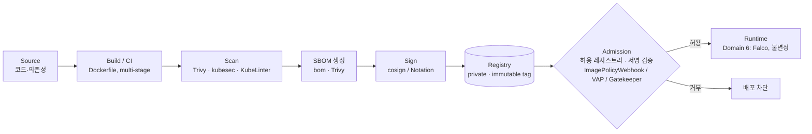
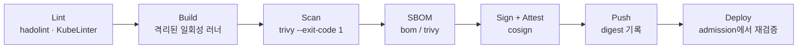
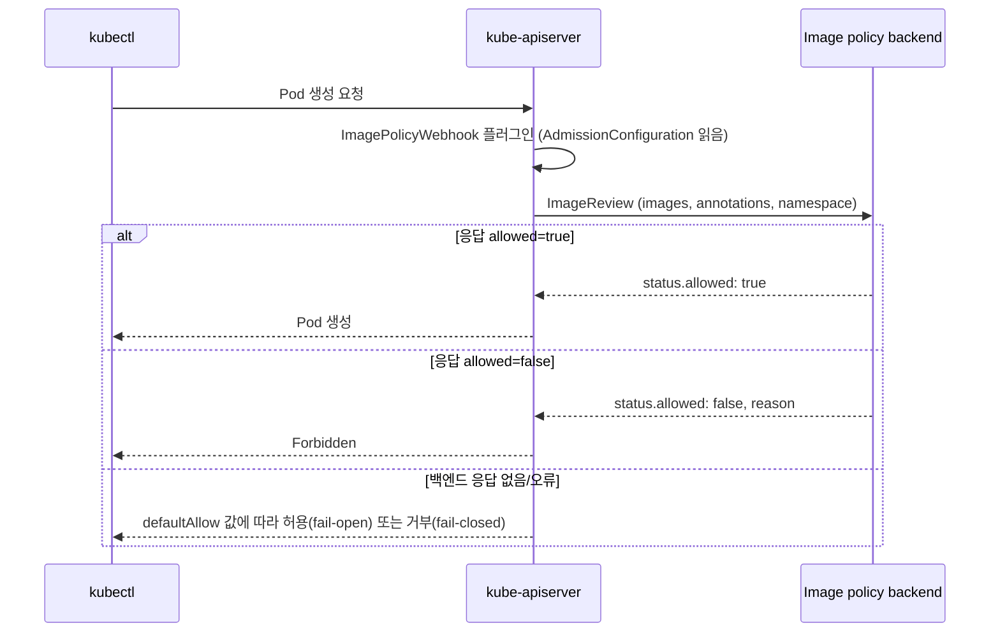

# CKS Domain 5 — Supply Chain Security (20%)

> 기준일: 2026-10-09 · 시험 환경 Kubernetes v1.35 기준
> 참고: CNCF CKS 커리큘럼(2024-10 개정), LF "Resources Allowed" 페이지, LFS260 Lab(V2026-07-30) Exercise 3.2 · 4.5 · 5.5 · 7.1~7.3
> 도구 버전과 플래그는 자주 바뀝니다. 시험 직전에 `--help`로 다시 확인합니다.

---

## 목차

- [0. 도메인 개요](#0-도메인-개요)
- [1. 베이스 이미지 풋프린트 최소화](#1-베이스-이미지-풋프린트-최소화)
- [2. 공급망 이해 — SBOM, CI/CD, 아티팩트 저장소](#2-공급망-이해--sbom-cicd-아티팩트-저장소)
- [3. 공급망 보안 — 허용 레지스트리, 서명·검증](#3-공급망-보안--허용-레지스트리-서명검증)
- [4. 워크로드·이미지 정적 분석](#4-워크로드이미지-정적-분석)
- [5. 실전 연습 문제 (풀이 포함)](#5-실전-연습-문제-풀이-포함)
- [6. 치트시트](#6-치트시트)
- [7. 자주 하는 실수](#7-자주-하는-실수)
- [8. 개인 실습 환경 준비](#8-개인-실습-환경-준비)
- [9. 참고 자료](#9-참고-자료)

---

## 0. 도메인 개요

### 0.1 공식 역량(competency)과 도구 매핑

| 공식 역량 | 핵심 내용 | 주로 쓰는 도구 | LFS260 Lab |
|---|---|---|---|
| Minimize base image footprint | 작은 베이스 이미지, multi-stage build, 비root 실행, 불필요 패키지 제거 | Dockerfile, distroless/alpine/scratch | — |
| Understand your supply chain (SBOM, CI/CD, artifact repositories) | SBOM 생성·조회, 빌드 파이프라인과 레지스트리 이해 | **bom**, Trivy SBOM, crictl | 7.2, 7.3 |
| Secure your supply chain (permitted registries, sign and validate artifacts) | 허용 레지스트리 강제, 이미지 서명·검증, digest 고정 | **ImagePolicyWebhook**, ValidatingAdmissionPolicy, OPA Gatekeeper, cosign | 4.5, 5.5 |
| Perform static analysis of user workloads and container images | 매니페스트·Dockerfile 정적 분석, 이미지 취약점 스캔 | **Trivy**, kubesec, KubeLinter | 3.2, 7.1 |

### 0.2 시험에서 쓸 수 있는 문서 (2026-10-09 확인)

LF "Resources Allowed" 페이지의 CKS 항목에 올라 있는 문서는 다음과 같습니다.

- Kubernetes Documentation (`kubernetes.io/docs`), Kubernetes Blog
- Falco, **Bom**(`kubernetes-sigs.github.io/bom/cli-reference/`), etcd, NGINX Ingress Controller, Cilium, Istio 문서
- 각 문제의 **Quick Reference** 박스에 제공되는 문서 링크

> [!IMPORTANT]
> **Trivy, kubesec, KubeLinter, cosign 문서는 상시 허용 목록에 없습니다.** (예전 자료에는 Trivy 문서가 허용 목록에 있었다는 글이 많지만 현재 목록에는 없습니다.)
> 문제에 따라 Quick Reference로 링크가 나올 수도 있지만 기대하지 말고 **`<tool> --help`만으로 풀 수 있게** 플래그를 손에 익혀 둡니다.
> 반대로 **bom 문서가 허용 목록에 있다는 것은 SBOM 문제가 출제 범위라는 신호**로 보는 편이 안전합니다.

### 0.3 공급망 전체 그림



시험은 이 흐름 중 **C(스캔) · D(SBOM) · G(어드미션)** 를 손으로 다루는 문제가 중심이고, A·B·E·F는 개념 이해와 Dockerfile 수정 정도로 나옵니다.

### 0.4 공급망 위협 모델

| 위협 | 예시 | 이 도메인의 대응 |
|---|---|---|
| 취약한 패키지 | 오래된 openssl, glibc가 들어간 베이스 이미지 | 작은 베이스 이미지, Trivy 스캔, CI 게이트 |
| 악성·위장 이미지 | 오타를 노린 이름(typosquatting), 출처 불명 Docker Hub 이미지 | 허용 레지스트리 강제, 서명 검증 |
| 태그 변조 | 같은 `:1.0` 태그를 다른 내용으로 덮어씀 | digest(`@sha256:`) 고정, immutable tag |
| 레이어 내 시크릿 유출 | `ENV DB_PASSWORD=...`, `COPY .env` | Dockerfile 정적 분석, BuildKit secret mount |
| 빌드 시스템 침해 | CI 러너 탈취 후 이미지에 백도어 삽입 | 서명·provenance(SLSA), 격리된 빌드 |
| 잘못된 워크로드 설정 | `privileged: true`, hostPath `/` | kubesec, KubeLinter, Trivy config |

---

## 1. 베이스 이미지 풋프린트 최소화

### 1.1 왜 작게 만드는가

이미지 안의 패키지 수는 세 가지에 그대로 비례합니다.

1. **CVE 수** — 패키지가 많을수록 스캐너가 찾는 취약점이 많아지고 패치 부담도 커집니다.
2. **공격자 도구** — `sh`, `curl`, `wget`, 패키지 매니저가 있으면 침투 후 추가 도구를 내려받거나 리버스 셸을 열기 쉽습니다.
3. **분석 범위** — 들어 있는 것이 적을수록 SBOM과 감사가 단순해집니다.

### 1.2 베이스 이미지 선택지

| 베이스 | 셸 | 패키지 매니저 | 특징·주의 | 적합한 용도 |
|---|---|---|---|---|
| `ubuntu`, `debian` | O | apt | 크고 패키지 많음 | 빌드 스테이지, 레거시 |
| `debian:*-slim` | O | apt | 문서·로케일 제거판 | 동적 링크 앱의 무난한 기본값 |
| `alpine` | O (busybox) | apk | 매우 작음. **musl libc**라 glibc 바이너리와 호환 문제 가능 | 작은 유틸, 스크립트 |
| `gcr.io/distroless/static` | **X** | **X** | libc도 없음(정적 바이너리용). `:nonroot` 태그는 UID 65532 | Go(CGO off), Rust 정적 빌드 |
| `gcr.io/distroless/base`, `cc` | X | X | glibc(+libstdc++) 포함 | 동적 링크 C/C++ 앱 |
| `distroless/*:debug` | busybox 셸 | X | 디버깅용. 운영에 쓰지 않음 | 트러블슈팅 |
| `scratch` | X | X | 완전히 빈 이미지. CA 인증서·tzdata도 직접 넣어야 함 | 정적 바이너리 |
| Chainguard/Wolfi 계열 | 대부분 X | apk(-dev 변형만) | 최소 구성 + 빠른 CVE 패치 | distroless 대안 |

> [!TIP]
> 시험에서 "가장 취약점이 적은/작은 이미지로 바꾸라"고 하면 **같은 앱의 alpine·slim·distroless 변형 중 하나를 고르고**, 필요하면 Trivy로 직접 비교합니다(5장 연습 문제 9).

### 1.3 Multi-stage build

빌드 도구(컴파일러, 헤더, 패키지 캐시)는 빌드 스테이지에만 두고, 실행 스테이지에는 결과물만 복사합니다.

```dockerfile
# syntax=docker/dockerfile:1

# ---- build stage ----
FROM golang:1.26-bookworm@sha256:<digest> AS build
WORKDIR /src
COPY go.mod go.sum ./
RUN go mod download
COPY . .
RUN CGO_ENABLED=0 GOOS=linux go build -trimpath -ldflags="-s -w" -o /out/server .

# ---- runtime stage ----
FROM gcr.io/distroless/static-debian12:nonroot@sha256:<digest>
COPY --from=build /out/server /server
USER 65532:65532
EXPOSE 8080
ENTRYPOINT ["/server"]
```

- `CGO_ENABLED=0` → libc에 의존하지 않는 정적 바이너리라 `static`/`scratch`에서 실행됩니다.
- 실행 이미지에는 셸도 패키지 매니저도 없습니다. `kubectl exec ... -- sh`가 실패하는 것이 정상입니다.

### 1.4 Dockerfile 하드닝 체크리스트

| # | 항목 | 나쁜 예 | 좋은 예 | 이유 |
|---|---|---|---|---|
| 1 | 베이스 태그 고정 | `FROM ubuntu:latest`, `FROM ubuntu` | `FROM ubuntu:24.04` 또는 `@sha256:...` | `latest`는 재현 불가, 내용이 바뀜 |
| 2 | 비root 사용자 | `USER root` 또는 USER 없음 | `USER 10001` / `USER 65532:65532` | 컨테이너 탈출 시 피해 축소 |
| 3 | 숫자 UID 사용 | `USER appuser` | `USER 10001` | `runAsNonRoot: true`일 때 kubelet은 **이름으로 된 USER를 검증할 수 없어** 컨테이너 생성 실패 |
| 4 | 불필요 패키지 제거 | `apt-get install -y curl vim netcat` | 필요한 것만, `--no-install-recommends` | 공격 도구·CVE 감소 |
| 5 | 같은 RUN에서 설치·정리 | 설치와 `rm`을 다른 RUN에 분리 | `apt-get update && apt-get install ... && rm -rf /var/lib/apt/lists/*` | 이전 레이어에 남은 파일은 지워지지 않음 |
| 6 | 시크릿 금지 | `ENV DB_PASSWORD=...`, `ARG TOKEN`, `COPY .env` | BuildKit `RUN --mount=type=secret,...`, 런타임에 Secret으로 주입 | ENV·ARG·COPY는 `history`/레이어에 남음 |
| 7 | `COPY` 우선 | `ADD https://.../x.tar.gz /` | `COPY` (원격·압축 해제가 필요하면 명시적으로) | ADD의 원격 다운로드·자동 압축 해제는 예측하기 어려움 |
| 8 | `.dockerignore` | 없음 | `.git`, `.env`, `*.pem` 제외 | 빌드 컨텍스트로 시크릿이 들어가는 것 방지 |
| 9 | exec form | `CMD ./server` | `ENTRYPOINT ["/server"]` | 셸 의존 제거, 시그널 전달 |
| 10 | 레이어 최소화 | RUN 여러 줄 | 관련 명령을 `&&`로 묶음 | 크기·캐시 효율 |

BuildKit secret mount 예시:

```dockerfile
# 빌드: docker build --secret id=npmrc,src=$HOME/.npmrc .
RUN --mount=type=secret,id=npmrc,target=/root/.npmrc npm ci --omit=dev
```

### 1.5 수정 실습: 나쁜 Dockerfile → 좋은 Dockerfile

**Before**

```dockerfile
FROM ubuntu:latest
RUN apt-get update
RUN apt-get install -y python3 python3-pip curl wget vim netcat-openbsd
ENV API_TOKEN=sk-live-1234567890
ADD . /app
WORKDIR /app
RUN pip3 install -r requirements.txt
USER root
CMD python3 app.py
```

**After**

```dockerfile
FROM python:3.12-slim-bookworm@sha256:<digest>
WORKDIR /app
COPY requirements.txt .
RUN pip install --no-cache-dir -r requirements.txt
COPY app.py .
RUN useradd --uid 10001 --no-create-home --shell /usr/sbin/nologin app
USER 10001
ENTRYPOINT ["python3", "app.py"]
```

| 수정 | 내용 |
|---|---|
| ① | `ubuntu:latest` → 버전·digest 고정된 slim 이미지 |
| ② | `curl wget vim netcat` 제거 |
| ③ | `ENV API_TOKEN` 삭제 → 런타임에 Secret으로 주입 |
| ④ | `ADD .` → 필요한 파일만 `COPY` |
| ⑤ | `USER root` → 숫자 UID 비root |
| ⑥ | shell form `CMD` → exec form `ENTRYPOINT` |

> [!NOTE]
> 시험의 Dockerfile 문제는 보통 **"이미지를 빌드하지 말고 Dockerfile만 고쳐라"** 형태입니다. 문제에서 지정한 개수(예: "두 가지 보안 모범 사례 위반")와 지정된 값(예: 특정 UID, 특정 베이스 태그)을 **정확히** 맞추는 것이 핵심입니다. 지시하지 않은 줄까지 고치다가 채점 스크립트와 어긋나지 않게 주의합니다.

### 1.6 이미지 내부 확인 명령

```bash
# 레이어별 명령 이력 (ENV·ARG에 박힌 시크릿이 보임)
docker history --no-trunc <image>
podman history --no-trunc <image>

# 이미지 설정: 실행 사용자, Entrypoint, Env
docker image inspect -f '{{.Config.User}} {{.Config.Entrypoint}} {{.Config.Env}}' <image>

# containerd 노드 (시험 노드는 보통 containerd)
sudo crictl images
sudo crictl inspecti <image> | less          # repoDigests, 크기, 설정 확인

# 크기 비교
docker images --format '{{.Repository}}:{{.Tag}}\t{{.Size}}'
```

### 1.7 런타임에서 보완하기 (Pod securityContext)

이미지가 비root로 만들어져 있어도 Pod 쪽에서 한 번 더 강제합니다. Domain 4와 겹치는 내용입니다.

```yaml
apiVersion: v1
kind: Pod
metadata:
  name: app
spec:
  securityContext:
    runAsNonRoot: true
    runAsUser: 10001
    runAsGroup: 10001
    seccompProfile:
      type: RuntimeDefault
  containers:
  - name: app
    image: registry.internal.example/app@sha256:<digest>
    securityContext:
      allowPrivilegeEscalation: false
      readOnlyRootFilesystem: true
      capabilities:
        drop: ["ALL"]
    volumeMounts:
    - name: tmp
      mountPath: /tmp
  volumes:
  - name: tmp
    emptyDir: {}
```

### 1.8 셸 없는 이미지 디버깅

distroless는 `kubectl exec`로 셸에 들어갈 수 없으므로 ephemeral container를 붙입니다.

```bash
kubectl debug -it <pod> --image=busybox:1.36 --target=<container-name>
# --target: 대상 컨테이너의 프로세스 네임스페이스를 공유 → /proc/1/root 로 파일시스템 확인 가능
```

### 1.9 시험 포인트 요약

- Dockerfile 수정 문제: `latest` 제거, 비root(지정 UID), 불필요 패키지 삭제, 하드코딩 시크릿 삭제.
- `runAsNonRoot: true` + 이름 기반 USER 조합은 **CreateContainerConfigError**를 낸다는 점.
- "더 안전한 베이스 이미지" 선택 문제는 Trivy 비교로 근거를 만들 수 있음.

---

## 2. 공급망 이해 — SBOM, CI/CD, 아티팩트 저장소

### 2.1 SBOM 기본 개념

SBOM(Software Bill of Materials)은 소프트웨어를 구성하는 **패키지·버전·라이선스·출처(PURL)** 목록입니다. 새 CVE가 공개됐을 때 "이 패키지 버전이 우리 어느 이미지에 들어 있나?"를 이미지 재스캔 없이 바로 답할 수 있게 해 줍니다.

| 구분 | SPDX | CycloneDX |
|---|---|---|
| 주관 | Linux Foundation (ISO/IEC 5962) | OWASP |
| 주된 관심 | 라이선스 컴플라이언스 + 구성요소 | 보안(취약점, VEX) + 구성요소 |
| 주요 포맷 | tag-value(`.spdx`), JSON(`.spdx.json`) | JSON, XML |
| 패키지 위치(JSON) | `.packages[]` → `name`, `versionInfo` | `.components[]` → `name`, `version` |
| 생성 도구 | **bom**, Trivy, Syft | Trivy, Syft |

### 2.2 bom (kubernetes-sigs/bom) — 시험 허용 문서 있음

bom은 Kubernetes 프로젝트에서 나온 SPDX SBOM 생성기입니다. 이미지·디렉터리·파일에서 SPDX 문서를 만들고, 내장 라이선스 분류기와 Go 의존성 분석을 지원합니다.

```bash
# 설치 (LFS260 7.3 방식)
wget https://github.com/kubernetes-sigs/bom/releases/download/v0.7.1/bom-amd64-linux -O bom
chmod +x bom && sudo mv bom /usr/local/bin/
bom version

# 하위 명령 구조
bom generate   # SBOM 생성
bom document   # outline / query
bom validate   # 아티팩트를 SBOM과 대조 검증
```

**생성**

```bash
# 이미지 → SPDX tag-value (기본 포맷)
bom generate --image nginx:1.27 --output nginx.spdx

# 이미지 → SPDX JSON  (시험에서 "SPDX-JSON으로" 요구 시)
bom generate --image nginx:1.27 --format json --output nginx.spdx.json

# digest로 지정 (재현성 확보)
bom generate --image debian@sha256:<digest> --output debian.spdx

# 네임스페이스 URI 지정
bom generate -n http://example.com/ --image registry.k8s.io/kube-apiserver:v1.35.0 --output apiserver.spdx

# 디렉터리(소스 코드) SBOM
bom generate -n http://example.com/ -d ./myproject --output src.spdx
```

> [!NOTE]
> 멀티아키텍처 이미지(index)를 지정하면 bom은 아키텍처별 이미지를 모두 패키지로 넣습니다(LFS260 7.3에서 kube-apiserver 이미지가 4개 manifest로 풀리는 예). 플래그 이름(`--format`, `--image-archive` 등)은 버전마다 다를 수 있으니 시험에서는 `bom generate --help`와 허용 문서(cli-reference)로 확인합니다.

**조회**

```bash
# 문서 구조 트리
bom document outline nginx.spdx

# 조건 검색 (필터 예: name:, purl:, depth:)
bom document query nginx.spdx 'name:openssl'
```

**tag-value에서 grep으로 찾기** — 가장 빠르고 확실한 방법입니다.

```bash
grep -n -A5 'PackageName: libssl' nginx.spdx
# PackageName / SPDXID / PackageVersion 줄이 이어서 나옴
```

### 2.3 Trivy로 SBOM 생성·스캔

```bash
# CycloneDX (JSON)
trivy image --format cyclonedx --output sbom.cdx.json nginx:1.27

# SPDX tag-value / SPDX JSON
trivy image --format spdx      --output sbom.spdx      nginx:1.27
trivy image --format spdx-json --output sbom.spdx.json nginx:1.27

# SBOM 파일을 입력으로 취약점 스캔 (이미지 재다운로드 없이)
trivy sbom sbom.cdx.json
trivy sbom --severity HIGH,CRITICAL sbom.spdx.json
```

> [!WARNING]
> `--format cyclonedx` / `spdx` 로 SBOM을 만들면 Trivy는 **취약점 스캔을 끕니다**. SBOM 안에 취약점 정보까지 넣으려면 `--scanners vuln`을 명시합니다.

### 2.4 SBOM에서 특정 패키지 찾기

```bash
# SPDX JSON (bom --format json, trivy --format spdx-json)
yq -p json '.packages[] | select(.name == "libcrypto3") | .versionInfo' sbom.spdx.json

# CycloneDX JSON
yq -p json '.components[] | select(.name == "libcrypto3") | .version' sbom.cdx.json

# yq/jq가 없을 때
grep -o '"name": *"libcrypto3"[^}]*' sbom.spdx.json
```

> 시험 노드에는 `yq`가 설치돼 있다고 안내되어 있습니다(jq는 보장되지 않음). `yq -p json`으로 JSON을 읽는 법을 연습해 둡니다.

### 2.5 클러스터에서 실행 중인 이미지 목록화

Kubernetes 문서 "List All Container Images Running in a Cluster" 페이지가 허용 문서 안에 있습니다.

```bash
# 전체 이미지 (중복 제거)
kubectl get pods -A -o jsonpath="{.items[*].spec['initContainers','containers'][*].image}" \
  | tr -s '[[:space:]]' '\n' | sort -u

# 네임스페이스/파드별 이미지
kubectl get pods -n team-a -o jsonpath='{range .items[*]}{.metadata.name}{"\t"}{range .spec.containers[*]}{.image}{" "}{end}{"\n"}{end}'

# 실제 실행 중인 digest (태그가 아니라 내용 기준)
kubectl get pod <pod> -o jsonpath='{range .status.containerStatuses[*]}{.name}{"\t"}{.imageID}{"\n"}{end}'
```

### 2.6 CI/CD 파이프라인 보안 (개념)



| 개념 | 내용 |
|---|---|
| 보안 게이트 | `trivy image --exit-code 1 --severity CRITICAL`처럼 **실패 시 파이프라인 중단** |
| 의존성 고정 | lock 파일(`go.sum`, `package-lock.json`), 베이스 이미지 digest 고정 |
| 격리된 빌드 | 빌드마다 새 러너, 최소 권한 CI 토큰, 빌드와 배포 자격 증명 분리 |
| Provenance | "누가, 어떤 소스로, 어떤 빌더에서" 만들었는지에 대한 서명된 기록 (in-toto attestation) |
| SLSA | Supply-chain Levels for Software Artifacts. 빌드 트랙 L1(provenance 존재) → L2(호스팅 빌드 + 서명된 provenance) → L3(강화·격리된 빌더) |
| 재현 가능 빌드 | 같은 입력이면 같은 digest → 제3자 검증 가능 |

### 2.7 아티팩트 저장소(레지스트리) 보안

| 항목 | 내용 |
|---|---|
| Private registry | 승인된 이미지만 보관, 외부 레지스트리 직접 pull 금지 |
| Pull-through cache(proxy) | 외부 이미지를 내부 레지스트리를 거쳐 가져와 스캔·통제 지점 확보 |
| Immutable tag | 같은 태그 덮어쓰기 금지 |
| 레지스트리 측 스캔 | push 시 자동 스캔, 심각도 기준 pull 차단 |
| 서명 강제 | 서명 없는 이미지 pull 차단 |
| 접근 제어 | 프로젝트별 RBAC, CI 전용 robot 계정 |
| 클러스터 인증 | `imagePullSecrets`, kubelet credential provider |
| `AlwaysPullImages` | 어드미션 플러그인. 모든 Pod의 `imagePullPolicy`를 `Always`로 바꿔, **노드에 캐시된 private 이미지를 자격 증명 없는 다른 테넌트가 쓰는 것**을 막음 |

> [!TIP]
> **실무 연결 (Harbor)**: Harbor는 위 항목 대부분(proxy cache 프로젝트, Trivy 연동 스캔, 취약 이미지 pull 차단, cosign 서명 강제, tag immutability 규칙, robot 계정)을 프로젝트 단위 설정으로 제공합니다. 시험 개념을 실제 레지스트리 설정과 1:1로 대응시켜 보면 기억에 오래 남습니다.

### 2.8 시험 포인트 요약

- "이미지 X의 SBOM을 SPDX(JSON) 형식으로 `/path/file`에 생성하라" → **bom** 또는 Trivy. 문제에서 도구를 지정하면 그 도구를 씁니다.
- "특정 버전의 패키지(예: libcrypto3 3.x)가 들어 있는 이미지를 쓰는 Pod를 찾아 삭제하라" → 이미지 목록화 → 각 이미지 SBOM 생성 → grep/yq.
- 포맷 이름 혼동 주의: Trivy `spdx`=tag-value, `spdx-json`=JSON, `cyclonedx`=JSON.

---

## 3. 공급망 보안 — 허용 레지스트리, 서명·검증

### 3.1 강제 수단 비교

| 방식 | 종류 | 정책 언어 | 외부 구성요소 | 시험 출제 가능성 |
|---|---|---|---|---|
| **ImagePolicyWebhook** | 내장 어드미션 플러그인 → 외부 백엔드 호출 | 백엔드가 결정 | 웹훅 서버 필요 | **높음** (apiserver 설정 문제) |
| **ValidatingAdmissionPolicy (VAP)** | 내장 API (v1.30 GA) | CEL | 없음 | 높음 |
| **OPA Gatekeeper** | Validating webhook | Rego | Gatekeeper 설치 | 중간 |
| Kyverno | Validating/Mutating webhook | YAML/CEL | Kyverno 설치 | 낮음 (개념) |
| digest 고정 | 매니페스트 수준 | — | — | 중간 |

### 3.2 ValidatingAdmissionPolicy로 허용 레지스트리 강제

```yaml
apiVersion: admissionregistration.k8s.io/v1
kind: ValidatingAdmissionPolicy
metadata:
  name: allowed-registries
spec:
  failurePolicy: Fail
  matchConstraints:
    resourceRules:
    - apiGroups: [""]
      apiVersions: ["v1"]
      operations: ["CREATE", "UPDATE"]
      resources: ["pods"]
  variables:
  - name: allContainers
    expression: >-
      object.spec.containers +
      (has(object.spec.initContainers) ? object.spec.initContainers : [])
  validations:
  - expression: "variables.allContainers.all(c, c.image.startsWith('registry.internal.example/'))"
    message: "images must come from registry.internal.example/"
    reason: Forbidden
---
apiVersion: admissionregistration.k8s.io/v1
kind: ValidatingAdmissionPolicyBinding
metadata:
  name: allowed-registries-binding
spec:
  policyName: allowed-registries
  validationActions: ["Deny"]        # Deny | Warn | Audit
  matchResources:
    namespaceSelector:
      matchLabels:
        env: prod
```

```bash
kubectl label ns prod env=prod
kubectl -n prod run t1 --image=nginx                                   # 거부되어야 함
kubectl -n prod run t2 --image=registry.internal.example/nginx:1.27    # 허용 (pull 성공 여부는 별개)
```

**digest 필수 정책** (validations에 추가):

```yaml
  - expression: "variables.allContainers.all(c, c.image.contains('@sha256:'))"
    message: "images must be pinned by digest"
```

> [!WARNING]
> **세 가지 함정**
> 1. **접두사 끝의 `/`를 빠뜨리지 않습니다.** `startsWith('docker.io')`는 `docker.io.evil.com/...`도 통과시킵니다.
> 2. **이미지 문자열은 정규화되지 않습니다.** `nginx`로 지정한 이미지는 정책 입장에서 `docker.io/library/nginx`가 아니라 그냥 `nginx`입니다. `docker.io/`만 허용하는 정책은 `nginx`를 거부합니다.
> 3. **Pod를 대상으로 한 정책은 Deployment 생성 자체를 막지 않습니다.** Deployment는 만들어지고 ReplicaSet이 Pod 생성에 실패합니다. 확인은 `kubectl describe rs <name>` 또는 `kubectl get events`로 합니다(LFS260 4.5의 Gatekeeper 예와 동일).

ephemeral container는 `pods/ephemeralcontainers` 하위 리소스로 추가되므로, 이것까지 막으려면 해당 subresource도 `resourceRules`에 넣어야 합니다.

### 3.3 OPA Gatekeeper로 허용 레지스트리 강제

LFS260 4.5 실습과 같은 구조입니다(ConstraintTemplate = 정책 정의, Constraint = 적용 대상과 파라미터).

```yaml
apiVersion: templates.gatekeeper.sh/v1
kind: ConstraintTemplate
metadata:
  name: k8sallowedrepos
spec:
  crd:
    spec:
      names:
        kind: K8sAllowedRepos
      validation:
        openAPIV3Schema:
          type: object
          properties:
            repos:
              type: array
              items:
                type: string
  targets:
  - target: admission.k8s.gatekeeper.sh
    rego: |
      package k8sallowedrepos

      violation[{"msg": msg}] {
        container := input.review.object.spec.containers[_]
        satisfied := [good | repo = input.parameters.repos[_]; good = startswith(container.image, repo)]
        not any(satisfied)
        msg := sprintf("container <%v> has an invalid image repo <%v>, allowed repos are %v", [container.name, container.image, input.parameters.repos])
      }

      violation[{"msg": msg}] {
        container := input.review.object.spec.initContainers[_]
        satisfied := [good | repo = input.parameters.repos[_]; good = startswith(container.image, repo)]
        not any(satisfied)
        msg := sprintf("initContainer <%v> has an invalid image repo <%v>, allowed repos are %v", [container.name, container.image, input.parameters.repos])
      }
---
apiVersion: constraints.gatekeeper.sh/v1beta1
kind: K8sAllowedRepos
metadata:
  name: prod-internal-only
spec:
  enforcementAction: deny        # deny | dryrun | warn
  match:
    kinds:
    - apiGroups: [""]
      kinds: ["Pod"]
    namespaces: ["prod"]
  parameters:
    repos:
    - "registry.internal.example/"
```

```bash
kubectl get constrainttemplates
kubectl get k8sallowedrepos
kubectl describe k8sallowedrepos prod-internal-only   # status.violations: 기존 위반 리소스(audit 결과)
```

### 3.4 ImagePolicyWebhook 심화 (출제 빈도 높음)

#### 동작 흐름



#### 구성 파일 3종

**① AdmissionConfiguration** (`--admission-control-config-file`이 가리키는 파일)

```yaml
apiVersion: apiserver.config.k8s.io/v1
kind: AdmissionConfiguration
plugins:
- name: ImagePolicyWebhook
  configuration:
    imagePolicy:
      kubeConfigFile: /etc/kubernetes/policywebhook/kubeconf   # 절대 경로 (컨테이너 안에서 보이는 경로)
      allowTTL: 50          # 허용 결과 캐시(초)
      denyTTL: 50           # 거부 결과 캐시(초)
      retryBackoff: 500     # 재시도 간격(ms)
      defaultAllow: false   # 백엔드 장애 시 거부 (fail-closed)
```

`configuration:`으로 인라인 대신 `path: <file>`로 별도 파일을 가리키는 형식도 있습니다. 시험에서는 **이미 있는 파일 형식을 그대로 유지하고 값만 고치는 것**이 안전합니다.

**② 백엔드 접속용 kubeconfig** (`kubeConfigFile`)

```yaml
apiVersion: v1
kind: Config
clusters:
- name: image-checker               # "cluster" = 원격 웹훅 서비스
  cluster:
    certificate-authority: /etc/kubernetes/policywebhook/external-cert.pem
    server: https://image-bouncer-webhook:1323/image_policy
contexts:
- name: image-checker
  context:
    cluster: image-checker
    user: api-server
current-context: image-checker
users:
- name: api-server                  # "user" = apiserver가 웹훅에 제시하는 클라이언트 인증서
  user:
    client-certificate: /etc/kubernetes/policywebhook/apiserver-client-cert.pem
    client-key: /etc/kubernetes/policywebhook/apiserver-client-key.pem
```

> `clusters`는 **원격 서비스**, `users`는 **apiserver 자신**을 뜻합니다. 일반 kubeconfig와 방향이 반대라서 자주 헷갈립니다.

**③ kube-apiserver static pod 매니페스트**

```yaml
spec:
  containers:
  - command:
    - kube-apiserver
    - --enable-admission-plugins=NodeRestriction,ImagePolicyWebhook          # 기존 값에 "추가"
    - --admission-control-config-file=/etc/kubernetes/policywebhook/admission_config.yaml
    # ... 기존 플래그 유지
    volumeMounts:
    - mountPath: /etc/kubernetes/policywebhook
      name: policywebhook
      readOnly: true
    # ... 기존 mount 유지
  volumes:
  - hostPath:
      path: /etc/kubernetes/policywebhook
      type: DirectoryOrCreate
    name: policywebhook
  # ... 기존 volume 유지
```

> [!TIP]
> LFS260 5.5 실습은 설정 파일을 `/etc/kubernetes/pki/`에 넣어 **이미 마운트된 경로를 재사용**합니다. 시험에서 파일이 다른 디렉터리에 주어지면 위처럼 **volume과 volumeMount를 반드시 추가**해야 합니다. 마운트를 빠뜨리면 apiserver가 파일을 못 찾아 기동에 실패합니다.

#### ImageReview 요청·응답 형식

```json
{
  "apiVersion": "imagepolicy.k8s.io/v1alpha1",
  "kind": "ImageReview",
  "spec": {
    "containers": [{ "image": "myrepo/myimage:v1" }],
    "annotations": { "mycluster.image-policy.k8s.io/ticket-1234": "break-glass" },
    "namespace": "mynamespace"
  }
}
```

```json
{
  "apiVersion": "imagepolicy.k8s.io/v1alpha1",
  "kind": "ImageReview",
  "status": { "allowed": false, "reason": "image is not from an allowed registry" }
}
```

Pod 어노테이션 중 `*.image-policy.k8s.io/*` 패턴만 백엔드로 전달됩니다(긴급 우회 ticket 같은 용도).

#### 시험 풀이 절차

```bash
# 0) 백업은 manifests 디렉터리 "밖"에
sudo cp /etc/kubernetes/manifests/kube-apiserver.yaml ~/kube-apiserver.yaml.bak

# 1) 주어진 파일 확인
sudo ls -l /etc/kubernetes/policywebhook/
sudo cat /etc/kubernetes/policywebhook/admission_config.yaml
sudo cat /etc/kubernetes/policywebhook/kubeconf

# 2) 문제 요구대로 수정: defaultAllow, server URL, 인증서 경로 등
sudo vim /etc/kubernetes/policywebhook/admission_config.yaml
sudo vim /etc/kubernetes/policywebhook/kubeconf

# 3) apiserver 매니페스트: 플러그인 추가, config 플래그, volume/volumeMount
sudo vim /etc/kubernetes/manifests/kube-apiserver.yaml

# 4) 재기동 대기
watch sudo crictl ps --name kube-apiserver
kubectl -n kube-system get pod -l component=kube-apiserver

# 5) 검증 (백엔드가 거부하거나, 백엔드 장애 + defaultAllow=false면 거부되어야 함)
kubectl run iw-test --image=nginx
```

**apiserver가 올라오지 않을 때**

```bash
sudo crictl ps -a | grep kube-apiserver
sudo crictl logs <container-id>
sudo ls /var/log/pods/ | grep apiserver
sudo tail -n 50 /var/log/pods/kube-system_kube-apiserver-*/kube-apiserver/*.log
sudo journalctl -u kubelet --since "5 min ago" | grep -i apiserver | tail
```

| 증상(로그) | 원인 |
|---|---|
| `no such file or directory` (config/kubeconfig/cert) | volumeMount 누락 또는 경로 오타 |
| `couldn't parse` / YAML 오류 | 들여쓰기, 탭 문자 |
| `unknown flag` | 플래그 이름 오타 |
| apiserver는 뜨는데 모든 Pod 거부 | defaultAllow=false + 백엔드 접속 불가 (문제 의도일 수 있음) |

> [!NOTE]
> kube-apiserver는 hostNetwork로 동작하므로 클러스터 DNS(`*.svc.cluster.local`)를 기본적으로 해석하지 못합니다. kubeconfig의 `server` 주소는 **문제에서 주어진 값을 그대로** 쓰고, 임의로 Service DNS 이름으로 바꾸지 않습니다.

### 3.5 이미지 서명과 검증

#### 개념

- 서명 대상은 **태그가 아니라 digest**입니다. 태그는 바뀔 수 있지만 digest는 내용 해시라 고정됩니다.
- 서명은 레지스트리에 OCI 아티팩트로 이미지 옆에 저장됩니다.
- 검증 시점은 두 곳입니다. **CI/CD(배포 전)** 와 **어드미션(클러스터 입장 시)**.

#### cosign — 키 쌍 방식

```bash
cosign generate-key-pair                       # cosign.key(비밀, 암호로 보호), cosign.pub
cosign sign   --key cosign.key registry.internal.example/app@sha256:<digest>
cosign verify --key cosign.pub registry.internal.example/app@sha256:<digest>

# SBOM을 attestation으로 첨부·검증
cosign attest --key cosign.key --type cyclonedx --predicate sbom.cdx.json registry.internal.example/app@sha256:<digest>
cosign verify-attestation --key cosign.pub --type cyclonedx registry.internal.example/app@sha256:<digest>
```

#### cosign — keyless 방식 (Sigstore)

OIDC 신원으로 짧게 쓰이는 인증서를 발급받아 서명하고, 투명성 로그(Rekor)에 기록합니다. 검증할 때는 **누가(identity) 어느 발급자(issuer)로** 서명했는지를 지정합니다.

**Kubernetes 릴리스 이미지 검증** (Kubernetes 문서 "Verify Signed Kubernetes Artifacts" — 허용 문서 안에 있음):

```bash
cosign verify registry.k8s.io/kube-apiserver-amd64:v1.35.0 \
  --certificate-identity krel-trust@k8s-releng-prod.iam.gserviceaccount.com \
  --certificate-oidc-issuer https://accounts.google.com
```

#### 어드미션 단계 서명 검증 도구 (개념)

| 도구 | 방식 |
|---|---|
| Kyverno `verifyImages` | 정책에 공개키/keyless identity를 지정, 서명 없는 이미지 거부 |
| Sigstore policy-controller | `ClusterImagePolicy` CR로 cosign 서명 검증 |
| Ratify + Gatekeeper | Gatekeeper 정책에서 외부 검증기(Ratify) 호출, Notation/cosign 지원 |
| ImagePolicyWebhook | 백엔드가 서명 검증을 구현하면 동일 역할 |
| Notation (Notary Project v2) | cosign과 다른 OCI 서명 표준·도구. 레지스트리 측 지원 여부 확인 필요 |

### 3.6 digest 고정과 imagePullPolicy

```bash
# 실행 중인 Pod에서 digest 얻기
kubectl get pod web-0 -o jsonpath='{.status.containerStatuses[0].imageID}'
# → docker.io/library/nginx@sha256:...

# 노드에서
sudo crictl inspecti nginx:1.27 | grep -A2 repoDigests

# Deployment 이미지를 digest로 교체
kubectl set image deploy/web nginx=docker.io/library/nginx@sha256:<digest>
```

| imagePullPolicy | 동작 | 보안 관점 |
|---|---|---|
| `Always` | 매번 레지스트리 확인(digest 같으면 레이어는 재사용) | 자격 증명 검사가 매번 일어남 |
| `IfNotPresent` | 노드에 있으면 그대로 사용 | 캐시된 이미지 재사용 위험 |
| `Never` | 노드에 있는 것만 사용 | 사전 배포 환경 전용 |

태그를 생략하거나 `:latest`면 기본값이 `Always`, 그 외에는 `IfNotPresent`입니다.

### 3.7 플랫폼 바이너리 검증 (Domain 1과 연결)

```bash
# 릴리스 페이지의 sha512 값과 비교
sha512sum kubelet
echo "<published-sha512>  kubelet" | sha512sum --check
```

### 3.8 시험 포인트 요약

- ImagePolicyWebhook: **플러그인 추가 / config 파일 플래그 / defaultAllow / kubeconfig server·인증서 / volumeMount** 다섯 가지를 체크리스트로 확인.
- `--enable-admission-plugins`는 **기존 값 뒤에 추가**합니다(NodeRestriction 삭제 금지).
- VAP·Gatekeeper 접두사 매칭은 끝 `/` 포함, 이미지 이름 정규화 안 됨.
- 서명 문제는 cosign `verify` 명령과 identity/issuer 옵션 정도만 알면 충분합니다.

---

## 4. 워크로드·이미지 정적 분석

### 4.1 도구 개요

| 도구 | 대상 | 결과 | 비고 |
|---|---|---|---|
| **Trivy** `image` | 컨테이너 이미지 | CVE, 시크릿 | 시험 거의 필수 |
| **Trivy** `config` / `fs` | YAML, Dockerfile, Helm, Terraform | 설정 오류(misconfig) | |
| **kubesec** | K8s 매니페스트 | 점수 + critical/advise 목록 | 공식 역량 문구에 이름 명시 |
| **KubeLinter** | K8s 매니페스트, Helm 차트 | 위반 체크 목록, exit code | 공식 역량 문구에 이름 명시 |
| hadolint | Dockerfile | 린트 경고 | CI 용도 |
| Kubescape | 클러스터·YAML·Helm | NSA/CIS/MITRE 프레임워크 점수 | LFS260 3.7 |

### 4.2 Trivy 이미지 스캔

```bash
trivy image nginx:1.27                                  # 기본 (vuln + secret)
trivy image -q nginx:1.27                               # 로그 생략, 결과만
trivy image --severity HIGH,CRITICAL nginx:1.27         # 심각도 필터
trivy image --ignore-unfixed nginx:1.27                 # 수정 버전 없는 CVE 제외
trivy image --scanners vuln nginx:1.27                  # 시크릿 스캔 끄기 (빠름)
trivy image --pkg-types os nginx:1.27                   # OS 패키지만 (구버전: --vuln-type)
trivy image --exit-code 1 --severity CRITICAL app:1.0   # CI 게이트
trivy image --format json -o result.json nginx:1.27     # JSON 결과
trivy image --input /tmp/app.tar                        # docker/podman save로 만든 tar
trivy image --list-all-pkgs --format json nginx:1.27    # 취약점 없는 패키지까지 출력
```

| 플래그 | 짧은 형태 | 의미 |
|---|---|---|
| `--severity` | `-s` | `UNKNOWN,LOW,MEDIUM,HIGH,CRITICAL` 중 쉼표 목록 |
| `--quiet` | `-q` | 진행 로그 숨김 |
| `--format` | `-f` | `table`(기본), `json`, `sarif`, `cyclonedx`, `spdx`, `spdx-json`, `template` |
| `--output` | `-o` | 결과 파일 |
| `--exit-code` | | 발견 시 종료 코드 |
| `--ignore-unfixed` | | 패치 없는 취약점 제외 |
| `--scanners` | | `vuln`, `secret`, `misconfig`, `license` |
| `--image-src` | | `docker,containerd,podman,remote` 우선순위 |
| `--skip-db-update` / `--offline-scan` | | 네트워크 없는 환경 |

**containerd 노드에서 스캔할 때**

```bash
# containerd 소켓 접근에는 root 필요
sudo trivy image nginx:1.27

# kubelet이 받은 이미지는 containerd "k8s.io" 네임스페이스에 있음 (환경에 따라 필요)
sudo CONTAINERD_NAMESPACE=k8s.io trivy image --image-src containerd nginx:1.27
```

**JSON 결과에서 개수 세기**

```bash
trivy image -q -f json -s HIGH,CRITICAL nginx:1.27 \
  | yq -p json '[.Results[].Vulnerabilities[]?] | length'
```

> [!TIP]
> 결과 해석: 테이블 위의 `Total: N (UNKNOWN: a, LOW: b, MEDIUM: c, HIGH: d, CRITICAL: e)` 줄이 **대상(target)별로** 나옵니다. OS 패키지와 언어 패키지(jar, package-lock.json 등)가 별도 target으로 나뉘므로 모든 Total 줄을 확인합니다(LFS260 3.2의 vuln-image 예).

### 4.3 Trivy config (IaC misconfiguration)

```bash
trivy config pod.yaml
trivy config ./manifests/                     # 디렉터리 전체
trivy config Dockerfile
trivy config --severity HIGH,CRITICAL ./chart/
trivy fs --scanners vuln,secret,misconfig .   # 소스 트리 전체
```

Pod 매니페스트에서는 `runAsNonRoot` 미설정, `readOnlyRootFilesystem` 미설정, `allowPrivilegeEscalation` 허용, `privileged`, hostPath 등이 탐지됩니다.

### 4.4 kubesec

```bash
# 바이너리
kubesec scan pod.yaml

# 컨테이너로
docker run -i kubesec/kubesec:v2 scan /dev/stdin < pod.yaml

# HTTP API (인터넷 필요)
curl -sSX POST --data-binary @pod.yaml https://v2.kubesec.io/scan
```

**출력 구조**

```json
[
  {
    "object": "Pod/web.default",
    "valid": true,
    "message": "Failed with a score of -30 points",
    "score": -30,
    "scoring": {
      "critical": [ { "id": "Privileged", "selector": "containers[] .securityContext .privileged == true", "reason": "...", "points": -30 } ],
      "passed":   [ ... ],
      "advise":   [ { "id": "ReadOnlyRootFilesystem", "selector": "...", "reason": "...", "points": 1 } ]
    }
  }
]
```

| 분류 | 대표 항목 | 조치 |
|---|---|---|
| **critical** (감점) | `Privileged`, `CapSysAdmin`, `HostNetwork`, `HostPID`, `HostIPC`, `AllowPrivilegeEscalation`, docker.sock hostPath | **반드시 제거** |
| **advise** (가점) | `ReadOnlyRootFilesystem`, `RunAsNonRoot`, `RunAsUser`(>10000), `CapDropAll`, `CapDropAny`, `LimitsCPU/Memory`, `RequestsCPU/Memory`, `ServiceAccountName`, `SeccompAny`, `ApparmorAny`, `AutomountServiceAccountToken` | 요구 점수에 맞춰 추가 |

**점수를 끌어올린 예**

```yaml
apiVersion: v1
kind: Pod
metadata:
  name: hardened
spec:
  serviceAccountName: app-sa
  automountServiceAccountToken: false
  securityContext:
    runAsNonRoot: true
    runAsUser: 10001
    runAsGroup: 10001
    seccompProfile:
      type: RuntimeDefault
  containers:
  - name: app
    image: registry.internal.example/app@sha256:<digest>
    securityContext:
      allowPrivilegeEscalation: false
      readOnlyRootFilesystem: true
      capabilities:
        drop: ["ALL"]
    resources:
      requests: { cpu: 100m, memory: 64Mi }
      limits:   { cpu: 500m, memory: 128Mi }
```

> kubesec의 AppArmor 체크는 예전 어노테이션 방식(`container.apparmor.security.beta.kubernetes.io/...`)을 기준으로 할 수 있습니다. 최신 `securityContext.appArmorProfile` 필드를 인식하는지는 도구 버전에 따라 다릅니다.

### 4.5 KubeLinter

```bash
kube-linter lint pod.yaml
kube-linter lint ./manifests/            # 디렉터리
kube-linter lint ./mychart/              # Helm 차트
kube-linter checks list                  # 사용 가능한 체크와 기본 활성 여부
kube-linter lint --format json pod.yaml
kube-linter lint --config .kube-linter.yaml ./manifests/
```

**설정 파일**

```yaml
# .kube-linter.yaml
checks:
  addAllBuiltIn: true          # 기본 비활성 체크까지 모두 켬
  exclude:
  - "unset-cpu-requirements"
  include:
  - "privileged-container"
```

**특정 오브젝트에서 체크 무시** (정당한 사유를 적음)

```yaml
metadata:
  annotations:
    ignore-check.kube-linter.io/run-as-non-root: "legacy image, tracked in SEC-123"
```

자주 나오는 체크: `privileged-container`, `privilege-escalation-container`, `run-as-non-root`, `no-read-only-root-fs`, `latest-tag`, `env-var-secret`, `writable-host-mount`, `unset-cpu-requirements`, `unset-memory-requirements`. 위반이 있으면 **0이 아닌 exit code**로 끝나므로 CI 게이트에 바로 쓸 수 있습니다.

### 4.6 수동 정적 분석 체크리스트 (도구 없이 매니페스트 읽기)

시험에서는 "이 디렉터리의 매니페스트 중 보안 모범 사례를 위반한 것을 찾아라/고쳐라" 형태로도 나옵니다.

| 위험 신호 | 검색 키워드 |
|---|---|
| 특권 컨테이너 | `privileged: true` |
| 호스트 네임스페이스 공유 | `hostPID`, `hostIPC`, `hostNetwork` |
| 위험한 hostPath | `path: /`, `/var/run/docker.sock`, `/run/containerd`, `/etc`, `/proc` |
| 위험한 capability | `add:` 아래 `SYS_ADMIN`, `NET_ADMIN`, `ALL` |
| 권한 상승 허용 | `allowPrivilegeEscalation: true` 또는 미설정 |
| root 실행 | `runAsUser: 0`, `runAsNonRoot` 미설정 |
| 고정되지 않은 이미지 | `:latest`, 태그 없음 |
| 평문 시크릿 | `env` 아래 `value:`에 비밀번호·토큰 |
| seccomp 해제 | `Unconfined` |
| 프로세스 마스킹 해제 | `procMount: Unmasked` |

```bash
grep -rnE 'privileged: *true|hostPID|hostIPC|hostNetwork|docker.sock|SYS_ADMIN|runAsUser: *0|:latest|Unconfined' ./manifests/
```

### 4.7 시험 포인트 요약

- "네임스페이스 X의 Pod 중 HIGH/CRITICAL 취약점이 있는 이미지를 쓰는 Pod를 삭제하라" → 5장 연습 문제 1이 표준 풀이입니다.
- kubesec/KubeLinter는 **출력을 읽고 지적된 항목을 고치는 것**이 핵심이라, 4.4의 critical 목록과 4.6 체크리스트를 외워 두면 도구가 없어도 대응할 수 있습니다.

---

## 5. 실전 연습 문제 (풀이 포함)

> 각 문제는 개인 실습 클러스터에서 재현할 수 있게 구성했습니다. 이미지·레지스트리 이름은 예시값입니다.

### 문제 1. 취약 이미지 Pod 정리

네임스페이스 `team-a`의 Pod 중 **CRITICAL** 취약점이 하나라도 있는 이미지를 쓰는 Pod를 모두 삭제하라.

<details>
<summary>풀이</summary>

```bash
# 1) 파드-이미지 목록
kubectl -n team-a get pod -o jsonpath='{range .items[*]}{.metadata.name}{"\t"}{.spec.containers[*].image}{"\n"}{end}'

# 2) 이미지별 CRITICAL 개수
for img in $(kubectl -n team-a get pod -o jsonpath='{.items[*].spec.containers[*].image}' | tr ' ' '\n' | sort -u); do
  echo "== $img"
  sudo trivy image -q --scanners vuln --severity CRITICAL "$img" | grep Total
done

# 3) CRITICAL > 0 인 이미지를 쓰는 Pod 삭제
kubectl -n team-a delete pod <pod-a> <pod-b>
```

- Deployment가 관리하는 Pod라면 삭제해도 다시 생깁니다. 문제가 "Pod 삭제"인지 "워크로드 제거/스케일 0"인지 문구를 확인합니다.
</details>

### 문제 2. bom으로 SPDX JSON SBOM 생성

이미지 `registry.k8s.io/kube-controller-manager:v1.35.0`의 SBOM을 **SPDX JSON** 형식으로 `/opt/sbom/kcm.spdx.json`에 생성하라.

<details>
<summary>풀이</summary>

```bash
sudo mkdir -p /opt/sbom
bom generate --image registry.k8s.io/kube-controller-manager:v1.35.0 \
  --format json --output /opt/sbom/kcm.spdx.json
head -c 400 /opt/sbom/kcm.spdx.json      # "spdxVersion" 필드 확인
```

플래그가 기억나지 않으면 `bom generate --help` 또는 허용 문서 `kubernetes-sigs.github.io/bom/cli-reference/`를 확인합니다.
</details>

### 문제 3. SBOM으로 특정 패키지 버전 추적

네임스페이스 `alpha`의 Deployment 3개 중 `libcrypto3` 버전 `3.1.4-r5`가 들어 있는 이미지를 쓰는 Deployment를 찾아 replicas를 0으로 줄여라.

<details>
<summary>풀이</summary>

```bash
for img in $(kubectl -n alpha get deploy -o jsonpath='{.items[*].spec.template.spec.containers[*].image}' | tr ' ' '\n' | sort -u); do
  echo "== $img"
  sudo trivy image -q --format spdx-json "$img" \
    | yq -p json '.packages[] | select(.name == "libcrypto3") | .versionInfo'
done
# bom 사용 시: bom generate --image "$img" | grep -A5 'PackageName: libcrypto3'

kubectl -n alpha get deploy -o wide          # 이미지와 Deployment 이름 매칭
kubectl -n alpha scale deploy <name> --replicas=0
```
</details>

### 문제 4. ImagePolicyWebhook 활성화

`/etc/kubernetes/policywebhook/`에 AdmissionConfiguration(`admission_config.yaml`)과 kubeconfig(`kubeconf`)가 있다. 다음을 수행하라.
1. 백엔드에 접속할 수 없으면 Pod 생성이 **거부**되도록 하라.
2. 백엔드 주소를 `https://localhost:1234`로 설정하라.
3. ImagePolicyWebhook을 활성화하라.
4. `kubectl run test --image=nginx`가 거부되는지 확인하라.

<details>
<summary>풀이</summary>

```bash
sudo cp /etc/kubernetes/manifests/kube-apiserver.yaml ~/kube-apiserver.yaml.bak

# 1) defaultAllow: false
sudo sed -i 's/defaultAllow: true/defaultAllow: false/' /etc/kubernetes/policywebhook/admission_config.yaml

# 2) server 주소
sudo vim /etc/kubernetes/policywebhook/kubeconf      # clusters[].cluster.server: https://localhost:1234

# 3) apiserver 매니페스트
sudo vim /etc/kubernetes/manifests/kube-apiserver.yaml
#   - --enable-admission-plugins=NodeRestriction,ImagePolicyWebhook
#   - --admission-control-config-file=/etc/kubernetes/policywebhook/admission_config.yaml
#   volumeMounts / volumes 에 /etc/kubernetes/policywebhook 추가 (3.4절 참고)

# 재기동 확인
watch sudo crictl ps --name kube-apiserver

# 4) 검증
kubectl run test --image=nginx
# Error from server (Forbidden): ... ImagePolicyWebhook ... 형태의 거부 메시지
```
</details>

### 문제 5. ValidatingAdmissionPolicy로 레지스트리 제한

라벨 `env=prod`가 붙은 네임스페이스에서는 `registry.internal.example/`로 시작하는 이미지만 허용하라. init container도 포함한다.

<details>
<summary>풀이</summary>

3.2절의 Policy + Binding을 적용합니다.

```bash
kubectl apply -f vap-allowed-registries.yaml
kubectl label ns prod env=prod --overwrite
kubectl -n prod run bad --image=nginx                     # 거부
kubectl -n prod create deploy bad2 --image=nginx          # Deployment는 생성됨
kubectl -n prod describe rs -l app=bad2 | grep -A3 Events # ReplicaSet에서 거부 확인
```
</details>

### 문제 6. Dockerfile 보안 수정

`/opt/app/Dockerfile`에서 보안 모범 사례 위반 **두 가지**를 고쳐라. 베이스 이미지는 `ubuntu:24.04`를 쓰고 사용자는 UID `65535`로 실행하라. 이미지는 빌드하지 마라.

```dockerfile
FROM ubuntu:latest
RUN apt-get update && apt-get install -y curl
COPY app /app
USER root
CMD ["/app"]
```

<details>
<summary>풀이</summary>

```dockerfile
FROM ubuntu:24.04
RUN apt-get update && apt-get install -y curl
COPY app /app
USER 65535
CMD ["/app"]
```

지시한 두 항목(`latest` → `24.04`, `root` → `65535`)만 정확히 고칩니다. `curl` 제거는 지시받지 않았으므로 건드리지 않는 편이 채점상 안전합니다.
</details>

### 문제 7. kubesec 결과로 매니페스트 고치기

`/opt/kubesec/pod.yaml`을 kubesec으로 스캔하고 **critical** 항목을 모두 해결하라.

<details>
<summary>풀이</summary>

```bash
kubesec scan /opt/kubesec/pod.yaml | yq -p json '.[0].scoring.critical[].id'
# 예: Privileged, AllowPrivilegeEscalation
vim /opt/kubesec/pod.yaml
#   privileged: true            → 삭제 또는 false
#   allowPrivilegeEscalation    → false
kubesec scan /opt/kubesec/pod.yaml | yq -p json '.[0].score, .[0].scoring.critical'
kubectl apply -f /opt/kubesec/pod.yaml   # 문제에서 적용까지 요구하면 (Pod는 대부분 필드 변경 불가 → delete 후 재생성)
```
</details>

### 문제 8. KubeLinter로 디렉터리 점검

`/opt/manifests/`를 KubeLinter로 점검해 `run-as-non-root`와 `no-read-only-root-fs` 위반을 해결하라.

<details>
<summary>풀이</summary>

```bash
kube-linter lint /opt/manifests/ 2>&1 | grep -E 'run-as-non-root|no-read-only-root-fs'
# 지적된 파일에 추가
#   securityContext.runAsNonRoot: true (+ runAsUser 숫자 UID)
#   containers[].securityContext.readOnlyRootFilesystem: true
kube-linter lint /opt/manifests/ ; echo "exit=$?"
```
</details>

### 문제 9. 가장 안전한 베이스 이미지 선택

`nginx:1.27`, `nginx:1.27-alpine`, `nginx:1.27-alpine-slim` 중 HIGH·CRITICAL 취약점이 가장 적은 이미지를 골라 Deployment `web`에 적용하라.

<details>
<summary>풀이</summary>

```bash
for i in nginx:1.27 nginx:1.27-alpine nginx:1.27-alpine-slim; do
  n=$(sudo trivy image -q --scanners vuln -s HIGH,CRITICAL -f json "$i" \
      | yq -p json '[.Results[].Vulnerabilities[]?] | length')
  echo "$i $n"
done
kubectl set image deploy/web nginx=<가장 적은 이미지>
kubectl rollout status deploy/web
```
</details>

### 문제 10. digest 고정

Deployment `api`(네임스페이스 `prod`)의 이미지를 **현재 실행 중인 것과 같은 digest**로 고정하라.

<details>
<summary>풀이</summary>

```bash
POD=$(kubectl -n prod get pod -l app=api -o jsonpath='{.items[0].metadata.name}')
DIGEST_REF=$(kubectl -n prod get pod $POD -o jsonpath='{.status.containerStatuses[0].imageID}')
echo $DIGEST_REF        # docker.io/library/xxx@sha256:...
kubectl -n prod set image deploy/api api=$DIGEST_REF
kubectl -n prod get deploy api -o jsonpath='{.spec.template.spec.containers[0].image}'
```
</details>

---

## 6. 치트시트

```bash
# ── 이미지 목록 ───────────────────────────────────────────────
kubectl get pods -A -o jsonpath="{.items[*].spec['initContainers','containers'][*].image}" | tr -s '[[:space:]]' '\n' | sort -u
kubectl get pod <p> -o jsonpath='{.status.containerStatuses[*].imageID}'
sudo crictl images ; sudo crictl inspecti 

# ── Trivy ────────────────────────────────────────────────────
sudo trivy image -q -s HIGH,CRITICAL 
sudo trivy image --scanners vuln --ignore-unfixed 
trivy image -f json -o out.json 
trivy image --input img.tar
trivy config <file|dir>
trivy image -f cyclonedx -o sbom.cdx.json      # SBOM (취약점 미포함)
trivy image -f spdx-json -o sbom.spdx.json 
trivy sbom sbom.cdx.json

# ── bom ──────────────────────────────────────────────────────
bom generate --image  --output x.spdx                 # tag-value
bom generate --image  --format json --output x.spdx.json
bom document outline x.spdx
grep -A5 'PackageName: <pkg>' x.spdx

# ── 정적 분석 ────────────────────────────────────────────────
kubesec scan pod.yaml
kube-linter lint <file|dir> ; kube-linter checks list

# ── 서명 ─────────────────────────────────────────────────────
cosign verify --key cosign.pub 
cosign verify  --certificate-identity <id> --certificate-oidc-issuer <issuer>

# ── apiserver 트러블슈팅 ──────────────────────────────────────
sudo crictl ps -a | grep apiserver ; sudo crictl logs <id>
sudo tail /var/log/pods/kube-system_kube-apiserver-*/kube-apiserver/*.log
```

| 기억할 값 | 내용 |
|---|---|
| ImagePolicyWebhook 플래그 | `--enable-admission-plugins=...,ImagePolicyWebhook` + `--admission-control-config-file=<abs path>` |
| AdmissionConfiguration | `apiVersion: apiserver.config.k8s.io/v1`, `kind: AdmissionConfiguration` |
| fail-closed | `defaultAllow: false` |
| ImageReview | `imagepolicy.k8s.io/v1alpha1` |
| VAP | `admissionregistration.k8s.io/v1`, Binding의 `validationActions: [Deny]` |
| Gatekeeper | `templates.gatekeeper.sh/v1` ConstraintTemplate, `constraints.gatekeeper.sh/v1beta1` Constraint |
| distroless nonroot UID | 65532 |

---

## 7. 자주 하는 실수

1. `--enable-admission-plugins` 값을 **덮어써서** `NodeRestriction`을 지워 버림.
2. AdmissionConfiguration·kubeconfig 안의 **상대 경로** 사용 → apiserver가 파일을 못 찾음.
3. 설정 디렉터리의 **volume/volumeMount 누락**.
4. 매니페스트 백업을 `/etc/kubernetes/manifests/` 안에 둠 → kubelet이 백업 파일까지 static pod로 읽으려 함. 백업은 반드시 디렉터리 밖에 둡니다.
5. apiserver가 내려간 상태에서 `kubectl`만 반복 → `crictl`과 `/var/log/pods`로 원인을 봅니다.
6. Trivy를 `sudo` 없이 실행해 containerd 이미지를 못 찾고 원격 pull을 시도하다 실패.
7. `trivy image -f cyclonedx` 결과에 취약점이 없다고 오해 (SBOM 모드는 vuln 스캔이 꺼짐).
8. Trivy `Total:` 줄을 **첫 번째 target만** 보고 판단.
9. 허용 레지스트리 접두사에 끝 `/` 누락, 짧은 이미지 이름(`nginx`) 정규화 착각.
10. Deployment가 생성됐다고 정책이 안 먹는다고 판단 → ReplicaSet 이벤트 확인.
11. `runAsNonRoot: true`와 이름 기반 `USER` 조합 → CreateContainerConfigError.
12. Dockerfile 문제에서 지시하지 않은 줄까지 수정.

---

## 8. 개인 실습 환경 준비

kubeadm 실습 클러스터(cp 1대 + worker 1대) 기준입니다. 버전은 설치 시점에 각 릴리스 페이지에서 확인합니다.

```bash
# Trivy (LFS260 7.1 방식, 버전 고정)
curl -sfL https://raw.githubusercontent.com/aquasecurity/trivy/main/contrib/install.sh \
  | sudo sh -s -- -b /usr/local/bin v0.72.0

# bom
wget https://github.com/kubernetes-sigs/bom/releases/download/v0.7.1/bom-amd64-linux -O bom
chmod +x bom && sudo mv bom /usr/local/bin/

# kubesec / kube-linter / cosign : 각 GitHub Releases의 linux-amd64 바이너리를 받아 /usr/local/bin 에 배치
#   https://github.com/controlplaneio/kubesec/releases
#   https://github.com/stackrox/kube-linter/releases
#   https://github.com/sigstore/cosign/releases

# OPA Gatekeeper (실습 후 반드시 제거: 다른 실습을 막을 수 있음)
kubectl apply -f https://raw.githubusercontent.com/open-policy-agent/gatekeeper/<release>/deploy/gatekeeper.yaml
```

**ImagePolicyWebhook 무거부 연습용 최소 구성** — LFS260 5.5처럼 `defaultAllow: true` + 존재하지 않는 백엔드로 먼저 apiserver 설정 흐름을 익히고, 그다음 `defaultAllow: false`로 바꿔 모든 Pod가 거부되는 것을 확인하는 순서로 연습합니다. 연습이 끝나면 백업 매니페스트로 원복합니다.

**연습 순서 제안 (약 4~5시간)**

| 순서 | 내용 | 시간 |
|---|---|---|
| 1 | Trivy 스캔·필터·JSON 파싱 (문제 1, 9) | 45분 |
| 2 | SBOM: bom/Trivy 생성, 패키지 추적 (문제 2, 3) | 45분 |
| 3 | ImagePolicyWebhook 설정·장애 복구를 3회 반복 (문제 4) | 60분 |
| 4 | VAP·Gatekeeper 허용 레지스트리 (문제 5) | 45분 |
| 5 | Dockerfile·kubesec·KubeLinter 수정 (문제 6~8) | 45분 |
| 6 | digest 고정, cosign verify (문제 10) | 20분 |

---

## 9. 참고 자료

**시험 허용 문서 안에 있는 것 (시험 중 열람 가능)**

- Kubernetes — Admission Controllers Reference (ImagePolicyWebhook, AlwaysPullImages): https://kubernetes.io/docs/reference/access-authn-authz/admission-controllers/
- Kubernetes — Validating Admission Policy: https://kubernetes.io/docs/reference/access-authn-authz/validating-admission-policy/
- Kubernetes — List All Container Images Running in a Cluster: https://kubernetes.io/docs/tasks/access-application-cluster/list-all-running-container-images/
- Kubernetes — Verify Signed Kubernetes Artifacts: https://kubernetes.io/docs/tasks/administer-cluster/verify-signed-artifacts/
- Kubernetes — Images (imagePullPolicy, digest): https://kubernetes.io/docs/concepts/containers/images/
- bom CLI reference: https://kubernetes-sigs.github.io/bom/cli-reference/

**시험 전 학습용**

- LF Resources Allowed: https://docs.linuxfoundation.org/tc-docs/certification/certification-resources-allowed
- CNCF CKS Curriculum: https://github.com/cncf/curriculum/tree/master/cks
- Trivy: https://trivy.dev/
- kubesec: https://kubesec.io/
- KubeLinter: https://docs.kubelinter.io/
- OPA Gatekeeper Library (k8sallowedrepos): https://open-policy-agent.github.io/gatekeeper-library/website/
- Sigstore cosign: https://docs.sigstore.dev/
- SLSA: https://slsa.dev/
- SPDX: https://spdx.dev/ · CycloneDX: https://cyclonedx.org/
- distroless: https://github.com/GoogleContainerTools/distroless

**LFS260 Lab 대응**

| Lab | 이 문서 |
|---|---|
| 3.2 Getting Started with Trivy | 4.2 |
| 4.5 Deploy OPA Gatekeeper | 3.3 |
| 5.5 Admission Control: Image Policy Webhook | 3.4 |
| 7.1 Image Analysis With Trivy | 4.2 |
| 7.2 SBOM Scanning With Trivy | 2.3 |
| 7.3 Using the BOM Tool | 2.2 |
| 9.2 Practice Steps #9, #13 | 5장 문제 1, 4 |
