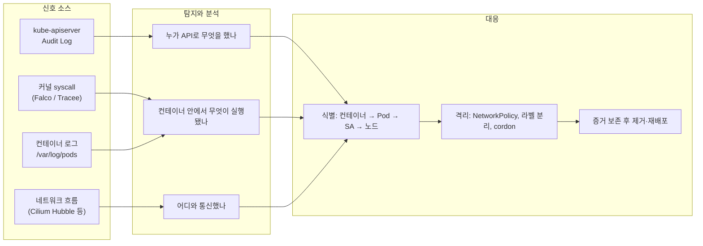
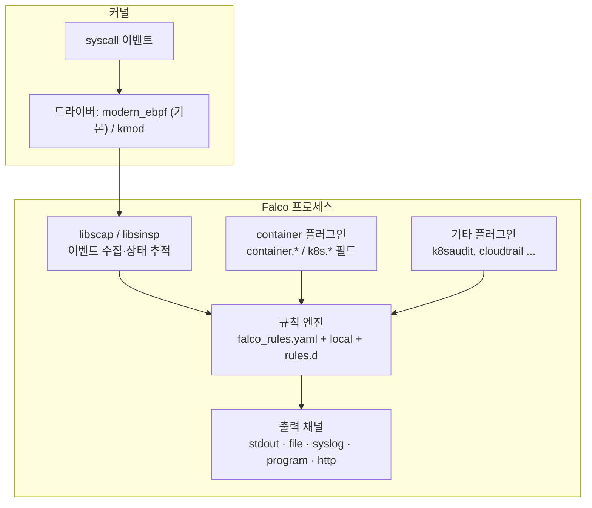
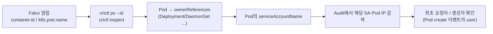
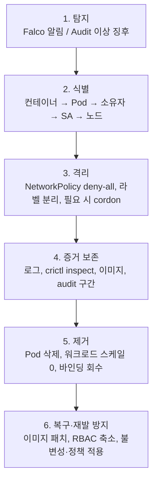

# CKS 도메인 6: Monitoring, Logging and Runtime Security (20%)

> 작성 기준일: 2026-10-09
> 기준 버전: 시험 환경 Kubernetes v1.35, Falco 문서 v0.45 (최신 릴리스 기준)
> 대상: CKA 합격자, kubeadm 클러스터 운영 경험이 있는 엔지니어
> 표기: **(공식)** = LF/CNCF/Kubernetes/Falco 공식 문서, **(제3자)** = 커뮤니티·시뮬레이터 경험담

---

## 목차

1. [도메인 개요](#1-도메인-개요)
2. [런타임 보안의 큰 그림](#2-런타임-보안의-큰-그림)
3. [Kubernetes Audit Logging](#3-kubernetes-audit-logging)
4. [노드·컨테이너 수준 조사 도구](#4-노드컨테이너-수준-조사-도구)
5. [Falco](#5-falco)
6. [행위 분석과 레이어별 위협 탐지](#6-행위-분석과-레이어별-위협-탐지)
7. [공격 단계와 공격자 식별](#7-공격-단계와-공격자-식별)
8. [런타임 컨테이너 불변성](#8-런타임-컨테이너-불변성)
9. [인시던트 대응 절차](#9-인시던트-대응-절차)
10. [실전 연습 문제 12선](#10-실전-연습-문제-12선)
11. [치트시트](#11-치트시트)
12. [자주 하는 실수](#12-자주-하는-실수)
13. [개인 랩 구성과 학습 시간 배분](#13-개인-랩-구성과-학습-시간-배분)
14. [참고 자료](#14-참고-자료)

---

## 1. 도메인 개요

### 1.1 핵심 메시지

- 이 도메인은 **"무슨 일이 일어났는지 기록하고(Audit), 이상 행위를 잡아내고(Falco), 잡아낸 대상을 찾아서 조치한다(crictl·kubectl)"** 는 한 흐름으로 출제됩니다.
- 시험 점수로 직결되는 실기 작업은 사실상 세 가지입니다.
  - kube-apiserver 감사 로그 활성화와 감사 정책 작성
  - Falco 규칙 작성·수정과 알림 해석
  - 알림에서 출발해 문제 Pod를 찾아 격리·삭제·스케일다운
- "불변성(immutability)"은 도메인 4(SecurityContext)와 겹치지만 이 도메인에서도 단독 문제로 나옵니다.

### 1.2 공식 역량(competency)과 이 문서의 매핑 (공식)

| 공식 역량 | 실기에서 하는 일 | 이 문서 섹션 |
|---|---|---|
| Perform behavioral analytics to detect malicious activities | Falco 규칙으로 시스템 콜 기반 이상 행위 탐지 | 5, 6 |
| Detect threats within physical infrastructure, apps, networks, data, users and workloads | 레이어별 신호 소스 선택(audit, syscall, network, log) | 6 |
| Investigate and identify phases of attack and bad actors within the environment | audit 로그와 Falco 출력에서 행위자·단계 특정 | 4, 7 |
| Ensure immutability of containers at runtime | readOnlyRootFilesystem, emptyDir, 권한 제거, 불변 아닌 Pod 판별 | 8 |
| Use Kubernetes audit logs to monitor access | 감사 정책 작성, apiserver 설정, 로그 분석 | 3 |

### 1.3 출제 패턴 (제3자)

- 감사 로그: "정책 파일이 일부 작성돼 있으니 요구사항대로 규칙을 추가하고 apiserver에 적용하라. 로그 보존 개수와 기간도 지정" 형태가 가장 흔합니다.
- Falco: "노드에 Falco가 설치돼 있다. 특정 행위를 하는 Pod를 찾아 Deployment replicas를 0으로 줄여라", "특정 규칙의 출력 형식을 바꿔 파일로 남겨라" 형태가 대표적입니다.
- 불변성: "불변(stateless/immutable)이 아닌 Pod를 찾아 삭제하라", "Deployment를 읽기 전용 루트 파일시스템으로 바꿔라" 형태입니다.
- 시간 배분: 감사 로그 문제는 apiserver 재시작 대기 때문에 시간이 많이 듭니다. 수정 직후 다른 문제를 풀고 돌아와 확인하는 방식이 효율적입니다.

### 1.4 시험 중 참고 가능한 문서

- 2026-10-09 기준 LF "CKS Resources Allowed" 목록에는 Kubernetes 문서·블로그와 함께 **Falco 문서(falco.org/docs)** 가 포함돼 있습니다. 응시 직전에 다시 확인합니다.
- Kubernetes 문서에서 이 도메인에 쓰는 페이지
  - Auditing: `kubernetes.io/docs/tasks/debug/debug-cluster/audit/`
  - Configure a Security Context: `kubernetes.io/docs/tasks/configure-pod-container/security-context/`
  - Debug Running Pods (kubectl debug): `kubernetes.io/docs/tasks/debug/debug-application/debug-running-pod/`
- Falco 문서에서 시험 중 가장 많이 찾게 되는 페이지
  - Supported Fields (`/docs/reference/rules/supported-fields/`)
  - Overriding Rules (`/docs/concepts/rules/overriding/`)
  - Default Macros (`/docs/reference/rules/default-macros/`)

---

## 2. 런타임 보안의 큰 그림



- **Audit 로그는 컨트롤 플레인 시점**입니다. `kubectl exec`가 호출됐다는 사실은 남지만, exec 안에서 실행된 명령은 남지 않습니다.
- **Falco는 노드 커널 시점**입니다. 컨테이너 안에서 쉘이 떴고 `/etc/shadow`를 읽었다는 사실은 잡지만, 그 요청을 보낸 Kubernetes 사용자는 모릅니다.
- 두 소스를 합쳐야 "누가(audit) 무엇을(Falco)" 했는지가 완성됩니다. 시험 문제도 대개 한쪽 소스만 주고 나머지는 crictl·kubectl로 메우게 합니다.

---

## 3. Kubernetes Audit Logging

### 3.1 개념

#### 요청 처리 단계(stage)

| Stage | 시점 | 비고 |
|---|---|---|
| `RequestReceived` | 요청 수신 직후, 핸들러 위임 전 | 대개 `omitStages`로 제외 (중복 기록) |
| `ResponseStarted` | 응답 헤더 전송 후, 본문 전송 전 | watch 같은 장기 요청에서만 발생 |
| `ResponseComplete` | 응답 본문 전송 완료 | 일반 요청의 최종 이벤트 |
| `Panic` | 패닉 발생 시 | |

#### 기록 수준(level)

| Level | 기록 내용 | 용도 |
|---|---|---|
| `None` | 기록하지 않음 | 노이즈 제거(healthz, kube-proxy watch 등) |
| `Metadata` | 사용자, 시각, 리소스, verb, 응답 코드 | **Secret·ConfigMap 기본값**. 본문이 남지 않음 |
| `Request` | Metadata + 요청 본문 | 응답 본문은 없음 |
| `RequestResponse` | Metadata + 요청 본문 + 응답 본문 | 로그 크기가 가장 큼 |

- 수준은 `None < Metadata < Request < RequestResponse` 순으로 포함 관계입니다.
- **Secret을 `Request` 이상으로 남기면 로그 파일에 Secret 값(base64)이 그대로 기록됩니다.** 문제에서 명시적으로 요구하지 않는 한 Secret은 `Metadata`로 둡니다.

#### 백엔드

| 백엔드 | 설정 | 비고 |
|---|---|---|
| log | `--audit-log-path` | JSON Lines 파일. 시험은 거의 이것 |
| webhook | `--audit-webhook-config-file` (kubeconfig 형식) | 외부 수집기(Falco k8saudit 플러그인 등)로 전송 |

### 3.2 감사 정책(Policy) 작성

#### 규칙 매칭 원리

- 규칙은 **위에서부터 순서대로 평가되고, 처음 매칭된 규칙 하나만 적용**됩니다(first match wins).
- 따라서 **구체적인 규칙을 위에, catch-all을 맨 아래에** 둡니다. catch-all이 위에 있으면 아래 규칙은 영원히 적용되지 않습니다.
- 어떤 규칙에도 매칭되지 않으면 기록되지 않습니다(None과 같음).
- 규칙 안의 필드끼리는 AND, 리스트 안의 값끼리는 OR입니다.

#### 규칙 필드

| 필드 | 의미 | 예시 |
|---|---|---|
| `level` | 기록 수준 (필수) | `Metadata` |
| `users` | 사용자 이름 | `["system:kube-proxy"]` |
| `userGroups` | 그룹 | `["system:nodes", "system:serviceaccounts:prod"]` |
| `verbs` | API verb | `["create", "update", "patch", "delete"]` |
| `resources` | `group` + `resources` (+`resourceNames`) | 아래 예시 참고 |
| `namespaces` | 네임스페이스 | `["prod"]` (빈 문자열 `""`은 클러스터 범위 리소스) |
| `nonResourceURLs` | 비리소스 경로, `*` 접미사 가능 | `["/healthz*", "/version"]` |
| `omitStages` | 이 규칙에서 제외할 stage | `["RequestReceived"]` |
| `omitManagedFields` | managedFields 생략 | `true` |

#### resources 작성법

```yaml
resources:
  - group: ""                 # core API 그룹 (pods, secrets, configmaps, namespaces ...)
    resources: ["pods", "pods/exec", "pods/log"]   # 하위 리소스는 "리소스/하위리소스"
  - group: "apps"
    resources: ["deployments"]
  - group: "rbac.authorization.k8s.io"
    resources: ["clusterroles", "clusterrolebindings", "roles", "rolebindings"]
  - group: ""
    resources: ["secrets"]
    resourceNames: ["db-cred"]   # 특정 오브젝트 이름 한정
```

- `group: ""`를 빼먹으면 core 그룹이 매칭되지 않습니다. 가장 흔한 실수입니다.
- `"pods/*"`는 Pod의 모든 하위 리소스, `"*"`는 그룹 내 모든 리소스, `"*/scale"`은 모든 리소스의 scale 하위 리소스입니다.
- 그룹 이름은 `kubectl api-resources -o wide`의 APIVERSION 열에서 `/` 앞부분입니다.

#### 실무형 정책 예시

```yaml
apiVersion: audit.k8s.io/v1
kind: Policy
# 전체 규칙에 공통 적용: RequestReceived 단계 생략
omitStages:
  - "RequestReceived"
rules:
  # 1) 노이즈 제거: 헬스체크, kube-proxy watch
  - level: None
    nonResourceURLs:
      - "/healthz*"
      - "/readyz*"
      - "/livez*"
      - "/version"
  - level: None
    users: ["system:kube-proxy"]
    verbs: ["watch"]
    resources:
      - group: ""
        resources: ["endpoints", "services", "services/status"]

  # 2) 노드(kubelet)가 보내는 요청은 기록하지 않음
  - level: None
    userGroups: ["system:nodes"]

  # 3) 민감 리소스: 본문 없이 메타데이터만
  - level: Metadata
    resources:
      - group: ""
        resources: ["secrets", "configmaps"]
      - group: "authentication.k8s.io"
        resources: ["tokenreviews"]

  # 4) 컨테이너 진입 행위: 누가 언제 exec/attach/port-forward 했는지
  - level: Metadata
    resources:
      - group: ""
        resources: ["pods/exec", "pods/attach", "pods/portforward"]

  # 5) RBAC 변경은 요청·응답 본문까지 (권한 상승 추적)
  - level: RequestResponse
    resources:
      - group: "rbac.authorization.k8s.io"
        resources: ["clusterroles", "clusterrolebindings", "roles", "rolebindings"]

  # 6) prod 네임스페이스의 Pod 생성·변경·삭제는 요청 본문까지
  - level: Request
    verbs: ["create", "update", "patch", "delete"]
    namespaces: ["prod"]
    resources:
      - group: ""
        resources: ["pods"]

  # 7) catch-all: 나머지는 메타데이터
  - level: Metadata
```

- 3번 규칙이 5·6번보다 위에 있으므로, prod의 Secret 변경도 3번에 먼저 매칭돼 Metadata로만 남습니다. 의도한 동작입니다.
- 2번 규칙을 3번보다 아래로 내리면 kubelet의 Secret 조회가 Metadata로 대량 기록됩니다. 순서가 곧 의미입니다.

### 3.3 kube-apiserver에 적용 (kubeadm static Pod)

#### 관련 플래그

| 플래그 | 의미 | 단위 |
|---|---|---|
| `--audit-policy-file` | 정책 파일 경로 (**없으면 감사 비활성**) | |
| `--audit-log-path` | 로그 파일 경로. `-`는 stdout | |
| `--audit-log-maxage` | 오래된 로그 보존 기간 | 일 |
| `--audit-log-maxbackup` | 보존할 로테이션 파일 개수 | 개 |
| `--audit-log-maxsize` | 로테이션 기준 크기 | MB |
| `--audit-log-format` | `json`(기본) 또는 `legacy` | |
| `--audit-webhook-config-file` | webhook 백엔드 설정 | |
| `--audit-webhook-mode` | `batch`(기본), `blocking`, `blocking-strict` | |

- 정책 파일과 로그 경로를 지정해도 **컨테이너 안에서 그 경로가 보이지 않으면** apiserver가 기동에 실패합니다. 반드시 `volumes`와 `volumeMounts`를 같이 추가합니다.

#### 적용 절차

```bash
# 0) 백업은 반드시 manifests 디렉터리 밖에 둡니다
sudo cp /etc/kubernetes/manifests/kube-apiserver.yaml /root/kube-apiserver.yaml.bak

# 1) 정책 파일 작성
sudo mkdir -p /etc/kubernetes/audit
sudo vim /etc/kubernetes/audit/policy.yaml

# 2) 매니페스트 수정
sudo vim /etc/kubernetes/manifests/kube-apiserver.yaml
```

```yaml
spec:
  containers:
  - command:
    - kube-apiserver
    # ... 기존 플래그 ...
    - --audit-policy-file=/etc/kubernetes/audit/policy.yaml
    - --audit-log-path=/var/log/kubernetes/audit/audit.log
    - --audit-log-maxage=10
    - --audit-log-maxbackup=2
    - --audit-log-maxsize=100
    volumeMounts:
    # ... 기존 마운트 ...
    - mountPath: /etc/kubernetes/audit/policy.yaml
      name: audit-policy
      readOnly: true
    - mountPath: /var/log/kubernetes/audit/
      name: audit-log
      readOnly: false
  volumes:
  # ... 기존 볼륨 ...
  - name: audit-policy
    hostPath:
      path: /etc/kubernetes/audit/policy.yaml
      type: File
  - name: audit-log
    hostPath:
      path: /var/log/kubernetes/audit/
      type: DirectoryOrCreate
```

```bash
# 3) 재기동 확인 (kubelet이 매니페스트 변경을 감지해 재생성, 보통 30초~1분)
watch -n2 'sudo crictl ps -a | grep kube-apiserver'
kubectl get pods -n kube-system -l component=kube-apiserver

# 4) 로그가 쌓이는지 확인
sudo tail -n 3 /var/log/kubernetes/audit/audit.log
```

- 정책 파일을 디렉터리째 마운트해도 됩니다(`/etc/kubernetes/audit/` → `type: DirectoryOrCreate`). 파일 하나만 마운트할 때는 `type: File`이므로 파일이 먼저 존재해야 합니다.
- 로그를 디렉터리로 마운트하면 로테이션 파일(`audit-2026-...log`)도 같은 디렉터리에 생성됩니다. 파일 하나만 `FileOrCreate`로 마운트하는 방식은 로테이션 파일이 컨테이너 안에만 생겼다 사라질 수 있어 디렉터리 마운트를 권장합니다.
- 정책 파일 내용만 바꾸고 매니페스트는 그대로 둘 경우, apiserver는 정책을 기동 시에만 읽으므로 **재시작을 유도해야 합니다.** 매니페스트를 잠시 manifests 디렉터리 밖으로 옮겼다가 되돌리거나, 의미 없는 주석 한 줄을 고쳐 kubelet이 재생성하게 합니다.

### 3.4 감사 로그 읽기

#### 이벤트 구조 (주요 필드)

```json
{
  "kind": "Event",
  "apiVersion": "audit.k8s.io/v1",
  "level": "Metadata",
  "auditID": "…",
  "stage": "ResponseComplete",
  "requestURI": "/api/v1/namespaces/prod/secrets/db-cred",
  "verb": "delete",
  "user": { "username": "system:serviceaccount:prod:webapp-sa", "groups": ["system:serviceaccounts", "…"] },
  "impersonatedUser": { "username": "…" },
  "sourceIPs": ["10.0.1.23"],
  "userAgent": "kubectl/v1.35.0 (linux/amd64) kubernetes/…",
  "objectRef": { "resource": "secrets", "namespace": "prod", "name": "db-cred", "apiVersion": "v1" },
  "responseStatus": { "code": 200 },
  "requestReceivedTimestamp": "2026-10-09T01:23:45.678901Z",
  "annotations": {
    "authorization.k8s.io/decision": "allow",
    "authorization.k8s.io/reason": "RBAC: allowed by ClusterRoleBinding …"
  }
}
```

| 질문 | 볼 필드 |
|---|---|
| 누가? | `user.username`, `user.groups`, `impersonatedUser` |
| 어디서? | `sourceIPs`, `userAgent` |
| 무엇을? | `verb`, `objectRef.resource`, `objectRef.subresource`, `objectRef.namespace`, `objectRef.name` |
| 성공했나? | `responseStatus.code`, `annotations."authorization.k8s.io/decision"` |
| 왜 허용됐나? | `annotations."authorization.k8s.io/reason"` (어떤 바인딩으로 허용됐는지) |

#### jq 없이 분석하기 (시험 노드에 jq가 있다는 보장이 없음)

```bash
LOG=/var/log/kubernetes/audit/audit.log

# 특정 Secret 삭제 이벤트
grep '"resource":"secrets"' $LOG | grep '"verb":"delete"' | grep '"name":"db-cred"'

# 위 결과에서 사용자 이름만 추출
grep '"resource":"secrets"' $LOG | grep '"verb":"delete"' | grep '"name":"db-cred"' \
  | grep -o '"username":"[^"]*"' | sort -u

# exec 이벤트 (프로토콜에 따라 verb가 create 또는 get이므로 subresource로 거릅니다)
grep '"subresource":"exec"' $LOG | grep -o '"username":"[^"]*"\|"name":"[^"]*"' | paste - - | sort -u

# 거부된 요청(권한 탐색 흔적)
grep '"code":403' $LOG | grep -o '"username":"[^"]*"' | sort | uniq -c | sort -rn | head

# 특정 ServiceAccount가 한 일 전체
grep '"username":"system:serviceaccount:prod:webapp-sa"' $LOG | grep -o '"verb":"[^"]*","user\|"resource":"[^"]*"' | head
```

#### jq가 있을 때

```bash
jq -c 'select(.objectRef.resource=="secrets" and .verb=="delete")
       | {t:.requestReceivedTimestamp, u:.user.username, ns:.objectRef.namespace, n:.objectRef.name, ip:.sourceIPs[0]}' $LOG

# 사용자별 요청 수
jq -r '.user.username' $LOG | sort | uniq -c | sort -rn | head
```

### 3.5 트러블슈팅

| 증상 | 원인 | 확인 방법 |
|---|---|---|
| `kubectl`이 계속 connection refused | apiserver 기동 실패 | `sudo crictl ps -a \| grep apiserver` 후 `sudo crictl logs <id>` |
| 컨테이너 자체가 안 생김 | 매니페스트 YAML 문법 오류 | `sudo journalctl -u kubelet --since "5 min ago" \| grep -i error` |
| `open /etc/...policy.yaml: no such file` | volumeMount 누락 또는 경로 불일치 | 플래그 경로 = mountPath, hostPath.path = 실제 파일 |
| 정책 파싱 오류 | `apiVersion`, `kind`, 들여쓰기, `group` 누락 | 로그에 `audit policy` 관련 오류가 찍힘 |
| 로그 파일이 안 생김 | hostPath 디렉터리 마운트 누락 | `ls -la /var/log/kubernetes/audit/` |
| 기대한 이벤트가 안 남음 | 상위 규칙에 먼저 매칭됨 | 정책 순서 재검토 |

- 기동에 실패한 apiserver 로그는 `/var/log/pods/kube-system_kube-apiserver-<node>_<uid>/kube-apiserver/` 아래에도 남습니다.
- 백업으로 되돌릴 때는 `sudo cp /root/kube-apiserver.yaml.bak /etc/kubernetes/manifests/kube-apiserver.yaml`입니다. manifests 디렉터리 안에 `.bak` 파일을 두면 kubelet이 그것까지 static Pod로 읽으려 하므로 피합니다.

### 3.6 webhook 백엔드 (개념만)

```yaml
# /etc/kubernetes/audit/webhook.kubeconfig
apiVersion: v1
kind: Config
clusters:
- name: audit-sink
  cluster:
    server: https://audit-collector.example.local:9765/k8s-audit
    certificate-authority: /etc/kubernetes/audit/ca.crt
contexts:
- name: default
  context:
    cluster: audit-sink
    user: ""
current-context: default
users: []
```

- `--audit-webhook-config-file=/etc/kubernetes/audit/webhook.kubeconfig`로 지정하고, 이 파일도 volume으로 마운트해야 합니다.
- Falco의 `k8saudit` 플러그인이 이런 webhook을 받아 audit 이벤트에 Falco 규칙을 적용합니다(5.11 참고).

---

## 4. 노드·컨테이너 수준 조사 도구

### 4.1 컨테이너 로그 위치

| 경로 | 내용 |
|---|---|
| `kubectl logs <pod> [-c <container>] [--previous]` | 현재·직전 컨테이너 stdout/stderr |
| `/var/log/pods/<ns>_<pod>_<uid>/<container>/<restart>.log` | kubelet이 관리하는 실제 로그 파일 |
| `/var/log/containers/<pod>_<ns>_<container>-<id>.log` | 위 파일로의 심볼릭 링크 |
| `journalctl -u kubelet`, `journalctl -u containerd` | 노드 데몬 로그 |

- Pod를 삭제하면 `/var/log/pods` 아래 로그도 곧 정리됩니다. **증거 보존이 필요하면 삭제 전에 복사**합니다.

### 4.2 crictl 핵심 명령

```bash
sudo crictl pods --name <pod>                 # Pod 샌드박스
sudo crictl ps -a --name <container>          # 컨테이너 (종료된 것 포함)
sudo crictl ps --id <container-id-prefix>     # ID 앞부분으로 찾기 (Falco 출력의 12자리 ID)
sudo crictl inspect <container-id>            # 상세 JSON (pid, 라벨, mounts, 이미지)
sudo crictl inspect -o go-template --template '{{.info.pid}}' <container-id>   # 호스트 PID
sudo crictl logs <container-id>
sudo crictl images
```

- `crictl inspect` 결과의 라벨 `io.kubernetes.pod.name`, `io.kubernetes.pod.namespace`로 컨테이너 ID에서 Pod를 역추적합니다.

```bash
sudo crictl inspect <id> | grep -E '"io.kubernetes.pod.(name|namespace)"'
```

### 4.3 호스트 PID ↔ 컨테이너 ↔ Pod 매핑

```bash
# 컨테이너 → 호스트 PID
PID=$(sudo crictl inspect -o go-template --template '{{.info.pid}}' <container-id>)

# 프로세스 정보
sudo ls -l /proc/$PID/exe                       # 실제 실행 파일
sudo cat /proc/$PID/cmdline | tr '\0' ' '; echo # 명령줄
sudo cat /proc/$PID/environ | tr '\0' '\n'      # 환경변수 (토큰 노출 여부 확인)
sudo ls -l /proc/$PID/fd                        # 열린 파일·소켓
sudo cat /proc/$PID/status | grep -E 'Uid|Cap'  # UID, capability

# 호스트 PID → 컨테이너 ID (역방향)
PID=$(pgrep -f suspicious-binary | head -1)
sudo cat /proc/$PID/cgroup                      # .../cri-containerd-<64자리ID>.scope
sudo crictl ps --id <ID 앞 12자리>
```

### 4.4 Pod 네트워크 네임스페이스 안의 소켓 보기

- **호스트에서 `ss -tlnp`를 실행하면 hostNetwork Pod가 아닌 이상 Pod의 소켓은 보이지 않습니다.** Pod는 별도 네트워크 네임스페이스에 있기 때문입니다.

```bash
# 특정 컨테이너의 네트워크 네임스페이스로 들어가 소켓 확인
sudo nsenter -t $PID -n ss -tunap

# 노드의 모든 컨테이너에서 4444 포트를 쓰는 것 찾기
for id in $(sudo crictl ps -q); do
  pid=$(sudo crictl inspect -o go-template --template '{{.info.pid}}' "$id")
  if sudo nsenter -t "$pid" -n ss -tunap 2>/dev/null | grep -q ':4444 '; then
    echo "container=$id pid=$pid"
    sudo crictl inspect "$id" | grep -E '"io.kubernetes.pod.(name|namespace)"'
  fi
done
```

### 4.5 kubectl debug

```bash
# 실행 중인 Pod에 임시 컨테이너를 붙여 같은 프로세스 네임스페이스 공유
kubectl debug -it pod/web -n shop --image=busybox:1.36 --target=app -- sh
#   → ps aux 로 app 컨테이너의 프로세스가 보임 (distroless 이미지 조사에 유용)

# 노드 디버깅: 호스트 파일시스템이 /host 에 마운트됨
kubectl debug node/worker1 -it --image=busybox:1.36
```

- 임시 컨테이너(ephemeral container)는 Pod 스펙에 기록이 남고 audit 로그에도 `pods/ephemeralcontainers` 하위 리소스로 남습니다. 공격자도 쓸 수 있는 기법이라는 점을 기억합니다.

### 4.6 Tracee (LFS260 7.4)

- Aqua Security의 eBPF 기반 런타임 탐지 도구로, DaemonSet으로 배포되며 탐지 결과를 각 Pod의 stdout에 JSON으로 남깁니다.
- 시그니처마다 MITRE ATT&CK 기법 ID가 메타데이터로 붙어 있어 "공격 단계 식별" 학습에 참고하기 좋습니다.
- CKS 허용 문서 목록에 Tracee 문서는 없으므로, 시험 대비 우선순위는 Falco가 훨씬 높습니다.

---

## 5. Falco

### 5.1 아키텍처



- **드라이버**
  - `modern_ebpf`: Falco 바이너리에 내장된 CO-RE eBPF 프로브. 별도 빌드가 필요 없고 현재 기본값입니다.
  - `kmod`: 커널 모듈. 커널 헤더나 사전 빌드 모듈이 필요합니다.
  - legacy `ebpf` 프로브는 0.43에서 deprecated, **0.44에서 제거**됐습니다. 오래된 자료의 `driver.kind=ebpf`는 최신 Falco에서 쓸 수 없습니다(공식 changelog).
  - 0.44에서 gVisor 엔진 지원과 gRPC 출력도 제거됐습니다.
- **container 플러그인**: 0.41부터 컨테이너 메타데이터(`container.*`)를 플러그인이 제공합니다. 패키지·이미지에 기본 포함돼 있어 사용법은 같지만, 필드가 비어 나오면 플러그인 로딩 여부를 확인합니다.
- **이벤트 소스**: 기본은 `syscall`. 플러그인으로 `k8s_audit`, `aws_cloudtrail` 같은 다른 소스를 추가할 수 있습니다.

### 5.2 설치 형태와 파일 위치

| 설치 형태 | 설정 위치 | 로그 확인 |
|---|---|---|
| 노드 패키지(DEB/RPM) | `/etc/falco/falco.yaml`, `/etc/falco/*.yaml`, `/etc/falco/rules.d/` | `journalctl -u falco*`, syslog, `file_output` 파일 |
| Helm DaemonSet | ConfigMap(`falco`), values의 `customRules` → `/etc/falco/rules.d` | `kubectl logs -n falco -l app.kubernetes.io/name=falco -c falco` |

- 시험 환경은 **노드에 패키지로 설치된 형태**가 많다는 경험담이 많습니다(제3자). 문제에 지정된 노드로 ssh 후 `sudo -i`로 작업합니다.
- systemd 서비스 이름은 드라이버에 따라 `falco-modern-bpf.service`, `falco-kmod.service` 등입니다. 0.39부터 `falco.service` 별칭이 있습니다. 모르면 아래로 찾습니다.

```bash
systemctl list-units --all | grep -i falco
falco --version
```

#### 기본 규칙 파일 로딩 순서 (공식)

```yaml
# /etc/falco/falco.yaml
rules_files:
  - /etc/falco/falco_rules.yaml        # 1) 기본(배포판) 규칙 - 직접 수정하지 않음
  - /etc/falco/falco_rules.local.yaml  # 2) 사용자 규칙·override
  - /etc/falco/rules.d                 # 3) 디렉터리 안 파일들
```

- **나중에 로드된 파일이 앞 파일의 규칙을 덮어쓰거나 확장**합니다. 기본 규칙을 수정하려면 반드시 뒤에 로드되는 파일에서 override합니다.
- `falco_rules.yaml`은 falcoctl 자동 업데이트로 덮어써질 수 있어 직접 수정하지 않는 것이 원칙입니다. 다만 **시험 문제가 특정 파일 수정을 지시하면 그 지시를 따릅니다.**
- 0.41부터 확장자가 `.yaml`/`.yml`인 규칙 파일만 로드합니다. `rules.d/custom.rules` 같은 이름은 조용히 무시됩니다.
- CLI에서 `-r`을 한 번이라도 주면 `rules_files` 설정 전체가 무시되고 `-r`로 준 파일만 로드됩니다.

#### 기본 규칙 세트 구성

- falco-rules 3.0 이후 공식 규칙은 성숙도에 따라 `stable`, `incubating`, `sandbox`로 나뉘며, 기본 `falco_rules.yaml`에는 stable 규칙만 들어 있습니다. 나머지는 `falco-incubating_rules.yaml`, `falco-sandbox_rules.yaml`로 따로 배포됩니다.
- 시험 환경의 규칙 버전은 알 수 없으므로 **규칙 이름은 외우지 말고 grep으로 찾는 습관**을 들입니다.

```bash
grep -n "^- rule:" /etc/falco/falco_rules.yaml
grep -n -A15 "rule: Terminal shell in container" /etc/falco/falco_rules.yaml
grep -n -A5 "macro: spawned_process" /etc/falco/falco_rules.yaml
```

### 5.3 falco.yaml 주요 옵션

```yaml
rules_files:
  - /etc/falco/falco_rules.yaml
  - /etc/falco/falco_rules.local.yaml
  - /etc/falco/rules.d

engine:
  kind: modern_ebpf          # 드라이버 선택

priority: debug              # 이 우선순위 이상만 출력 (높이면 낮은 알림이 사라짐)
json_output: false           # true면 JSON 한 줄
time_format_iso_8601: false
buffered_outputs: false
watch_config_files: true     # 설정·규칙 파일 변경 시 자동 핫 리로드

stdout_output:
  enabled: true
syslog_output:
  enabled: true
file_output:
  enabled: false             # 파일로 남기려면 true
  keep_alive: false
  filename: /var/log/falco/events.log
program_output:
  enabled: false
  program: "jq '{text: .output}' | curl -d @- -X POST https://hooks.example.local"
http_output:
  enabled: false
  url: http://falcosidekick.falco:2801/
```

- `priority:`는 "최소 우선순위"입니다. `warning`으로 두면 `NOTICE`·`INFO` 규칙의 알림은 출력되지 않습니다. 알림이 안 보일 때 먼저 확인합니다.
- `-o key=value`로 실행 시 덮어쓸 수 있습니다. 예: `falco -o file_output.enabled=true -o file_output.filename=/tmp/f.log`.
- 0.38부터 `/etc/falco/config.d/` 같은 드롭인 설정 파일도 지원합니다(`config_files` 키).

### 5.4 규칙 문법

#### 세 가지 구성 요소

```yaml
# list: 값 모음
- list: my_shells
  items: [bash, sh, zsh, ash, dash]

# macro: 재사용 가능한 조건 조각
- macro: my_container
  condition: container.id != host

# rule: 알림 조건
- rule: Shell Spawned In Container
  desc: 컨테이너 안에서 쉘 프로세스가 실행됨
  condition: >
    evt.type in (execve, execveat)
    and my_container
    and proc.name in (my_shells)
  output: >
    Shell in container (user=%user.name uid=%user.uid cmd=%proc.cmdline
    parent=%proc.pname container_id=%container.id image=%container.image.repository
    ns=%k8s.ns.name pod=%k8s.pod.name)
  priority: WARNING
  tags: [container, shell, mitre_execution]
```

| rule 키 | 필수 | 설명 |
|---|---|---|
| `rule` | O | 규칙 이름 (override 시 이 이름으로 매칭) |
| `desc` | O | 설명 |
| `condition` | O | 필터 표현식 |
| `output` | O | 알림 문자열. `%필드`로 값 삽입 |
| `priority` | O | `EMERGENCY` `ALERT` `CRITICAL` `ERROR` `WARNING` `NOTICE` `INFORMATIONAL`(`INFO`) `DEBUG` |
| `enabled` | | 기본 true |
| `tags` | | 분류 태그 |
| `exceptions` | | 예외 조건 |
| `source` | | 기본 `syscall` |

#### 조건 연산자

| 연산자 | 예 |
|---|---|
| `=`, `!=`, `<`, `>` | `user.uid = 0` |
| `in`, `intersects` | `proc.name in (bash, sh)` |
| `startswith`, `endswith`, `contains`, `icontains` | `fd.name startswith /etc/` |
| `glob` | `fd.name glob '/etc/*.conf'` |
| `pmatch` | `fd.name pmatch (/etc, /usr/bin)` (경로 접두사 목록) |
| `exists` | `k8s.pod.name exists` |
| `and`, `or`, `not`, `( )` | 괄호로 우선순위 명시 |

### 5.5 자주 쓰는 필드

| 분류 | 필드 | 의미 |
|---|---|---|
| 이벤트 | `evt.type`, `evt.time`, `evt.hostname` | syscall 이름, 시각, 노드 이름 |
| 프로세스 | `proc.name`, `proc.exepath`, `proc.cmdline`, `proc.pid` | 실행 파일 이름·경로·명령줄·PID |
| 부모 | `proc.pname`, `proc.pcmdline`, `proc.aname[2]` | 부모, 조상 프로세스 |
| 사용자 | `user.name`, `user.uid`, `user.loginuid` | 실행 사용자 |
| 파일 | `fd.name`, `fd.directory`, `fd.filename`, `fd.typechar` | 열린 파일 경로 |
| 네트워크 | `fd.sip`, `fd.sport`, `fd.cip`, `fd.l4proto` | 서버·클라이언트 IP·포트 |
| 컨테이너 | `container.id`, `container.name`, `container.image.repository`, `container.image.tag` | 12자리 ID, 이름, 이미지 |
| Kubernetes | `k8s.ns.name`, `k8s.pod.name` | 컨테이너 라벨에서 가져온 Pod 정보 |

- 컨테이너가 아닌 호스트 프로세스는 `container.id = host`입니다.
- 전체 목록은 `falco --list` 또는 `falco --list=syscall`, 문서의 Supported Fields 페이지에서 확인합니다.

### 5.6 기본 규칙에 들어 있는 유용한 매크로

| 매크로 | 의미(요지) |
|---|---|
| `spawned_process` | 새 프로세스 실행(execve 계열) |
| `container` | 컨테이너 안의 이벤트 |
| `open_read`, `open_write` | 읽기·쓰기 목적의 파일 open 성공 |
| `sensitive_files` | `/etc/shadow`, `/etc/sudoers` 등 |
| `shell_procs` | 쉘 프로세스 |
| `inbound_outbound`, `outbound` | 네트워크 연결 |

- 이 매크로들은 **`falco_rules.yaml`이 먼저 로드돼 있어야** 쓸 수 있습니다. `-r my_rules.yaml` 하나만 주고 실행하면 "undefined macro" 오류가 납니다.
- 매크로 정의는 버전마다 조금씩 다르므로 쓰기 전에 `grep -A5 "macro: <이름>"`으로 확인합니다.

### 5.7 커스텀 규칙 예시 모음

```yaml
# /etc/falco/falco_rules.local.yaml

# 1) 컨테이너 안 패키지 매니저 실행 (불변성 위반 신호)
- list: pkg_mgmt_binaries_custom
  items: [apt, apt-get, dpkg, yum, dnf, rpm, apk, pip, pip3, npm]

- rule: Package Manager In Container
  desc: 실행 중인 컨테이너에서 패키지 매니저 실행
  condition: spawned_process and container and proc.name in (pkg_mgmt_binaries_custom)
  output: "Package manager run (cmd=%proc.cmdline container=%container.name image=%container.image.repository ns=%k8s.ns.name pod=%k8s.pod.name)"
  priority: ERROR
  tags: [container, mitre_persistence]

# 2) 컨테이너 안 /etc 아래 쓰기
- rule: Write Below Etc In Container
  desc: 컨테이너 안에서 /etc 아래 파일을 쓰기 모드로 open
  condition: open_write and container and fd.name startswith /etc/
  output: "Write below /etc (file=%fd.name cmd=%proc.cmdline user=%user.name container=%container.id pod=%k8s.pod.name)"
  priority: ERROR
  tags: [container, filesystem]

# 3) 민감 파일 읽기
- rule: Read Shadow In Container
  desc: 컨테이너 안에서 /etc/shadow 읽기
  condition: open_read and container and fd.name = /etc/shadow
  output: "Shadow read (cmd=%proc.cmdline user=%user.name container=%container.id pod=%k8s.pod.name)"
  priority: CRITICAL
  tags: [container, mitre_credential_access]

# 4) /dev/mem 접근 (커널 메모리 접근 시도)
- rule: Dev Mem Access
  desc: /dev/mem 또는 /dev/kmem 접근
  condition: evt.type in (open, openat, openat2) and fd.name in (/dev/mem, /dev/kmem)
  output: "Device memory access (file=%fd.name proc=%proc.name container=%container.id pod=%k8s.pod.name ns=%k8s.ns.name)"
  priority: CRITICAL

# 5) ServiceAccount 토큰 읽기 (자격 증명 탈취 시도)
- rule: Read SA Token In Container
  desc: 앱 프로세스가 아닌 프로세스가 SA 토큰을 읽음
  condition: >
    open_read and container
    and fd.name startswith /var/run/secrets/kubernetes.io/serviceaccount
    and proc.name in (cat, head, tail, less, more, base64)
  output: "SA token read (cmd=%proc.cmdline container=%container.id pod=%k8s.pod.name)"
  priority: WARNING
```

### 5.8 기존 규칙 수정: override (공식 권장 방식)

`append: true` 키는 deprecated이며 Falco 1.0에서 제거 예정입니다. 대신 `override` 섹션을 씁니다.

| 대상 | append 가능 키 | replace 가능 키 |
|---|---|---|
| list | `items` | `items` |
| macro | `condition` | `condition` |
| rule | `condition`, `output`, `desc`, `tags`, `exceptions` | 위 키 + `priority`, `enabled`, `warn_evttypes`, `skip-if-unknown-filter` |

- 한 키에 `append`와 `replace`를 동시에 지정할 수 없습니다.

```yaml
# /etc/falco/falco_rules.local.yaml

# 리스트에 항목 추가
- list: my_shells
  items: [fish]
  override:
    items: append

# 규칙 조건에 예외 추가 + 출력 교체 + 우선순위 교체
- rule: Terminal shell in container
  condition: and not k8s.ns.name = kube-system
  output: "%evt.time,%container.id,%container.image.repository,%user.uid,%proc.name"
  priority: ERROR
  override:
    condition: append
    output: replace
    priority: replace

# 비활성 규칙 켜기 (enabled: true 단독 사용은 deprecated)
- rule: Some Disabled Rule
  enabled: true
  override:
    enabled: replace
```

- `condition: append`는 기존 조건 뒤에 문자열을 이어 붙이므로 `and ...`로 시작해야 합니다. 원래 조건에 `or`가 섞여 있으면 의도와 다르게 결합될 수 있습니다.
- 출력만 바꾸는 문제라면 `output: replace` 한 줄이 가장 안전합니다.

### 5.9 출력 형식 변경 문제 패턴

시험에서 "알림을 `time,container-id,container-name,user-uid` 형식으로 `/opt/falco/alerts.log`에 남겨라" 같은 요구가 자주 나옵니다(제3자).

```yaml
# 1) 규칙 출력 교체 (falco_rules.local.yaml)
- rule: Terminal shell in container
  output: "%evt.time,%container.id,%container.name,%user.uid"
  override:
    output: replace
```

```yaml
# 2) 파일 출력 활성화 (falco.yaml)
file_output:
  enabled: true
  keep_alive: false
  filename: /opt/falco/alerts.log
```

```bash
sudo mkdir -p /opt/falco
sudo systemctl restart falco-modern-bpf   # 실제 서비스 이름으로
# 트리거
kubectl exec -it <pod> -- sh -c 'id'
sudo tail /opt/falco/alerts.log
```

- 출력 줄 앞에는 Falco가 자동으로 `시각: 우선순위` 접두어를 붙입니다. 문제가 "정확히 이 형식"을 요구하면 접두어는 Falco 동작이므로 그대로 둡니다.
- 문제에서 "Falco를 N초 동안 실행해 결과를 파일에 남겨라"라고 하면 서비스와 별개로 포그라운드 실행을 씁니다.

```bash
sudo falco -U -M 60 | tee /opt/falco/run.log        # 60초 실행, 버퍼링 없이 출력
sudo falco -U -M 60 -o json_output=true > /opt/falco/run.json
```

### 5.10 검증·조회 명령

```bash
sudo falco -V /etc/falco/falco_rules.local.yaml     # 규칙 파일 문법 검증 (기본 규칙 매크로 필요 시 함께 지정)
sudo falco -V /etc/falco/falco_rules.yaml -V /etc/falco/falco_rules.local.yaml
sudo falco -L | head                                # 로드된 규칙 목록
sudo falco -l "Terminal shell in container"         # 특정 규칙 상세
sudo falco --list=syscall | grep container.         # 필드 목록
sudo journalctl -u falco-modern-bpf -f              # 서비스 알림 실시간
sudo grep -i falco /var/log/syslog | tail           # syslog 출력
```

- `watch_config_files: true`(기본)면 규칙 파일 저장 시 핫 리로드되지만, 문법 오류가 있으면 리로드가 거부되고 이전 규칙이 유지됩니다. 시험에서는 **검증 후 서비스 재시작**이 확실합니다.

### 5.11 Kubernetes Audit 이벤트를 Falco로 (k8saudit 플러그인)

- `k8saudit` 플러그인을 켜면 Falco가 HTTP 엔드포인트를 열고, kube-apiserver가 audit webhook으로 이벤트를 보냅니다.
- 이 소스의 규칙은 `source: k8s_audit`이며 `ka.verb`, `ka.user.name`, `ka.target.resource` 같은 `ka.*` 필드를 씁니다.
- LFS260 Ex 9.2-8 항목(AWS 자격 증명이 든 ConfigMap 생성 탐지)이 이 구조의 대표 예입니다. 시험 빈도는 syscall 규칙보다 낮은 편입니다(제3자).

### 5.12 Helm 설치 (개인 랩용)

```bash
helm repo add falcosecurity https://falcosecurity.github.io/charts
helm repo update
helm install falco falcosecurity/falco -n falco --create-namespace \
  --set tty=true \
  --set driver.kind=modern_ebpf
kubectl logs -n falco -l app.kubernetes.io/name=falco -c falco -f
```

- LFS260 Ex 7.5는 `driver.kind=ebpf`를 쓰는데, 이는 0.44에서 제거된 legacy 프로브입니다. 최신 차트에서는 `modern_ebpf`(또는 차트 기본값)를 씁니다.
- 커스텀 규칙은 values의 `customRules`로 넣으면 `/etc/falco/rules.d`에 들어갑니다.

---

## 6. 행위 분석과 레이어별 위협 탐지

### 6.1 행위 분석(behavioral analytics)의 의미

- 시그니처(알려진 악성 파일 해시)가 아니라 **"이 워크로드가 평소에 하지 않는 행동"** 을 잡는 방식입니다.
- 컨테이너는 보통 실행하는 바이너리, 접근하는 파일, 통신 대상이 매우 좁습니다. 그래서 다음 같은 행동은 그 자체로 강한 신호가 됩니다.
  - 웹 서버 컨테이너에서 쉘이 뜸
  - 실행 중에 패키지가 설치됨, 새 바이너리가 생성되고 실행됨
  - `/etc`, `/bin`, `/usr` 아래 파일이 바뀜
  - SA 토큰, `/etc/shadow`, 클라우드 자격 증명 파일을 읽음
  - 알 수 없는 외부 IP나 클라우드 메타데이터(169.254.169.254)로 연결
- Falco 규칙은 이 기준선(baseline)을 코드로 표현한 것이고, seccomp·AppArmor는 같은 기준선을 **차단**으로 강제하는 도구입니다(도메인 3).

### 6.2 레이어별 탐지 신호 (공식 역량의 6개 영역)

| 영역 | 위협 예 | 신호 소스 | 도구·설정 |
|---|---|---|---|
| 물리·노드 인프라 | 노드 탈취, 커널 모듈 로드, `/dev/mem` 접근 | syscall, 노드 로그 | Falco, `journalctl`, kube-bench |
| 애플리케이션 | RCE 후 쉘 실행, 웹쉘 업로드 | syscall, 컨테이너 로그 | Falco, `kubectl logs` |
| 네트워크 | C2 통신, 내부 스캐닝, 횡적 이동 | 네트워크 흐름, connect syscall | NetworkPolicy, Cilium Hubble, Falco |
| 데이터 | Secret 대량 조회, etcd 직접 접근 | audit, syscall | Audit(Secrets Metadata), etcd 암호화(도메인 1·4) |
| 사용자 | 탈취된 kubeconfig, 권한 상승 바인딩 생성 | audit | Audit(RBAC RequestResponse), RBAC 검토 |
| 워크로드 | 특권 Pod 생성, hostPath 마운트, 크립토마이너 | audit, syscall, 메트릭 | PSA, Admission, Falco |

---

## 7. 공격 단계와 공격자 식별

### 7.1 Kubernetes 위협 매트릭스로 보는 공격 단계

Microsoft의 Threat Matrix for Kubernetes와 MITRE ATT&CK Containers 매트릭스는 컨테이너 공격을 아래 전술(tactic)로 나눕니다. 시험에서 용어 자체를 묻기보다는, **각 단계가 어떤 로그에 어떤 흔적을 남기는지** 연결할 수 있으면 충분합니다.

| 전술 | 대표 기법 | 남는 흔적 | 탐지 위치 |
|---|---|---|---|
| Initial Access | 취약 앱 RCE, 유출된 kubeconfig, 악성 이미지 | 낯선 `sourceIPs`·`userAgent`, 이미지 취약점 | Audit, 이미지 스캔 |
| Execution | `kubectl exec`, 새 컨테이너 실행, 앱 내 쉘 | `pods/exec`, Pod create, 쉘 spawn | Audit, Falco |
| Persistence | 백도어 DaemonSet·CronJob, 쓰기 가능한 hostPath | 워크로드 create, 호스트 파일 쓰기 | Audit, Falco |
| Privilege Escalation | privileged Pod, cluster-admin 바인딩 생성 | ClusterRoleBinding create, privileged 스펙 | Audit(RequestResponse), PSA |
| Defense Evasion | 컨테이너 로그·이벤트 삭제, 정상 이름 위장 | `events` delete, 로그 파일 truncate | Audit, Falco |
| Credential Access | Secret list, SA 토큰 읽기, 메타데이터 API | `secrets` get/list, 토큰 파일 open | Audit, Falco |
| Discovery | API 서버·kubelet 조회, `auth can-i --list` | 403 다수, `selfsubjectrulesreviews` | Audit |
| Lateral Movement | 탈취 토큰으로 타 네임스페이스 접근, 컨테이너 탈출 | 같은 SA의 이례적 네임스페이스 접근 | Audit, Falco |
| Collection / Impact | 데이터 유출, 크립토마이닝, 리소스 삭제 | 외부 연결, CPU 급증, delete 다수 | 네트워크, 메트릭, Audit |

### 7.2 공격자(bad actor) 식별 순서



```bash
# Pod의 소유자와 SA
kubectl get pod <pod> -n <ns> -o jsonpath='{.metadata.ownerReferences[*].kind}/{.metadata.ownerReferences[*].name}{"\n"}{.spec.serviceAccountName}{"\n"}{.status.podIP}{"\n"}'

# audit 로그에서 SA가 한 요청
grep '"username":"system:serviceaccount:<ns>:<sa>"' $LOG | grep -o '"verb":"[^"]*"\|"resource":"[^"]*"\|"namespace":"[^"]*"' | paste - - - | sort | uniq -c

# Pod IP에서 들어온 API 요청 (SA 토큰을 다른 프로세스가 썼는지)
grep '"sourceIPs":\["<podIP>"\]' $LOG | grep -o '"username":"[^"]*"' | sort -u

# 그 Pod를 만든 사람
grep '"resource":"pods"' $LOG | grep '"verb":"create"' | grep '"name":"<pod>"' | grep -o '"username":"[^"]*"'
```

- `system:serviceaccount:<ns>:<name>` 형식의 사용자는 그 SA를 마운트한 Pod 안에서 요청이 왔다는 뜻입니다.
- Deployment가 만든 Pod는 `create` 이벤트의 사용자가 `system:serviceaccount:kube-system:replicaset-controller`로 남습니다. 실제 사람을 찾으려면 Deployment의 create·patch 이벤트까지 거슬러 올라갑니다.
- `impersonatedUser`가 있으면 실제 요청자는 `user`, 행세한 대상은 `impersonatedUser`입니다.

### 7.3 LFS260 8.1에서 다루는 권한 상승 흐름 (요지)

- 과도한 ClusterRole이 바인딩된 SA를 쓰는 Pod가 RCE로 장악되면, 공격자는 마운트된 토큰을 꺼내 `kubectl auth can-i --list --token=...`으로 권한을 확인하고 다른 네임스페이스의 Secret까지 읽습니다.
- 이때 audit 로그에는 해당 SA 이름으로 `selfsubjectrulesreviews` create와 다른 네임스페이스 `secrets` list가 연달아 남습니다.
- 대응은 ClusterRoleBinding을 네임스페이스 범위 Role/RoleBinding으로 좁히고, 토큰이 필요 없는 Pod는 `automountServiceAccountToken: false`로 바꾸는 것입니다(도메인 2와 연결).

---

## 8. 런타임 컨테이너 불변성

### 8.1 개념

- **불변 컨테이너**: 실행 중에 컨테이너 파일시스템과 구성이 바뀌지 않는 컨테이너입니다. 바꿔야 하면 새 이미지로 다시 배포합니다.
- 이점
  - 공격자가 바이너리나 웹쉘을 써넣을 수 없습니다.
  - 실행 중 패키지 설치, 설정 파일 변조가 실패합니다.
  - 정상 상태가 이미지에 고정되므로 Falco 같은 행위 탐지의 오탐도 줄어듭니다.
- 여러 계층에서 함께 적용합니다.

| 계층 | 수단 |
|---|---|
| 이미지 | distroless·scratch 베이스, 쉘·패키지 매니저 제거, 고정 태그 대신 digest (도메인 5) |
| Pod 스펙 | `readOnlyRootFilesystem: true`, 쓰기 경로만 `emptyDir`, 비루트, 권한 제거 |
| 정책 강제 | ValidatingAdmissionPolicy, Gatekeeper, PSA restricted |
| 런타임 탐지 | Falco의 쓰기·실행 규칙 |
| 설정 오브젝트 | ConfigMap·Secret `immutable: true` |

### 8.2 불변 Pod 템플릿

```yaml
apiVersion: apps/v1
kind: Deployment
metadata:
  name: web
  namespace: shop
spec:
  replicas: 2
  selector:
    matchLabels: { app: web }
  template:
    metadata:
      labels: { app: web }
    spec:
      automountServiceAccountToken: false
      securityContext:                    # Pod 수준
        runAsNonRoot: true
        runAsUser: 101
        runAsGroup: 101
        seccompProfile:
          type: RuntimeDefault
      containers:
      - name: app
        image: nginxinc/nginx-unprivileged:1.27   # 8080 포트, 비루트 실행 이미지
        ports:
        - containerPort: 8080
        securityContext:                  # 컨테이너 수준
          readOnlyRootFilesystem: true    # ← 컨테이너 수준에만 존재하는 필드
          allowPrivilegeEscalation: false
          privileged: false
          capabilities:
            drop: ["ALL"]
        volumeMounts:
        - { name: tmp,   mountPath: /tmp }
        - { name: cache, mountPath: /var/cache/nginx }
        - { name: run,   mountPath: /var/run }
      volumes:
      - { name: tmp,   emptyDir: {} }
      - { name: cache, emptyDir: {} }
      - { name: run,   emptyDir: { medium: Memory, sizeLimit: 16Mi } }
```

- **`readOnlyRootFilesystem`은 PodSecurityContext에 없는 필드입니다.** Pod 수준 `securityContext`에 넣으면 `kubectl apply`가 unknown field로 거부하거나(strict 검증) 무시됩니다. 컨테이너마다 넣습니다.
- 공식 `nginx` 이미지는 루트로 시작하고 80 포트를 쓰므로 `runAsNonRoot: true`와 함께 쓰면 기동 실패합니다. 시험 문제가 이미지 교체를 허용하지 않으면 **문제가 요구한 필드만** 추가합니다.
- 앱이 어디에 쓰는지 모를 때는 일단 적용하고 `kubectl logs`에서 `Read-only file system` 오류가 난 경로를 emptyDir로 추가합니다.

#### 적용 확인

```bash
kubectl exec -n shop deploy/web -- touch /test-file
# touch: cannot touch '/test-file': Read-only file system   ← 기대 결과
kubectl exec -n shop deploy/web -- touch /tmp/ok && echo "tmp is writable"
```

### 8.3 불변이 아닌 Pod 찾기

시험에서 "불변(immutable)·무상태(stateless)가 아닌 Pod를 삭제하라"는 문제는 보통 아래 조건 중 하나로 판정합니다(제3자).

- `privileged: true`
- `readOnlyRootFilesystem`이 없거나 false
- 컨테이너 파일시스템에 상태를 쓰는 볼륨 구성(hostPath 등)

```bash
# jq 없이: custom-columns로 한눈에
kubectl get pods -n team-a -o custom-columns=\
'NAME:.metadata.name,PRIV:.spec.containers[*].securityContext.privileged,RO_ROOT:.spec.containers[*].securityContext.readOnlyRootFilesystem,HOSTPATH:.spec.volumes[*].hostPath.path'

# 특정 Pod 상세
kubectl get pod <pod> -n team-a -o yaml | grep -n -A8 securityContext

# jq가 있을 때: privileged이거나 RO 루트가 아닌 컨테이너가 하나라도 있는 Pod
kubectl get pods -A -o json | jq -r '
  .items[]
  | select(any(.spec.containers[];
        (.securityContext.privileged == true) or
        ((.securityContext.readOnlyRootFilesystem // false) == false)))
  | "\(.metadata.namespace)/\(.metadata.name)"'
```

- 출력이 `<none>`이면 해당 필드가 없다는 뜻이고, 기본값은 privileged=false, readOnlyRootFilesystem=false입니다.
- initContainers와 ephemeralContainers도 있다면 같이 확인합니다(`.spec.initContainers[*]`).

### 8.4 정책으로 강제하기 (ValidatingAdmissionPolicy)

PSA의 restricted 프로필도 `readOnlyRootFilesystem`은 강제하지 않습니다. 강제하려면 Admission 정책을 씁니다.

```yaml
apiVersion: admissionregistration.k8s.io/v1
kind: ValidatingAdmissionPolicy
metadata:
  name: require-readonly-rootfs
spec:
  failurePolicy: Fail
  matchConstraints:
    resourceRules:
    - apiGroups: [""]
      apiVersions: ["v1"]
      operations: ["CREATE", "UPDATE"]
      resources: ["pods"]
  validations:
  - expression: >
      object.spec.containers.all(c,
        has(c.securityContext) &&
        has(c.securityContext.readOnlyRootFilesystem) &&
        c.securityContext.readOnlyRootFilesystem == true)
    message: "모든 컨테이너는 readOnlyRootFilesystem: true 여야 합니다."
---
apiVersion: admissionregistration.k8s.io/v1
kind: ValidatingAdmissionPolicyBinding
metadata:
  name: require-readonly-rootfs-binding
spec:
  policyName: require-readonly-rootfs
  validationActions: ["Deny"]
  matchResources:
    namespaceSelector:
      matchLabels:
        immutable: "enforced"
```

- Pod만 대상으로 하면 Deployment 생성은 통과하고 ReplicaSet 컨트롤러가 Pod를 만들 때 거부됩니다. 사용자 피드백이 늦으므로 실무에서는 워크로드 리소스도 함께 검사합니다.

### 8.5 ConfigMap·Secret의 immutable

```yaml
apiVersion: v1
kind: ConfigMap
metadata:
  name: app-config
immutable: true
data:
  LOG_LEVEL: info
```

- 한 번 `immutable: true`로 만들면 data를 수정할 수 없고 삭제 후 재생성만 가능합니다. 실수·악의적 변경 방지와 kubelet watch 부하 감소 효과가 있습니다.

### 8.6 참고: startupProbe로 쉘 제거하기 (제3자)

- 일부 시뮬레이터 문제는 "이미지는 바꿀 수 없지만 컨테이너 안에서 쉘을 쓸 수 없게 하라"를 요구하며, `startupProbe`의 exec 명령으로 기동 시 `/bin/sh` 등을 삭제하는 우회 해법을 씁니다.
- readOnlyRootFilesystem과 함께 쓰면 삭제 자체가 실패하므로 순서와 조합에 주의합니다. 실무 권장 방식은 아니고, 문제 요구가 명확할 때만 씁니다.

---

## 9. 인시던트 대응 절차



### 9.1 격리

```bash
# 1) 격리용 라벨 부여 (원래 라벨을 지우면 Service와 ReplicaSet에서 분리됨)
kubectl label pod <pod> -n <ns> quarantine=true
```

```yaml
# 2) 격리 라벨을 가진 Pod의 모든 트래픽 차단
apiVersion: networking.k8s.io/v1
kind: NetworkPolicy
metadata:
  name: quarantine
  namespace: <ns>
spec:
  podSelector:
    matchLabels:
      quarantine: "true"
  policyTypes: ["Ingress", "Egress"]
  # ingress·egress 규칙을 비워 두면 전부 거부
```

- **원래 라벨(`app=web`)을 제거하는 기법**: `kubectl label pod <pod> app-`처럼 ReplicaSet selector 라벨을 지우면 Pod가 RS에서 분리(orphan)됩니다. Service 트래픽이 끊기고 RS는 새 정상 Pod를 만들며, 문제 Pod는 조사용으로 그대로 남습니다.
- NetworkPolicy는 CNI가 지원해야 동작합니다. Flannel 단독 구성처럼 미지원 CNI에서는 효과가 없습니다.
- 노드 자체가 의심되면(컨테이너 탈출 정황) `kubectl cordon`으로 신규 스케줄링을 막습니다. drain은 조사 대상 Pod까지 옮길 수 있으므로 신중히 씁니다.

### 9.2 증거 보존

```bash
mkdir -p /opt/ir/<pod>
kubectl get pod <pod> -n <ns> -o yaml          > /opt/ir/<pod>/pod.yaml
kubectl logs <pod> -n <ns> --all-containers    > /opt/ir/<pod>/logs.txt
kubectl logs <pod> -n <ns> --previous          > /opt/ir/<pod>/logs-prev.txt 2>/dev/null
kubectl get events -n <ns> --field-selector involvedObject.name=<pod> > /opt/ir/<pod>/events.txt

# 노드에서
sudo crictl inspect <container-id> > /opt/ir/<pod>/inspect.json
sudo cp /var/log/kubernetes/audit/audit.log /opt/ir/<pod>/audit-$(date +%Y%m%d%H%M).log
```

### 9.3 제거

```bash
kubectl scale deployment <deploy> -n <ns> --replicas=0     # 문제에서 "삭제 말고 0으로" 요구 시
kubectl delete pod <pod> -n <ns>
kubectl delete clusterrolebinding <과도한-바인딩>
```

- 문제 지시가 "Pod 삭제"인지 "Deployment 스케일 0"인지 정확히 구분합니다. Deployment 소속 Pod를 삭제하면 곧바로 다시 생성됩니다.

---

## 10. 실전 연습 문제 12선

> 각 문제는 kubeadm 기반 랩을 가정합니다. 노드 이름·경로는 예시입니다.

### 문제 1. 감사 로그 활성화

`cks-cp` 노드에서 다음을 구성하라.

- 정책 파일: `/etc/kubernetes/audit/policy.yaml`
- 로그: `/var/log/kubernetes/audit/audit.log`, 최대 2개 백업, 10일 보존, 100MB 로테이션
- 정책
  - `system:nodes` 그룹의 요청은 기록하지 않는다
  - 모든 네임스페이스의 Secret은 Metadata 수준
  - Namespace 리소스 변경은 RequestResponse 수준
  - 그 외 모든 요청은 Metadata 수준
  - 모든 규칙에서 RequestReceived 단계는 생략

<details>
<summary>풀이</summary>

```yaml
apiVersion: audit.k8s.io/v1
kind: Policy
omitStages: ["RequestReceived"]
rules:
- level: None
  userGroups: ["system:nodes"]
- level: Metadata
  resources:
  - group: ""
    resources: ["secrets"]
- level: RequestResponse
  verbs: ["create", "update", "patch", "delete"]
  resources:
  - group: ""
    resources: ["namespaces"]
- level: Metadata
```

매니페스트에 플래그 5개(`--audit-policy-file`, `--audit-log-path`, `--audit-log-maxbackup=2`, `--audit-log-maxage=10`, `--audit-log-maxsize=100`)와 3.3절의 volumes·volumeMounts를 추가합니다.

확인:

```bash
kubectl create ns audit-test
sudo grep '"resource":"namespaces"' /var/log/kubernetes/audit/audit.log | grep audit-test | head -1
# "level":"RequestResponse" 확인
```

"Namespace 리소스 변경"이 조회까지 포함하는지 애매하면, 변경 verb를 명시하는 편이 요구사항에 정확히 맞습니다. 조회는 catch-all(Metadata)로 떨어집니다.

</details>

### 문제 2. 정책 순서 버그 수정

아래 정책을 적용했더니 Pod 변경 본문이 기록되지 않는다. 원인을 찾고 고쳐라.

```yaml
apiVersion: audit.k8s.io/v1
kind: Policy
rules:
- level: Metadata
- level: RequestResponse
  resources:
  - group: ""
    resources: ["pods"]
```

<details>
<summary>풀이</summary>

첫 규칙이 조건 없는 catch-all이라 모든 요청이 여기서 Metadata로 확정됩니다. 첫 매칭 규칙만 적용되므로 순서를 바꿉니다.

```yaml
rules:
- level: RequestResponse
  resources:
  - group: ""
    resources: ["pods"]
- level: Metadata
```

정책 파일만 바꿨다면 apiserver 재시작을 유도해야 반영됩니다(3.3 마지막 항목).

</details>

### 문제 3. 감사 로그에서 행위자 찾기

`prod` 네임스페이스의 Secret `db-cred`가 삭제됐다. 삭제한 사용자 이름을 `/opt/answers/q3.txt`에 기록하라.

<details>
<summary>풀이</summary>

```bash
LOG=/var/log/kubernetes/audit/audit.log
sudo grep '"resource":"secrets"' $LOG | grep '"verb":"delete"' \
  | grep '"namespace":"prod"' | grep '"name":"db-cred"' \
  | grep -o '"username":"[^"]*"' | head -1 \
  | cut -d'"' -f4 | sudo tee /opt/answers/q3.txt
```

로테이션된 이전 파일(`audit-*.log`)에 있을 수 있으므로 결과가 없으면 `sudo grep ... /var/log/kubernetes/audit/*.log`로 넓힙니다.

</details>

### 문제 4. Falco 알림으로 Pod 찾아 조치

`cks-node1`에 Falco가 설치돼 있다. `/dev/mem`에 접근하는 Pod가 있다. 해당 Pod를 관리하는 Deployment를 replicas 0으로 줄여라.

<details>
<summary>풀이</summary>

```bash
ssh cks-node1
sudo -i

# 1) 기존 알림 확인 (규칙이 이미 있으면)
journalctl -u 'falco*' --since "30 min ago" | grep -i "/dev/mem"

# 2) 규칙이 없으면 5.7의 Dev Mem Access 규칙을 falco_rules.local.yaml에 추가하고
falco -U -M 30 -r /etc/falco/falco_rules.yaml -r /etc/falco/falco_rules.local.yaml | grep -i mem

# 3) 알림의 container_id로 Pod 특정
crictl ps --id <container-id>
crictl inspect <container-id> | grep -E '"io.kubernetes.pod.(name|namespace)"'

exit; exit   # base 노드로 복귀

# 4) 소유자 확인 후 스케일다운
kubectl get pod <pod> -n <ns> -o jsonpath='{.metadata.ownerReferences[0].name}{"\n"}'
#   ReplicaSet 이름에서 해시를 뺀 것이 Deployment 이름
kubectl scale deploy <deploy> -n <ns> --replicas=0
```

출력에 `k8s.pod.name`이 이미 있으면 3단계를 건너뛸 수 있습니다.

</details>

### 문제 5. 기존 규칙 출력 형식 변경

기본 규칙 `Terminal shell in container`의 출력을 `%evt.time,%container.id,%container.image.repository,%user.uid,%proc.name` 형식으로 바꾸고, 알림을 `/opt/falco/shell.log`에도 기록하라. 기본 규칙 파일은 수정하지 마라.

<details>
<summary>풀이</summary>

```yaml
# /etc/falco/falco_rules.local.yaml
- rule: Terminal shell in container
  output: "%evt.time,%container.id,%container.image.repository,%user.uid,%proc.name"
  override:
    output: replace
```

```yaml
# /etc/falco/falco.yaml
file_output:
  enabled: true
  keep_alive: false
  filename: /opt/falco/shell.log
```

```bash
mkdir -p /opt/falco
falco -V /etc/falco/falco_rules.yaml -V /etc/falco/falco_rules.local.yaml
systemctl restart falco-modern-bpf     # list-units로 확인한 실제 이름
kubectl exec -it <any-pod> -- sh -c 'echo hi'
tail /opt/falco/shell.log
```

규칙 이름은 대소문자·공백까지 기본 파일과 정확히 같아야 override가 적용됩니다. `grep "rule: Terminal" /etc/falco/falco_rules.yaml`로 복사해 씁니다.

</details>

### 문제 6. 비활성 규칙 활성화와 우선순위 변경

기본 규칙 파일에 `enabled: false`로 들어 있는 규칙 `X`를 활성화하고, 우선순위를 `CRITICAL`로 바꿔라.

<details>
<summary>풀이</summary>

```yaml
# /etc/falco/falco_rules.local.yaml
- rule: X
  enabled: true
  priority: CRITICAL
  override:
    enabled: replace
    priority: replace
```

`falco -l "X"`로 반영 여부를 확인합니다. 단독 `enabled: true`도 동작은 하지만 deprecated 경고가 출력됩니다.

</details>

### 문제 7. 커스텀 규칙 작성

컨테이너 안에서 `/etc` 아래에 파일을 쓰는 행위를 탐지하는 규칙을 작성하라. 우선순위는 `ERROR`, 출력에는 파일 경로, 명령줄, 네임스페이스, Pod 이름을 포함한다. 규칙 파일은 `/etc/falco/rules.d/etc-write.yaml`.

<details>
<summary>풀이</summary>

```yaml
- rule: Write Below Etc In Container
  desc: Detect writes below /etc inside containers
  condition: open_write and container and fd.name startswith /etc/
  output: "Write below /etc (file=%fd.name cmd=%proc.cmdline ns=%k8s.ns.name pod=%k8s.pod.name)"
  priority: ERROR
  tags: [container, filesystem]
```

```bash
falco -V /etc/falco/falco_rules.yaml -V /etc/falco/rules.d/etc-write.yaml
systemctl restart falco-modern-bpf
kubectl run t --image=busybox:1.36 --restart=Never -- sh -c 'sleep 3600'
kubectl exec t -- sh -c 'echo x > /etc/evil'
journalctl -u 'falco*' -n 20 | grep "Write below"
```

`open_write`, `container` 매크로는 기본 규칙에 정의돼 있으므로 기본 파일이 먼저 로드돼야 합니다(rules.d는 기본 순서상 마지막이라 문제없음).

</details>

### 문제 8. 포트를 연 프로세스의 Pod 찾기

`cks-node1`에서 어떤 컨테이너가 4444 포트로 리슨하고 있다. 해당 Pod를 삭제하고, 리슨 중이던 실행 파일의 절대 경로를 `/opt/answers/q8.txt`에 기록하라.

<details>
<summary>풀이</summary>

```bash
ssh cks-node1; sudo -i
for id in $(crictl ps -q); do
  pid=$(crictl inspect -o go-template --template '{{.info.pid}}' "$id")
  if nsenter -t "$pid" -n ss -tlnp 2>/dev/null | grep -q ':4444 '; then
    echo "container=$id"
    nsenter -t "$pid" -n ss -tlnp | grep ':4444 '     # users:(("nc",pid=12345,...))
    crictl inspect "$id" | grep -E '"io.kubernetes.pod.(name|namespace)"'
  fi
done

# ss 출력의 pid(호스트 PID 기준)로 실행 파일 확인
ls -l /proc/12345/exe          # -> /usr/bin/nc 등
```

base 노드에 `/opt/answers`가 있는지, 대상 노드에 있는지 문제의 경로 기준을 확인한 뒤 기록합니다. 이후 `kubectl delete pod <pod> -n <ns>`.

</details>

### 문제 9. Deployment를 불변으로

`shop` 네임스페이스의 Deployment `web`(이미지 `nginx:1.27`)을 다음 조건으로 수정하라.

- 루트 파일시스템 읽기 전용
- 권한 상승 금지
- nginx가 정상 기동해야 함

<details>
<summary>풀이</summary>

```yaml
        securityContext:
          readOnlyRootFilesystem: true
          allowPrivilegeEscalation: false
        volumeMounts:
        - { name: cache, mountPath: /var/cache/nginx }
        - { name: run,   mountPath: /var/run }
        - { name: tmp,   mountPath: /tmp }
      volumes:
      - { name: cache, emptyDir: {} }
      - { name: run,   emptyDir: {} }
      - { name: tmp,   emptyDir: {} }
```

```bash
kubectl edit deploy web -n shop
kubectl rollout status deploy web -n shop
kubectl exec -n shop deploy/web -- touch /x     # Read-only file system 이어야 함
```

공식 nginx 이미지는 루트로 동작하므로 `runAsNonRoot`는 요구되지 않았다면 넣지 않습니다.

</details>

### 문제 10. 불변이 아닌 Pod 삭제

`team-a` 네임스페이스에서 privileged로 실행되거나 루트 파일시스템이 쓰기 가능한 Pod를 모두 삭제하라.

<details>
<summary>풀이</summary>

```bash
kubectl get pods -n team-a -o custom-columns=\
'NAME:.metadata.name,PRIV:.spec.containers[*].securityContext.privileged,RO:.spec.containers[*].securityContext.readOnlyRootFilesystem'
```

`PRIV`에 `true`가 있거나 `RO`가 `<none>`/`false`인 Pod를 삭제합니다. 컨테이너가 여러 개면 값이 쉼표로 나열되므로 하나라도 조건에 걸리면 대상입니다.

```bash
kubectl delete pod <p1> <p2> -n team-a
```

컨트롤러가 관리하는 Pod라면 다시 생성되므로, 문제 의도가 "현재 Pod 삭제"인지 "워크로드 수정"인지 지시문을 다시 읽습니다.

</details>

### 문제 11. 침해 Pod 격리와 증거 보존

`shop` 네임스페이스의 Pod `cart-5f7c9-abcde`가 외부로 비정상 통신 중이다.

- Pod를 삭제하지 말고 모든 송수신을 차단하라
- Pod를 Service에서 분리하라
- Pod 로그와 스펙을 `/opt/ir/`에 저장하라

<details>
<summary>풀이</summary>

```bash
P=cart-5f7c9-abcde; NS=shop
mkdir -p /opt/ir
kubectl get pod $P -n $NS -o yaml > /opt/ir/$P.yaml
kubectl logs $P -n $NS --all-containers > /opt/ir/$P.log

kubectl get pod $P -n $NS --show-labels           # 예: app=cart,pod-template-hash=5f7c9
kubectl label pod $P -n $NS quarantine=true app-   # app 라벨 제거 → Service·RS에서 분리
```

```yaml
apiVersion: networking.k8s.io/v1
kind: NetworkPolicy
metadata:
  name: quarantine
  namespace: shop
spec:
  podSelector:
    matchLabels:
      quarantine: "true"
  policyTypes: ["Ingress", "Egress"]
```

```bash
kubectl get endpointslices -n shop -l kubernetes.io/service-name=cart -o wide   # 분리 확인
```

증거 저장을 라벨 변경보다 먼저 하면 원래 라벨 상태까지 기록에 남습니다.

</details>

### 문제 12. 과도한 권한을 쓴 ServiceAccount 추적

감사 로그상 어떤 ServiceAccount가 여러 네임스페이스의 Secret을 list했다. SA 이름을 찾고, 그 권한을 준 바인딩을 삭제하라.

<details>
<summary>풀이</summary>

```bash
LOG=/var/log/kubernetes/audit/audit.log
sudo grep '"resource":"secrets"' $LOG | grep '"verb":"list"' \
  | grep -o '"username":"system:serviceaccount:[^"]*"' | sort | uniq -c

# 허용 근거(어떤 바인딩인지)
sudo grep '"username":"system:serviceaccount:prod-a:webapp-sa"' $LOG \
  | grep '"resource":"secrets"' | grep -o '"authorization.k8s.io/reason":"[^"]*"' | sort -u

# 바인딩 확인 후 삭제
kubectl get clusterrolebindings -o wide | grep webapp-sa
kubectl delete clusterrolebinding <binding>
kubectl auth can-i list secrets -A --as=system:serviceaccount:prod-a:webapp-sa   # no
```

</details>

---

## 11. 치트시트

### Audit

```bash
# apiserver 플래그
--audit-policy-file=/etc/kubernetes/audit/policy.yaml
--audit-log-path=/var/log/kubernetes/audit/audit.log
--audit-log-maxage=<일> --audit-log-maxbackup=<개> --audit-log-maxsize=<MB>

# 재기동·디버깅
sudo crictl ps -a | grep apiserver
sudo crictl logs <id>
sudo journalctl -u kubelet --since "5 min ago" | tail -50
ls /var/log/pods/ | grep apiserver

# 분석
grep '"verb":"delete"' audit.log | grep '"resource":"secrets"' | grep -o '"username":"[^"]*"'
```

```text
레벨: None < Metadata < Request < RequestResponse
스테이지: RequestReceived → (ResponseStarted) → ResponseComplete / Panic
규칙: 위에서부터 첫 매칭 하나만. 구체적 규칙 위, catch-all 맨 아래
core 그룹: group: ""
```

### Falco

```bash
systemctl list-units --all | grep falco
falco --version
grep -n "^- rule:" /etc/falco/falco_rules.yaml
falco -V /etc/falco/falco_rules.yaml -V /etc/falco/falco_rules.local.yaml
falco -L ; falco -l "<rule>"
falco --list=syscall | grep k8s
falco -U -M 60                    # 60초 포그라운드
journalctl -u 'falco*' -f
```

```yaml
# override 템플릿
- rule: <기존 규칙 이름 그대로>
  output: "..."
  override:
    output: replace        # condition: append / enabled: replace / priority: replace
```

```text
출력 필드: %evt.time %proc.name %proc.cmdline %user.name %user.uid %fd.name
          %container.id %container.name %container.image.repository %k8s.ns.name %k8s.pod.name
우선순위: EMERGENCY ALERT CRITICAL ERROR WARNING NOTICE INFORMATIONAL DEBUG
로드 순서: falco_rules.yaml → falco_rules.local.yaml → rules.d/ (.yaml/.yml만)
```

### 조사

```bash
crictl ps --id <prefix>
crictl inspect <id> | grep -E '"io.kubernetes.pod.(name|namespace)"'
crictl inspect -o go-template --template '{{.info.pid}}' <id>
ls -l /proc/<pid>/exe ; tr '\0' ' ' < /proc/<pid>/cmdline
cat /proc/<pid>/cgroup
nsenter -t <pid> -n ss -tunap
kubectl debug -it pod/<p> --image=busybox:1.36 --target=<c>
```

### 불변성

```yaml
securityContext:                 # 컨테이너 수준
  readOnlyRootFilesystem: true
  allowPrivilegeEscalation: false
  privileged: false
  capabilities: { drop: ["ALL"] }
# 쓰기 필요한 경로만 emptyDir
```

---

## 12. 자주 하는 실수

### Audit

- `volumeMounts`만 넣고 `volumes`를 빼먹거나, 그 반대
- 플래그 경로, `mountPath`, `hostPath.path` 세 곳의 철자가 다름
- `type: File`로 마운트했는데 정책 파일이 아직 없음
- 매니페스트 백업을 `/etc/kubernetes/manifests/` 안에 둠 (kubelet이 같이 읽음)
- `group: ""` 누락으로 core 리소스 규칙이 매칭되지 않음
- catch-all 규칙을 맨 위에 둠
- Secret을 `Request`/`RequestResponse`로 기록해 로그에 값이 남음
- 정책만 수정하고 apiserver 재시작을 유도하지 않음
- apiserver 재기동을 기다리지 않고 다음 문제로 넘어갔다가 클러스터 전체가 응답하지 않는 상태로 남김

### Falco

- 기본 규칙 파일을 직접 고쳐 문제 지시(“기본 파일은 수정하지 말 것”)를 어김
- override 시 규칙 이름 오타 → 새 규칙으로 인식돼 `desc`/`condition` 누락 오류
- 규칙 파일 확장자를 `.yaml`/`.yml` 이외로 저장
- `-r`로 커스텀 파일만 지정해 기본 매크로가 정의되지 않음
- `falco.yaml`의 `priority:`가 높게 설정돼 낮은 우선순위 알림이 안 보이는데 규칙 문제로 오해
- 출력이 버퍼링돼 안 보임 → `-U` 사용, 또는 `buffered_outputs: false`
- 대상 노드가 아닌 base 노드에서 Falco를 찾음
- 오래된 자료의 `driver.kind=ebpf`, `-pk`/`-pc` 같은 제거된 옵션을 사용

### 불변성·조사

- `readOnlyRootFilesystem`을 Pod 수준 securityContext에 넣음
- emptyDir 없이 RO 루트를 적용해 nginx 등이 기동 실패
- 호스트에서 `ss -tlnp`로 Pod 소켓을 찾으려 함 (네트워크 네임스페이스가 다름)
- 증거 보존 전에 Pod를 삭제
- "Pod 삭제"와 "Deployment replicas 0"을 혼동

---

## 13. 개인 랩 구성과 학습 시간 배분

### 13.1 랩 구성

- kubeadm 클러스터 1 CP + 1 Worker(v1.35 권장)이면 충분합니다.
- 감사 로그 실습은 CP 노드의 static Pod 매니페스트를 직접 고치므로, 공용·운영 클러스터가 아닌 **전용 랩 클러스터**에서만 합니다.
- Falco는 시험 환경과 비슷하게 **워커 노드에 패키지로 설치**해 두는 것을 권합니다.

```bash
# Ubuntu/Debian 워커 노드 (설치 전 falco.org/docs/setup/packages 최신 절차 확인)
curl -fsSL https://falco.org/repo/falcosecurity-packages.asc \
  | sudo gpg --dearmor -o /usr/share/keyrings/falco-archive-keyring.gpg
echo "deb [signed-by=/usr/share/keyrings/falco-archive-keyring.gpg] https://download.falco.org/packages/deb stable main" \
  | sudo tee /etc/apt/sources.list.d/falcosecurity.list
sudo apt-get update
sudo FALCO_FRONTEND=noninteractive FALCO_DRIVER_CHOICE=modern_ebpf apt-get install -y falco
systemctl list-units --all | grep falco
```

- 트리거용 워크로드

```bash
kubectl run victim --image=busybox:1.36 --restart=Never -- sh -c 'sleep infinity'
kubectl exec -it victim -- sh                        # Terminal shell in container
kubectl exec victim -- cat /etc/shadow               # 민감 파일 읽기
kubectl exec victim -- sh -c 'echo x > /etc/evil'    # /etc 쓰기
```

### 13.2 학습 시간 배분 (약 5~6시간)

| 주제 | 시간 | 목표 |
|---|---|---|
| Audit 정책·apiserver 적용 | 1.5h | 백지에서 10분 안에 적용·확인까지 |
| Audit 로그 분석 | 0.5h | grep만으로 행위자·시각 추출 |
| Falco 규칙·override·출력 | 1.5h | 문제 5·6·7 각각 5분 이내 |
| crictl·/proc·nsenter 조사 | 1h | 문제 4·8 흐름 손에 익히기 |
| 불변성 적용·판별 | 0.5h | 문제 9·10 |
| 인시던트 대응 시나리오 | 0.5h | 문제 11 |

- 감사 로그 문제는 **타이머를 켜고 3회 반복**하는 것이 가장 효과적입니다. 매니페스트 오타로 apiserver가 죽었을 때 복구하는 연습도 한 번은 일부러 해 봅니다.

---

## 14. 참고 자료

### 14.1 시험 중 허용 문서 (2026-10-09 확인, 응시 전 재확인)

- Kubernetes Auditing: https://kubernetes.io/docs/tasks/debug/debug-cluster/audit/
- Kubernetes Security Context: https://kubernetes.io/docs/tasks/configure-pod-container/security-context/
- Kubernetes Debug Running Pods: https://kubernetes.io/docs/tasks/debug/debug-application/debug-running-pod/
- Falco Docs: https://falco.org/docs/
  - Supported Fields: https://falco.org/docs/reference/rules/supported-fields/
  - Overriding Rules: https://falco.org/docs/concepts/rules/overriding/
  - Default and Local Rules: https://falco.org/docs/concepts/rules/default-custom/
  - Default Macros: https://falco.org/docs/reference/rules/default-macros/
  - Alert Formatting: https://falco.org/docs/concepts/outputs/formatting/

### 14.2 일반 학습 자료

- Falco Changelog (드라이버·옵션 변경 이력): https://falco.org/docs/reference/changelog/
- Falco 공식 규칙 문서: https://falcosecurity.github.io/rules/
- Microsoft Threat Matrix for Kubernetes: https://microsoft.github.io/Threat-Matrix-for-Kubernetes/
- MITRE ATT&CK Containers Matrix: https://attack.mitre.org/matrices/enterprise/containers/
- CNCF CKS 커리큘럼: https://github.com/cncf/curriculum/tree/master/cks

### 14.3 LFS260 실습 매핑 (교재 버전 2026-07-30)

| 이 문서 섹션 | LFS260 실습 | 비고 |
|---|---|---|
| 3 Audit Logging | Ex 5.6 Enabling API Server Auditing | 교재는 로그 파일 하나를 `FileOrCreate`로 마운트. 이 문서는 로테이션 보존을 위해 디렉터리 마운트를 권장 |
| 4.6 Tracee | Ex 7.4 Use Tracee to Scan Running Container | 시그니처에 MITRE 기법 ID 포함 |
| 5 Falco | Ex 7.5 Try Falco on Kubernetes Cluster | 교재의 `driver.kind=ebpf`는 Falco 0.44에서 제거된 legacy 프로브 → `modern_ebpf` 사용 |
| 7 공격 단계·행위자 | Ex 8.1 Enumerating and Escalating Privileges | SA 토큰 탈취 → 권한 확인 → 횡적 이동 흐름 |
| 8 불변성 | Ex 5.3 Security Context | 도메인 4와 공통 |
| 9 인시던트 대응 | Ex 8.2 Kubernetes Incident Response | 격리 → cordon 판단 → 증거 보존 → 정리 |
| 10 연습 문제 | Ex 9.2 Practice Steps 6·7·8·10·12번 | 불변 Pod, 감사 정책, Falco, 런타임 분석, 로그 보존 설정 |
